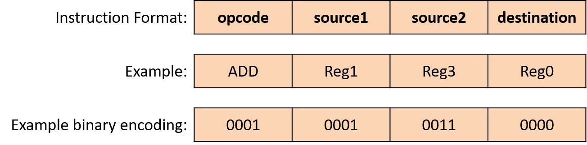
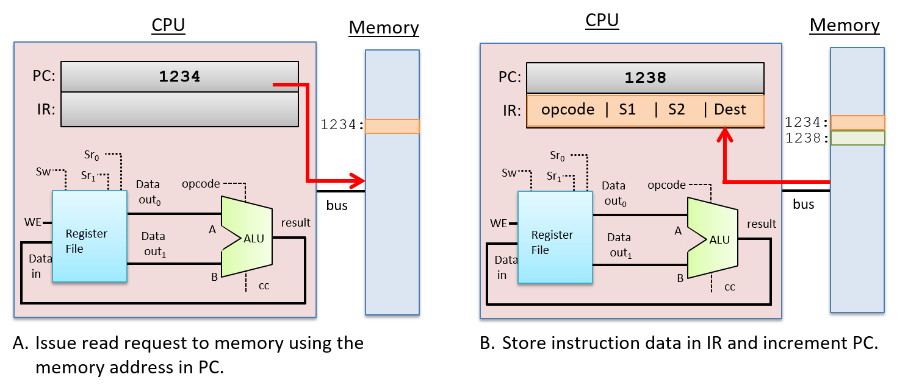
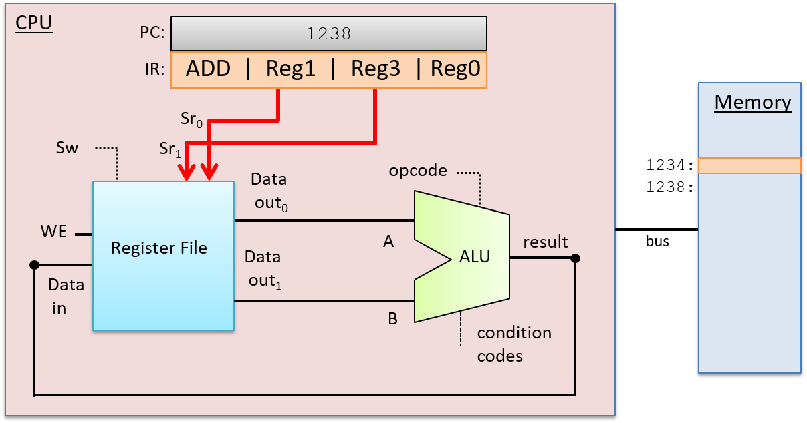
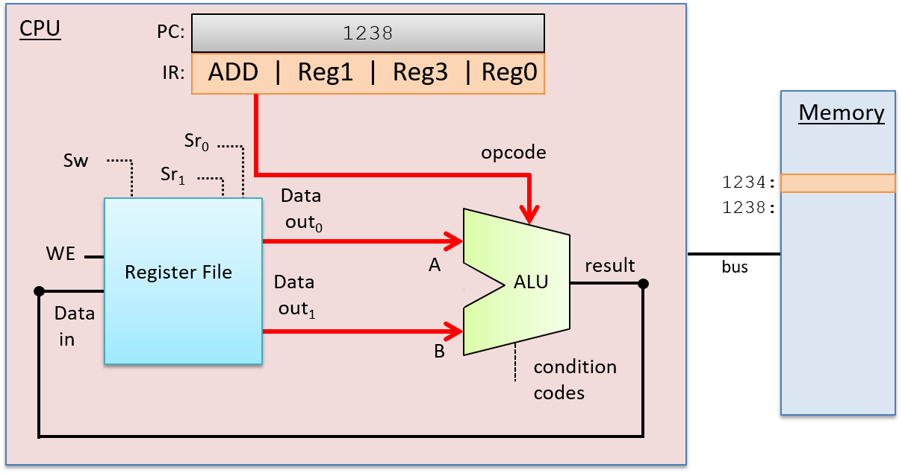
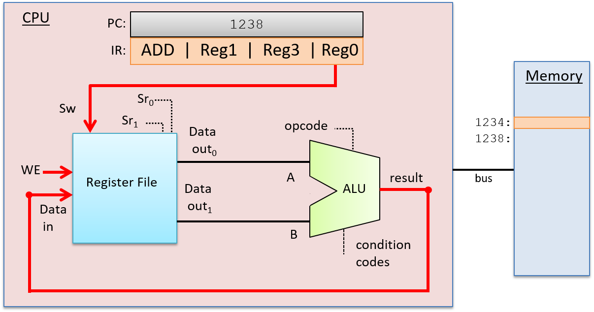
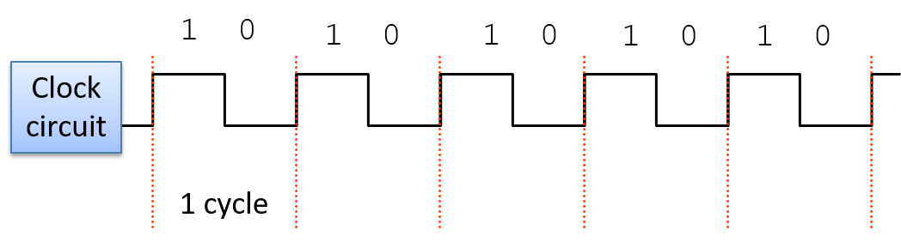
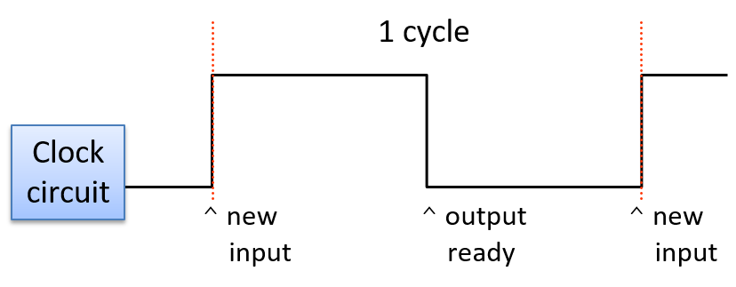
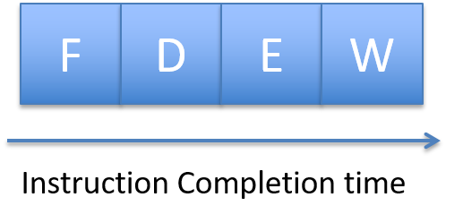
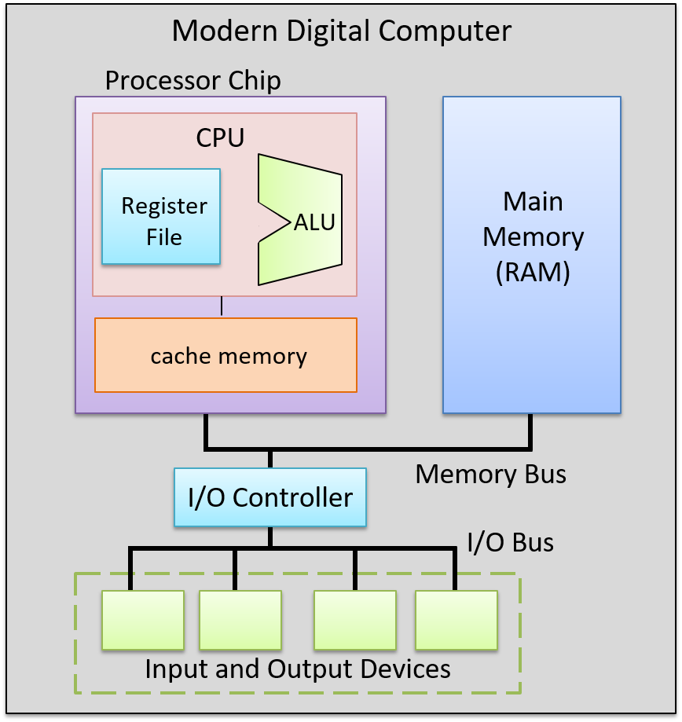

> [!WARNING] 说明
> 本文是个人学习用的**非官方**中英对照译文，原文：<https://diveintosystems.org/book/C5-Arch/instrexec.html>。
> 原书采用 CC BY-NC-ND 4.0 许可（禁止演绎），**请勿公开传播本译文**。
> 标为「译注」「现代更新」的内容是译者补充，不代表原书作者观点；代码与原文逐字一致，未作改动。

*5.6. The Processor’s Execution of Program Instructions*

指令的执行分若干个阶段进行。不同的体系结构实现的阶段数各不相同，但大多数都把指令执行的取指（Fetch）、译码（Decode）、执行（Execute）和写回（WriteBack）几个阶段实现为四个或更多的独立阶段。在讨论指令执行时，我们重点关注这四个执行阶段，并以一条 ADD 指令为例。我们的示例 ADD 指令的编码如[图 1](5.6-instrexec.html) 所示。

> Instruction execution is performed in several stages. Different architectures implement different numbers of stages, but most implement the Fetch, Decode, Execute, and WriteBack phases of instruction execution in four or more discrete stages. In discussing instruction execution, we focus on these four stages of execution, and we use an ADD instruction as our example. Our ADD instruction example is encoded as shown in [Figure 1](5.6-instrexec.html).

**图 1.** 三寄存器运算的一种示例指令格式。指令用二进制编码，它的不同位子集对应于指令不同部分的编码：运算（操作码）、两个源寄存器（操作数），以及存放运算结果的目标寄存器。示例展示了一条 ADD 指令按这种格式的编码。

*Figure 1. An example instruction format for a three-register operation. The instruction is encoded in binary with subsets of its bits corresponding to encodings of different parts of the instruction: the operation (opcode), the two source registers (the operands), and the destination register for storing the result of the operation. The example shows the encoding of an ADD instruction in this format.*

要执行一条指令，CPU 首先从内存中把下一条指令*取*到一个专用寄存器——指令寄存器（IR）——中。要取的指令的内存地址存放在另一个专用寄存器——程序计数器（PC）——中。PC 记录下一条要取的指令的内存地址，并在执行取指阶段时递增，从而存放紧接着的下一条指令的内存地址。例如，如果所有指令都是 32 位长，那么 PC 的值就加 4（每个字节 8 位，有一个唯一的地址），以存放紧跟在正在取的那条指令之后的指令的内存地址。递增 PC 值的是独立于 ALU 的算术电路。PC 的值也可能在写回阶段改变。例如，有些指令会跳转到特定的地址，比如与循环、`if`-`else` 或函数调用的执行相关的地址。[图 2](5.6-instrexec.html) 展示了执行的取指阶段。

> To execute an instruction, the CPU first *fetches* the next instruction from memory into a special-purpose register, the instruction register (IR). The memory address of the instruction to fetch is stored in another special-purpose register, the program counter (PC). The PC keeps track of the memory address of the next instruction to fetch and is incremented as part of executing the fetch stage, so that it stores the value of the very next instruction’s memory address. For example, if all instructions are 32 bits long, then the PC’s value is incremented by 4 (each byte, 8 bits, has a unique address) to store the memory address of the instruction immediately following the one being fetched. Arithmetic circuits that are separate from the ALU increment the PC’s value. The PC’s value may also change during the WriteBack stage. For example, some instructions jump to specific addresses, such as those associated with the execution of loops, `if`-`else`, or function calls. [Figure 2](5.6-instrexec.html) shows the fetch stage of execution.

**图 2.** 指令执行的取指阶段：从内存中读出 PC 寄存器中存放的内存地址处的指令，存入 IR。在这一阶段结束时，PC 的值也会递增（如果指令为 4 字节，下一个地址就是 1238；实际的指令大小因体系结构和指令类型而异）。

*Figure 2. The fetch stage of instruction execution: the instruction at the memory address value stored in the PC register is read from memory and stored into the IR. The PC’s value is also incremented at the end of this stage (if instructions are 4 bytes, then the next address is 1238; the actual instruction size varies by architecture and instruction type).*

取出指令之后，CPU 把存放在 IR 寄存器中的指令位*译码*为四部分：指令的高位编码操作码，指定要执行的运算（例如 ADD、SUB、OR……），其余的位被分为三个子集，分别指定两个操作数的来源和结果的目标。在我们的例子中，两个来源和结果目标都使用寄存器。操作码被送到作为 ALU 输入的导线上，源位被送到作为寄存器文件输入的导线上。源位被送到两个读选择输入（Sr0 和 Sr1），它们指定从寄存器文件中读出哪些寄存器的值。译码阶段如[图 3](5.6-instrexec.html) 所示。

> After fetching the instruction, the CPU *decodes* the instruction bits stored in the IR register into four parts: the high-order bits of an instruction encode the opcode, which specifies the operation to perform (e.g. ADD, SUB, OR, …​), and the remaining bits are divided into three subsets that specify the two operand sources and the result destination. In our example, we use registers for both sources and the result destination. The opcode is sent on wires that are input to the ALU and the source bits are sent on wires that are inputs to the register file. The source bits are sent to the two read selection inputs (Sr0 and Sr1) that specify which register values are read from the register file. The Decode stage is shown in [Figure 3](5.6-instrexec.html).

**图 3.** 指令执行的译码阶段：把 IR 中的指令位分成若干部分，作为输入送到 ALU 和寄存器文件。IR 中的操作码位被送到 ALU 的选择输入，以选择要执行的运算。IR 中的两组操作数位被送到寄存器文件的选择输入，以选出读取操作数值的寄存器。IR 中的目标位在写回阶段被送到寄存器文件，它们指定 ALU 结果要写入的寄存器。

*Figure 3. The Decode stage of instruction execution: separate the instruction bits in the IR into components and send them as input to the ALU and register file. The opcode bits in the IR are sent to the ALU selection input to choose which operation to perform. The two sets of operand bits in the IR are sent to the selection inputs of the register file to pick the registers from which to read the operand values. The destination bits in the IR are sent to the register file in the WriteBack stage. They specify the register to which to write the ALU result.*

译码阶段确定了要执行的运算和操作数来源之后，ALU 在下一个阶段——*执行*阶段——执行运算。ALU 的数据输入来自寄存器文件的两个输出，它的选择输入来自指令的操作码位。这些输入在 ALU 中传播，产生用该运算组合操作数值所得的结果。在我们的例子中，ALU 输出把 Reg1 中存放的值与 Reg3 中存放的值相加的结果，并输出与结果值相关的条件码值。执行阶段如[图 4](5.6-instrexec.html) 所示。

> After the Decode stage determines the operation to perform and the operand sources, the ALU performs the operation in the next stage, the *Execution* stage. The ALU’s data inputs come from the two outputs of the register file, and its selection input comes from the opcode bits of the instruction. These inputs propagate through the ALU to produce a result that combines the operand values with the operation. In our example, the ALU outputs the result of adding the value stored in Reg1 to the value stored in Reg3, and outputs the condition code values associated with the result value. The Execution stage is shown in [Figure 4](5.6-instrexec.html).

**图 4.** 指令执行的执行阶段：ALU 在其输入值（来自寄存器文件的输出）上执行指定的运算（来自指令的操作码位）。

*Figure 4. The Execution stage of instruction execution: the ALU performs the specified operation (from the instruction opcode bits) on its input values (from the register file outputs).*

在*写回*阶段，ALU 的结果被存入目标寄存器。寄存器文件在 Data in 输入上接收 ALU 的结果输出，在写选择（Sw）输入上接收目标寄存器（来自 IR 中的指令位），在 WE 输入上接收 1。例如，如果目标寄存器是 Reg0，那么 IR 中编码 Reg0 的位就作为 Sw 输入送到寄存器文件以选出目标寄存器。ALU 的输出作为 Data in 输入送到寄存器文件，WE 位被设为 1，以允许把 ALU 结果写入 Reg0。写回阶段如[图 5](5.6-instrexec.html) 所示。

> In the *WriteBack* stage, the ALU result is stored in the destination register. The register file receives the ALU’s result output on its Data in input, the destination register (from instructions bits in the IR) on its write-select (Sw) input, and 1 on its WE input. For example, if the destination register is Reg0, then the bits encoding Reg0 in the IR are sent as the Sw input to the register file to pick the destination register. The output from the ALU is sent as the Data in input to the register file, and the WE bit is set to 1 to enable writing the ALU result into Reg0. The WriteBack stage is shown in [Figure 5](5.6-instrexec.html).

**图 5.** 指令执行的写回阶段：执行阶段的结果（ALU 的输出）被写入寄存器文件中的目标寄存器。ALU 的输出是寄存器文件的 Data in 输入，指令的目标位送到寄存器文件的写选择输入（Sw），WE 输入设为 1，以允许把 Data in 的值写入指定的目标寄存器。

*Figure 5. The WriteBack stage of instruction execution: the result of the execution stage (the output from the ALU) is written to the destination register in the register file. The ALU output is the register file’s Data in input, the destination bits of the instruction go to the register file’s write-selection input (Sw), and the WE input is set to 1 to enable writing the Data in value to the specified destination register.*

### 5.6.1. 时钟驱动的执行

*5.6.1. Clock-Driven Execution*

时钟驱动着 CPU 执行指令，触发每个阶段的开始。换句话说，CPU 用时钟来确定与各个阶段相关的电路的输入何时已经准备好、可以被电路使用，并且用它来控制电路的输出何时代表某个阶段的有效结果、可以用作执行下一阶段的其他电路的输入。

> A clock drives the CPU’s execution of instructions, triggering the start of each stage. In other words, the clock is used by the CPU to determine when inputs to circuits associated with each stage are ready to be used by the circuit, and it controls when outputs from circuits represent valid results from one stage and can be used as inputs to other circuits executing the next stage.

CPU 时钟度量的是离散时间，而不是连续时间。换句话说，存在时刻 0，接着是时刻 1，然后是时刻 2，后续的每个时钟滴答依此类推。处理器的**时钟周期时间**（clock cycle time）度量两个时钟滴答之间的时间。处理器的**时钟速度**（clock speed，或称**时钟频率**，clock rate）等于 `1/(时钟周期时间)`，通常以兆赫（MHz）或吉赫（GHz）为单位。1 MHz 的时钟频率表示每秒一百万个时钟滴答，1 GHz 表示每秒十亿个时钟滴答。时钟频率衡量的是 CPU 能运行多快，也是对 CPU 每秒最多能执行多少条指令的估计。例如，在我们这个示例 CPU 这样简单的标量处理器上，一个 2 GHz 的处理器最多可能达到每秒二十亿条指令（即每纳秒两条指令）的指令执行速率。

> A CPU clock measures discrete time as opposed to continuous time. In other words, there exists a time 0, followed by a time 1, followed by a time 2, and so on for each subsequent clock tick. A processor’s **clock cycle time** measures the time between each clock tick. A processor’s **clock speed** (or **clock rate**) is `1/(clock cycle time)`. It is typically measured in megahertz (MHz) or gigahertz (GHz). A 1-MHz clock rate has one million clock ticks per second, and 1-GHz has one billion clock ticks per second. The clock rate is a measure of how fast the CPU can run, and is an estimate of the maximum number of instructions per second a CPU can execute. For example, on simple scalar processors like our example CPU, a 2-GHz processor might achieve a maximum instruction execution rate of two billion instructions per second (or two instructions every nanosecond).

尽管提高单台机器的时钟频率会提升它的性能，但单靠时钟频率来比较不同处理器的性能并没有意义。例如，有些体系结构（如 RISC）执行指令所需的阶段比另一些体系结构（如 CISC）少。在执行阶段较少的体系结构中，较慢的时钟每秒完成的指令数，可能与另一种时钟频率更高但执行阶段更多的体系结构相同。不过，对于某个特定的微处理器而言，把它的时钟速度提高一倍，大致会使它的指令执行速度提高一倍。

> Although increasing the clock rate on a single machine will improve its performance, clock rate alone is not a meaningful metric for comparing the performance of different processors. For example, some architectures (such as RISC) require fewer stages to execute instructions than others (such as CISC). In architectures with fewer execution stages a slower clock may yield the same number of instructions completed per second as on another architecture with a faster clock rate but more execution stages. For a specific microprocessor, however, doubling its clock speed will roughly double its instruction execution speed.

> [!NOTE] 原书旁注 · 时钟频率与处理器性能（Clock Rates and Processor Performance）
> 历史上，提高时钟频率（同时设计出由更快的时钟驱动的、更复杂更强大的微体系结构）一直是计算机体系结构设计者提升处理器性能的非常有效的手段。例如，1974 年的 Intel 8080 CPU 运行在 2 MHz（时钟频率为每秒两百万个周期）。1995 年推出的 Intel Pentium Pro 的时钟频率是 150 MHz（每秒一亿五千万个周期），2000 年推出的 Intel Pentium 4 的时钟频率是 1.3 GHz（每秒 13 *亿*个周期）。时钟频率在 2000 年代中后期达到顶峰，代表是时钟频率为 4.4 GHz 的 IBM z10 等处理器。
>
> 然而如今，由于处理更快时钟带来的散热问题，CPU 的时钟频率已经达到了极限。这一极限被称为**功耗墙**（power wall）。功耗墙促使人们从 2000 年代中期开始发展多核处理器。多核处理器的每块芯片上有多个「简单的」CPU 核心，每个核心由一个时钟驱动，其时钟频率与上一代核心相比并没有提高。多核处理器设计是一种无需提高 CPU 时钟频率就能提升 CPU 性能的方法。
>
> > Historically, increasing the clock rate (along with designing more complicated and powerful microarchitectures that a faster clock can drive) has been a very effective way for computer architects to improve processor performance. For example, in 1974, the Intel 8080 CPU ran at 2 MHz (a clock rate of two million cycles per second). The clock rate of the Intel Pentium Pro, introduced in 1995, was 150 MHz (150 million cycles per second), and the clock rate of the Intel Pentium 4, introduced in 2000, was 1.3 GHz or (1.3 *billion* cycles per second). Clock rates peaked in the mid to late 2000s with processors like the IBM z10, which had a clock rate of 4.4 GHz.
> >
> > Today, however, CPU clock rates have reached their limit due to problems associated with handling heat dissipation of faster clocks. This limit is known as the **power wall**. The power wall resulted in the development of multicore processors starting in the mid 2000s. Multicore processors have multiple "simple" CPU cores per chip, each core driven by a clock whose rate has not increased from the previous-generation core. Multicore processor design is a way to improve CPU performance without having to increase the CPU clock rate.

#### 时钟电路

*The Clock Circuit*

时钟电路利用振荡器电路产生非常精确而规则的脉冲模式。通常由晶体振荡器产生振荡器电路的基准频率，时钟电路利用振荡器的脉冲模式，输出高低电压交替的模式，对应于 1 和 0 交替出现的二进制值模式。[图 6](5.6-instrexec.html) 展示了一个产生规则的 1、0 输出模式的示例时钟电路。

> A clock circuit uses an oscillator circuit to generate a very precise and regular pulse pattern. Typically, a crystal oscillator generates the base frequency of the oscillator circuit, and the pulse pattern of the oscillator is used by the clock circuit to output a pattern of alternating high and low voltages corresponding to an alternating pattern of 1 and 0 binary values. [Figure 6](5.6-instrexec.html) shows an example clock circuit generating a regular output pattern of 1 and 0.

**图 6.** 时钟电路规则的 1、0 输出模式。每个 1 和 0 的序列构成一个时钟周期。

*Figure 6. The regular output pattern of 1 and 0 of a clock circuit. Each sequence of 1 and 0 makes up a clock cycle.*

**时钟周期**（clock cycle，或称滴答，tick）是时钟电路模式中的一个 1 和 0 子序列。从 1 到 0 或从 0 到 1 的跳变称为**时钟边沿**（clock edge）。时钟边沿触发 CPU 电路中的状态变化，驱动指令的执行。上升沿（新时钟周期开始时从 0 到 1 的跳变）表示指令执行某一阶段的输入值已经准备就绪的状态。例如，上升沿跳变标志着 ALU 电路的输入值已经就绪。在时钟值为 1 期间，这些输入在电路中传播，直到电路的输出准备就绪。这称为电路的**传播延迟**（propagation delay）。例如，在时钟信号为 1 期间，ALU 的输入值在 ALU 的运算电路中传播，然后经过多路复用器，为组合输入值的运算产生正确的 ALU 输出。在下降沿（从 1 到 0 的跳变），该阶段的输出已经稳定，可以传播到下一个位置（[图 7](5.6-instrexec.html) 中标为 "output ready"）。例如，ALU 的输出在下降沿时就绪。在时钟值为 0 期间，ALU 的输出传播到寄存器文件的输入。在下一个时钟周期，上升沿表示寄存器文件的输入值已经可以写入寄存器（[图 7](5.6-instrexec.html) 中标为 "new input"）。

> A **clock cycle** (or tick) is a 1 and 0 subsequence from the clock circuit pattern. The transition from a 1 to a 0 or a 0 to a 1 is called a **clock edge**. Clock edges trigger state changes in CPU circuits, driving the execution of instructions. The rising clock edge (the transition from 0 to 1 at the beginning of a new clock cycle) indicates a state in which input values are ready for a stage of instruction execution. For example, the rising edge transition signals that input values to the ALU circuit are ready. While the clock’s value is 1, these inputs propagate through the circuit until the output of the circuit is ready. This is called the **propagation delay** through the circuit. For example, while the clock signal is 1 the input values to the ALU propagate through the ALU operation circuits and then through the multiplexer to produce the correct output from the ALU for the operation combining the input values. On the falling edge (the transition from 1 to 0), the outputs of the stage are stable and ready to be propagated to the next location (shown as "output ready" in [Figure 7](5.6-instrexec.html)). For example, the output from the ALU is ready on the falling edge. For the duration of the clock value 0, the ALU’s output propagates to register file inputs. On the next clock cycle the rising edge indicates that the register file input value is ready to write into a register (shown as "new input" in [Figure 7](5.6-instrexec.html)).

**图 7.** 新时钟周期的上升沿触发它所控制的电路的输入发生变化，下降沿则在它所控制的电路的输出有效时触发。

*Figure 7. The rising edge of a new clock cycle triggers changes in the inputs to the circuits it controls. The falling edge triggers when the outputs are valid from the circuits it controls.*

时钟周期的长度（即时钟频率）受指令执行各阶段中最长的传播延迟所限。执行阶段以及在 ALU 中的传播通常是最长的阶段。因此，半个时钟周期的时间不能短于 ALU 输入值通过最慢的运算电路传播到 ALU 输出所需的时间（换句话说，输出要反映对输入执行运算的结果）。例如，在我们的四运算 ALU（OR、ADD、AND 和 EQUALS）中，行波进位加法器电路的传播延迟最长，它决定了时钟周期的最小长度。

> The length of the clock cycle (or the clock rate) is bounded by the longest propagation delay through any stage of instruction execution. The execution stage and propagation through the ALU is usually the longest stage. Thus, half of the clock cycle time must be no faster than the time it takes for the ALU input values to propagate through the slowest operation circuit to the ALU outputs (in other words, the outputs reflect the results of the operation on the inputs). For example, in our four-operation ALU (OR, ADD, AND, and EQUALS), the ripple carry adder circuit has the longest propagation delay and determines the minimum length of the clock cycle.

由于完成 CPU 指令执行的一个阶段需要一个时钟周期，一个指令执行序列有四个阶段（取指、译码、执行、写回；见[图 8](5.6-instrexec.html)）的处理器，最多每四个时钟周期完成一条指令。

> Because it takes one clock cycle to complete one stage of CPU instruction execution, a processor with a four-stage instruction execution sequence (Fetch, Decode, Execute, WriteBack; see [Figure 8](5.6-instrexec.html)) completes at most one instruction every four clock cycles.

**图 8.** 四阶段的指令执行需要四个时钟周期才能完成。

*Figure 8. Four-stage instruction execution takes four clock cycles to complete.*

例如，如果时钟频率为 1 GHz，完成一条指令需要 4 纳秒（四个阶段各需 1 纳秒）。时钟频率为 2 GHz 时，完成一条指令只需要 2 纳秒。

> If, for example, the clock rate is 1 GHz, one instruction takes 4 nanoseconds to complete (each of the four stages taking 1 nanosecond). With a 2-GHz clock rate, one instruction takes only 2 nanoseconds to complete.

尽管时钟频率是影响处理器性能的一个因素，但单靠时钟频率并不能有意义地衡量处理器的性能。更好的 CPU 性能衡量标准，是在程序的整个执行过程中测得的平均**每条指令周期数**（cycles per instruction，CPI）。通常，处理器无法在整个程序的执行过程中一直保持它的最大 CPI。达不到最大 CPI 是许多因素造成的，包括执行那些改变控制流的常见程序结构，如循环、`if`-`else` 分支和函数调用。运行一组标准基准测试程序得到的平均 CPI 被用来比较不同的体系结构。CPI 是一个更准确的 CPU 性能衡量标准，因为它衡量的是执行一个程序的速度，而不是衡量单条指令执行的某一个方面。关于处理器性能以及为提升性能而设计处理器的更多细节，请参见计算机体系结构教材1。

> Although clock rate is a factor in a processor’s performance, clock rate alone is not a meaningful measure of its performance. Instead, the average number of **cycles per instruction** (CPI) measured over a program’s full execution is a better measure of a CPU’s performance. Typically, a processor cannot maintain its maximum CPI for an entire program’s execution. A submaximum CPI is the result of many factors, including the execution of common program constructs that change control flow such as loops, `if`-`else` branching, and function calls. The average CPI for running a set of standard benchmark programs is used to compare different architectures. CPI is a more accurate measure of the CPU’s performance as it measures its speed executing a program versus a measure of one aspect of an individual instruction’s execution. See a computer architecture textbook1 for more details about processor performance and designing processors to improve their performance.

> [!NOTE] 译注
> CPI 越**小**越好。原文说处理器「无法一直保持最大 CPI」，按意思应理解为无法一直保持*最好*的 CPI（即最小值）；实际执行中分支、缓存未命中等因素会让 CPI 变大。现代处理器每个周期能完成多条指令，人们也常用它的倒数 IPC（instructions per cycle，每周期指令数）来描述。

### 5.6.2. 把一切组合起来：完整计算机中的 CPU

*5.6.2. Putting It All Together: The CPU in a Full Computer*

数据通路（ALU、寄存器文件以及连接它们的总线）和控制通路（指令执行电路）构成了 CPU。它们共同实现了冯·诺依曼体系结构中的处理和控制部分。如今的处理器以蚀刻在硅芯片上的数字电路实现。处理器芯片上还包含一些快速的片上缓存存储器（用锁存器存储电路实现），用来在处理器附近存放最近使用过的程序数据和指令的副本。关于片上缓存存储器的更多信息，请参见[存储与存储器层次结构](../C11-MemHierarchy/11.0-index.html)一章。

> The data path (ALU, register file, and the buses that connect them) and the control path (instruction execution circuitry) make up the CPU. Together they implement the processing and control parts of the von Neumann architecture. Today’s processors are implemented as digital circuits etched into silicon chips. The processor chip also includes some fast on-chip cache memory (implemented with latch storage circuits), used to store copies of recently used program data and instructions close to the processor. See the [Storage and Memory Hierarchy Chapter](../C11-MemHierarchy/11.0-index.html) for more information about on-chip cache memory.

[图 9](5.6-instrexec.html) 展示了一个处于完整现代计算机中的处理器的例子，这台计算机的各个部件共同实现了冯·诺依曼体系结构。

> [Figure 9](5.6-instrexec.html) shows an example of a processor in the context of a complete modern computer, whose components together implement the von Neumann architecture.

**图 9.** 完整现代计算机中的 CPU。总线连接着处理器芯片、主存以及输入和输出设备。

*Figure 9. The CPU in a full modern computer. Buses connect the processor chip, main memory, and input and output devices.*

### 5.6.3. 脚注

*5.6.3. Footnotes*

1. 推荐一本：John Hennessy 和 David Patterson 合著的《Computer Architecture: A Quantitative Approach》（中译本《计算机体系结构：量化研究方法》）。

> 1.  One suggestion is "Computer Architecture: A Quantitative Approach", by John Hennessy and David Patterson.
