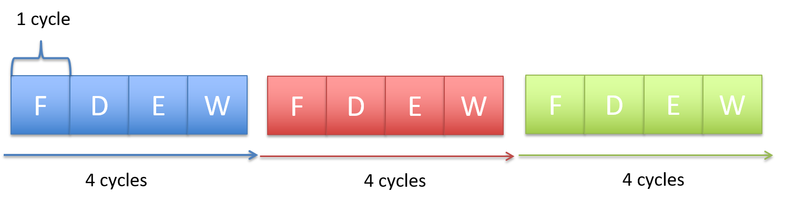
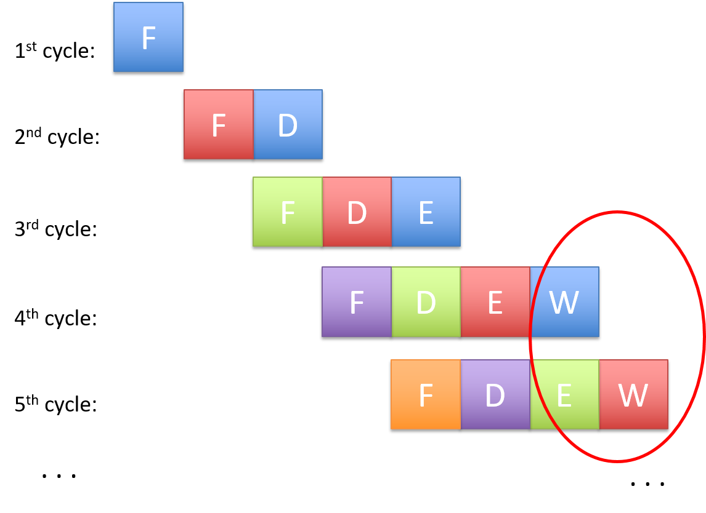

> [!WARNING] 说明
> 本文是个人学习用的**非官方**中英对照译文，原文：<https://diveintosystems.org/book/C5-Arch/pipelining.html>。
> 原书采用 CC BY-NC-ND 4.0 许可（禁止演绎），**请勿公开传播本译文**。
> 标为「译注」「现代更新」的内容是译者补充，不代表原书作者观点；代码与原文逐字一致，未作改动。

*5.7. Pipelining: Making the CPU Faster*

我们的四阶段 CPU 执行一条指令需要四个周期：第一个周期从内存中取出指令；第二个周期对指令译码并从寄存器文件读取操作数；第三个周期由 ALU 执行运算；第四个周期把 ALU 的结果写回寄存器文件中的某个寄存器。执行一个由 *N* 条指令组成的序列需要 *4N* 个时钟周期，因为 CPU 按顺序一次执行一条指令。

> Our four-stage CPU takes four cycles to execute one instruction: the first cycle is used to fetch the instruction from memory; the second to decode the instruction and read operands from the register file; the third for the ALU to execute the operation; and the fourth to write back the ALU result to a register in the register file. To execute a sequence of *N* instructions takes *4N* clock cycles, as each is executed one at a time, in order, by the CPU.

**图 1.** 执行三条指令总共需要 12 个周期。

*Figure 1. Executing three instructions takes 12 total cycles.*

[图 1](5.7-pipelining.html) 展示了三条指令总共用 12 个周期执行完，每条指令四个周期，CPI 为 4（CPI 是执行一条指令的平均周期数）。不过，可以改进 CPU 的控制电路，以获得更好（更低）的 CPI 值。

> [Figure 1](5.7-pipelining.html) shows three instructions taking a total of 12 cycles to execute, four cycles per instruction, resulting in a CPI of 4 (CPI is the average number of cycles to execute an instruction). However, the control circuitry of the CPU can be improved to achieve a better (lower) CPI value.

在这种每条指令执行四个周期、接着下一条指令再执行四个周期、依此类推的执行模式中，实现每个阶段的 CPU 电路每四个周期才真正参与一次指令执行。例如，取指阶段之后，CPU 中的取指电路在接下来的三个时钟周期内不执行任何与指令执行相关的有用动作。然而，如果取指电路能在接下来的三个周期里继续执行后续指令的取指部分，CPU 就能每四个周期完成不止一条指令的执行。

> In considering the pattern of execution in which each instruction takes four cycles to execute, followed by the next instruction taking four cycles, and so on, the CPU circuitry associated with implementing each stage is only actively involved in instruction execution once every four cycles. For example, after the Fetch stage, the fetch circuitry in the CPU is not used to perform any useful action related to executing an instruction for the next three clock cycles. If, however, the fetch circuitry could continue to actively execute the Fetch parts of subsequent instructions in the next three cycles, the CPU could complete the execution of more than a single instruction every four cycles.

CPU **流水线**（pipelining）正是这样一种思想：在当前指令完全执行完之前，就开始执行下一条指令。CPU 流水线按顺序执行指令，但允许一系列指令的执行相互重叠。例如，在第一个周期，第一条指令进入它的取指阶段。在第二个周期，第一条指令进入译码阶段，同时第二条指令进入取指阶段。在第三个周期，第一条指令进入执行阶段，第二条指令进入译码阶段，第三条指令从内存中被取出。在第四个周期，第一条指令进入写回阶段并完成，第二条指令进入执行阶段，第三条进入译码阶段，第四条指令进入取指阶段。此时，CPU 的指令流水线已经填满——CPU 的每个阶段都在积极地执行程序指令，后一条指令比前一条落后一个阶段。当流水线满时，CPU 每个时钟周期完成一条指令的执行！

> CPU **pipelining** is this idea of starting the execution of the next instruction before the current instruction has fully completed its execution. CPU pipelining executes instructions in order, but it allows the execution of a sequence of instructions to overlap. For example, in the first cycle, the first instruction enters its Fetch stage of execution. In the second cycle, the first instruction moves to its Decode stage, and the second instruction simultaneously enters its Fetch stage. In the third cycle, the first instruction moves to its Execution stage, the second instruction to its Decode stage, and the third instruction is fetched from memory. In the fourth cycle, the first instruction moves to its WriteBack stage and completes, the second instruction moves to its Execution stage, the third to its Decode, and the fourth instruction enters its Fetch stage. At this point, the CPU pipeline of instructions is full—​every CPU stage is actively executing program instructions where each subsequent instruction is one stage behind its predecessor. When the pipeline is full, the CPU completes the execution of one instruction every clock cycle!

**图 2.** 流水线：让指令的执行相互重叠，以达到每个周期完成一条指令。圆圈表示 CPU 已经达到每个周期完成一条指令的稳定状态。

*Figure 2. Pipelining: overlapping instruction execution to achieve one instruction completed per cycle. The circle indicates that the CPU has reached the steady state of completing one instruction every cycle.*

[图 2](5.7-pipelining.html) 展示了指令在我们的 CPU 中流水线执行的例子。从第四个时钟周期开始，流水线被填满，也就是说 CPU 每个周期完成一条指令的执行，CPI 达到 1（[图 2](5.7-pipelining.html) 中圆圈所示）。注意，在流水线执行中，执行单条指令所需的总周期数（指令的**延迟**，latency）并没有减少——每条指令仍然需要四个周期才能执行完。流水线所做的，是让顺序的各条指令交错地经过流水线的不同阶段、重叠执行，从而提高指令的**吞吐量**（throughput），即 CPU 在给定时间内能执行的指令数。

> [Figure 2](5.7-pipelining.html) shows an example of pipelined instruction execution through our CPU. Starting with the fourth clock cycle the pipeline fills, meaning that the CPU completes the execution of one instruction every cycle, achieving a CPI of 1 (shown in the circle in [Figure 2](5.7-pipelining.html)). Notice that the total number of cycles required to execute a single instruction (the instruction **latency**) has not decreased in pipelined execution—​it still takes four cycles for each instruction to execute. Instead, pipelining increases instruction **throughput**, or the number of instructions that the CPU can execute in a given period of time, by overlapping the execution of sequential instructions in a staggered manner, through the different stages of the pipeline.

自 1970 年代以来，计算机体系结构设计者一直把流水线作为大幅提升微处理器性能的手段。然而，流水线的代价是 CPU 的设计比不支持流水线执行的 CPU 更复杂，需要额外的存储和控制电路来支持流水线。例如，可能需要多个指令寄存器来存放当前处于流水线中的多条指令。流水线在 CPI 上带来的巨大改进，几乎总是值得这些额外的复杂性。因此，大多数现代微处理器都实现了流水线执行。

> Since the 1970s, computer architects have used pipelining as a way to drastically improve the performance of microprocessors. However, pipelining comes at the cost of a more complicated CPU design than one that does not support pipelined execution. Additional storage and control circuitry is needed to support pipelining. For example, multiple instruction registers may be required to store the multiple instructions currently in the pipeline. This added complexity is almost always worth the large improvements in CPI that pipelining provides. As a result most modern microprocessors implement pipelined execution.

流水线的思想在计算机科学的其他场合也被用来加快执行速度，而且这一思想也适用于许多非计算机领域的应用。例如，考虑用一台洗衣机洗好几批衣服的任务。如果洗完一批衣服包括四个步骤（洗、烘干、叠好、收起来），那么在洗完第一批之后，第一批衣服在烘干机里烘的时候，第二批就可以放进洗衣机，通过让各批衣服的洗涤相互重叠，缩短洗完四批衣服的总时间。工厂的装配线也是流水线的一个例子。

> The idea of pipelining is also used in other contexts in computer science to speed up execution, and the idea applies to many non-CS applications as well. Consider, for example, the task of doing multiple loads of laundry using a single washing machine. If completing one laundry consists of four steps (washing, drying, folding, and putting away clothes), then after washing the first load, the second load can go in the washing machine while the first load is in the dryer, overlapping the washing of individual laundry loads to speed up the total time it takes to wash four loads. Factory assembly lines are another example of pipelining.

在讨论 CPU 如何执行程序指令以及 CPU 流水线时，我们用的是一个简单的四阶段流水线和一条示例 ADD 指令。要执行在内存和寄存器之间加载和存储值的指令，需要使用五阶段流水线。五阶段流水线包括一个用于访问内存的访存（Memory）阶段：取指—译码—执行—访存—写回。不同的处理器可能有比典型的五阶段流水线更少或更多的流水线阶段。例如，最初的 ARM 体系结构只有三个阶段（取指、译码和执行，其中执行阶段同时完成 ALU 执行和寄存器文件写回的功能）。较新的 ARM 体系结构的流水线有五个以上的阶段。最初的 Intel Pentium 体系结构采用五阶段流水线，但后来的体系结构的流水线阶段要多得多。例如，Intel Core i7 有 14 级流水线。

> In our discussion of how a CPU executes program instructions and CPU pipelining, we used a simple four-stage pipeline and an example ADD instruction. To execute instructions that load and store values between memory and registers, a five-stage pipeline is used. A five-stage pipeline includes a Memory stage for memory access: Fetch-Decode-Execute-Memory-WriteBack. Different processors may have fewer or more pipeline stages than a typical five-stage pipeline. For example, the initial ARM architecture had three stages (Fetch, Decode, and Execute, wherein the Execute stage performed both the ALU execution and the register file WriteBack functionality). More recent ARM architectures have more than five stages in their pipelines. The initial Intel Pentium architectures had a five-stage pipeline, but later architectures had significantly more pipeline stages. For example, the Intel Core i7 has a 14-stage pipeline.
