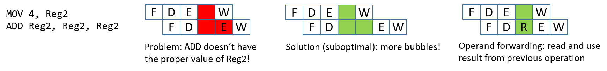
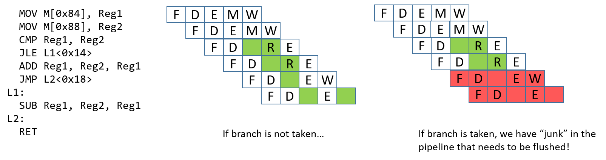
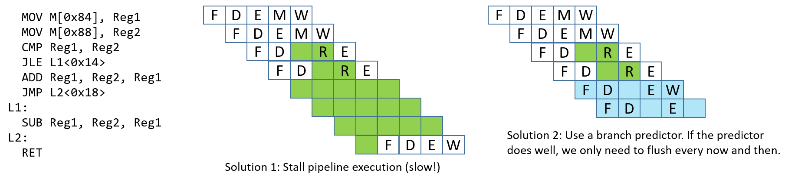

> [!WARNING] 说明
> 本文是个人学习用的**非官方**中英对照译文，原文：<https://diveintosystems.org/book/C5-Arch/pipelining_advanced.html>。
> 原书采用 CC BY-NC-ND 4.0 许可（禁止演绎），**请勿公开传播本译文**。
> 标为「译注」「现代更新」的内容是译者补充，不代表原书作者观点；代码与原文逐字一致，未作改动。


*5.8. Advanced Pipelined Instruction Considerations*

回想一下，[流水线](5.7-pipelining.html)通过让多条指令的执行相互重叠来提升处理器的性能。在[前面](5.7-pipelining.html)关于流水线的讨论中，我们描述了一个简单的四阶段流水线，包含取指（F）、译码（D）、执行（E）和写回（W）这几个基本阶段。在下面的讨论中，我们还考虑第五个阶段——访存（M），它表示对数据存储器的访问。因此，我们的五阶段流水线由以下几个阶段组成：

> Recall that [pipelining](5.7-pipelining.html) improves the performance of a processor by overlapping the execution of multiple instructions. In our [earlier discussion](5.7-pipelining.html) on pipelining, we described a simple four-stage pipeline with the basic stages of Fetch (F), Decode (D), Execute (E) and WriteBack (W). In our discussion that follows, we also consider a fifth stage, Memory (M), which represents an access to data memory. Our five-stage pipeline therefore comprises the following stages:

- **取指（F）：**从存储器中读取一条指令（由程序计数器指向）。

> - **Fetch (F):** reads an instruction from memory (pointed to by the program counter).

- **译码（D）：**读取源寄存器并设置控制逻辑。

> - **Decode (D):** reads source registers and sets control logic.

- **执行（E）：**执行指令。

> - **Execute (E):** executes the instruction.

- **访存（M）：**读或写数据存储器。

> - **Memory (M):** reads from or writes to data memory.

- **写回（W）：**把结果存入目标寄存器。

> - **WriteBack (W):** stores a result in a destination register.

回想一下，编译器把代码行转换成一系列供 CPU 执行的机器码指令。汇编代码是机器码的人类可读版本。下面的片段展示了一系列虚构的汇编指令：

> Recall that the compiler transforms lines of code into a series of machine code instructions for the CPU to execute. Assembly code is a human-readable version of machine code. The snippet below displays a series of made-up assembly instructions:

```
MOV M[0x84], Reg1     # move value at memory address 0x84 to register Reg1
ADD 2, Reg1, Reg1     # add 2 to value in Reg1 and store result in Reg1
MOV 4, Reg2           # copy the value 4 to register Reg2
ADD Reg2, Reg2, Reg2  # compute Reg2 + Reg2, store result in Reg2
JMP L1<0x14>          # jump to executing code at L1 (code address 0x14)
```

如果你在理解这段代码时遇到困难，不必担心——我们会在[后面的章节](../C7-x86_64/7.0-index.html)中更详细地介绍汇编。目前，只需关注以下几点事实：

> Don’t worry if you are having trouble parsing the snippet — we cover assembly in greater detail in [upcoming chapters](../C7-x86_64/7.0-index.html). For now, it suffices to focus on the following set of facts:

- 每种 ISA 都定义了一组指令。

> - Every ISA defines a set of instructions.

- 每条指令对一个或多个操作数（即寄存器、存储器或常数值）进行操作。

> - Each instruction operates on one or more operands (i.e. registers, memory, or constant values).

- 并非所有指令执行时都需要相同数量的流水线阶段。

> - Not all instructions require the same number of pipeline stages to execute.

在前面的讨论中，我们假定每条指令执行所需的周期数都相同；然而，实际情况通常并非如此。例如，第一条 `MOV` 指令需要全部五个阶段，因为它需要把数据从存储器移到寄存器。相比之下，接下来的三条指令只需要四个阶段（F、D、E、W）就能执行完，因为它们的运算只涉及寄存器，而不涉及存储器。最后一条指令（`JMP`）是一种*分支*或*条件*指令，它的作用是把控制流转移到代码的另一部分。具体来说，存储器代码区中的地址指向可执行文件中不同的*指令*。由于 `JMP` 指令不更新通用寄存器，写回阶段被省略，结果只需要三个阶段（F、D、E）。我们会在后面关于汇编的[章节](../C7-x86_64/7.4-conditional_control_loops.html)中更详细地介绍条件指令。

> In our previous discussion, it was assumed that every instruction takes the same number of cycles to execute; however, this is usually not the case. For example, the first `MOV` instruction requires all five stages, as it requires the movement of data from memory to a register. In contrast, the next three instructions require only four stages (F, D, E, W) to execute given that the operations involve only registers, and not memory. The last instruction (`JMP`) is a type of *branch* or *conditional* instruction. Its purpose is to transfer the flow of control to another part of the code. Specifically, addresses in the code region of memory reference different *instructions* in an executable. Since the `JMP` instruction does not update a general-purpose register, the WriteBack stage is omitted, resulting in only three stages (F, D, E) being required. We cover conditional instructions in greater detail in the [upcoming chapters](../C7-x86_64/7.4-conditional_control_loops.html) on assembly.

当某条指令被迫等待另一条指令执行完毕才能继续时，就产生了**流水线停顿**（pipeline stall）。编译器和处理器会尽一切可能避免流水线停顿，以使性能最大化。

> A **pipeline stall** results when any instruction is forced to wait for another to finish executing before it can continue. Compilers and processors do whatever they can to avoid pipeline stalls in order to maximize performance.

### 5.8.1. 流水线问题：数据冒险

*5.8.1. Pipelining Consideration: Data Hazards*

当两条指令试图在指令流水线中访问共同的数据时，就会发生**数据冒险**（data hazard）。例如，考虑上面代码片段中的第一对指令：

> A **data hazard** occurs when two instructions attempt to access common data in an instruction pipeline. As an example, consider the first pair of instructions from the code snippet above:

```
MOV M[0x84], Reg1     # move value at memory address 0x84 to register Reg1
ADD 2, Reg1, Reg1     # add 2 to value in Reg1 and store result in Reg1
```


**图 1.** 两条指令同时到达同一流水线阶段而引发流水线冒险的例子。

*Figure 1. An example of a pipeline hazard arising from two instructions simultaneously reaching the same pipeline stage.*

回想一下，这条 `MOV` 指令需要五个阶段（因为它涉及对存储器的访问），而 `ADD` 指令只需要四个。在这种情形下，两条指令会试图同时写寄存器 `Reg1`（见[图 1](5.8-pipelining_advanced.html)）。

> Recall that this `MOV` instruction requires five stages (as it involves an access to memory), whereas the `ADD` instruction requires only four. In this scenario, both instructions will attempt to write to register `Reg1` at the same time (see [Figure 1](5.8-pipelining_advanced.html)).

为了防止上述情形，处理器首先强制每条指令都经过五个流水线阶段来执行。对于通常不到五个阶段的指令，CPU 会加入一条「空操作」（`NOP`）指令（也称为流水线「气泡」，bubble）来顶替那个阶段。

> The processor prevents the aforementioned scenario by first forcing every instruction to take five pipeline stages to execute. For instructions that normally take fewer than five stages, the CPU adds a "no-operation" (`NOP`) instruction (also called a pipeline "bubble") to substitute for that phase.

不过，问题仍未完全解决。由于第二条指令的目标是把 `2` 加到寄存器 `Reg1` 中存储的值上，`MOV` 指令必须先完成对寄存器 `Reg1` 的*写入*，`ADD` 指令才能正确执行。接下来的两条指令也存在类似的问题：

> However, the problem is still not fully resolved. Since the goal of the second instruction is to add `2` to the value stored in register `Reg1`, the `MOV` instruction needs to finish *writing* to register `Reg1` before the `ADD` instruction can execute correctly. A similar problem exists in the next two instructions:

```
MOV 4, Reg2           # copy the value 4 to register Reg2
ADD Reg2, Reg2, Reg2  # compute Reg2 + Reg2, store result in Reg2
```



**图 2.** 处理器可以通过在指令之间转发操作数，减轻流水线冒险造成的损失。

*Figure 2. The processor can reduce the damage caused by pipeline hazards by forwarding operands between instructions.*

这两条指令先把值 `4` 加载到寄存器 `Reg2` 中，再把它乘以 2（通过与自身相加）。同样，为了强制每条指令都经过五个流水线阶段，加入了气泡。在这种情况下，无论有没有气泡，第二条指令的执行阶段都发生在第一条指令把所需的值（`4`）写入寄存器 `Reg2` *之前*。

> These two instructions load the value `4` into register `Reg2` and then multiply it by 2 (by adding to itself). Once again, bubbles are added to enforce that each instruction takes five pipeline stages. In this case, regardless of the bubbles, the second instruction’s execute phase occurs *before* the first instruction finishes writing the required value (`4`) to register `Reg2`.

加入更多的气泡并不是一个好的解决方案，因为它会让流水线停顿。处理器采用的是一种称为**操作数转发**（operand forwarding）的技术，让流水线直接读取前一个操作的结果。看一下[图 2](5.8-pipelining_advanced.html)：在指令 `MOV 4, Reg2` 执行时，它把结果转发给指令 `ADD Reg2, Reg2, Reg2`。这样，在 `MOV` 指令写寄存器 `Reg2` 的同时，`ADD` 指令就可以使用它从 `MOV` 指令那里收到的 `Reg2` 的新值。

> Adding more bubbles is a suboptimal solution, because it stalls the pipeline. Instead, processors employ a technique called **operand forwarding**, in which the pipeline reads the result from the previous operation. Looking at [Figure 2](5.8-pipelining_advanced.html), while the instruction `MOV 4, Reg2` executes, it forwards its results to the instruction `ADD Reg2, Reg2, Reg2`. So, while the `MOV` instruction is writing to register `Reg2`, the `ADD` instruction can use the updated value of `Reg2` that it received from the `MOV` instruction.

### 5.8.2. 流水线冒险：控制冒险

*5.8.2. Pipelining Hazards: Control Hazards*

流水线是针对一条接一条依次出现的指令而优化的。程序中由 `if` 语句或循环等条件结构引起的控制流变化，会严重影响流水线的性能。我们来看另一个示例代码片段，先看 C 代码：

> The pipeline is optimized for instructions that occur one after another. Control changes in a program arising from conditionals such as `if` statements or loops can seriously affect the pipeline performance. Let’s take a look at a different example code snippet, first in C:

```
int result = *x; // x holds an int
int temp = *y;   // y holds another int

if (result <= temp) {
	result = result - temp;
}
else {
	result = result + temp;
}
return result;
```

这段代码只是从两个不同的指针读出整数数据，比较它们的值，然后根据比较结果进行不同的算术运算。上面的代码片段可能被翻译成如下的汇编指令：

> This snippet simply reads integer data from two different pointers, compares the values, and then does different arithmetic based on the result. Here is how the above code snippet may translate into assembly instructions:

```
  MOV M[0x84], Reg1     # move value at memory address 0x84 to register Reg1
  MOV M[0x88], Reg2     # move value at memory address 0x88 to register Reg2
  CMP Reg1, Reg2        # compare value in Reg1 to value in Reg2
  JLE L1<0x14>          # switch code execution to L1 if Reg1 less than Reg2
  ADD Reg1, Reg2, Reg1  # compute Reg1 + Reg2, store result in Reg1
  JMP L2<0x20>          # switch code execution to L2 (code address 0x20)
L1:
  SUB Reg1, Reg2, Reg1  # compute Reg1 - Reg2, store in Reg1
L2:
  RET                   # return from function
```

这串指令把数据从存储器加载到两个不同的寄存器中，比较它们的值，然后根据第一个寄存器中的值是否小于第二个寄存器中的值进行不同的算术运算。在上面的例子中，`if` 语句用两条指令表示：比较（`CMP`）指令和小于等于时条件跳转（`JLE`）指令。我们会在[后面关于汇编](../C7-x86_64/7.4-conditional_control_loops.html)的章节中更详细地介绍条件指令；目前只需理解：`CMP` 指令*比较*两个寄存器，而 `JLE` 指令是一种特殊的分支指令，*当且仅当*条件（本例中为小于等于）为真时，它才把代码执行切换到程序的另一部分。

> This sequence of instructions loads data from memory into two separate registers, compares the values, and then does different arithmetic based on whether the value in the first register is less than the value in the second. The `if` statement is represented in the above example with two instructions: the compare (`CMP`) instruction and a conditional jump less than (`JLE`) instruction. We cover conditional instructions in greater detail in the [upcoming assembly](../C7-x86_64/7.4-conditional_control_loops.html) chapters; for now it is sufficient to understand that the `CMP` instruction *compares* two registers, while the `JLE` instruction is a special type of branch instruction that switches code execution to another part of the program *if and only if* the condition (i.e. less than or equal, in this case) is true.

> [!WARNING] 原书警示 · 不要被细节吓倒！（Don’t get overwhelmed by the details!）
> 初次看到汇编代码会感到发怵，这是可以理解的。如果你也有这种感觉，尽量别担心！我们会在[后面的章节](../C7-x86_64/7.0-index.html)中更详细地介绍汇编。关键是要明白：包含条件语句的代码与其他任何代码片段一样，会被翻译成一系列汇编指令。然而，与其他代码片段不同，条件语句*并不*保证以某种特定的方式执行。条件语句执行方式的不确定性，对流水线有很大的影响。
>
> > Looking at assembly for the first time can be understandably intimidating. If this is how you feel, try not to worry! We cover assembly in much greater detail in [coming chapters](../C7-x86_64/7.0-index.html). The key takeaway is that code containing conditional statements translates to a series of assembly instructions just like any other code snippet. However, unlike other code snippets, conditional statements are *not* guaranteed to execute in a particular way. The uncertainty surrounding how a conditional statement executes has large ramifications for the pipeline.



**图 3.** 由条件分支引起的控制冒险的例子。

*Figure 3. An example of a control hazard resulting from a conditional branch.*

当流水线遇到分支（或条件）指令时，就会发生**控制冒险**（control hazard）。这时，流水线必须「猜测」分支是否会发生跳转。如果分支不跳转，处理器就继续按顺序执行接下来的指令。考虑[图 3](5.8-pipelining_advanced.html) 中的例子。如果分支跳转，接下来应该执行的是 `SUB` 指令。然而，在 `JLE` 指令执行完之前，无法知道分支是否会跳转。而到那时，`ADD` 和 `JMP` 指令已经被加载到流水线中了。如果分支*确实*跳转，就必须先把流水线中这些「垃圾」指令清除掉，即**冲刷**（flush），然后才能用新指令重新填充流水线。冲刷流水线的代价很高。

> A **control hazard** occurs when the pipeline encounters a branch (or conditional) instruction. When this happens, the pipeline has to "guess" whether the branch will be taken. If the branch is not taken, the process continues to execute the next instructions in sequence. Consider the example in [Figure 3](5.8-pipelining_advanced.html). If the branch is taken, the next instruction that executes should be the `SUB` instruction. However, it is impossible to know whether the branch is taken until the `JLE` instruction finishes executing. At that point, the `ADD` and `JMP` instructions have already been loaded into the pipeline. If the branch *is* taken, these "junk" instructions in the pipeline need to be removed, or **flushed**, before the pipeline can be reloaded with new instructions. Flushing the pipeline is expensive.

硬件工程师可以选择实现以下几种方案，帮助处理器应对控制冒险：

> There are a few options that hardware engineers can choose to implement to help the processor deal with control hazards:

- **让流水线停顿**：一种简单的解决办法是，每当遇到分支，就加入大量 `NOP` 气泡让流水线停顿，直到处理器确定分支是否跳转。虽然让流水线停顿能解决问题，但也会导致性能下降（见[图 4](5.8-pipelining_advanced.html)）。

> - **Stall the pipeline**: As a simple solution, whenever there is a branch, add lots of `NOP` bubbles and stall the pipeline until the processor is sure that the branch is taken. Although stalling the pipeline will fix the issue, it will also lead to a performance hit (see [Figure 4](5.8-pipelining_advanced.html)).

- **分支预测**（branch prediction）：最常见的解决办法是使用**分支预测器**（branch predictor），它根据以往的执行情况预测分支的走向。现代分支预测器非常好，也非常准确。然而，这种方法近年来引发了一些安全漏洞（例如 Spectre<sup>1</sup>）。[图 4](5.8-pipelining_advanced.html) 描绘了分支预测器可能如何处理前面讨论的控制冒险。

> - **Branch prediction**: The most common solution is to use a **branch predictor**, which will predict which way a branch will go, based on previous executions. Modern branch predictors are really good and accurate. However, this approach has recently caused some security vulnerabilities (e.g. Spectre<sup>1</sup>). [Figure 4](5.8-pipelining_advanced.html) depicts how a branch predictor may deal with the control hazard discussed.

> [!TIP] 现代更新（截至 2026-11）· Spectre 是怎么回事
> Spectre 和同时公布的 Meltdown 于 2018 年 1 月公开，Google Project Zero 早在 2017 年 6 月 1 日就把问题报告给了 Intel、AMD 和 ARM。它们利用的正是本节讲的分支预测和推测执行：CPU 在猜测的路径上「先做了再说」，错误路径上执行的指令虽然最后会被撤销，却会在缓存中留下痕迹，攻击者可以通过测量访问时间读出本不该读到的数据。这类漏洞的根源在硬件设计上，只能靠微码更新、编译器和操作系统的缓解措施来降低风险，代价往往是一部分性能。[Meltdown and Spectre](https://spectreattack.com/) · [Project Zero：Reading privileged memory with a side-channel](https://googleprojectzero.blogspot.com/2018/01/reading-privileged-memory-with-side.html)

- **激进执行**（eager execution）：在激进执行中，CPU 同时执行分支的两侧，并进行有条件的数据传送而不是有条件的控制转移（在 x86 和 ARMv8-A 中分别通过 [cmov](../C7-x86_64/7.4.2-if_statements.html) 和 [csel](../C9-ARM64/9.4.2-if_statements.html) 指令实现）。有条件的数据传送使处理器能在不打乱流水线的情况下继续执行。不过，并非所有代码都能利用激进执行，在涉及指针解引用和副作用的情况下，它可能是危险的。

> - **Eager execution**: In eager execution, the CPU executes both sides of the branch and performs a conditional transfer of data rather than control (implemented through the [cmov](../C7-x86_64/7.4.2-if_statements.html) and the [csel](../C9-ARM64/9.4.2-if_statements.html) instructions in x86 and ARMv8-A, respectively). A conditional transfer of data enables the processor to continue execution without disrupting the pipeline. However, not all code is capable of taking advantage of eager execution, which can be dangerous in the case of pointer dereferences and side effects.



**图 4.** 处理控制冒险的几种可能方案。

*Figure 4. Potential solutions for handling control hazards.*

### 参考文献

*References*

1.  Peter Bright. [Google: Software is never going to be able to fix Spectre-type bugs](https://arstechnica.com/gadgets/2019/02/google-software-is-never-going-to-be-able-to-fix-spectre-type-bugs/) *Ars Technica* 2019.
