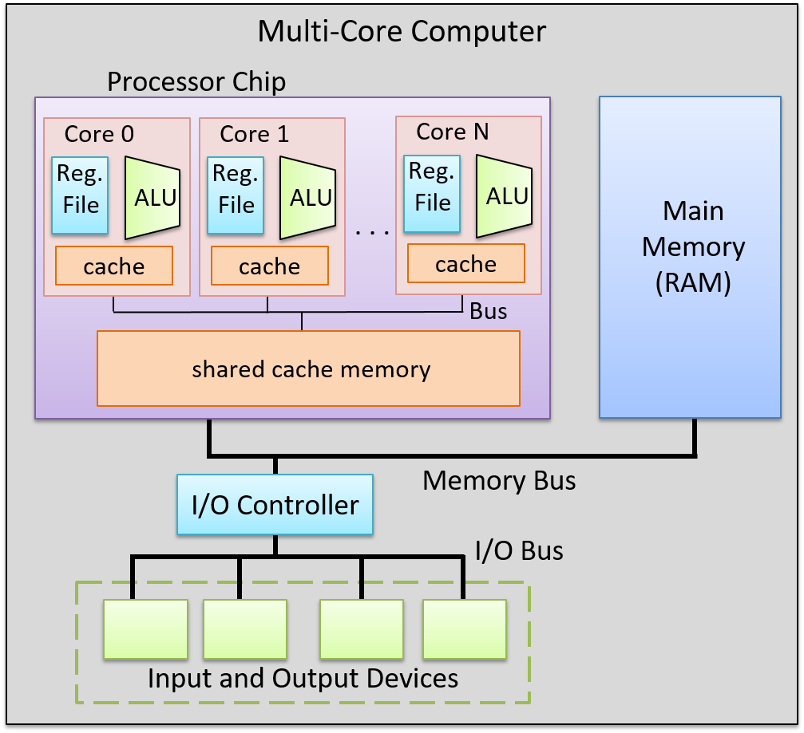

> [!WARNING] 说明
> 本文是个人学习用的**非官方**中英对照译文，原文：<https://diveintosystems.org/book/C5-Arch/modern.html>。
> 原书采用 CC BY-NC-ND 4.0 许可（禁止演绎），**请勿公开传播本译文**。
> 标为「译注」「现代更新」的内容是译者补充，不代表原书作者观点；代码与原文逐字一致，未作改动。

*5.9. Looking Ahead: CPUs Today*

CPU 流水线是**指令级并行**（instruction-level parallelism，ILP）的一个例子，在指令级并行中，CPU 同时并行地执行多条指令。在流水线执行中，CPU 通过让多条指令的执行在流水线中重叠，来同时执行多条指令。一个简单的流水线 CPU 可以达到 1 的 CPI，即每个时钟周期完成一条指令的执行。现代微处理器通常同时采用流水线和其他 ILP 技术，并包含多个 CPU 核心，从而使处理器的 CPI 值小于 1。对于这些微体系结构，通常用平均**每周期指令数**（instructions per cycle，IPC）来描述它们的性能。IPC 值大，表明处理器能持续保持很高程度的指令同时执行。

> CPU pipelining is one example of **instruction-level parallelism** (ILP), in which the CPU simultaneously executes multiple instructions in parallel. In a pipelined execution, the CPU simultaneously executes multiple instructions by overlapping their execution in the pipeline. A simple pipelined CPU can achieve a CPI of 1, completing the execution of one instruction every clock cycle. Modern microprocessors typically employ pipelining along with other ILP techniques and include multiple CPU cores to achieve processor CPI values of less than 1. For these microarchitectures, the average number of **instructions per cycle** (IPC) is the metric commonly used to describe their performance. A large IPC value indicates that a processor achieves a high sustained degree of simultaneous instruction execution.

晶体管是集成电路（芯片）上所有电路的构件。现代 CPU 的处理单元和控制单元由电路构成，而这些电路又由子电路和用晶体管实现的基本逻辑门构成。晶体管还实现了 CPU 寄存器所用的存储电路，以及存放最近访问过的数据和指令副本的快速片上缓存（我们会在[第 11 章](../C11-MemHierarchy/11.0-index.html)中详细讨论缓存）。

> Transistors are the building blocks of all circuitry on an integrated circuit (a chip). The processing and control units of modern CPUs are constructed from circuits, which are built from subcircuits and basic logic gates that are implemented with transistors. Transistors also implement the storage circuits used in CPU registers and in fast on-chip cache memory that stores copies of recently accessed data and instructions (we discuss cache memory in detail in [Chapter 11](../C11-MemHierarchy/11.0-index.html)).

一块芯片上能容纳的晶体管数量，是衡量其性能的一个粗略指标。**摩尔定律**（Moore’s Law）是戈登·摩尔（Gordon Moore）在 1975 年提出的观察：每块集成电路上的晶体管数量大约每两年翻一番1,2。每块芯片上的晶体管数量每两年翻一番，意味着计算机体系结构设计者能设计出一块新芯片，它的存储电路和计算电路可用的空间是原来的两倍，能力也大致翻倍。历史上，体系结构设计者利用多出来的晶体管，借助 ILP 技术设计出更复杂的单处理器，以提升整体性能。

> The number of transistors that can fit on a chip is a rough measure of its performance. **Moore’s Law** is the observation, made by Gordon Moore in 1975, that the number of transistors per integrated circuit doubles about every two years1,2. A doubling in the number of transistors per chip every two years means that computer architects can design a new chip with twice as much space for storage and computation circuitry, roughly doubling its power. Historically, computer architects used the extra transistors to design more complex single processors using ILP techniques to improve overall performance.

### 5.9.1. 指令级并行

*5.9.1. Instruction-Level Parallelism*

指令级并行（ILP）是一组设计技术的统称，这些技术用来支持在单个处理器上并行执行单个程序的指令。ILP 技术对程序员是透明的，也就是说，程序员写的是顺序的 C 程序，而处理器在一个或多个执行单元上同时、并行地执行它的若干条指令。流水线是 ILP 的一个例子，一串程序指令同时执行，每条指令处于不同的流水线阶段。流水线处理器每个周期可以执行一条指令（可以达到 1 的 IPC）。其他类型的微处理器 ILP 设计每个时钟周期可以执行不止一条指令，IPC 值可以大于 1。

> Instruction level parallelism (ILP) is a term for a set of design techniques used to support parallel execution of a single program’s instructions on a single processor. ILP techniques are transparent to the programmer, meaning that a programmer writes a sequential C program but the processor executes several of its instructions simultaneously, in parallel, on one or more execution units. Pipelining is one example of ILP, where a sequence of program instructions execute simultaneously, each in a different pipeline stage. A pipelined processor can execute one instruction per cycle (can achieve an IPC of 1). Other types of microprocessor ILP designs can execute more than a single instruction per clock cycle and achieve IPC values higher than 1.

**向量处理器**（vector processor）是一种通过特殊的向量指令实现 ILP 的体系结构，向量指令以一维数组（向量）数据作为操作数。向量指令由向量处理器在多个执行单元上并行执行，每个单元对向量操作数中的单个元素执行算术运算。过去，向量处理器常用于大型并行计算机。1976 年的 Cray-1 是第一台基于向量处理器的超级计算机，Cray 在整个 1990 年代一直用向量处理器设计它的超级计算机。然而，这种设计最终无法与其他并行超级计算机的设计竞争，如今向量处理器主要出现在图形处理器（GPU）这样的加速器设备中，它们特别擅长对存储在一维数组中的图像数据进行计算。

> A **vector processor** is an architecture that implements ILP through special vector instructions that take one-dimensional arrays (vectors) of data as their operands. Vector instructions are executed in parallel by a vector processor on multiple execution units, each unit performing an arithmetic operation on single elements of its vector operands. In the past, vector processors were often used in large parallel computers. The 1976 Cray-1 was the first vector processor-based supercomputer, and Cray continued to design its supercomputers with vector processors throughout the 1990s. However, eventually this design could not compete with other parallel supercomputer designs, and today vector processors appear primarily in accelerator devices such as graphics processing units (GPUs) that are particularly optimized for performing computation on image data stored in 1D arrays.

**超标量**（superscalar）是 ILP 处理器设计的另一个例子。超标量处理器是一个拥有多个执行单元和多条执行流水线的单处理器。超标量处理器从一个顺序程序的指令流中取出一组指令，把它们拆分成多个独立的指令流，由它的各个执行单元并行执行。超标量处理器是一种**乱序处理器**（out-of-order processor），即它不按照指令在顺序指令流中出现的顺序来执行指令。乱序执行需要找出那些没有依赖关系、可以安全地并行执行的指令序列。超标量处理器包含动态创建多个独立指令流、送入多个执行单元的功能。这一功能必须进行依赖分析，以确保在这些顺序流中，凡是执行依赖于前面某条指令结果的指令，都按正确的顺序执行。例如，一个有五个流水线执行单元的超标量处理器，可以在一个周期内执行一个顺序程序中的五条指令（可以达到 5 的 IPC）。然而，由于指令之间的依赖，超标量处理器并不总能让它的所有流水线都满载。

> **Superscalar** is another example of an ILP processor design. A superscalar processor is a single processor with multiple execution units and multiple execution pipelines. A superscalar processor fetches a set of instructions from a sequential program’s instruction stream, and breaks them up into multiple independent streams of instructions that are executed in parallel by its execution units. A superscalar processor is an **out-of-order processor**, or one that executes instructions out of the order in which they appear in a sequential instruction stream. Out-of-order execution requires identifying sequences of instructions without dependencies that can safely execute in parallel. A superscalar processor contains functionality to dynamically create the multiple streams of independent instructions to feed through its multiple execution units. This functionality must perform dependency analysis to ensure the correct ordering of any instruction whose execution depends on the result of a previous instruction in these sequential streams. As an example, a superscalar processor with five pipelined execution units can execute five instructions from a sequential program in a single cycle (can achieve an IPC of 5). However, due to instruction dependencies, it is not always the case that a superscalar processor can keep all of its pipelines full.

**超长指令字**（very long instruction word，VLIW）是另一种与超标量类似的 ILP 微体系结构设计。不过，在 VLIW 体系结构中，由编译器负责构造处理器并行执行的多个独立指令流。VLIW 体系结构的编译器分析程序指令，静态地构造出一条 VLIW 指令，它由多条指令组成，每个独立流各贡献一条。VLIW 带来比超标量更简单的处理器设计，因为 VLIW 处理器在执行程序指令时，不需要进行依赖分析来构造多个独立的指令流。VLIW 处理器只需要增加电路来取出下一条 VLIW 指令，把它拆成多条指令，分别送入各条执行流水线。然而，由于把依赖分析推给了编译器，VLIW 体系结构需要专门的编译器才能获得良好的性能。

> **Very long instruction word** (VLIW) is another ILP microarchitecture design that is similar to superscalar. In VLIW architectures, however, the compiler is responsible for constructing the multiple independent instruction streams executed in parallel by the processor. A compiler for a VLIW architecture analyzes the program instructions to statically construct a VLIW instruction that consists of multiple instructions, one from each independent stream. VLIW leads to simpler processor design than superscalar because the VLIW processor does not need to perform dependency analysis to construct the multiple independent instruction streams as part of its execution of program instructions. Instead, a VLIW processor just needs added circuitry to fetch the next VLIW instruction and break it up into its multiple instructions that it feeds into each of its execution pipelines. However, by pushing dependency analysis to the compiler, VLIW architectures require specialized compilers to achieve good performance.

超标量和 VLIW 都有一个问题：并行性能的程度常常受到它们所执行的顺序应用程序的严重限制。程序中指令之间的依赖限制了让所有流水线保持满载的能力。

> One problem with both superscalar and VLIW is that the degree of parallel performance is often significantly limited by the sequential application programs they execute. Dependencies between instructions in the program limit the ability to keep all of the pipelines full.

### 5.9.2. 多核与硬件多线程

*5.9.2. Multicore and Hardware Multithreading*

通过设计采用越来越复杂的 ILP 技术的单处理器，并提高 CPU 时钟速度来驱动这些越来越复杂的功能，计算机体系结构设计者设计出的处理器的性能一直跟上了摩尔定律，直到 2000 年代初。此后，如果不大幅增加处理器的功耗，CPU 的时钟速度就无法再提高3。这导致了当今多核和多线程微体系结构的时代，两者都需要程序员进行*显式并行编程*，才能加快单个程序的执行。

> By designing single processors that employed increasingly complicated ILP techniques and increasing the CPU clock speed to drive this increasingly complicated functionality, computer architects designed processors whose performance kept pace with Moore’s Law until the early 2000s. After this time, CPU clock speeds could no longer increase without greatly increasing a processor’s power consumption3. This led to the current era of multicore and multithreaded microarchitectures, both of which require *explicit parallel programming* by a programmer to speed up the execution of a single program.

**硬件多线程**（hardware multithreading）是一种支持执行多个硬件线程的单处理器设计。**线程**（thread）是一条独立的执行流。例如，两个正在运行的程序各自有自己独立执行的线程。这两个程序的执行线程可以由操作系统调度，在多线程处理器上「同时」运行。硬件多线程的一种实现方式，是处理器每个周期在各个线程的指令流之间交替执行指令。在这种情况下，不同硬件线程的指令并不是每个周期都同时执行，而是处理器被设计成能在执行不同线程执行流的指令之间快速切换。与在单线程处理器上执行相比，这通常能让它们整体上执行得更快。

> **Hardware multithreading** is a single-processor design that supports executing multiple hardware threads. A **thread** is an independent stream of execution. For example, two running programs each have their own thread of independent execution. These two programs' threads of execution could then be scheduled by the operating system to run "at the same time" on a multithreaded processor. Hardware multithreading may be implemented by a processor alternating between executing instructions from each of its threads' instruction streams each cycle. In this case, the instructions of different hardware threads are not all executed simultaneously each cycle. Instead, the processor is designed to quickly switch between executing instructions from different threads' execution streams. This usually results in a speed-up of their execution as a whole as compared to their execution on a singly threaded processor.

多线程既可以在标量微处理器上、也可以在超标量微处理器上用硬件实现。硬件至少需要支持从多个独立的指令流（每个执行线程一个）中取指令，并为每个线程的执行流配备独立的寄存器组。这些体系结构是**显式多线程**（explicitly multithreaded）4的，因为与超标量体系结构不同，每条执行流都由操作系统独立调度，运行一个单独的逻辑程序指令序列。多条执行流可以来自多个顺序程序，也可以来自单个多线程并行程序中的多个软件线程（我们会在[第 14 章](../C14-SharedMemory/14.1-multicore.html)中讨论多线程并行编程）。

> Multithreading can be implemented in hardware on either scalar- or super-scalar type microprocessors. At a minimum, the hardware needs to support fetching instructions from multiple separate instruction streams (one for each thread of execution), and have separate register sets for each thread’s execution stream. These architectures are **explicitly multithreaded**4 because, unlike superscalar architectures, each of the execution streams is independently scheduled by the operating system to run a separate logical sequence of program instructions. The multiple execution streams could come from multiple sequential programs or from multiple software threads from a single multithreaded parallel program (we discuss multithreaded parallel programming in [Chapter 14](../C14-SharedMemory/14.1-multicore.html)).

基于超标量处理器的硬件多线程微体系结构有多条流水线和多个执行单元，因此它们可以同时、并行地执行来自几个硬件线程的指令，使 IPC 值大于 1。基于简单标量处理器的多线程体系结构实现的是**交错多线程**（interleaved multithreading）。这类微体系结构通常共享一条流水线，并且总是共享处理器唯一的 ALU（CPU 在 ALU 上切换执行不同的线程）。这种多线程无法达到大于 1 的 IPC 值。由基于超标量的微体系结构支持的硬件多线程通常称为**同时多线程**（simultaneous multithreading，SMT）4。遗憾的是，SMT 这个词经常被用来同时指代这两种硬件多线程，单凭这个术语并不总能判断一个多线程微体系结构实现的是真正的同时多线程还是交错多线程。

> Hardware multithreaded microarchitectures that are based on superscalar processors have multiple pipelines and multiple execution units, and thus they can execute instructions from several hardware threads simultaneously, in parallel, resulting in an IPC value greater than 1. Multithreaded architectures based on simple scalar processors implement **interleaved multithreading**. These microarchitectures typically share a pipeline and always share the processor’s single ALU (the CPU switches between executing different threads on the ALU). This type of multithreading cannot achieve IPC values greater than 1. Hardware threading supported by superscalar-based microarchitectures is often called **simultaneous multithreading** (SMT)4. Unfortunately, SMT is often used to refer to both types of hardware multithreading, and the term alone is not always sufficient to determine whether a multithreaded microarchitecture implements true simultaneous or interleaved multithreading.

**多核处理器**（multicore processor）包含多个完整的 CPU 核心。与多线程处理器一样，每个核心都由操作系统独立调度。不过，多核处理器的每个核心都是一个完整的 CPU 核心，拥有独立的、完整的执行程序指令的功能。多核处理器包含这些 CPU 核心的多个副本，外加一些让各核心共享缓存数据的硬件支持。多核处理器的每个核心可以是标量的、超标量的或硬件多线程的。[图 1](5.9-modern.html) 展示了一台多核计算机的例子。

> **Multicore processors** contain multiple complete CPU cores. Like multithreaded processors, each core is independently scheduled by the OS. However, each core of a multicore processor is a full CPU core, one that contains its own complete and separate functionality to execute program instructions. A multicore processor contains replicas of these CPU cores with some additional hardware support for the cores to share cached data. Each core of a multicore processor could be scalar, superscalar, or hardware multithreaded. [Figure 1](5.9-modern.html) shows an example of a multicore computer.

**图 1.** 一台配有多核处理器的计算机。处理器包含多个完整的 CPU 核心，每个核心都有自己私有的缓存。各核心之间相互通信，并通过片上总线共享一个更大的共享缓存。

*Figure 1. A computer with a multicore processor. The processor contains multiple complete CPU cores, each with its own private cache memory. The cores communicate with each and share a larger shared cached memory via on-chip buses.*

多核微处理器设计是处理器体系结构的性能在不提高处理器时钟频率的情况下继续跟上摩尔定律的主要途径。多核计算机可以同时运行几个顺序程序，操作系统把不同程序的指令流调度到各个核心上。如果单个程序被写成显式多线程（软件级线程）的并行程序，多核计算机还能加快这个程序的执行。例如，操作系统可以把单个程序的各个线程调度到多核处理器的各个核心上同时运行，与执行同一程序的顺序版本相比，加快了程序的执行。在[第 14 章](../C14-SharedMemory/14.0-index.html)中，我们会讨论面向多核以及其他具有共享主存的并行系统的显式多线程并行编程。

> Multicore microprocessor design is the primary way in which the performance of processor architectures can continue to keep pace with Moore’s Law without increasing the processor clock rate. A multicore computer can simultaneously run several sequential programs, the OS scheduling each core with a different program’s instruction stream. It can speed up execution of a single program if the program is written as an explicitly multithreaded (software-level threads) parallel program. For example, the OS can schedule the threads of an individual program to run simultaneously on individual cores of the multicore processor, speeding up the execution of the program compared to its execution of a sequential version of the same program. In [Chapter 14](../C14-SharedMemory/14.0-index.html), we discuss explicit multithreaded parallel programming for multicore and other types of parallel systems with shared main memory.

### 5.9.3. 几个处理器实例

*5.9.3. Some Example Processors*

如今，处理器是用 ILP、硬件多线程和多核技术混合构建的。事实上，已经很难找到不是多核的处理器了。台式机级处理器通常有二到八个核心，其中许多核心还支持较低程度的单核多线程。例如，AMD Zen 多核处理器5以及 Intel 支持超线程（hyperthreaded）的多核 Xeon 和 Core 处理器6都支持每个核心两个硬件线程。Intel 的超线程核心实现的是交错多线程。因此，它的每个核心只能达到 1 的 IPC，但由于每块芯片上有多个 CPU 核心，整个处理器可以达到更高的 IPC。

> Today, processors are built using a mix of ILP, hardware multithreading, and multicore technologies. In fact, it is difficult to find a processor that is not multicore. Desktop-class processors typically have two to eight cores, many of which also support a low level of per-core multithreading. For example, AMD Zen multicore processors5 and Intel’s hyperthreaded multicore Xeon and Core processors6 both support two hardware threads per core. Intel’s hyperthreaded cores implement interleaved multithreading. Thus, each of its cores can only achieve an IPC of 1, but with multiple CPU cores per chip, the processor can achieve higher IPC levels.

> [!TIP] 现代更新（截至 2026-11）· 大小核与上百核的服务器
> - **异构多核**：今天的处理器常把不同类型的核心放在同一块芯片上。例如 Apple 2020 年的 M1 有 8 个 CPU 核心，其中 4 个高性能核心、4 个高能效核心；轻负载交给高能效核心，重负载再动用高性能核心。原书「台式机 2–8 核」的说法也早已过时。[Apple Newsroom：Apple unleashes M1](https://www.apple.com/newsroom/2020/11/apple-unleashes-m1/)
> - **服务器核数**：AMD 2024 年 10 月发布的第五代 EPYC（9005 系列）中，顶配的 EPYC 9965 有 **192 个**「Zen 5c」核心。[AMD：5th Gen AMD EPYC 发布](https://www.amd.com/en/newsroom/press-releases/2024-10-10-amd-launches-5th-gen-amd-epyc-cpus-maintaining-le.html)

为服务器和超级计算机等高端系统设计的处理器包含许多核心，每个核心都有很高程度的多线程。例如，用于高端服务器的 Oracle SPARC M7 处理器7有 32 个核心。它的每个核心有八个硬件线程，其中两个可以同时执行，使处理器的最大 IPC 值达到 64。世界上最快的两台超级计算机（截至 2019 年 6 月）8使用的是 IBM 的 Power 9 处理器9。Power 9 处理器每块芯片最多有 24 个核心，每个核心最多支持八路同时多线程。24 核版本的 Power 9 处理器可以达到 192 的 IPC。

> Processors designed for high-end systems, such as those used in servers and supercomputers, contain many cores, where each core has a high degree of multithreading. For example, Oracle’s SPARC M7 processor7, used in high-end servers, has 32 cores. Each of its cores has eight hardware threads, two of which can execute simultaneously, resulting in a maximum IPC value of 64 for the processor. The two fastest supercomputers in the world (as of June 2019)8, use IBM’s Power 9 processors9. Power 9 processors have up to 24 cores per chip, and each core supports up to eight-way simultaneous multithreading. A 24-core version of the Power 9 processor can achieve an IPC of 192.

> [!TIP] 现代更新（截至 2026-11）· 今天最快的超算
> 原书提到的 2019 年 6 月榜首是采用 IBM Power 9 的系统。在 2026 年 6 月的 TOP500 榜单上，第一名是位于中国国家超级计算深圳中心的 LineShine（约 1380 万个核心，Linpack 实测 2,198.4 PFlop/s，即约 2.2 EFlop/s），第二名是美国的 El Capitan（AMD 第四代 EPYC CPU + AMD Instinct MI300A）。[TOP500 List - June 2026](https://top500.org/lists/top500/list/2026/06/)

### 脚注与参考文献

*Footnotes and References*

1. 摩尔在 1965 年最初观察到的是每年翻一番，1975 年他把这一观察修正为每两年多翻一番，后者被称为摩尔定律。

> 1.  Moore first observed a doubling every year in 1965, that he then updated in 1975 to every \> 2 years, which became known as Moore’s Law.

2. 摩尔定律一直成立到 2012 年前后，此后晶体管密度的提升开始放缓。摩尔预测摩尔定律将在 2020 年代中期终结。

> 2.  Moore’s Law held until around 2012 when improvements in transistor density began to slow. Moore predicted the end of Moore’s Law in the mid 2020s.

3.  "The End of Dennard scaling" by Adrian McMenamin, 2013. <https://cartesianproduct.wordpress.com/2013/04/15/the-end-of-dennard-scaling/>

4.  "A Survey of Processors with Explicit Multithreading", by Ungerer, Robic, and Silc. In ACM Computing Surveys, Vol. 35, No. 1, March 2003, pp. 29–63. <http://citeseerx.ist.psu.edu/viewdoc/download?doi=10.1.1.96.9105&rep=rep1&type=pdf>

5.  AMD’s Zen Architectures: <https://www.amd.com/en/technologies/zen-core>

6.  Intel’s Xeon and Core processors with Hyper-Threading: <https://www.intel.com/content/www/us/en/architecture-and-technology/hyper-threading/hyper-threading-technology.html>

7.  Oracle’s SPARC M7 Processor: <http://www.oracle.com/us/products/servers-storage/sparc-m7-processor-ds-2687041.pdf>

8.  Top 500 Lists: <https://www.top500.org/lists/top500/>

9.  IBM’s Power 9 Processor: <https://www.ibm.com/it-infrastructure/power/power9>
