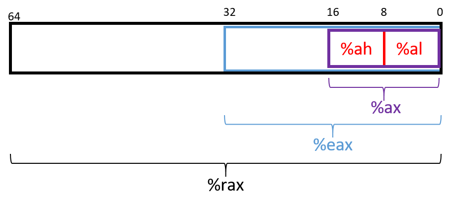

> **说明**
> 本文是个人学习用的**非官方**中英对照译文，原文：<https://diveintosystems.org/book/C7-x86_64/basics.html>。
> 原书采用 CC BY-NC-ND 4.0 许可（禁止演绎），**请勿公开传播本译文**。
> 标为「译注」「现代更新」的内容是译者补充，不代表原书作者观点；代码与原文逐字一致，未作改动。

## 7.1. 潜入汇编：基础知识

*7.1. Diving into Assembly: Basics*

为了初步了解 x64 汇编，我们修改[第 6 章](7.0-index.html)中的 `adder` 函数，简化它的行为。修改后的函数（`adder2`）如下：

> For a first look at x64 assembly, we modify the `adder` function from [Chapter 6](7.0-index.html) to simplify its behavior. The modified function (`adder2`) is shown below:

```
#include <stdio.h>

//adds two to an integer and returns the result
int adder2(int a) {
    return a + 2;
}

int main(void){
    int x = 40;
    x = adder2(x);
    printf("x is: %d\n", x);
    return 0;
}
```

要编译这段代码，使用以下命令：

> To compile this code, use the following command:

```
$ gcc -o adder adder.c
```

接下来，用 `objdump` 命令查看这段代码对应的汇编：

> Next, let’s view the corresponding assembly of this code by using the `objdump` command:

```
$ objdump -d adder > output
$ less output
```

用 `less` 查看文件 `output` 时，输入 `/adder2` 搜索与 `adder2` 相关的代码片段。与 `adder2` 相关的部分应该类似下面这样：

> Search for the code snippet associated with `adder2` by typing `/adder2` while examining the file `output` using `less`. The section associated with `adder2` should look similar to the following:

*`adder2` 函数的汇编输出*

> *Assembly output for the `adder2` function*

```
0000000000400526 <adder2>:
  400526:       55                      push   %rbp
  400527:       48 89 e5                mov    %rsp,%rbp
  40052a:       89 7d fc                mov    %edi,-0x4(%rbp)
  40052d:       8b 45 fc                mov    -0x4(%rbp),%eax
  400530:       83 c0 02                add    $0x2,%eax
  400533:       5d                      pop    %rbp
  400534:       c3                      retq
```

如果你还不明白这是怎么回事，不必担心。我们会在后面的小节中更详细地介绍汇编。目前，我们先来研究一下这些单独指令的结构。

> Don’t worry if you don’t understand what’s going on just yet. We will cover assembly in greater detail in later sections. For now, let’s study the structure of these individual instructions.

上例中的每一行都包含一条指令在程序内存中的 64 位地址、与这条指令对应的字节，以及指令本身的文本表示。例如，`55` 是指令 `push %rbp` 的机器码表示，这条指令位于程序内存中的地址 `0x400526` 处。注意，`0x400526` 是与 `push %rbp` 指令相关的完整 64 位地址的缩写；为了便于阅读，前导零被省略了。

> Each line in the preceding example contains an instruction’s 64-bit address in program memory, the bytes corresponding to the instruction, and the plaintext representation of the instruction itself. For example, `55` is the machine code representation of the instruction `push %rbp`, and the instruction occurs at address `0x400526` in program memory. Note that `0x400526` is an abbreviation of the full 64-bit address associated with the `push %rbp` instruction; the leading zeroes are ignored for readability.

要注意，一行 C 代码常常会被翻译成多条汇编指令。运算 `a + 2` 用 `mov -0x4(%rbp), %eax` 和 `add $0x2, %eax` 两条指令表示。

> It is important to note that a single line of C code often translates to multiple instructions in assembly. The operation `a + 2` is represented by the two instructions `mov -0x4(%rbp), %eax` and `add $0x2, %eax`.

> **原书警示 · 你的汇编可能看起来不一样！（Your assembly may look different!）**
> 如果你一边读一边跟着编译代码，可能会注意到你得到的一些汇编示例与书中所示的不同。任何编译器输出的确切汇编指令，都取决于编译器的版本和底层的操作系统。本书中的大多数汇编示例是在运行 Ubuntu 或红帽企业版 Linux（RHEL）的系统上生成的。
>
> 在接下来的示例中，我们不使用任何优化选项。例如，编译任何示例文件（`example.c`）都使用命令 `gcc -o example example.c`。因此，接下来的示例中会有许多看似多余的指令。记住，编译器并不「聪明」——它只是遵循一系列规则，把人类可读的代码翻译成机器语言。在这个翻译过程中，出现一些冗余并不罕见。优化编译器在优化过程中会去掉许多这样的冗余，我们会在[后面的章节](../C12-CodeOpt/12.0-index.html)中介绍优化。
>
> > If you are compiling your code along with us, you may notice that some of your assembly examples look different from what is shown in this book. The precise assembly instructions that are output by any compiler depend on that compiler’s version and the underlying operating system. Most of the assembly examples in this book were generated on systems running Ubuntu or Red Hat Enterprise Linux (RHEL).
> >
> > In the examples that follow, we do not use any optimization flags. For example, we compile any example file (`example.c`) using the command `gcc -o example example.c`. Consequently, there are many seemingly redundant instructions in the examples that follow. Remember that the compiler is not "smart" — it simply follows a series of rules to translate human-readable code into machine language. During this translation process, it is not uncommon for some redundancy to occur. Optimizing compilers remove many of these redundancies during optimization, which is covered in a [later chapter](../C12-CodeOpt/12.0-index.html).

> **译注**
> 较新的 GCC 和 Linux 发行版默认生成位置无关可执行文件（PIE），所以你用 `objdump` 看到的地址通常是 `0x1129` 这样从很小的值开始的相对地址，而不是书中的 `0x400526`；不开优化时函数开头还可能多出一条 `endbr64` 指令（Intel CET 控制流保护）。这些差异不影响理解本章内容。

### 7.1.1. 寄存器

*7.1.1. Registers*

回想一下，**寄存器**是直接位于 CPU 上的、字大小的存储单元。可能会有分别用于数据、指令和地址的寄存器。例如，Intel CPU 共有 16 个用于存储 64 位数据的寄存器：

> Recall that a **register** is a word-sized storage unit located directly on the CPU. There may be separate registers for data, instructions, and addresses. For example, the Intel CPU has a total of 16 registers for storing 64-bit data:

> **现代更新（截至 2026-11）· x86 的寄存器要翻倍了**
> 本章讲的 16 个通用寄存器是 x86-64 自诞生以来的配置。Intel 公布的 **APX**（Advanced Performance Extensions，高级性能扩展）把通用寄存器从 16 个增加到 32 个，让编译器能把更多值留在寄存器里；Intel 称用 APX 编译的代码加载指令减少约 10%、存储指令减少 20% 以上。这需要新处理器和新编译器支持，本章的知识仍然完全适用。[Intel：Introducing Intel APX](https://www.intel.com/content/www/us/en/developer/articles/technical/advanced-performance-extensions-apx.html)

`%rax`、`%rbx`、`%rcx`、`%rdx`、`%rdi`、`%rsi`、`%rsp`、`%rbp`，以及 `%r8`–`%r15`。除了 `%rsp` 和 `%rbp` 之外，所有寄存器都存放通用的 64 位数据。尽管程序可能会把寄存器的内容解释为整数或地址等，但寄存器本身并不加以区分。程序可以读写全部十六个寄存器。

> `%rax`, `%rbx`, `%rcx`, `%rdx`, `%rdi`, `%rsi`, `%rsp`, `%rbp`, and `%r8`-`%r15`. All the registers save for `%rsp` and `%rbp` hold general-purpose 64-bit data. While a program may interpret a register’s contents as, say, an integer or an address, the register itself makes no distinction. Programs can read from or write to all sixteen registers.

寄存器 `%rsp` 和 `%rbp` 分别称为**栈指针**（stack pointer）和**帧指针**（frame pointer，或称**基址指针**，base pointer）。编译器把这两个寄存器保留给维护程序栈布局的操作。例如，寄存器 `%rsp` 总是指向栈顶。在早期的 x86 系统（例如 IA32）中，帧指针通常用来跟踪活动栈帧的底部，并帮助引用参数。不过，在 x86-64 系统中，基址指针用得比较少。编译器通常把前六个参数依次存放在寄存器 `%rdi`、`%rsi`、`%rdx`、`%rcx`、`%r8` 和 `%r9` 中。寄存器 `%rax` 存放函数的返回值。

> The registers `%rsp` and `%rbp` are known as the **stack pointer** and the **frame pointer** (or **base pointer**), respectively. The compiler reserves these registers for operations that maintain the layout of the program stack. For example, register `%rsp` always points to the top of the stack. In earlier x86 systems (e.g., IA32), the frame pointer commonly tracked the base of the active stack frame and helped to reference parameters. However, the base pointer is less frequently used in x86-64 systems. Compilers typically store the first six parameters in registers `%rdi`, `%rsi`, `%rdx`, `%rcx`, `%r8` and `%r9`, respectively. Register `%rax` stores the return value from a function.

> **现代更新（截至 2026-11）· 帧指针回来了**
> 原文说 x86-64 上帧指针用得少了：编译器优化时常省略 `%rbp` 帧指针（`-fomit-frame-pointer`），把它当普通寄存器用。近年风向有变：Canonical 宣布从 **Ubuntu 24.04 LTS** 起，其 GCC 包在 64 位平台上**默认启用帧指针**，几乎所有软件包都用帧指针重新构建，理由是这样软件更容易做性能分析，而带来的性能损失相对很小。所以在新版 Ubuntu 上反汇编系统库，你会更常看到 `push %rbp; mov %rsp,%rbp` 这样的函数开头。[Ubuntu 博客：Performance engineering on Ubuntu leaps forward with frame pointers by default](https://ubuntu.com/blog/ubuntu-performance-engineering-with-frame-pointers-by-default)

最后一个值得一提的寄存器是 `%rip`，即**指令指针**（instruction pointer），有时也称为**程序计数器**（PC）。它指向 CPU 要执行的下一条指令。与前面提到的 16 个寄存器不同，程序不能直接写寄存器 `%rip`。

> The last register worth mentioning is `%rip` or the **instruction pointer**, sometimes called the **program counter** (PC). It points to the next instruction to be executed by the CPU. Unlike the 16 registers mentioned previously, programs cannot write directly to register `%rip`.

### 7.1.2. 寄存器的进阶记法

*7.1.2. Advanced Register Notation*

由于 x86-64 是 32 位 x86 体系结构的扩展（而后者本身又是更早的 16 位版本的扩展），这种 ISA 提供了访问每个寄存器低 32 位、低 16 位和低字节的机制。[表 1](7.1-basics.html) 列出了全部 16 个寄存器，以及访问其组成字节的 ISA 记法。

> Since x86-64 is an extension of the 32-bit x86 architecture (which itself was an extension of an earlier 16-bit version), the ISA provides mechanisms to access the lower 32 bits, 16 bits, and lower bytes of each register. [Table 1](7.1-basics.html) lists each of the 16 registers and the ISA notations to access their component bytes.

**表 1.** x86-64 寄存器及访问其低位字节的方式

*Table 1. x86-64 Registers and Mechanisms for Accessing Lower Bytes*

| 64 位寄存器 | 32 位寄存器 | 低 16 位 | 低 8 位 |
|-----------------|-----------------|---------------|--------------|
| `%rax` | `%eax` | `%ax` | `%al` |
| `%rbx` | `%ebx` | `%bx` | `%bl` |
| `%rcx` | `%ecx` | `%cx` | `%cl` |
| `%rdx` | `%edx` | `%dx` | `%dl` |
| `%rdi` | `%edi` | `%di` | `%dil` |
| `%rsi` | `%esi` | `%si` | `%sil` |
| `%rsp` | `%esp` | `%sp` | `%spl` |
| `%rbp` | `%ebp` | `%bp` | `%bpl` |
| `%r8` | `%r8d` | `%r8w` | `%r8b` |
| `%r9` | `%r9d` | `%r9w` | `%r9b` |
| `%r10` | `%r10d` | `%r10w` | `%r10b` |
| `%r11` | `%r11d` | `%r11w` | `%r11b` |
| `%r12` | `%r12d` | `%r12w` | `%r12b` |
| `%r13` | `%r13d` | `%r13w` | `%r13b` |
| `%r14` | `%r14d` | `%r14w` | `%r14b` |
| `%r15` | `%r15d` | `%r15w` | `%r15b` |

> | 64-bit Register | 32-bit Register | Lower 16 Bits | Lower 8 Bits |
> |-----------------|-----------------|---------------|--------------|
> | `%rax`          | `%eax`          | `%ax`         | `%al`        |
> | `%rbx`          | `%ebx`          | `%bx`         | `%bl`        |
> | `%rcx`          | `%ecx`          | `%cx`         | `%cl`        |
> | `%rdx`          | `%edx`          | `%dx`         | `%dl`        |
> | `%rdi`          | `%edi`          | `%di`         | `%dil`       |
> | `%rsi`          | `%esi`          | `%si`         | `%sil`       |
> | `%rsp`          | `%esp`          | `%sp`         | `%spl`       |
> | `%rbp`          | `%ebp`          | `%bp`         | `%bpl`       |
> | `%r8`           | `%r8d`          | `%r8w`        | `%r8b`       |
> | `%r9`           | `%r9d`          | `%r9w`        | `%r9b`       |
> | `%r10`          | `%r10d`         | `%r10w`       | `%r10b`      |
> | `%r11`          | `%r11d`         | `%r11w`       | `%r11b`      |
> | `%r12`          | `%r12d`         | `%r12w`       | `%r12b`      |
> | `%r13`          | `%r13d`         | `%r13w`       | `%r13b`      |
> | `%r14`          | `%r14d`         | `%r14w`       | `%r14b`      |
> | `%r15`          | `%r15d`         | `%r15w`       | `%r15b`      |

前八个寄存器（`%rax`、`%rbx`、`%rcx`、`%rdx`、`%rdi`、`%rsi`、`%rsp` 和 `%rbp`）是 x86 中 32 位寄存器的 64 位扩展，访问它们的低 32 位、低 16 位和最低有效字节有一套共同的机制。要访问前八个寄存器的低 32 位，只需把寄存器名中的 `r` 换成 `e`。因此，对应于寄存器 `%rax` 低 32 位的寄存器是 `%eax`。要访问这八个寄存器各自的低 16 位，就取寄存器名的最后两个字母。所以，访问寄存器 `%rax` 低两个字节的方式是 `%ax`。

> The first eight registers (`%rax`, `%rbx`, `%rcx`, `%rdx`, `%rdi`, `%rsi`, `%rsp`, and `%rbp`) are 64-bit extensions of 32-bit registers in x86 and have a common mechanism for accessing their lower 32 bits, lower 16 bits, and least-significant byte. To access the lower 32 bits of the first eight registers, simply replace the `r` in the register name with `e`. Thus, the register corresponding to the lower 32 bits of register `%rax` is register `%eax`. To access the lower 16 bits of each of these eight registers, reference the last two letters of the register’s name. So, the mechanism to access the lower two bytes of register `%rax` is `%ax`.



**图 1.** 引用寄存器 %rax 各部分的名字。

*Figure 1. The names that refer to subsets of register %rax.*

> **译注 · 图中内容**
> `%eax` 指 `%rax` 的低 32 位，`%ax` 指低 16 位，`%al` 指最低字节（第 0–7 位），`%ah` 指第二个字节（第 8–15 位）。

对于列出的前四个寄存器，ISA 还提供了另一种机制来访问其低 16 位中的八位部分。[图 1](7.1-basics.html) 描绘了寄存器 `%rax` 的访问方式。要访问前四个寄存器低 16 位中的*高*字节和*低*字节，就取寄存器名的最后两个字母，并根据想要哪个字节，把最后一个字母换成 `h`（表示*高*）或 `l`（表示*低*）。例如，`%al` 引用寄存器 `%ax` 的低八位，而 `%ah` 引用寄存器 `%ax` 的高八位。这些八位寄存器常用于在某些运算中存放单字节的值，比如移位（32 位寄存器移位不能超过 32 位，而数字 32 只需要一个字节就能存下）。

> The ISA provides a separate mechanism to access the eight-bit components within the lower 16 bits of the first four listed registers. [Figure 1](7.1-basics.html) depicts the access mechanisms for register `%rax`. The *higher* and *lower* bytes within the lower 16 bits of the first four listed registers can be accessed by taking the last two letters of the register name and replacing the last letter with either an `h` (for *higher*) or an `l` (for *lower*) depending on which byte is desired. For example, `%al` references the lower eight-bits of register `%ax`, whereas `%ah` references the higher eight-bits of register `%ax`. These eight-bit registers are commonly used for storing single-byte values for certain operations, such as bitwise shifts (a 32-bit register cannot be shifted more than 32 places, and the number 32 requires only a single byte of storage).

> **原书警示 · 编译器可能会根据类型选用寄存器的组成部分（Compiler may choose component registers depending on type）**
> 阅读汇编代码时要记住，编译器在处理 64 位值（例如指针或 `long` 类型）时通常使用 64 位寄存器，在处理 32 位类型（例如 `int`）时则使用 32 位的组成部分寄存器。在 x86-64 中，32 位的组成部分寄存器与完整的 64 位寄存器混合使用是非常常见的。例如，在前面示例的 `adder2` 函数中，编译器引用的是组成部分寄存器 `%eax` 而不是 `%rax`，因为在 64 位系统上 `int` 类型通常占 32 位（四个字节）。如果 `adder2` 函数的参数是 `long` 而不是 `int`，编译器就会把 `a` 存放在寄存器 `%rax` 而不是 `%eax` 中。
>
> > When reading assembly code, keep in mind that the compiler typically uses the 64-bit registers when dealing with 64-bit values (e.g., pointers or `long` types) and the 32-bit component registers when dealing with 32-bit types (e.g., `int`). In x86-64, it is very common to see 32-bit component registers intermixed with the full 64-bit registers. For example, in the `adder2` function shown in the previous example, the compiler references component register `%eax` instead of `%rax` since `int` types typically take up 32 bits (four bytes) of space on 64-bit systems. If the `adder2` function had a `long` parameter instead of a `int`, the compiler would store `a` in register `%rax` instead of register `%eax`.

最后八个寄存器（`%r8`–`%r15`）不属于 IA32 ISA。不过，它们也有访问不同字节部分的机制。要访问后八个寄存器的低 32 位、低 16 位或低字节，就分别在寄存器名的末尾加上字母 `d`、`w` 或 `b`。因此，`%r9d` 访问寄存器 `%r9` 的低 32 位，`%r9w` 访问它的低 16 位，`%r9b` 访问它的最低字节。

> The last eight registers (`%r8`-`%r15`) were not part of the IA32 ISA. However, they also have mechanisms to access their different byte components. To access the lower 32 bits, 16 bits, or byte of the last eight registers, append the letter `d`, `w`, or `b`, respectively, to the end of the register’s name. Thus, `%r9d` accesses the lower 32 bits of register `%r9`, whereas `%r9w` accesses the lower 16 bits, and `%r9b` accesses the lowest byte of register `%r9`.

### 7.1.3. 指令的结构

*7.1.3. Instruction Structure*

每条指令由一个指明它做什么的操作码（**opcode**）和一个或多个告诉指令如何去做的**操作数**（operand）组成。例如，指令 `add $0x2, %eax` 的操作码是 `add`，操作数是 `$0x2` 和 `%eax`。

> Each instruction consists of an operation code (or **opcode**) that specifies what it does, and one or more **operands** that tell the instruction how to do it. For example, the instruction `add $0x2, %eax` has the opcode `add` and the operands `$0x2` and `%eax`.

每个操作数对应于某个特定运算的源位置或目标位置。双操作数指令通常遵循「源，目标」（`S`, `D`）的格式，第一个操作数指定源寄存器，第二个操作数指定目标。

> Each operand corresponds to a source or destination location for a specific operation. Two operand instructions typically follow the source, destination (`S`, `D`) format, where the first operand specifies a source register, and the second operand specifies the destination.

操作数有多种类型：

> There are multiple types of operands:

- **常数（字面量）**值前面带有 `$` 符号。例如，在指令 `add $0x2, %eax` 中，`$0x2` 是一个字面值，对应于十六进制值 0x2。

> - **Constant (literal)** values are preceded by the `$` sign. For example, in the instruction `add $0x2, %eax`, `$0x2` is a literal value that corresponds to the hexadecimal value 0x2.

- **寄存器**形式指单个寄存器。指令 `mov %rsp, %rbp` 指明，源寄存器（`%rsp`）中的值应当被复制到目标位置（寄存器 `%rbp`）。

> - **Register** forms refer to individual registers. The instruction `mov %rsp, %rbp` specifies that the value in the source register (`%rsp`) should be copied to the destination location (register `%rbp`).

- **内存**形式对应于主存（RAM）中的某个值，常用于地址查找。内存地址形式可以包含寄存器和常数值的组合。例如，在指令 `mov -0x4(%rbp),%eax` 中，操作数 `-0x4(%rbp)` 就是内存形式的一个例子。它大致可以翻译为：「把 -0x4 加到寄存器 `%rbp` 中的值上（即从 `%rbp` 中减去 0x4），然后执行一次内存查找」。如果这听起来像是指针解引用，那是因为它就是！

> - **Memory** forms correspond to some value inside main memory (RAM) and are commonly used for address lookups. Memory address forms can contain a combination of registers and constant values. For example, in the instruction `mov -0x4(%rbp),%eax`, the operand `-0x4(%rbp)` is an example of a memory form. It loosely translates to "add -0x4 to the value in register `%rbp` (i.e., subtract 0x4 from `%rbp`), and then perform a memory lookup." If this sounds like a pointer dereference, that’s because it is!

### 7.1.4. 一个关于操作数的例子

*7.1.4. An Example with Operands*

详细解释操作数的最好方式是举一个简短的例子。假设内存中包含以下值：

> The best way to explain operands in detail is to present a quick example. Suppose that memory contains the following values:

| 地址 | 值 |
|---------|-------|
| 0x804 | 0xCA |
| 0x808 | 0xFD |
| 0x80c | 0x12 |
| 0x810 | 0x1E |

> | Address | Value |
> |---------|-------|
> | 0x804   | 0xCA  |
> | 0x808   | 0xFD  |
> | 0x80c   | 0x12  |
> | 0x810   | 0x1E  |

我们再假设下面这些寄存器中存放着所示的值：

> Let’s also assume that the following registers contain the values shown:

| 寄存器 | 值 |
|----------|-------|
| %rax | 0x804 |
| %rbx | 0x10 |
| %rcx | 0x4 |
| %rdx | 0x1 |

> | Register | Value |
> |----------|-------|
> | %rax     | 0x804 |
> | %rbx     | 0x10  |
> | %rcx     | 0x4   |
> | %rdx     | 0x1   |

那么，[表 2](7.1-basics.html) 中的操作数会求值为表中所示的值。表中的每一行把一个操作数与它的形式（例如常数、寄存器、内存）、它的含义以及它的值对应起来。注意，在这里记号 M[x] 表示由地址 x 指定的内存位置上的值。

> Then the operands in [Table 2](7.1-basics.html) evaluate to the values shown there. Each row of the table matches an operand with its form (e.g., constant, register, memory), how it is translated, and its value. Note that the notation M[x] in this context denotes the value at the memory location specified by address x.

**表 2.** 操作数示例

*Table 2. Example operands*

| 操作数 | 形式 | 含义 | 值 |
|-----------------|----------|------------------------------------|-------|
| %rcx | 寄存器 | %rcx | 0x4 |
| (%rax) | 内存 | M[%rax] 即 M[0x804] | 0xCA |
| \$0x808 | 常数 | 0x808 | 0x808 |
| 0x808 | 内存 | M[0x808] | 0xFD |
| 0x8(%rax) | 内存 | M[%rax + 8] 即 M[0x80c] | 0x12 |
| (%rax, %rcx) | 内存 | M[%rax + %rcx] 即 M[0x808] | 0xFD |
| 0x4(%rax, %rcx) | 内存 | M[%rax + %rcx + 4] 即 M[0x80c] | 0x12 |
| 0x800(,%rdx,4) | 内存 | M[0x800 + %rdx\*4] 即 M[0x804] | 0xCA |
| (%rax, %rdx, 8) | 内存 | M[%rax + %rdx\*8] 即 M[0x80c] | 0x12 |

> | Operand         | Form     | Translation                        | Value |
> |-----------------|----------|------------------------------------|-------|
> | %rcx            | Register | %rcx                               | 0x4   |
> | (%rax)          | Memory   | M[%rax] or M[0x804]            | 0xCA  |
> | \$0x808         | Constant | 0x808                              | 0x808 |
> | 0x808           | Memory   | M[0x808]                         | 0xFD  |
> | 0x8(%rax)       | Memory   | M[%rax + 8] or M[0x80c]        | 0x12  |
> | (%rax, %rcx)    | Memory   | M[%rax + %rcx] or M[0x808]     | 0xFD  |
> | 0x4(%rax, %rcx) | Memory   | M[%rax + %rcx + 4] or M[0x80c] | 0x12  |
> | 0x800(,%rdx,4)  | Memory   | M[0x800 + %rdx\*4] or M[0x804] | 0xCA  |
> | (%rax, %rdx, 8) | Memory   | M[%rax + %rdx\*8] or M[0x80c]  | 0x12  |

在[表 2](7.1-basics.html) 中，记号 `%rcx` 表示寄存器 `%rcx` 中存放的值。与之不同，M[`%rax`] 表示应当把 `%rax` 中的值当作一个地址，并对它解引用（查找该地址处的值）。因此，操作数 `(%rax)` 对应于 M[0x804]，也就是值 0xCA。

> In [Table 2](7.1-basics.html), the notation `%rcx` indicates the value stored in register `%rcx`. In contrast, M[`%rax`] indicates that the value inside `%rax` should be treated as an address, and to dereference (look up) the value at that address. Therefore, the operand `(%rax)` corresponds to M[0x804] which corresponds to the value 0xCA.

在继续之前，有几点重要说明。尽管[表 2](7.1-basics.html) 列出了许多合法的操作数形式，但并不是所有形式在所有情况下都可以互换使用。具体来说：

> A few important notes before continuing. Although [Table 2](7.1-basics.html) shows many valid operand forms, not all forms can be used interchangeably in all circumstances. Specifically:

- 常数形式不能作为目标操作数。

> - Constant forms cannot serve as destination operands.

- 在同一条指令中，内存形式不能*同时*作为源操作数和目标操作数。

> - Memory forms cannot serve as *both* the source and destination operand in a single instruction.

- 在有比例因子的运算中（见[表 2](7.1-basics.html) 的最后两个操作数），比例因子是括号中的第三个参数。比例因子只能是 1、2、4 或 8 之一。

> - In cases of scaling operations (see the last two operands in [Table 2](7.1-basics.html)), the scaling factor is a third parameter in the parentheses. Scaling factors can be one of 1, 2, 4, or 8.

[表 2](7.1-basics.html) 是供参考的；不过，理解关键的操作数形式会帮助读者更快地读懂汇编语言。

> [Table 2](7.1-basics.html) is provided as a reference; however, understanding key operand forms will help improve the reader’s speed in parsing assembly language.

### 7.1.5. 指令后缀

*7.1.5. Instruction Suffixes*

在接下来的例子中，有几处常见指令和算术指令带有一个后缀，表示在代码层面被操作的数据的*大小*（与*类型*相关）。编译器会自动把代码翻译成带有相应后缀的指令。[表 3](7.1-basics.html) 列出了 x86-64 指令的常见后缀。

> In several cases in upcoming examples, common and arithmetic instructions have a suffix that indicates the *size* (associated with the *type*) of the data being operated on at the code level. The compiler automatically translates code to instructions with the appropriate suffix. [Table 3](7.1-basics.html) shows the common suffixes for x86-64 instructions.

**表 3.** 指令后缀示例

*Table 3. Example Instruction Suffixes*

| 后缀 | C 类型 | 大小（字节） |
|--------|---------------------------------------|--------------|
| b | `char` | 1 |
| w | `short` | 2 |
| l | `int` 或 `unsigned` | 4 |
| s | `float` | 4 |
| q | `long`、`unsigned long`、所有指针 | 8 |
| d | `double` | 8 |

> | Suffix | C Type                                | Size (bytes) |
> |--------|---------------------------------------|--------------|
> | b      | `char`                                | 1            |
> | w      | `short`                               | 2            |
> | l      | `int` or `unsigned`                   | 4            |
> | s      | `float`                               | 4            |
> | q      | `long`, `unsigned long`, all pointers | 8            |
> | d      | `double`                              | 8            |

注意，与条件执行有关的指令会根据求值的条件带有不同的后缀。我们会在[后面的小节](7.4-conditional_control_loops.html)中介绍与条件执行相关的指令。

> Note that instructions involved with conditional execution have different suffixes based on the evaluated condition. We cover instructions associated with conditional execution in a [later section](7.4-conditional_control_loops.html).
