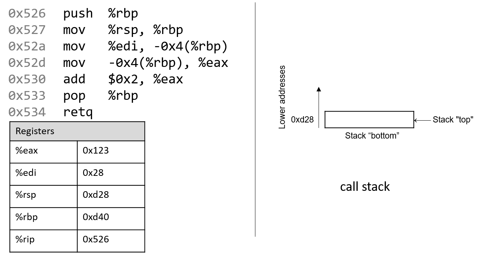
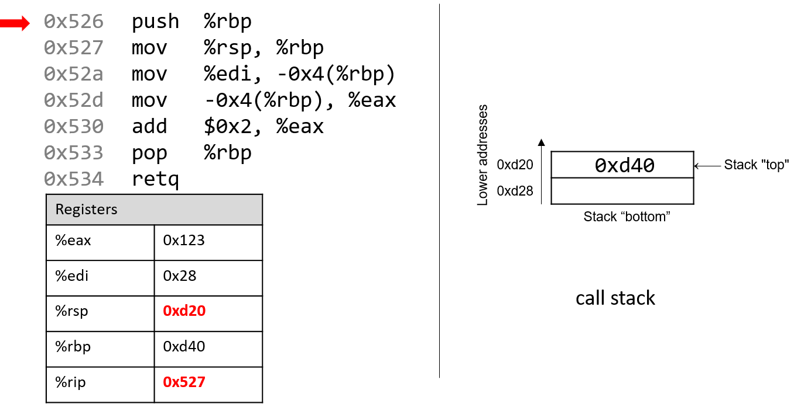
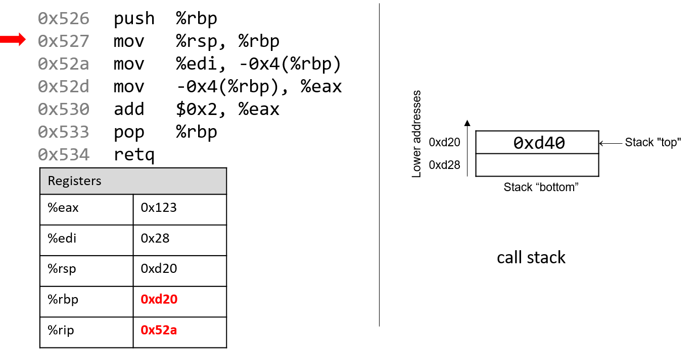
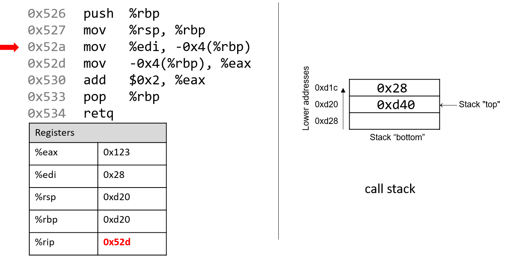
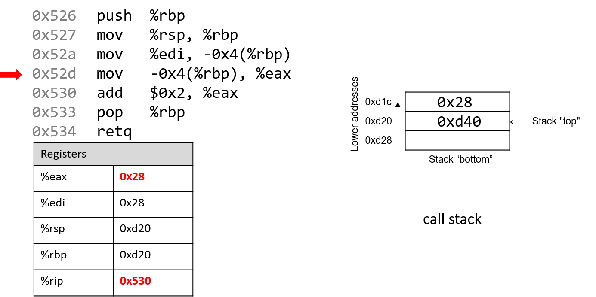
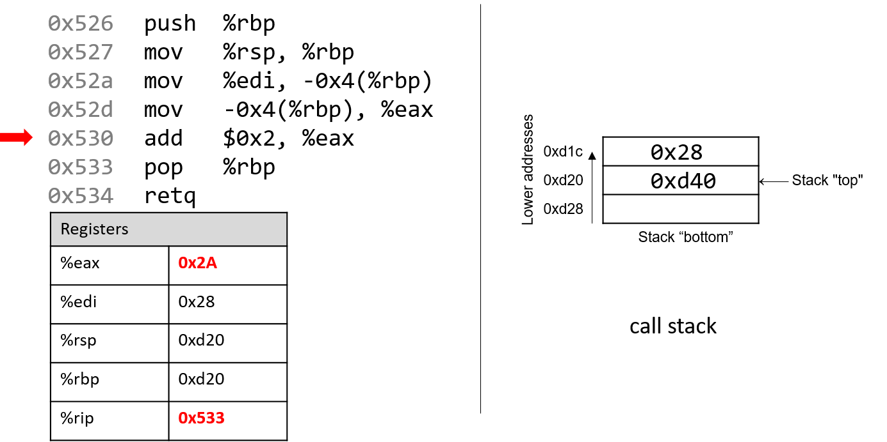
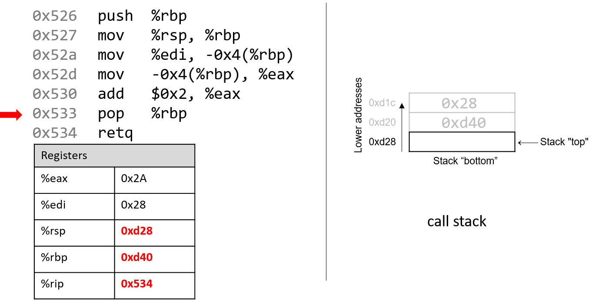

> [!WARNING] 说明
> 本文是个人学习用的**非官方**中英对照译文，原文：<https://diveintosystems.org/book/C7-x86_64/common.html>。
> 原书采用 CC BY-NC-ND 4.0 许可（禁止演绎），**请勿公开传播本译文**。
> 标为「译注」「现代更新」的内容是译者补充，不代表原书作者观点；代码与原文逐字一致，未作改动。


*7.2. Common Instructions*

本节讨论几条常用的汇编指令。[表 1](7.2-common.html) 列出了 x86（因而也是 x64）汇编中最基础的指令。

> In this section, we discuss several common assembly instructions. [Table 1](7.2-common.html) lists the most foundational instructions in x86 (and thus x64) assembly.

**表 1.** 最常用的指令

*Table 1. Most Common Instructions*

| 指令 | 含义 |
|-------------|---------------------------------------------------------|
| `mov S, D` | S → D（把 S 的值复制到 D） |
| `add S, D` | S + D → D（把 S 加到 D 上，结果存入 D） |
| `sub S, D` | D - S → D（*从* D 中减去 S，结果存入 D） |

> | Instruction | Translation                                             |
> |-------------|---------------------------------------------------------|
> | `mov S, D`  | S → D (copies value of S into D)                        |
> | `add S, D`  | S + D → D (adds S to D and stores result in D)          |
> | `sub S, D`  | D - S → D (subtracts S *from* D and stores result in D) |

因此，指令序列

> Therefore, the sequence of instructions

```
mov    -0x4(%rbp),%eax
add    $0x2,%eax
```

的含义是：

> translates to:

- 把*内存*中位置 `%rbp` + -0x4 处的值（M[`%rbp` - 0x4]）复制到寄存器 `%eax`。

> - Copy the value at location `%rbp` + -0x4 in *memory* (M[`%rbp` - 0x4]) to register `%eax`.

- 把值 0x2 加到寄存器 `%eax` 上，结果存入寄存器 `%eax`。

> - Add the value 0x2 to register `%eax`, and store the result in register `%eax`.

[表 1](7.2-common.html) 中的三条指令也是那些维护程序栈（即**调用栈**，call stack）组织结构的指令的基础。回想一下，寄存器 `%rbp` 和 `%rsp` 分别指*帧*指针和*栈*指针，编译器把它们保留用于调用栈的管理。回想我们之前对[程序内存](../C2-C_depth/2.1-scope_memory.html)的讨论，调用栈通常存放局部变量和参数，帮助程序跟踪自己的执行（见[图 1](7.2-common.html)）。在 x86-64 系统上，执行栈向*较低*的地址增长。和所有栈数据结构一样，操作都发生在栈的「顶部」。

> The three instructions shown in [Table 1](7.2-common.html) also form the building blocks for instructions that maintain the organization of the program stack (i.e., the **call stack**). Recall that registers `%rbp` and `%rsp` refer to the *frame* pointer and *stack* pointer, respectively, and are reserved by the compiler for call stack management. Recall from our earlier discussion on [program memory](../C2-C_depth/2.1-scope_memory.html) that the call stack typically stores local variables and parameters and helps the program track its own execution (see [Figure 1](7.2-common.html)). On x86-64 systems, the execution stack grows toward *lower* addresses. Like all stack data structures, operations occur at the "top" of the stack.


**图 1.** 程序地址空间的组成部分

*Figure 1. The parts of a program’s address space*

x86-64 ISA 提供了两条指令（[表 2](7.2-common.html)）来简化调用栈的管理。

> The x86-64 ISA provides two instructions ([Table 2](7.2-common.html)) to simplify call stack management.

**表 2.** 栈管理指令

*Table 2. Stack Management Instructions*

指令

> Instruction

含义

> Translation

`push S`

> `push S`

把 S 的一个副本压入栈顶。等价于：

> Pushes a copy of S onto the top of the stack. Equivalent to:

```
sub $0x8, %rsp
mov S, (%rsp)
```

`pop D`

> `pop D`

把栈顶元素弹出，放到位置 D。等价于：

> Pops the top element off the stack and places it in location D. Equivalent to:

```
mov (%rsp), D
add $0x8, %rsp
```

注意，[表 1](7.2-common.html) 中的三条指令需要两个操作数，而[表 2](7.2-common.html) 中的 `push` 和 `pop` 指令各自只需要一个操作数。

> Notice that while the three instructions in [Table 1](7.2-common.html) require two operands, the `push` and `pop` instructions in [Table 2](7.2-common.html) require only one operand apiece.

### 7.2.1. 把一切组合起来：一个更具体的例子

*7.2.1. Putting It All Together: A More Concrete Example*

我们来仔细看看 `adder2` 函数：

> Let’s take a closer look at the `adder2` function:

```
//adds two to an integer and returns the result
int adder2(int a) {
    return a + 2;
}
```

以及它对应的汇编代码：

> and its corresponding assembly code:

```
0000000000400526 <adder2>:
  400526:       55                      push   %rbp
  400527:       48 89 e5                mov    %rsp,%rbp
  40052a:       89 7d fc                mov    %edi,-0x4(%rbp)
  40052d:       8b 45 fc                mov    -0x4(%rbp),%eax
  400530:       83 c0 02                add    $0x2,%eax
  400533:       5d                      pop    %rbp
  400534:       c3                      retq
```

这段汇编代码由一条 `push` 指令、接着的三条 `mov` 指令、一条 `add` 指令、一条 `pop` 指令，最后是一条 `retq` 指令组成。要理解 CPU 如何执行这组指令，我们需要重温[程序内存](../C2-C_depth/2.1-scope_memory.html)的结构。回想一下，每次程序执行时，操作系统都会为新程序分配地址空间（也称为**虚拟内存**，virtual memory）。[虚拟内存](../C13-OS/13.3-vm.html)和与之相关的[进程](../C13-OS/13.2-processes.html)概念会在第 13 章中更详细地介绍；目前，只需把进程看作对运行中程序的抽象，把虚拟内存看作分配给单个进程的内存。每个进程都有自己的一块称为**调用栈**的内存区域。记住，调用栈位于进程/虚拟内存中，而不像寄存器那样位于 CPU 上。

> The assembly code consists of a `push` instruction, followed by three `mov` instructions, an `add` instruction, a `pop` instruction, and finally a `retq` instruction. To understand how the CPU executes this set of instructions, we need to revisit the structure of [program memory](../C2-C_depth/2.1-scope_memory.html). Recall that every time a program executes, the operating system allocates the new program’s address space (also known as **virtual memory**). [Virtual memory](../C13-OS/13.3-vm.html) and the related concept of [processes](../C13-OS/13.2-processes.html) are covered in greater detail in Chapter 13; for now, it suffices to think of a process as the abstraction of a running program and virtual memory as the memory that is allocated to a single process. Every process has its own region of memory called the **call stack**. Keep in mind that the call stack is located in process/virtual memory, unlike registers (which are located on the CPU).

[图 2](7.2-common.html) 描绘了执行 `adder2` 函数之前调用栈和寄存器的一个示例状态。

> [Figure 2](7.2-common.html) depicts a sample state of the call stack and registers prior to the execution of the `adder2` function.



**图 2.** 执行之前的执行栈

*Figure 2. Execution stack prior to execution*

注意，栈向*较低*的地址增长。寄存器 `%eax` 中是一个垃圾值。按照惯例，`adder2` 函数的唯一参数（`a`）存放在寄存器 `%rdi` 中。由于 `a` 是 `int` 类型，它被存放在组成部分寄存器 `%edi` 中，如[图 2](7.2-common.html) 所示。同样，由于 `adder2` 函数返回 `int`，返回值使用的是组成部分寄存器 `%eax` 而不是 `%rax`。

> Notice that the stack grows toward *lower* addresses. Register `%eax` contains a junk value. The single parameter to the `adder2` function (`a`) is stored in register `%rdi` by convention. Since `a` is of type `int`, it is stored in component register `%edi`, which is shown in [Figure 2](7.2-common.html). Likewise, since the `adder2` function returns an `int`, component register `%eax` is used for the return value instead of `%rax`.

为了让图更易读，程序内存代码段中与指令相关的地址（0x400526–0x400534）被缩写成了（0x526–0x534）。同样，程序内存调用栈段中的地址也从 0x7fffffffdd28–0x7fffffffdd1c 缩写成了 0xd28–0xd1c。实际上，调用栈的地址在程序内存中比代码段的地址高得多。

> The addresses associated with the instructions in the code segment of program memory (0x400526-0x400534) have been shortened to (0x526-0x534) to improve figure readability. Likewise, the addresses associated with the call stack segment of program memory have been shortened to 0xd28-0xd1c from 0x7fffffffdd28 - 0x7fffffffdd1c. In truth, call stack addresses occur at much higher addresses in program memory than code segment addresses.

请密切注意寄存器 `%rsp` 和 `%rbp` 的初始值：它们分别是 0xd28 和 0xd40。在后面的各个图中，红色（左上角）箭头直观地指出当前正在执行的指令。`%rip` 寄存器（即指令指针）显示下一条要执行的指令。最初，`%rip` 中存放的是地址 0x526，对应于 `adder2` 函数中的第一条指令。

> Pay close attention to the initial values of registers `%rsp` and `%rbp`: they are 0xd28 and 0xd40, respectively. The red (upper-left) arrow in the following figures visually indicates the currently executing instruction. The `%rip` register (or instruction pointer) shows the next instruction to execute. Initially, `%rip` contains address 0x526, which corresponds to the first instruction in the `adder2` function.

------------------------------------------------------------------------



第一条指令（`push %rbp`）把 `%rbp` 中的值（即 0xd40）的一个副本放到栈顶。执行之后，`%rip` 寄存器前进到下一条要执行的指令的地址（0x527）。`push` 指令把栈指针减 8（栈「增长」8 个字节），使 `%rsp` 的新值为 0xd20。回想一下，`push %rbp` 指令等价于：

> The first instruction (`push %rbp`) places a copy of the value in `%rbp` (or 0xd40) on top of the stack. After it executes, the `%rip` register advances to the address of the next instruction to execute (0x527). The `push` instruction decrements the stack pointer by 8 ("growing" the stack by 8 bytes), resulting in a new `%rsp` value of 0xd20. Recall that the `push %rbp` instruction is equivalent to:

```
sub $8, %rsp
mov %rbp, (%rsp)
```

换句话说，就是把栈指针减去 8，然后把 `%rbp` 内容的一个副本放到对栈指针解引用所指向的位置 `(%rsp)`。

> In other words, subtract 8 from the stack pointer and place a copy of the contents of `%rbp` in the location pointed to by the dereferenced stack pointer, `(%rsp)`.

------------------------------------------------------------------------



回想一下，`mov` 指令的结构是 `mov S,D`，其中 S 是源位置，D 是目标位置。因此，下一条指令（`mov %rsp, %rbp`）把 `%rbp` 的值更新为 0xd20。寄存器 `%rip` 前进到下一条要执行的指令的地址，即 0x52a。

> Recall that the structure of the `mov` instruction is `mov S,D`, where S is the source location, and D is the destination. Thus, the next instruction (`mov %rsp, %rbp`) updates the value of `%rbp` to 0xd20. The register `%rip` advances to the address of the next instruction to execute, or 0x52a.

------------------------------------------------------------------------



接下来执行 `mov %edi, -0x4(%rbp)`。这条指令比上一条 `mov` 指令稍微复杂一点，我们逐部分来分析。首先，回想一下，任何函数的第一个参数都存放在寄存器 `%rdi` 中。由于 `a` 是 `int` 类型，编译器把第一个参数存放在组成部分寄存器 `%edi` 中。接着，操作数 `-0x4(%rbp)` 的含义是 M[`%rbp` - 0x4]。由于 `%rbp` 中存放的是值 0xd20，减去 4 得到 0xd1c。因此，这条 `mov` 指令把寄存器 `%edi` 的值（即 0x28）复制到栈上的位置 0xd1c。指令指针前进到地址 0x52d，即下一条要执行的地址。

> Next, `mov %edi, -0x4(%rbp)` is executed. This is a bit more complicated than the last `mov` instruction. Let’s parse it piece by piece. First, recall that the first parameter to any function is stored in register `%rdi`. Since `a` is of type `int`, the compiler stores the first parameter in component register `%edi`. Next, the operand `-0x4(%rbp)` translates to M[`%rbp` - 0x4]. Since `%rbp` contains the value 0xd20, subtracting 4 from it yields 0xd1c. Therefore, the `mov` instruction copies the value of register `%edi` (or 0x28) to location 0xd1c on the stack. The instruction pointer advances to address 0x52d, the next address to be executed.

注意，存放值 0x28 并不影响栈指针（`%rsp`）。因此，就程序而言，这个栈的「顶部」仍然是地址 0xd20。

> Note that storing the value 0x28 does not affect the stack pointer (`%rsp`). Therefore, as far as the program is concerned, the "top" of this stack is still address 0xd20.

------------------------------------------------------------------------



下一条 `mov` 指令（`mov -0x4(%rbp), %eax`）复制栈位置 0xd1c 处的值（即 M[`%rbp` - 0x4]，也就是 0x28），并把它存入寄存器 `%eax`。寄存器 `%rip` 前进到下一条要执行的指令，即 0x530。

> The next `mov` instruction (`mov -0x4(%rbp), %eax`) copies the value at stack location 0xd1c (i.e., M[`%rbp` - 0x4] or 0x28) and stores it in register `%eax`. Register `%rip` advances to the next instruction to be executed, or 0x530.

------------------------------------------------------------------------



接下来执行 `add $0x2, %eax`。回想一下，`add` 指令的形式是 `add S,D`，它把 S + D 的值放到目标 D 中。所以，`add $0x2, %eax` 把常数值 0x2 加到 `%eax` 中存放的值（即 0x28）上，结果值 `0x2A` 被存入寄存器 `%eax`。寄存器 `%rip` 前进，指向下一条要执行的指令，即 0x533。

> Next, `add $0x2, %eax` is executed. Recall that the `add` instruction has the form `add S,D` and places the quantity S + D in the destination D. So, `add $0x2, %eax` adds the constant value 0x2 to the value stored in `%eax` (or 0x28), resulting in the value `0x2A` being stored in register `%eax`. Register `%rip` advances to point to the next instruction to be executed, or 0x533.

------------------------------------------------------------------------



接下来执行的指令是 `pop %rbp`。这条指令把值从调用栈顶「弹出」，放到目标寄存器 `%rbp` 中。回想一下，这条指令等价于下面这两条指令的序列：

> The next instruction that executes is `pop %rbp`. This instruction "pops" the value off the top of the call stack and places it in destination register `%rbp`. Recall that this instruction is equivalent to the following sequence of two instructions:

```
mov (%rsp), %rbp
add $8, %rsp
```

回想一下，栈顶是 0xd20，因为 `%rsp` 中存放的就是这个值。因此，这条指令一执行，`(%rsp)` 的值（即 M[0xd20]）就被复制到寄存器 `%rbp` 中。于是，`%rbp` 现在存放的是值 0xd40。栈指针*增加* 8，因为栈向较低的地址增长（相应地，向较高的地址*收缩*）。`%rsp` 的新值是 0xd28，`%rip` 现在指向最后一条要执行的指令的地址（即 0x534）。

> Recall that the top of the stack is 0xd20, since that is the value stored in `%rsp`. Therefore, once this instruction executes, the value `(%rsp)` (i.e., M[0xd20]) is copied into register `%rbp`. Thus, `%rbp` now contains the value 0xd40. The stack pointer *increments* by 8, since the stack grows toward lower addresses (and consequently *shrinks* toward higher ones). The new value of `%rsp` is 0xd28, and `%rip` now points to the address of the last instruction to execute (i.e., 0x534).

最后执行的指令是 `retq`。我们会在后面讨论函数调用的小节中更详细地讲 `retq` 做了什么，目前只需知道它为从函数返回准备好调用栈。按照惯例，寄存器 `%rax` 总是存放返回值（如果有的话）。在这个例子中，由于 `adder2` 的返回类型是 `int`，返回值存放在组成部分寄存器 `%eax` 中，函数返回值 0x2A，即 42。

> The last instruction executed is `retq`. We will talk more about what happens with `retq` in future sections when we discuss function calls, but for now it suffices to know that it prepares the call stack for returning from a function. By convention, the register `%rax` always contains the return value (if one exists). In this case, because `adder2` is of type `int`, the return value is stored in component register `%eax`, and the function returns the value 0x2A, or 42.

在继续之前，注意寄存器 `%rsp` 和 `%rbp` 的最终值分别是 0xd28 和 0xd40，与*函数开始执行时的值相同*！对于调用栈来说，这是正常的、预期中的行为。调用栈的作用是在程序的上下文中，存放每个函数执行时的临时变量和数据。一旦函数执行完毕，栈就会回到函数调用之前的状态。因此，常常会在函数的开头看到下面这两条指令：

> Before we continue, note that the final values in registers `%rsp` and `%rbp` are 0xd28 and 0xd40, respectively, which are the *same values as when the function started executing*! This is normal and expected behavior with the call stack. The purpose of the call stack is to store the temporary variables and data of each function as it executes in the context of a program. Once a function completes executing, the stack returns to the state it was in prior to the function call. As a result, it is common to see the following two instructions at the beginning of a function:

```
push %rbp
mov %rsp, %rbp
```

在函数的结尾看到下面这两条指令：

> and the following two instructions at the end of a function:

```
pop %rbp
retq
```
