> [!WARNING] 说明
> 本文是个人学习用的**非官方**中英对照译文，原文：<https://diveintosystems.org/book/C7-x86_64/functions.html>。
> 原书采用 CC BY-NC-ND 4.0 许可（禁止演绎），**请勿公开传播本译文**。
> 标为「译注」「现代更新」的内容是译者补充，不代表原书作者观点；代码与原文逐字一致，未作改动。


*7.5. Functions in Assembly*

在上一节中，我们跟踪了汇编中的一些简单函数。本节在一个较大程序的背景下，讨论汇编中多个函数之间的交互。我们还会介绍一些与函数管理有关的新指令。

> In the previous section, we traced through simple functions in assembly. In this section, we discuss the interaction between multiple functions in assembly in the context of a larger program. We also introduce some new instructions involved with function management.

我们先复习一下调用栈是如何管理的。回想一下，`%rsp` 是**栈指针**，总是指向栈顶。寄存器 `%rbp` 表示基址指针（也称**帧指针**），指向当前栈帧的底部。**栈帧**（stack frame，也称**活动帧**或**活动记录**）指的是栈中分配给单次函数调用的那一部分。当前正在执行的函数总是位于栈顶，它的栈帧称为**活动帧**（active frame）。活动帧的边界由栈指针（在栈顶）和帧指针（在帧底）界定。活动记录中通常存放着函数的局部变量。

> Let’s begin with a refresher on how the call stack is managed. Recall that `%rsp` is the **stack pointer** and always points to the top of the stack. The register `%rbp` represents the base pointer (also known as the **frame pointer**) and points to the base of the current stack frame. The **stack frame** (also known as the **activation frame** or the **activation record**) refers to the portion of the stack allocated to a single function call. The currently executing function is always at the top of the stack, and its stack frame is referred to as the **active frame**. The active frame is bounded by the stack pointer (at the top of stack) and the frame pointer (at the bottom of the frame). The activation record typically holds local variables for a function.

[图 1](7.5-functions.html) 展示了 `main` 及其调用的一个名为 `fname` 的函数的栈帧。我们把 `main` 函数称为*调用者*（caller）函数，把 `fname` 称为*被调用者*（callee）函数。

> [Figure 1](7.5-functions.html) shows the stack frames for `main` and a function it calls named `fname`. We will refer to the `main` function as the *caller* function and `fname` as the *callee* function.

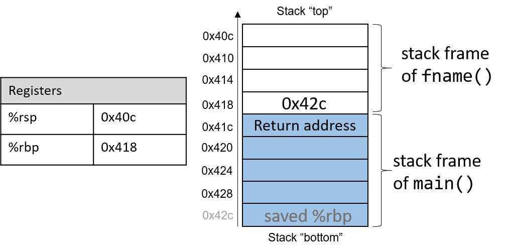

**图 1.** 栈帧的管理

*Figure 1. Stack frame management*

在[图 1](7.5-functions.html) 中，当前的活动帧属于被调用者函数（`fname`）。栈指针和帧指针之间的内存用于存放局部变量。随着局部值被压入和弹出栈，栈指针会移动。与之不同，帧指针相对保持不变，指向当前栈帧的开头（底部）。因此，像 GCC 这样的编译器通常相对于帧指针来引用栈上的值。在[图 1](7.5-functions.html) 中，活动帧的下边界是 `fname` 的基址指针，即栈地址 0x418。存放在地址 0x418 处的值是「保存的」`%rbp` 值（0x42c），它本身是一个地址，表示 `main` 函数活动帧的底部。`main` 活动帧的顶部以**返回地址**（return address）为界，返回地址表示被调用函数 `fname` 执行完毕后，程序在 `main` 函数中从哪里继续执行。

> In [Figure 1](7.5-functions.html), the current active frame belongs to the callee function (`fname`). The memory between the stack pointer and the frame pointer is used for local variables. The stack pointer moves as local values are pushed and popped from the stack. In contrast, the frame pointer remains relatively constant, pointing to the beginning (the bottom) of the current stack frame. As a result, compilers like GCC commonly reference values on the stack relative to the frame pointer. In [Figure 1](7.5-functions.html), the active frame is bounded below by the base pointer of `fname`, which is stack address 0x418. The value stored at address 0x418 is the "saved" `%rbp` value (0x42c), which itself is an address that indicates the bottom of the activation frame for the `main` function. The top of the activation frame of `main` is bounded by the **return address**, which indicates where in the `main` function program execution resumes once the callee function `fname` finishes executing.

> [!WARNING] 原书警示 · 返回地址指向代码段内存，而不是栈内存（The return address points to code segment memory, not stack memory）
> 回想一下，程序的调用栈区域（栈内存）与其代码区域（代码段内存）是不同的。`%rbp` 和 `%rsp` 指向栈内存中的地址，而 `%rip` 指向*代码*段内存中的地址。换句话说，返回地址是代码段内存中的一个地址，而不是栈内存中的地址：
>
> 
>
> *图示：程序地址空间的组成部分*
>
> > Recall that the call stack region (stack memory) of a program is different from its code region (code segment memory). While `%rbp` and `%rsp` point to addresses in the stack memory, `%rip` points to an address in *code* segment memory. In other words, the return address is an address in code segment memory, not stack memory:
> >
> >
> >
> > *Figure 2. The parts of a program’s address space*

[表 1](7.5-functions.html) 列出了编译器用于基本函数管理的另外几条指令。

> [Table 1](7.5-functions.html) contains several additional instructions that the compiler uses for basic function management.

**表 1.** 常用的函数管理指令

*Table 1. Common Function Management Instructions*

**指令**

> **Instruction**

`leaveq`

> `leaveq`

**含义**

> **Translation**

为离开函数准备好栈。等价于：

> Prepares the stack for leaving a function. Equivalent to:

```
mov %rbp, %rsp
pop %rbp
```

**指令**

> **Instruction**

`callq addr <fname>`

> `callq addr <fname>`

**含义**

> **Translation**

把活动帧切换到被调用者函数。等价于：

> Switches active frame to callee function. Equivalent to:

```
push %rip
mov addr, %rip
```

**指令**

> **Instruction**

`retq`

> `retq`

**含义**

> **Translation**

把活动帧恢复为调用者函数。等价于：

> Restores active frame to caller function. Equivalent to:

```
pop %rip
```

例如，`leaveq` 指令是编译器在准备离开函数时，用来恢复栈指针和帧指针的简写形式。当被调用函数执行完毕时，`leaveq` 确保帧指针被*恢复*为之前的值。

> For example, the `leaveq` instruction is a shorthand that the compiler uses to restore the stack and frame pointers as it prepares to leave a function. When the callee function finishes execution, `leaveq` ensures that the frame pointer is *restored* to its previous value.

`callq` 和 `retq` 指令在一个函数调用另一个函数的过程中起着重要作用。两条指令都会修改指令指针（寄存器 `%rip`）。当调用者函数执行 `callq` 指令时，`%rip` 的当前值被保存到栈上，作为返回地址，即被调用函数执行完毕后调用者继续执行的程序地址。`callq` 指令还会用被调用函数的地址替换 `%rip` 的值。

> The `callq` and `retq` instructions play a prominent role in the process where one function calls another. Both instructions modify the instruction pointer (register `%rip`). When the caller function executes the `callq` instruction, the current value of `%rip` is saved on the stack to represent the return address, or the program address at which the caller resumes executing once the callee function finishes. The `callq` instruction also replaces the value of `%rip` with the address of the callee function.

`retq` 指令把 `%rip` 的值恢复为保存在栈上的值，确保程序在调用者函数中指定的程序地址处继续执行。被调用者返回的任何值都存放在 `%rax` 或它的某个组成部分寄存器（例如 `%eax`）中。`retq` 指令通常是任何函数中执行的最后一条指令。

> The `retq` instruction restores the value of `%rip` to the value saved on the stack, ensuring that the program resumes execution at the program address specified in the caller function. Any value returned by the callee is stored in `%rax` or one of its component registers (e.g., `%eax`). The `retq` instruction is usually the last instruction that executes in any function.

### 7.5.1. 函数参数

*7.5.1. Function Parameters*

与 IA32 不同，函数参数通常在函数调用之前就被预先加载到寄存器中。[表 2](7.5-functions.html) 列出了函数的各个参数，以及在函数调用之前它们被加载到的寄存器（如果有的话）。

> Unlike IA32, function parameters are typically preloaded into registers prior to a function call. [Table 2](7.5-functions.html) lists the parameters to a function and the register (if any) that they are loaded into prior to a function call.

**表 2.** 函数参数的位置

*Table 2. Locations of Function Parameters.*

| 参数 | 位置 |
|--------------|---------------|
| 参数 1 | %rdi |
| 参数 2 | %rsi |
| 参数 3 | %rdx |
| 参数 4 | %rcx |
| 参数 5 | %r8 |
| 参数 6 | %r9 |
| 参数 7 及以后 | 调用栈上 |

> | Parameter    | Location      |
> |--------------|---------------|
> | Parameter 1  | %rdi          |
> | Parameter 2  | %rsi          |
> | Parameter 3  | %rdx          |
> | Parameter 4  | %rcx          |
> | Parameter 5  | %r8           |
> | Parameter 6  | %r9           |
> | Parameter 7+ | on call stack |

函数的前六个参数依次被加载到寄存器 `%rdi`、`%rsi`、`%rdx`、`%rcx`、`%r8` 和 `%r9` 中。其余的参数按照各自的大小依次被加载到调用栈上（32 位数据以 4 字节为偏移，64 位数据以 8 字节为偏移）。

> The first six parameters to a function are loaded into registers `%rdi`, `%rsi`, `%rdx`, `%rcx`, `%r8`, and `%r9`, respectively. Any additional parameters are successively loaded into the call stack based on their size (4 byte offsets for 32-bit data, 8 byte offsets for 64-bit data).

> [!NOTE] 译注
> 这是 Linux、macOS 等系统在 x86-64 上遵循的 System V AMD64 调用约定，栈上传递的参数实际上每个都占 8 字节的槽位。Windows x64 用的是另一套约定：只有前四个整数参数用寄存器传递（`rcx`、`rdx`、`r8`、`r9`）。

### 7.5.2. 跟踪一个例子

*7.5.2. Tracing Through an Example*

运用关于函数管理的知识，我们来跟踪本章开头首次介绍的那个代码示例。注意，我们在每个函数定义的参数列表中加上了 `void` 关键字，指明这些函数不接收参数。这一改动不会改变程序的输出，但确实会简化对应的汇编。

> Using our knowledge of function management, let’s trace through the code example first introduced at the beginning of this chapter. Note that the `void` keyword is added to the parameter list of each function definition to specify that the functions take no arguments. This change does not modify the output of the program; however, it does simplify the corresponding assembly.

```
#include <stdio.h>

int assign(void) {
    int y = 40;
    return y;
}

int adder(void) {
    int a;
    return a + 2;
}

int main(void) {
    int x;
    assign();
    x = adder();
    printf("x is: %d\n", x);
    return 0;
}
```

我们用命令 `gcc -o prog prog.c` 编译这段代码，并用 `objdump -d` 查看底层的汇编。后一条命令会输出一个相当大的文件，里面有很多我们不需要的信息。用 `less` 及其搜索功能提取出 `adder`、`assign` 和 `main` 函数：

> We compile this code with the command `gcc -o prog prog.c` and use `objdump -d` to view the underlying assembly. The latter command outputs a pretty big file that contains a lot of information that we don’t need. Use `less` and the search functionality to extract the `adder`, `assign`, and `main` functions:

```
0000000000400526 <assign>:
  400526:       55                      push   %rbp
  400527:       48 89 e5                mov    %rsp,%rbp
  40052a:       c7 45 fc 28 00 00 00    movl   $0x28,-0x4(%rbp)
  400531:       8b 45 fc                mov    -0x4(%rbp),%eax
  400534:       5d                      pop    %rbp
  400535:       c3                      retq

0000000000400536 <adder>:
  400536:       55                      push   %rbp
  400537:       48 89 e5                mov    %rsp,%rbp
  40053a:       8b 45 fc                mov    -0x4(%rbp),%eax
  40053d:       83 c0 02                add    $0x2,%eax
  400540:       5d                      pop    %rbp
  400541:       c3                      retq

0000000000400542 <main>:
  400542:       55                      push   %rbp
  400543:       48 89 e5                mov    %rsp,%rbp
  400546:       48 83 ec 10             sub    $0x10,%rsp
  40054a:       e8 e3 ff ff ff          callq  400526 <assign>
  40054f:       e8 d2 ff ff ff          callq  400536 <adder>
  400554:       89 45 fc                mov    %eax,-0x4(%rbp)
  400557:       8b 45 fc                mov    -0x4(%rbp),%eax
  40055a:       89 c6                   mov    %eax,%esi
  40055c:       bf 04 06 40 00          mov    $0x400604,%edi
  400561:       b8 00 00 00 00          mov    $0x0,%eax
  400566:       e8 95 fe ff ff          callq  400400 <printf@plt>
  40056b:       b8 00 00 00 00          mov    $0x0,%eax
  400570:       c9                      leaveq
  400571:       c3                      retq
```

每个函数都以一个符号标签开头，它对应于该函数在程序中声明的名字。例如，`<main>:` 是 `main` 函数的符号标签。函数标签的地址也就是该函数第一条指令的地址。为了在下面的图中节省空间，我们把地址截断为低 12 位。所以，程序地址 0x400542 显示为 0x542。

> Each function begins with a symbolic label that corresponds to its declared name in the program. For example, `<main>:` is the symbolic label for the `main` function. The address of a function label is also the address of the first instruction in that function. To save space in the figures below, we truncate addresses to the lower 12 bits. So, program address 0x400542 is shown as 0x542.

### 7.5.3. 跟踪 main

*7.5.3. Tracing Through main*

[图 3](7.5-functions.html) 展示了紧接在 `main` 执行之前的执行栈。

> [Figure 3](7.5-functions.html) shows the execution stack immediately prior to the execution of `main`.

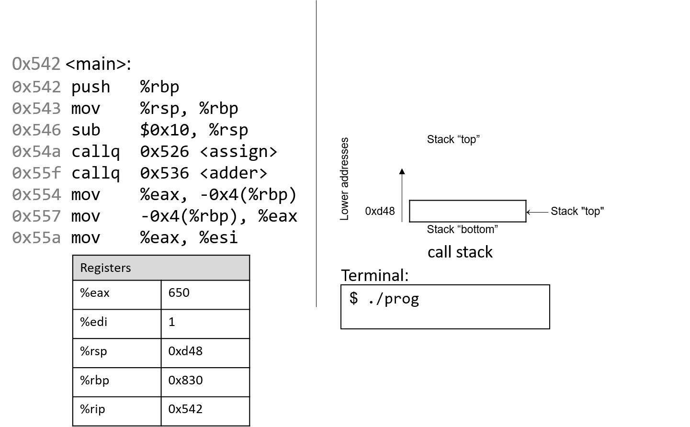

**图 3.** 执行 main 函数之前 CPU 寄存器和调用栈的初始状态

*Figure 3. The initial state of the CPU registers and call stack prior to executing the main function*

回想一下，栈向较低的地址增长。在这个例子中，`%rbp` 最初是栈地址 0x830，`%rsp` 最初是栈地址 0xd48。这两个值都是为这个例子编造的。

> Recall that the stack grows toward lower addresses. In this example, `%rbp` initially is stack address 0x830, and `%rsp` initially is stack address 0xd48. Both of these values are made up for this example.

由于前面示例中的函数使用的是整数数据，我们突出显示组成部分寄存器 `%eax` 和 `%edi`，它们最初存放的是垃圾值。红色（左上角）箭头指示当前正在执行的指令。最初，`%rip` 中存放的是地址 0x542，即 `main` 函数第一行的程序内存地址。

> Since the functions shown in the previous example utilize integer data, we highlight component registers `%eax` and `%edi`, which initially contain junk values. The red (upper-left) arrow indicates the currently executing instruction. Initially, `%rip` contains address 0x542, which is the program memory address of the first line in the `main` function.

------------------------------------------------------------------------

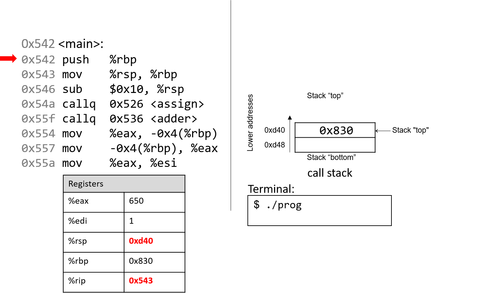

第一条指令通过把 0x830 压入栈来保存 `%rbp` 的当前值。由于栈向较低的地址增长，栈指针 `%rsp` 被更新为 0xd40，比 0xd48 小 8 个字节。`%rip` 前进到顺序中的下一条指令。

> The first instruction saves the current value of `%rbp` by pushing 0x830 onto the stack. Since the stack grows toward lower addresses, the stack pointer `%rsp` is updated to 0xd40, which is 8 bytes less than 0xd48. `%rip` advances to the next instruction in sequence.

------------------------------------------------------------------------


下一条指令（`mov %rsp, %rbp`）把 `%rbp` 的值更新为与 `%rsp` 相同。帧指针（`%rbp`）现在指向 `main` 函数栈帧的开头。`%rip` 前进到顺序中的下一条指令。

> The next instruction (`mov %rsp, %rbp`) updates the value of `%rbp` to be the same as `%rsp`. The frame pointer (`%rbp`) now points to the start of the stack frame for the `main` function. `%rip` advances to the next instruction in sequence.

------------------------------------------------------------------------


`sub` 指令从栈指针的地址中减去 0x10，这实际上使栈「增长」了 16 个字节，我们在图中用栈上的两个 8 字节位置来表示。因此寄存器 `%rsp` 的新值是 0xd30。`%rip` 前进到顺序中的下一条指令。

> The `sub` instruction subtracts 0x10 from the address of our stack pointer, which essentially causes the stack to "grow" by 16 bytes, which we represent by showing two 8-byte locations on the stack. Register `%rsp` therefore has the new value of 0xd30. `%rip` advances to the next instruction in sequence.

------------------------------------------------------------------------

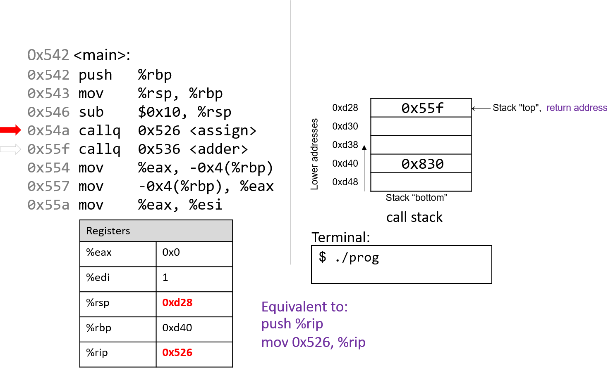

`callq <assign>` 指令把寄存器 `%rip` 中的值（它表示*下一条*要执行的指令的地址）压入栈。由于 `callq <assign>` 之后的下一条指令的地址是 0x55f，这个值作为返回地址被压入栈。回想一下，返回地址表示程序执行返回到 `main` 时应当从哪个程序地址继续执行。

> The `callq <assign>` instruction pushes the value inside register `%rip` (which denotes the address of the *next* instruction to execute) onto the stack. Since the next instruction after `callq <assign>` has an address of 0x55f, that value is pushed onto the stack as the return address. Recall that the return address indicates the program address where execution should resume when program execution returns to `main`.

> [!NOTE] 译注
> 对照上面的 `objdump` 输出，`callq <assign>` 位于 0x40054a，它的下一条指令（`callq <adder>`）位于 0x40054f，所以截断后的返回地址应为 0x54f 而不是 0x55f。下文「`%rip` 前进到地址 0x55f 处的 `callq` 指令」中的 0x55f 同样应为 0x54f。

接着，`callq` 指令把 `assign` 函数的地址（0x526）移入寄存器 `%rip`，表示程序的执行应当继续进入被调用函数 `assign`，而不是 `main` 中的下一条指令。

> Next, the `callq` instruction moves the address of the `assign` function (0x526) into register `%rip`, signifying that program execution should continue into the callee function `assign` and not the next instruction in `main`.

------------------------------------------------------------------------

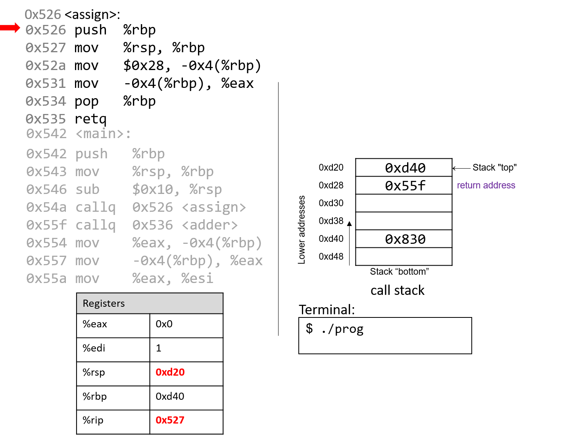

`assign` 函数中执行的前两条指令是每个函数都要做的例行簿记工作。第一条指令把 `%rbp` 中存放的值（内存地址 0xd40）压入栈。回想一下，这个地址指向 `main` 栈帧的开头。`%rip` 前进到 `assign` 中的第二条指令。

> The first two instructions that execute in the `assign` function are the usual book-keeping that every function performs. The first instruction pushes the value stored in `%rbp` (memory address 0xd40) onto the stack. Recall that this address points to the beginning of the stack frame for `main`. `%rip` advances to the second instruction in `assign`.

------------------------------------------------------------------------


下一条指令（`mov %rsp, %rbp`）把 `%rbp` 更新为指向栈顶，标志着 `assign` 栈帧的开始。指令指针（`%rip`）前进到 `assign` 函数中的下一条指令。

> The next instruction (`mov %rsp, %rbp`) updates `%rbp` to point to the top of the stack, marking the beginning of the stack frame for `assign`. The instruction pointer (`%rip`) advances to the next instruction in the `assign` function.

------------------------------------------------------------------------

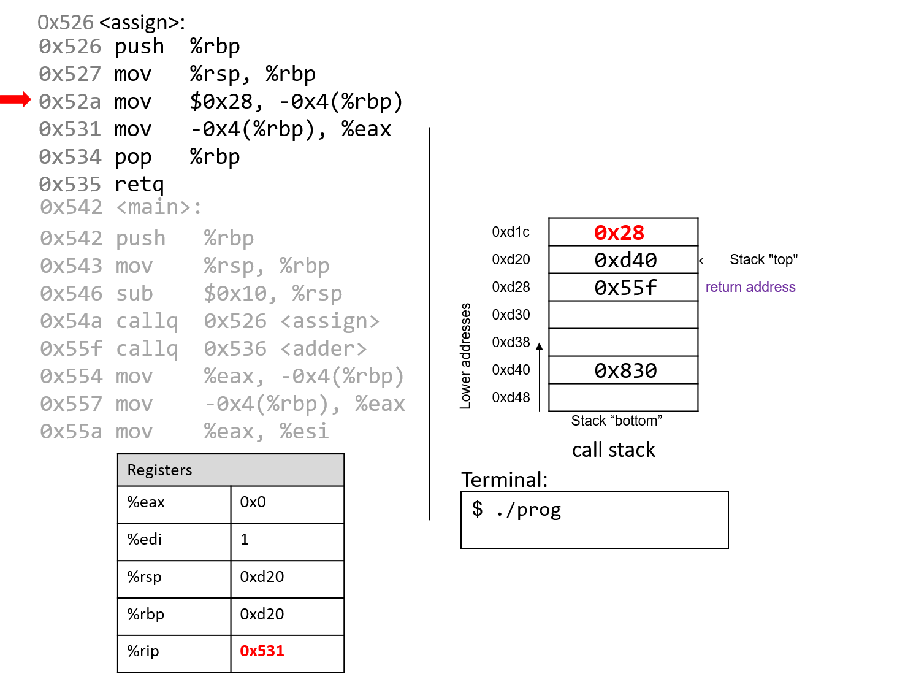

地址 0x52a 处的 `mov` 指令把值 `$0x28`（即 40）移到栈上的地址 `-0x4(%rbp)` 处，这个位置在帧指针上方四个字节。回想一下，帧指针通常用来引用栈上的位置。不过要记住，这个操作不会改变 `%rsp` 的值——栈指针仍然指向地址 0xd20。寄存器 `%rip` 前进到 `assign` 函数中的下一条指令。

> The `mov` instruction at address 0x52a moves the value `$0x28` (or 40) onto the stack at address `-0x4(%rbp)`, which is four bytes above the frame pointer. Recall that the frame pointer is commonly used to reference locations on the stack. However, keep in mind that this operation does not change the value of `%rsp` — the stack pointer still points to address 0xd20. Register `%rip` advances to the next instruction in the `assign` function.

------------------------------------------------------------------------

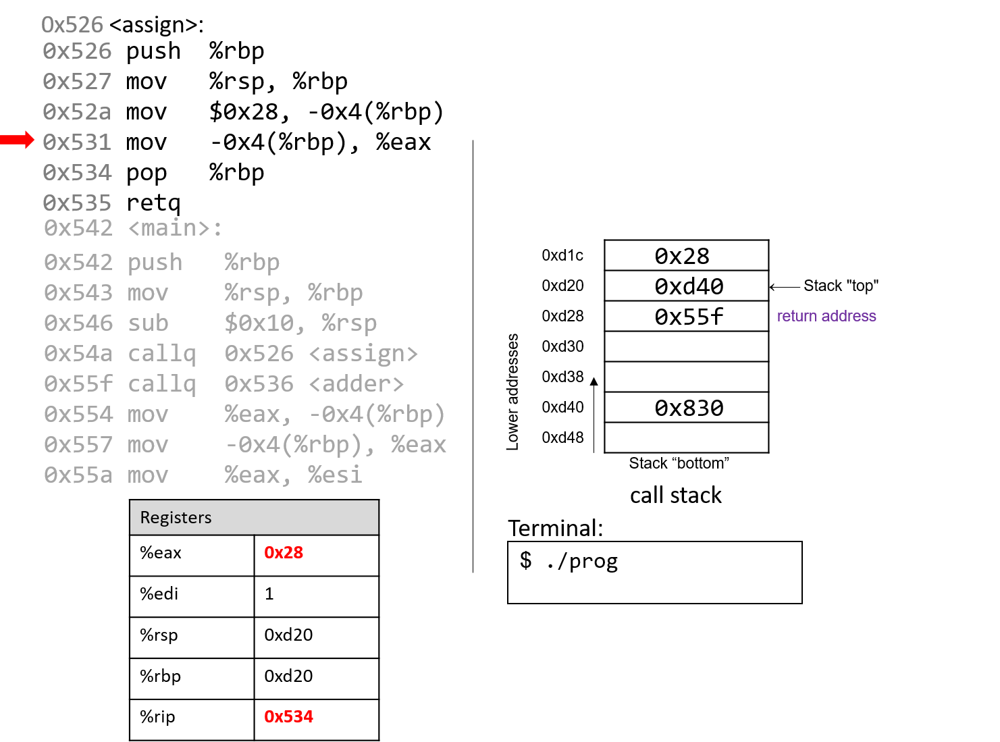

地址 0x531 处的 `mov` 指令把值 `$0x28` 放入寄存器 `%eax`，它存放函数的返回值。`%rip` 前进到 `assign` 函数中的 `pop` 指令。

> The `mov` instruction at address 0x531 places the value `$0x28` into register `%eax`, which holds the return value of the function. `%rip` advances to the `pop` instruction in the `assign` function.

------------------------------------------------------------------------

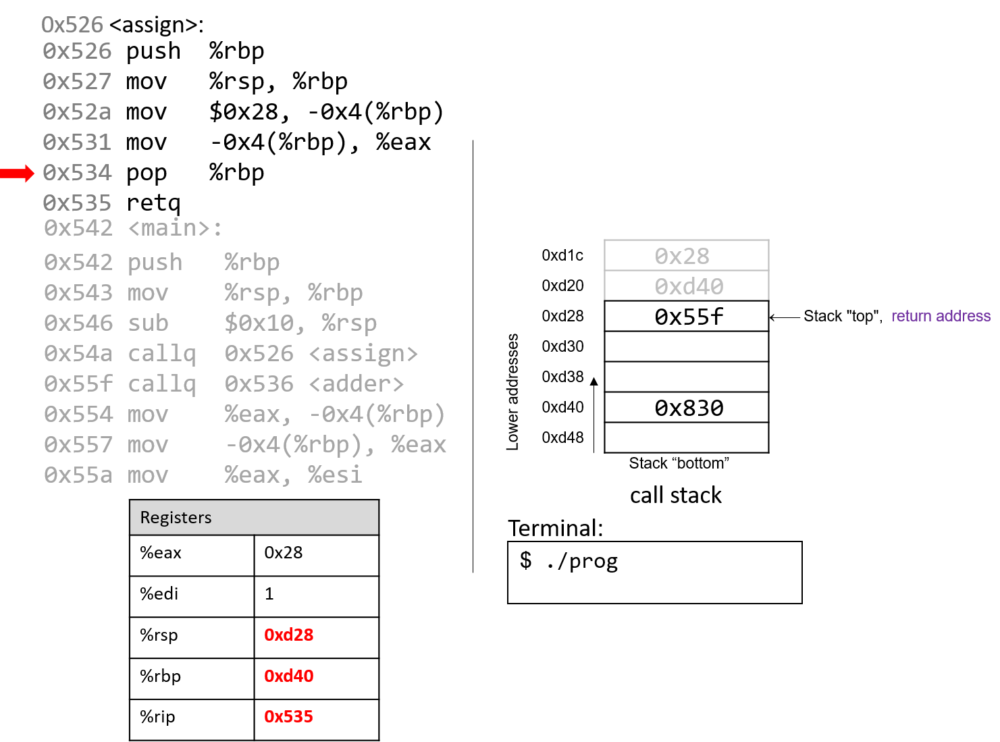

此时，`assign` 函数几乎已经执行完毕。接下来执行的指令是 `pop %rbp`，它把 `%rbp` 恢复为之前的值，即 0xd40。由于 `pop` 指令会修改栈指针，`%rsp` 被更新为 0xd28。

> At this point, the `assign` function has almost completed execution. The next instruction that executes is `pop %rbp`, which restores `%rbp` to its previous value, or 0xd40. Since the `pop` instruction modifies the stack pointer, `%rsp` updates to 0xd28.

------------------------------------------------------------------------

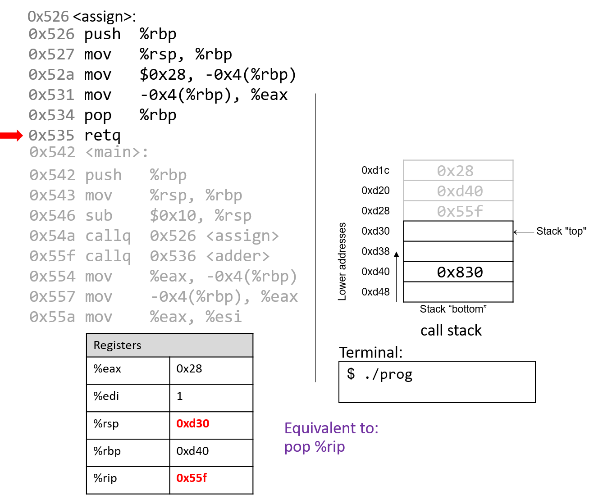

`assign` 中的最后一条指令是 `retq`。`retq` 执行时，返回地址被从栈中弹出到寄存器 `%rip`。在我们的例子中，`%rip` 现在前进到指向 `main` 中位于地址 0x55f 处的 `callq` 指令。

> The last instruction in `assign` is a `retq` instruction. When `retq` executes, the return address is popped off the stack into register `%rip`. In our example, `%rip` now advances to point to the `callq` instruction in `main` at address 0x55f.

此时有几件重要的事值得注意：

> Some important things to notice at this juncture:

- 栈指针和帧指针都已恢复为调用 `assign` 之前的值，这表明 `main` 的栈帧再次成为活动帧。

> - The stack pointer and the frame pointer have been restored to their values prior to the call to `assign`, reflecting that the stack frame for `main` is once again the active frame.

- 之前那个活动栈帧中的旧值*并没有*被移除，它们仍然存在于调用栈上。

> - The old values on the stack from the prior active stack frame are *not* removed. They still exist on the call stack.

------------------------------------------------------------------------

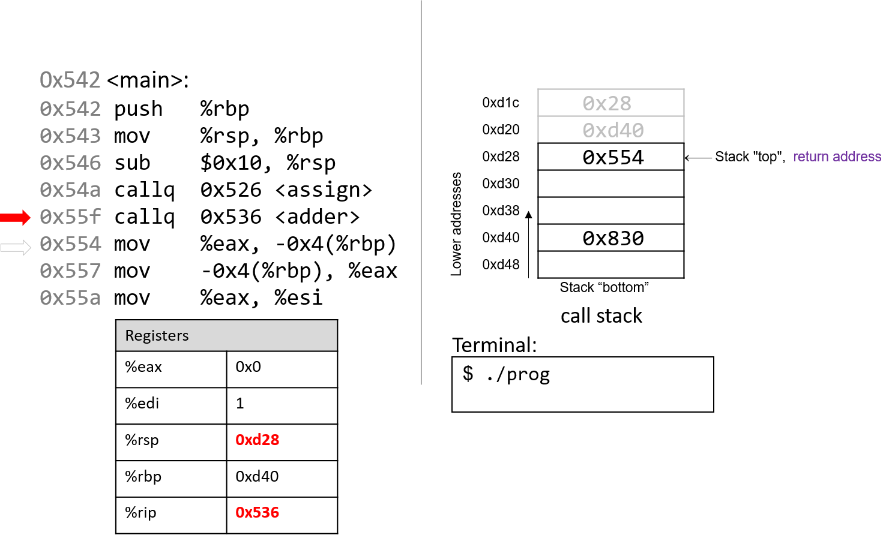

回到 `main` 中，对 `adder` 的调用用一个新的返回地址（0x554）*覆盖*了栈上旧的返回地址。这个返回地址指向 `adder` 返回后要执行的下一条指令，即 `mov %eax, -0x4(%rbp)`。寄存器 `%rip` 更新为指向 `adder` 中要执行的第一条指令，它位于地址 0x536。

> Back in `main`, the call to `adder` *overwrites* the old return address on the stack with a new return address (0x554). This return address points to the next instruction to be executed after `adder` returns, or `mov %eax, -0x4(%rbp)`. Register `%rip` updates to point to the first instruction to execute in `adder`, which is at address 0x536.

------------------------------------------------------------------------

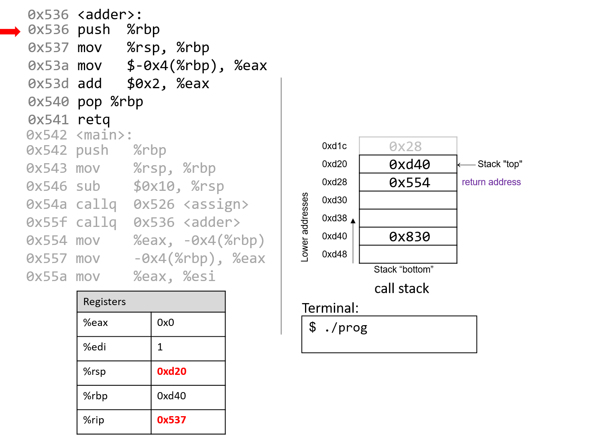

`adder` 函数中的第一条指令把调用者的帧指针（`main` 的 `%rbp`）保存到栈上。

> The first instruction in the `adder` function saves the caller’s frame pointer (`%rbp` of `main`) on the stack.

------------------------------------------------------------------------


下一条指令用 `%rsp` 的当前值（即地址 0xd20）更新 `%rbp`。这两条指令共同确立了 `adder` 栈帧的开始。

> The next instruction updates `%rbp` with the current value of `%rsp`, or address 0xd20. Together, these last two instructions establish the beginning of the stack frame for `adder`.

------------------------------------------------------------------------

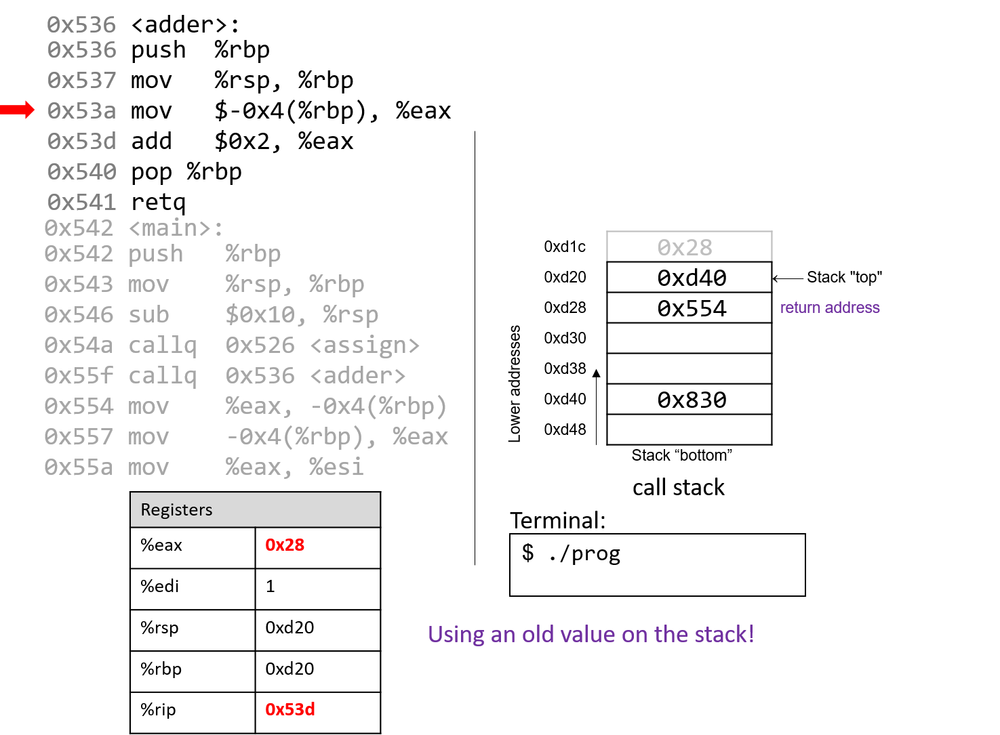

请密切注意接下来执行的这条指令。回想一下，在调用 `assign` 期间，`$0x28` 被放到了栈上。`mov $-0x4(%rbp), %eax` 指令把栈上的一个*旧*值移入了寄存器 `%eax`！如果程序员在 `adder` 函数中初始化了变量 `a`，就不会发生这种情况。

> Pay close attention to the next instruction that executes. Recall that `$0x28` was placed on the stack during the call to `assign`. The `mov $-0x4(%rbp), %eax` instruction moves an *old* value that is on the stack into register `%eax`! This would not have occurred if the programmer had initialized variable `a` in the `adder` function.

------------------------------------------------------------------------

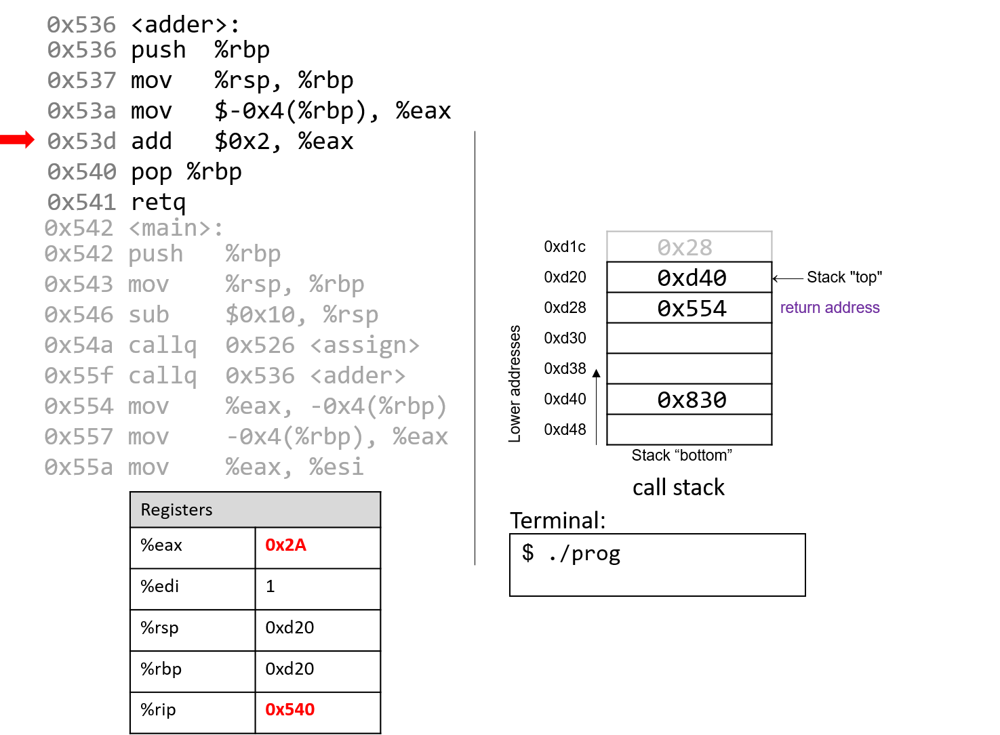

地址 0x53d 处的 `add` 指令把寄存器 `%eax` 加 2。回想一下，返回 32 位整数时，x86-64 使用的是组成部分寄存器 `%eax` 而不是 `%rax`。最后这两条指令合起来，等价于 `adder` 中的如下代码：

> The `add` instruction at address 0x53d adds 2 to register `%eax`. Recall that when a 32-bit integer is being returned, x86-64 utilizes component register `%eax` instead of `%rax`. Together the last two instructions are equivalent to the following code in `adder`:

```
int a;
return a + 2;
```

------------------------------------------------------------------------

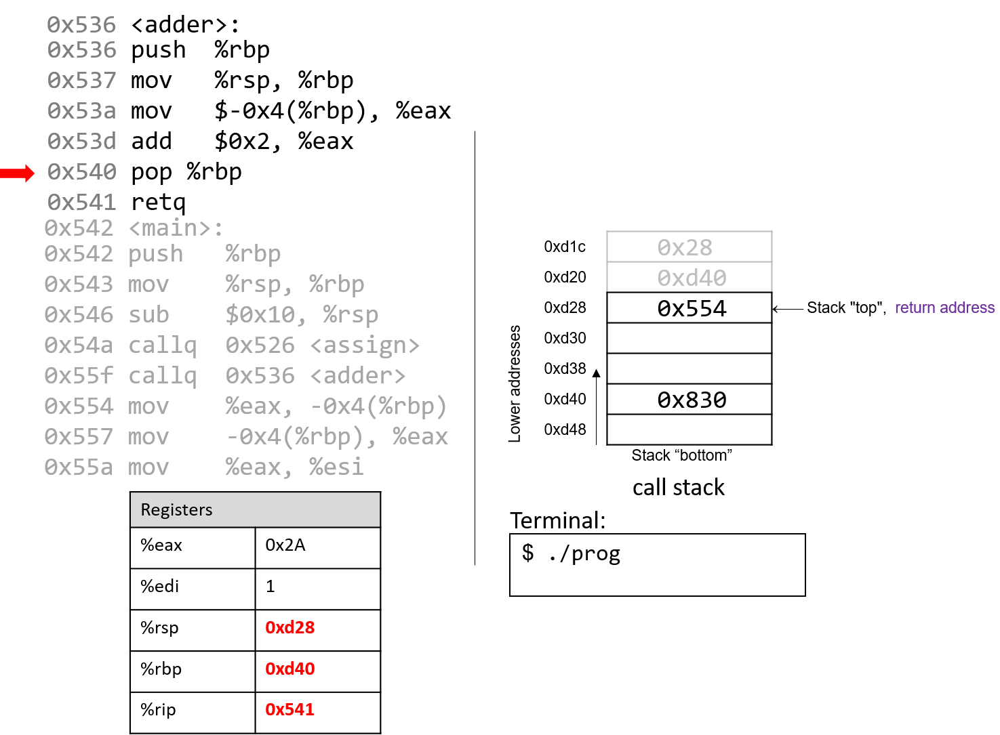

`pop` 执行之后，帧指针再次指向 `main` 栈帧的开头，即地址 0xd40。栈指针现在存放的是地址 0xd28。

> After `pop` executes, the frame pointer again points to the beginning of the stack frame for `main`, or address 0xd40. The stack pointer now contains the address 0xd28.

------------------------------------------------------------------------

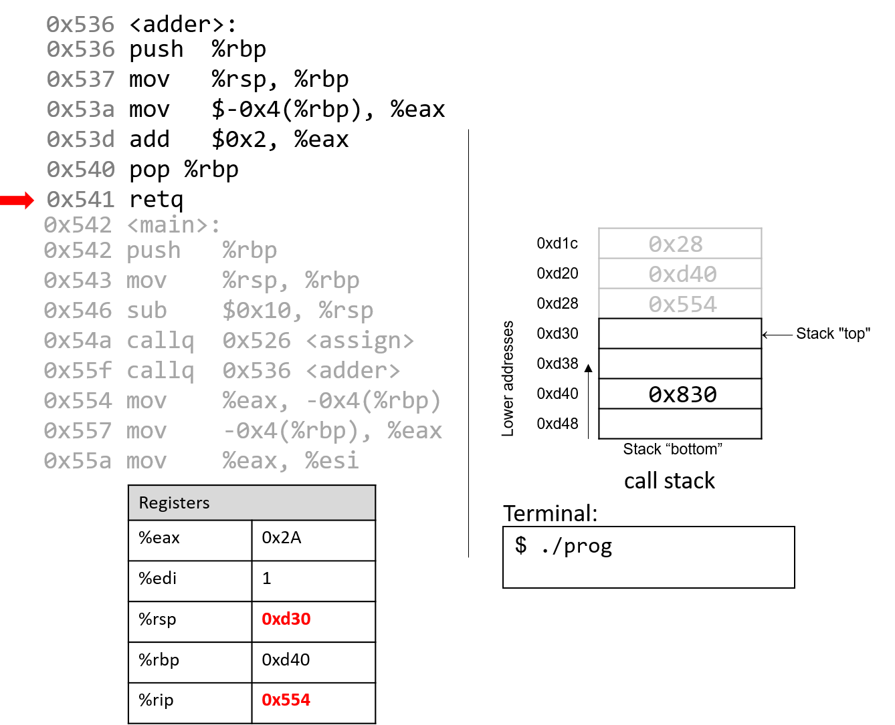

`retq` 的执行把返回地址从栈中弹出，把指令指针恢复为 0x554，即 `main` 中下一条要执行的指令的地址。`%rsp` 中存放的地址现在是 0xd30。

> The execution of `retq` pops the return address off the stack, restoring the instruction pointer back to 0x554, or the address of the next instruction to execute in `main`. The address contained in `%rsp` is now 0xd30.

------------------------------------------------------------------------

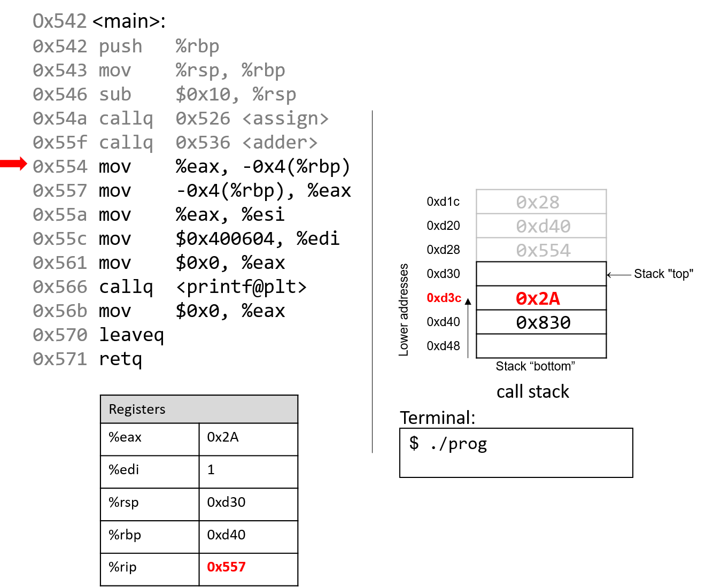

回到 `main` 中，`mov %eax, -0x4(%rbp)` 指令把 `%eax` 中的值放到 `%rbp` 上方四个字节的位置，即地址 0xd3c。下一条指令又把它放回寄存器 `%eax`。

> Back in `main`, the `mov %eax, -0x4(%rbp)` instruction places the value in `%eax` at a location four bytes above `%rbp`, or at address 0xd3c. The next instruction replaces it back into register `%eax`.

------------------------------------------------------------------------

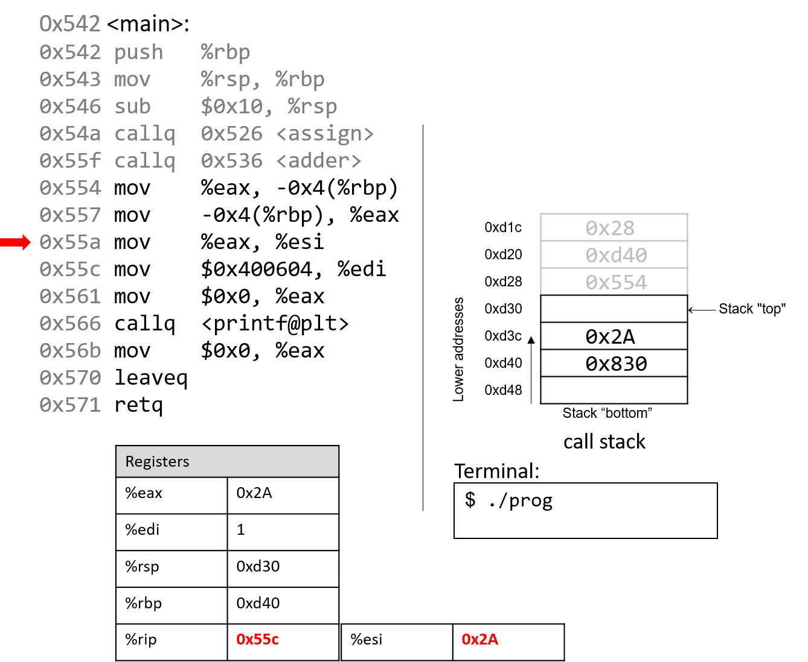

稍微往后跳一点，地址 0x55a 处的 `mov` 指令把 `%eax` 中的值（即 0x2A）复制到寄存器 `%esi`，它是与 `%rsi` 对应的 32 位组成部分寄存器，通常存放函数的第二个参数。

> Skipping ahead a little, the `mov` instruction at address 0x55a copies the value in `%eax` (or 0x2A) to register `%esi`, which is the 32-bit component register associated with `%rsi` and typically stores the second parameter to a function.

------------------------------------------------------------------------

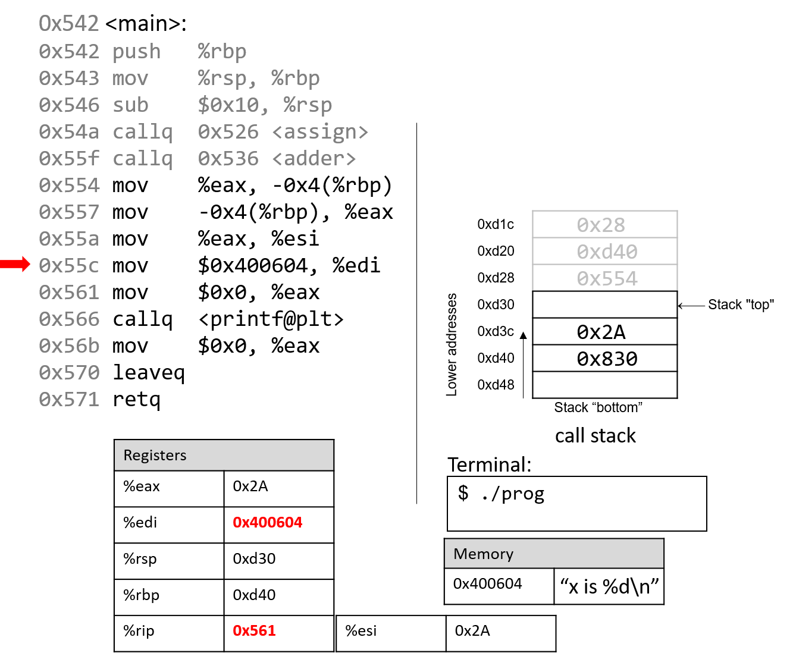

下一条指令（`mov $0x400604, %edi`）把一个常数值（代码段内存中的一个地址）复制到寄存器 `%edi`。回想一下，寄存器 `%edi` 是 `%rdi` 的 32 位组成部分寄存器，通常存放函数的第一个参数。代码段内存地址 0x400604 是字符串 `"x is %d\n"` 的基地址。

> The next instruction (`mov $0x400604, %edi`) copies a constant value (an address in code segment memory) to register `%edi`. Recall that register `%edi` is the 32-bit component register of `%rdi`, which typically stores the first parameter to a function. The code segment memory address 0x400604 is the base address of the string `"x is %d\n"`.

------------------------------------------------------------------------

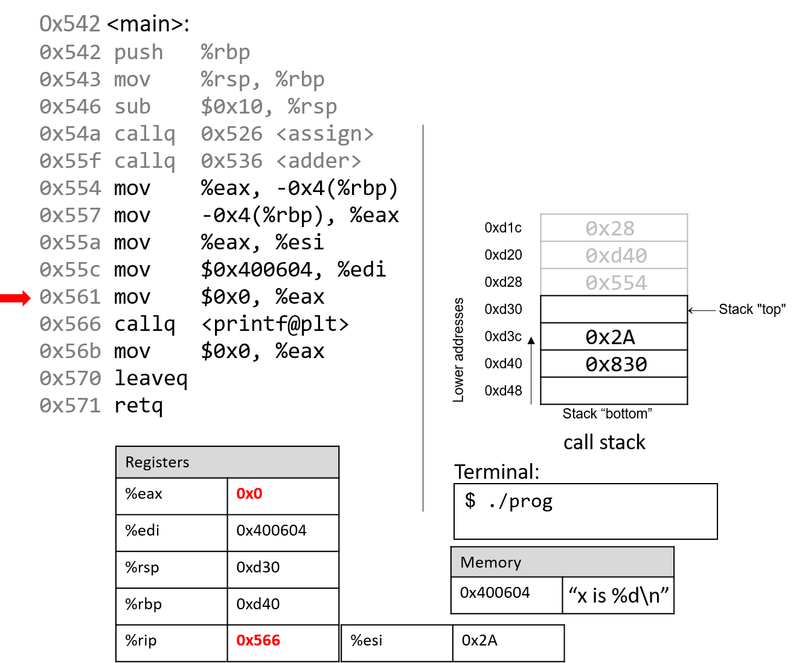

下一条指令把寄存器 `%eax` 重置为 0。指令指针前进到对 `printf` 函数的调用处（用标签 `<printf@plt>` 表示）。

> The next instruction resets register `%eax` with the value 0. The instruction pointer advances to the call to the `printf` function (which is denoted with the label `<printf@plt>`).

> [!NOTE] 译注
> 调用 `printf` 这样的可变参数函数之前把 `%eax` 清零，并不是随手之举：System V AMD64 调用约定规定，调用可变参数函数时 `%al` 中要存放用向量寄存器（`%xmm0`–`%xmm7`）传递的浮点参数个数，这里没有浮点参数，所以是 0。

------------------------------------------------------------------------

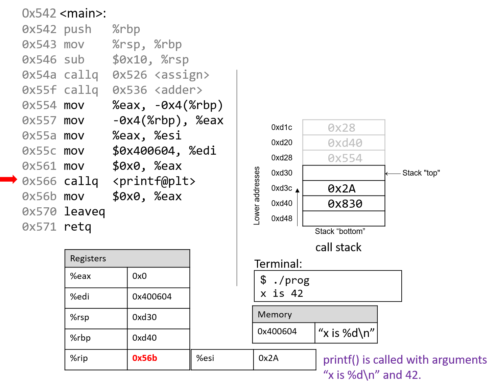

下一条指令调用 `printf` 函数。为了简洁起见，我们不跟踪 `printf` 函数，它是 `stdio.h` 的一部分。不过，从手册页（`man -s3 printf`）我们知道 `printf` 的格式如下：

> The next instruction calls the `printf` function. For the sake of brevity, we will not trace the `printf` function, which is part of `stdio.h`. However, we know from the manual page (`man -s3 printf`) that `printf` has the following format:

```
int printf(const char * format, ...)
```

换句话说，第一个参数是指向指定格式的字符串的指针，从第二个参数开始是格式中要用到的值。地址 0x55a–0x566 所指定的那些指令对应于 `main` 函数中的下面这一行：

> In other words, the first argument is a pointer to a string specifying the format, and the second argument onward specify the values that are used in that format. The instructions specified by addresses 0x55a - 0x566 correspond to the following line in the `main` function:

```
printf("x is %d\n", x);
```

调用 `printf` 函数时：

> When the `printf` function is called:

- 一个指定 `printf` 调用之后要执行的指令的返回地址被压入栈。

> - A return address specifying the instruction that executes after the call to `printf` is pushed onto the stack.

- `%rbp` 的值被压入栈，`%rbp` 被更新为指向栈顶，表示 `printf` 栈帧的开始。

> - The value of `%rbp` is pushed onto the stack, and `%rbp` is updated to point to the top of the stack, indicating the beginning of the stack frame for `printf`.

在某个时刻，`printf` 会引用它的参数，即字符串 `"x is %d\n"` 和值 0x2A。第一个参数存放在组成部分寄存器 `%edi` 中，第二个参数存放在组成部分寄存器 `%esi` 中。返回地址位于 `%rbp` 的正下方，即位置 `%rbp+8`。

> At some point, `printf` references its arguments, which are the string `"x is %d\n"` and the value 0x2A. The first parameter is stored in component register `%edi`, and the second parameter is stored in component register `%esi`. The return address is located directly below `%rbp` at location `%rbp+8`.

对于任何有 *n* 个参数的函数，GCC 把前六个参数放在寄存器中（如[表 2](7.5-functions.html) 所示），把其余的参数放在栈上返回地址的*下方*。

> For any function with *n* arguments, GCC places the first six arguments in registers, as shown in [Table 2](7.5-functions.html), and the remaining arguments onto the stack *below* the return address.

调用 `printf` 之后，值 0x2A 以整数格式输出给用户。于是，屏幕上打印出了值 42！

> After the call to `printf`, the value 0x2A is output to the user in integer format. Thus, the value 42 is printed to the screen!

------------------------------------------------------------------------

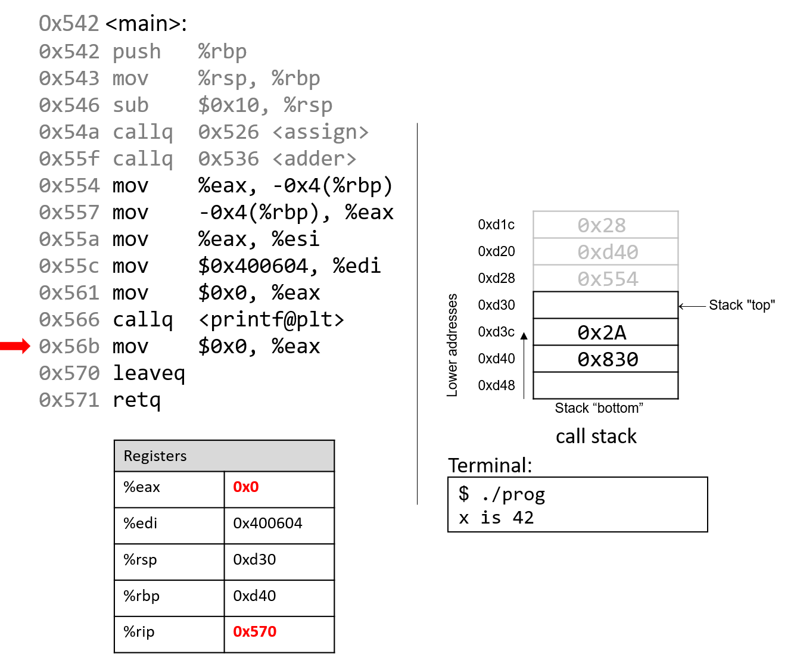

调用 `printf` 之后，最后几条指令清理栈，为从 `main` 函数干净地退出做准备。首先，地址 0x56b 处的 `mov` 指令确保返回寄存器中是 0（因为 `main` 做的最后一件事是返回 0）。

> After the call to `printf`, the last few instructions clean up the stack and prepare a clean exit from the `main` function. First, the `mov` instruction at address 0x56b ensures that 0 is in the return register (since the last thing `main` does is return 0).

------------------------------------------------------------------------

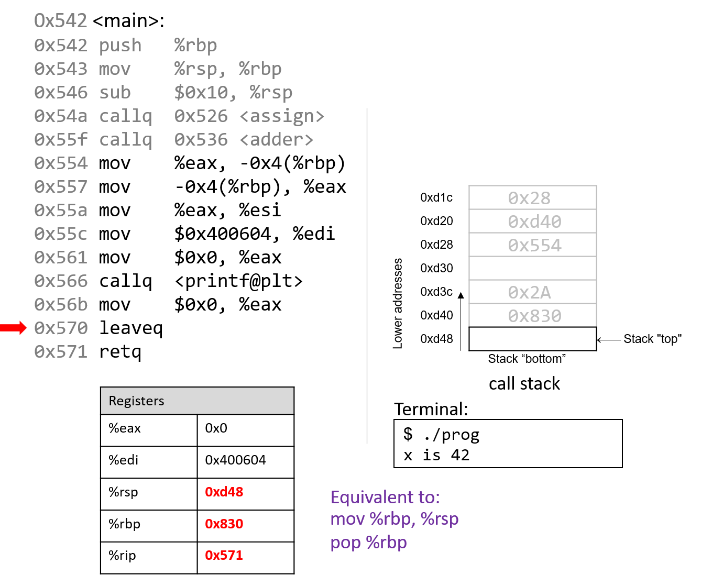

`leaveq` 指令为从函数调用返回准备好栈。回想一下，`leaveq` 相当于下面这一对指令：

> The `leaveq` instruction prepares the stack for returning from the function call. Recall that `leaveq` is analogous to the following pair of instructions:

```
mov %rbp, %rsp
pop %rbp
```

换句话说，CPU 用帧指针覆盖栈指针。在我们的例子中，栈指针先从 0xd30 被更新为 0xd40。接着，CPU 执行 `pop %rbp`，取出位于 0xd40 处的值（在我们的例子中是地址 0x830），放入 `%rbp`。`leaveq` 执行之后，栈指针和帧指针都恢复为执行 `main` 之前的原始值。

> In other words, the CPU overwrites the stack pointer with the frame pointer. In our example, the stack pointer is initially updated from 0xd30 to 0xd40. Next, the CPU executes `pop %rbp`, which takes the value located at 0xd40 (in our example, the address 0x830) and places it in `%rbp`. After `leaveq` executes, the stack and frame pointers revert to their original values prior to the execution of `main`.

最后执行的指令是 `retq`。返回寄存器 `%eax` 中是 0x0，程序返回零，表示正常终止。

> The last instruction that executes is `retq`. With 0x0 in the return register `%eax`, the program returns zero, indicating correct termination.

如果你仔细读完了这一节，就应该明白我们的程序为什么会打印出值 42。从本质上说，程序无意中用到了栈上的旧值，使它表现出我们没有预料到的行为。这个例子还算无害；不过，我们会在后面的小节中讨论黑客是如何滥用函数调用，让程序以真正恶意的方式出错的。

> If you have carefully read through this section, you should understand why our program prints out the value 42. In essence, the program inadvertently uses old values on the stack to cause it to behave in a way that we didn’t expect. This example was pretty harmless; however, we discuss in future sections how hackers have misused function calls to make programs misbehave in truly malicious ways.
