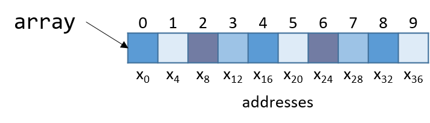

> [!WARNING] 说明
> 本文是个人学习用的**非官方**中英对照译文，原文：<https://diveintosystems.org/book/C7-x86_64/arrays.html>。
> 原书采用 CC BY-NC-ND 4.0 许可（禁止演绎），**请勿公开传播本译文**。
> 标为「译注」「现代更新」的内容是译者补充，不代表原书作者观点；代码与原文逐字一致，未作改动。


*7.7. Arrays*

回想一下，[数组](../C1-C_intro/1.5-arrays_strings.html)是由相同类型的数据元素组成、在内存中连续存放的有序集合。静态分配的[一维数组](../C2-C_depth/2.5-arrays.html)的形式是 `Type arr[N]`，其中 `Type` 是数据类型，`arr` 是与数组关联的标识符，`N` 是数据元素的个数。静态地声明数组 `Type arr[N]`，或者动态地分配 `arr = malloc(N * sizeof(Type))`，都会分配总共 *N* x sizeof(*Type*) 个字节的内存。

> Recall that [arrays](../C1-C_intro/1.5-arrays_strings.html) are ordered collections of data elements of the same type that are contiguously stored in memory. Statically allocated [single-dimension arrays](../C2-C_depth/2.5-arrays.html) have the form `Type arr[N]` where `Type` is the data type, `arr` is the identifier associated with the array, and `N` is the number of data elements. Declaring an array statically as `Type arr[N]` or dynamically as `arr = malloc(N * sizeof(Type))` allocates *N* x sizeof(*Type*) total bytes of memory.

要访问数组 `arr` 中下标为 *i* 的元素，使用语法 `arr[i]`。编译器在翻译成汇编之前，通常会把数组引用转换成[指针运算](../C2-C_depth/2.2-pointers.html)。所以，`arr+i` 等价于 `&arr[i]`，`*(arr+i)` 等价于 `arr[i]`。由于 `arr` 中的每个数据元素都是 `Type` 类型，`arr+i` 意味着元素 *i* 存放在地址 `arr + sizeof(Type) * i` 处。

> To access the element at index *i* in array `arr`, use the syntax `arr[i]`. Compilers commonly convert array references into [pointer arithmetic](../C2-C_depth/2.2-pointers.html) prior to translating to assembly. So, `arr+i` is equivalent to `&arr[i]`, and `*(arr+i)` is equivalent to `arr[i]`. Since each data element in `arr` is of type `Type`, `arr+i` implies that element *i* is stored at address `arr + sizeof(Type) * i`.

[表 1](7.7-arrays.html) 概括了一些常见的数组操作及其对应的汇编指令。在下面的例子中，假设我们声明了一个长度为 10 的 `int` 数组（`int arr[10]`）。假设寄存器 `%rdx` 存放 `arr` 的地址，寄存器 `%rcx` 存放 `int` 值 `i`，寄存器 `%rax` 表示某个变量 `x`（也是 `int` 类型）。回想一下，`int` 变量占四个字节，而 `int *` 变量占八个字节。

> [Table 1](7.7-arrays.html) outlines some common array operations and their corresponding assembly instructions. In the examples that follow, suppose that we declare an `int` array of length 10 (`int arr[10]`). Assume that register `%rdx` stores the address of `arr`, register `%rcx` stores the `int` value `i`, and register `%rax` represents some variable `x` (also of type `int`). Recall that `int` variables take up four bytes of space, whereas `int *` variables take up eight bytes of space.

**表 1.** 常见的数组操作及其对应的汇编表示

*Table 1. Common Array Operations and Their Corresponding Assembly Representations*

| 操作 | 类型 | 汇编表示 |
|----------------|---------|----------------------------|
| `x = arr` | `int *` | `mov %rdx, %rax` |
| `x = arr[0]` | `int` | `mov (%rdx), %eax` |
| `x = arr[i]` | `int` | `mov (%rdx, %rcx,4), %eax` |
| `x = &arr[3]` | `int *` | `lea 0xc(%rdx), %rax` |
| `x = arr+3` | `int *` | `lea 0xc(%rdx), %rax` |
| `x = *(arr+5)` | `int` | `mov 0x14(%rdx), %eax` |

> | Operation      | Type    | Assembly Representation    |
> |----------------|---------|----------------------------|
> | `x = arr`      | `int *` | `mov %rdx, %rax`           |
> | `x = arr[0]`   | `int`   | `mov (%rdx), %eax`         |
> | `x = arr[i]`   | `int`   | `mov (%rdx, %rcx,4), %eax` |
> | `x = &arr[3]`  | `int *` | `lea 0xc(%rdx), %rax`      |
> | `x = arr+3`    | `int *` | `lea 0xc(%rdx), %rax`      |
> | `x = *(arr+5)` | `int`   | `mov 0x14(%rdx), %eax`     |

请密切注意[表 1](7.7-arrays.html) 中每个表达式的*类型*。一般来说，编译器用 `mov` 指令对指针解引用，用 `lea` 指令计算地址。

> Pay close attention to the *type* of each expression in [Table 1](7.7-arrays.html). In general, the compiler uses `mov` instructions to dereference pointers and the `lea` instruction to compute addresses.

注意，要访问元素 `arr[3]`（或者用指针运算写成 `*(arr+3)`），编译器对地址 `arr+3*4` 而不是 `arr+3` 执行内存查找。要理解为什么必须这样，回想一下，数组中下标为 *i* 的任何元素都存放在地址 `arr + sizeof(Type) * i` 处。因此，编译器必须把下标乘以数据类型的大小（在这里是四，因为 `sizeof(int)` = 4）来算出正确的偏移量。再回想一下，内存是按字节寻址的；按正确的字节数偏移，就相当于计算出一个地址。最后，由于 `int` 值只需要 4 个字节的空间，它们被存放在寄存器 `%rax` 的组成部分寄存器 `%eax` 中。

> Notice that to access element `arr[3]` (or `*(arr+3)` using pointer arithmetic), the compiler performs a memory lookup on address `arr+3*4` instead of `arr+3`. To understand why this is necessary, recall that any element at index *i* in an array is stored at address `arr + sizeof(Type) * i`. The compiler must therefore multiply the index by the size of the data type (in this case four, since `sizeof(int)` = 4) to compute the correct offset. Recall also that memory is byte-addressable; offsetting by the correct number of bytes is the same as computing an address. Lastly, because `int` values require only 4 bytes of space, they are stored in component register `%eax` of register `%rax`.

举个例子，考虑一个有 10 个整数元素的示例数组（`array`）（[图 1](7.7-arrays.html)）：

> As an example, consider a sample array (`array`) with 10 integer elements ([Figure 1](7.7-arrays.html)):



**图 1.** 一个 10 元素整数数组在内存中的布局。每个标为 x<sub>i</sub> 的方框代表四个字节。

*Figure 1. The layout of a 10-integer array in memory. Each x<sub>i</sub>-labeled box represents four bytes.*

注意，由于 `array` 是一个整数数组，每个元素恰好占四个字节。因此，一个有 10 个元素的整数数组占用 40 个字节的连续内存。

> Notice that since `array` is an array of integers, each element takes up exactly four bytes. Thus, an integer array with 10 elements consumes 40 bytes of contiguous memory.

要计算元素 3 的地址，编译器把下标 3 乘以整数类型的数据大小（4），得到偏移量 12（即 0xc）。果然，[图 1](7.7-arrays.html) 中的元素 3 位于字节偏移 x<sub>12</sub> 处。

> To compute the address of element 3, the compiler multiplies the index 3 by the data size of the integer type (4) to yield an offset of 12 (or 0xc). Sure enough, element 3 in [Figure 1](7.7-arrays.html) is located at byte offset x<sub>12</sub>.

我们来看一个简单的 C 函数 `sumArray`，它把数组中的所有元素加起来：

> Let’s take a look at a simple C function called `sumArray` that sums up all the elements in an array:

```
int sumArray(int *array, int length) {
    int i, total = 0;
    for (i = 0; i < length; i++) {
        total += array[i];
    }
    return total;
}
```

`sumArray` 函数接收一个数组的地址和数组的长度，把数组中的所有元素加起来。现在来看 `sumArray` 函数对应的汇编：

> The `sumArray` function takes the address of an array and the array’s associated length and sums up all the elements in the array. Now take a look at the corresponding assembly for the `sumArray` function:

```
0x400686 <+0>:	push %rbp                   # save %rbp
0x400687 <+1>:	mov  %rsp,%rbp              # update %rbp (new stack frame)
0x40068a <+4>:	mov  %rdi,-0x18(%rbp)       # copy array to %rbp-0x18
0x40068e <+8>:	mov  %esi,-0x1c(%rbp)       # copy length to %rbp-0x1c
0x400691 <+11>:	movl $0x0,-0x4(%rbp)        # copy 0 to %rbp-0x4 (total)
0x400698 <+18>:	movl $0x0,-0x8(%rbp)        # copy 0 to %rbp-0x8 (i)
0x40069f <+25>:	jmp  0x4006be <sumArray+56> # goto <sumArray+56>
0x4006a1 <+27>:	mov  -0x8(%rbp),%eax        # copy i to %eax
0x4006a4 <+30>:	cltq                        # convert i to a 64-bit integer
0x4006a6 <+32>:	lea  0x0(,%rax,4),%rdx      # copy i*4 to %rdx
0x4006ae <+40>:	mov  -0x18(%rbp),%rax       # copy array to %rax
0x4006b2 <+44>:	add  %rdx,%rax              # compute array+i*4, store in %rax
0x4006b5 <+47>:	mov  (%rax),%eax            # copy array[i] to %eax
0x4006b7 <+49>:	add  %eax,-0x4(%rbp)        # add %eax to total
0x4006ba <+52>:	addl $0x1,-0x8(%rbp)        # add 1 to i (i+=1)
0x4006be <+56>:	mov  -0x8(%rbp),%eax        # copy i to %eax
0x4006c1 <+59>:	cmp  -0x1c(%rbp),%eax       # compare i to length
0x4006c4 <+62>:	jl   0x4006a1 <sumArray+27> # if i<length goto <sumArray+27>
0x4006c6 <+64>:	mov  -0x4(%rbp),%eax        # copy total to %eax
0x4006c9 <+67>:	pop  %rbp                   # prepare to leave the function
0x4006ca <+68>:	retq                        # return total
```

跟踪这段汇编代码时，要考虑被访问的数据代表的是地址还是值。例如，`<sumArray+11>` 处的指令使 `%rbp-0x4` 中存放一个 `int` 类型的变量，它的初值被设为 0。与之不同，存放在 `%rbp-0x18` 处的实参是函数的第一个参数（`array`），它是 `int *` 类型，对应于数组的基地址。另一个变量（我们称之为 `i`）存放在位置 `%rbp-0x8`。最后，注意 `add` 和 `mov` 这样的指令只在必要时才在末尾带上表示大小的后缀。在涉及常数值的情况下，编译器需要明确说明要移动常数的多少个字节。

> When tracing this assembly code, consider whether the data being accessed represents an address or a value. For example, the instruction at `<sumArray+11>` results in `%rbp-0x4` containing a variable of type `int`, which is initially set to 0. In contrast, the argument stored at `%rbp-0x18` is the first argument to the function (`array`) which is of type `int *` and corresponds to the base address of the array. A different variable (which we call `i`) is stored at location `%rbp-0x8`. Lastly, note that size suffixes are included at the end of instructions like `add` and `mov` only when necessary. In cases where constant values are involved, the compiler needs to explicitly state how many bytes of the constant are being moved.

细心的读者会注意到，`<sumArray+30>` 这一行有一条以前没见过的指令 `cltq`。`cltq` 指令代表「convert long to quad」（把长字转换为四字），它把存放在 `%eax` 中的 32 位 `int` 值转换为存放在 `%rax` 中的 64 位整数值。之所以需要这个操作，是因为后面的指令要执行指针运算。回想一下，在 64 位系统上，指针占 8 个字节。编译器使用 `cltq`，确保所有数据都存放在 64 位寄存器而不是 32 位组成部分中，从而简化了这个过程。

> The astute reader will notice a previously unseen instruction at line `<sumArray+30>` called `cltq`. The `cltq` instruction stands for "convert long to quad" and converts the 32-bit `int` value stored in `%eax` to a 64-bit integer value that is stored in `%rax`. This operation is necessary because the instructions that follow perform pointer arithmetic. Recall that on 64-bit systems, pointers take up 8 bytes of space. The compiler’s use of `cltq` simplifies the process by ensuring that all data are stored in 64-bit registers instead of 32-bit components.

我们来仔细看看位置 `<sumArray+32>` 和 `<sumArray+49>` 之间的五条指令：

> Let’s take a closer look at the five instructions between locations `<sumArray+32>` and `<sumArray+49>`:

```
<+32>: lea 0x0(,%rax,4),%rdx       # copy i*4 to %rdx
<+40>: mov -0x18(%rbp),%rax        # copy array to %rax
<+44>: add %rdx,%rax               # add i*4 to array (i.e. array+i) to %rax
<+47>: mov (%rax),%eax             # dereference array+i*4, place in %eax
<+49>: add %eax,-0x4(%rbp)         # add %eax to total (i.e. total+=array[i])
```

回想一下，编译器常用 `lea` 对操作数执行简单的算术运算。操作数 `0x0(,%rax,4)` 的含义是 `%rax*4 + 0x0`。由于 `%rax` 存放着 `i` 的值，这个操作把值 `i*4` 复制到 `%rdx`。此时，`%rdx` 中存放的是计算 `array[i]` 正确偏移量所需的字节数（回想一下，`sizeof(int)` = 4）。

> Recall that the compiler commonly uses `lea` to perform simple arithmetic on operands. The operand `0x0(,%rax,4)` translates to `%rax*4 + 0x0`. Since `%rax` holds the value of `i`, this operation copies the value `i*4` to `%rdx`. At this point, `%rdx` contains the number of bytes to calculate the correct offset of `array[i]` (recall that `sizeof(int)` = 4).

下一条指令（`mov -0x18(%rbp), %rax`）把函数的第一个参数（`array` 的基地址）复制到寄存器 `%rax`。下一条指令把 `%rdx` 加到 `%rax` 上，使 `%rax` 存放 `array+i*4`。回想一下，`array` 中下标为 *i* 的元素存放在地址 `array + sizeof(T) * i` 处。因此，`%rax` 现在存放的就是在汇编层面计算出的地址 `&array[i]`。

> The next instruction (`mov -0x18(%rbp), %rax`) copies the first argument to the function (the base address of `array`) into register `%rax`. Adding `%rdx` to `%rax` in the next instruction causes `%rax` to contain `array+i*4`. Recall that the element at index *i* in `array` is stored at address `array + sizeof(T) * i`. Therefore, `%rax` now contains the assembly-level computation of the address `&array[i]`.

`<sumArray+47>` 处的指令对位于 `%rax` 处的值*解引用*，把 `array[i]` 的值放入 `%eax`。注意这里使用的是组成部分寄存器 `%eax`，因为 `array[i]` 存放的是一个 32 位 `int` 值！与之不同，变量 `i` 在 `<sumArray+30>` 这一行被转换成了四字，因为 `i` 即将用于*地址计算*。再说一遍，地址是以 64 位字存放的。

> The instruction at `<sumArray+47>` *dereferences* the value located at `%rax`, placing the value of `array[i]` into `%eax`. Notice the use of the component register `%eax`, since `array[i]` contains a 32-bit `int` value! In contrast, the variable `i` was changed to a quad-word on line `<sumArray+30>` since `i` was about to be used for *address computation*. Again, addresses are stored as 64-bit words.

最后，`%eax` 被加到 `%rbp-0x4` 中的值（即 `total`）上。因此，位置 `<sumArray+22>` 和 `<sumArray+39>` 之间的五条指令，对应于 `sumArray` 函数中 `total += array[i]` 这一行。

> Lastly, `%eax` is added to the value in `%rbp-0x4`, or `total`. Therefore, the five instructions between locations `<sumArray+22>` and `<sumArray+39>` correspond to the line `total += array[i]` in the `sumArray` function.

> [!NOTE] 译注
> 这里的 `<sumArray+22>` 和 `<sumArray+39>` 应为前文所说的 `<sumArray+32>` 和 `<sumArray+49>`，原文笔误。
