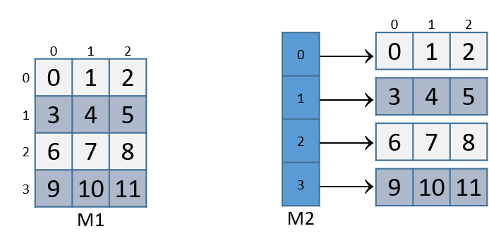
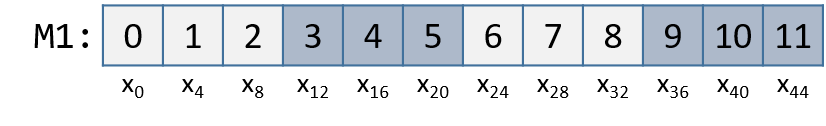
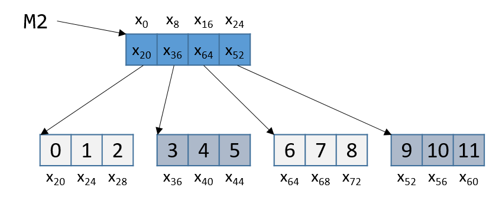

> **说明**
> 本文是个人学习用的**非官方**中英对照译文，原文：<https://diveintosystems.org/book/C7-x86_64/matrices.html>。
> 原书采用 CC BY-NC-ND 4.0 许可（禁止演绎），**请勿公开传播本译文**。
> 标为「译注」「现代更新」的内容是译者补充，不代表原书作者观点；代码与原文逐字一致，未作改动。

## 7.8. 矩阵

*7.8. Matrices*

矩阵是一个二维数组。C 中的矩阵可以静态分配为二维数组（`M[n][m]`），可以通过一次 `malloc` 调用动态分配，也可以动态分配为一个「数组的数组」。我们来考虑数组的数组这种实现。第一个数组包含 `n` 个元素（`M[n]`），矩阵中的每个元素 `M[i]` 又包含一个由 `m` 个元素组成的数组。下面的代码片段各自声明了一个 4 × 3 的矩阵：

> A matrix is a two-dimensional array. A matrix in C can be statically allocated as a two-dimensional array (`M[n][m]`), dynamically allocated with a single call to `malloc`, or dynamically allocated as an array of arrays. Let’s consider the array of arrays implementation. The first array contains `n` elements (`M[n]`), and each element `M[i]` in our matrix contains an array of `m` elements. The following code snippets each declare matrices of size 4 × 3:

```
//statically allocated matrix (allocated on stack)
int M1[4][3];

//dynamically allocated matrix (programmer friendly, allocated on heap)
int **M2, i;
M2 = malloc(4 * sizeof(int*));
for (i = 0; i < 4; i++) {
    M2[i] = malloc(3 * sizeof(int));
}
```

在动态分配矩阵的情况下，主数组包含一个连续的 `int` 指针数组，每个整型指针指向内存中一个不同的数组。[图 1](7.8-matrices.html) 展示了我们通常如何直观地想象这两种矩阵。

> In the case of the dynamically allocated matrix, the main array contains a contiguous array of `int` pointers. Each integer pointer points to a different array in memory. [Figure 1](7.8-matrices.html) illustrates how we would normally visualize each of these matrices.



**图 1.** 静态分配（M1）和动态分配（M2）的 3x4 矩阵示意图

*Figure 1. Illustration of a statically allocated (M1) and a dynamically allocated (M2) 3x4 matrix*

对于这两种矩阵声明，都可以用双下标语法 `M[i][j]` 访问元素 (*i*,*j*)，其中 `M` 是 `M1` 或 `M2`。不过，这两个矩阵在内存中的组织方式不同。尽管两者都把各自主数组中的元素连续存放在内存中，但我们的静态分配矩阵还把所有的行也连续存放在内存中，如[图 2](7.8-matrices.html) 所示。

> For both of these matrix declarations, element (*i*,*j*) can be accessed using the double-indexing syntax `M[i][j]`, where `M` is either `M1` or `M2`. However, these matrices are organized differently in memory. Even though both store the elements in their primary array contiguously in memory, our statically allocated matrix also stores all the rows contiguously in memory, as shown in [Figure 2](7.8-matrices.html).



**图 2.** 矩阵 M1 按行主序的内存布局

*Figure 2. Matrix M1’s memory layout in row-major order*

对于 `M2`，并不能保证这种连续的排列。[回想一下](../C2-C_depth/2.5-arrays.html)，要在堆上连续地分配一个 *n* × *m* 的矩阵，应当用一次 `malloc` 调用分配 *n* × *m* 个元素：

> This contiguous ordering is not guaranteed for `M2`. [Recall that](../C2-C_depth/2.5-arrays.html) to contiguously allocate an *n* × *m* matrix on the heap, we should use a single call to `malloc` that allocates *n* × *m* elements:

```
//dynamic matrix (allocated on heap, memory efficient way)
#define ROWS 4
#define COLS 3
int *M3;
M3 = malloc(ROWS * COLS * sizeof(int));
```

回想一下，对于 `M3` 这样的声明，*不能*用 `M[i][j]` 记法访问元素 (*i*,*j*)，而必须用 `M3[i*COLS + j]` 的格式来索引元素。

> Recall that with the declaration of `M3`, element (*i*,*j*) *cannot* be accessed using the `M[i][j]` notation. Instead, we must index the element using the format `M3[i*COLS + j]`.

### 7.8.1. 连续的二维数组

*7.8.1. Contiguous Two-Dimensional Arrays*

考虑一个函数 `sumMat`，它的第一个参数是指向一个连续分配的（静态分配的或以节省内存的方式动态分配的）矩阵的指针，另外两个参数是行数和列数，它返回矩阵中所有元素的和。

> Consider a function `sumMat` that takes a pointer to a contiguously allocated (either statically allocated or memory-efficiently dynamically allocated) matrix as its first parameter, along with the numbers of rows and columns, and returns the sum of all the elements inside the matrix.

在下面的代码片段中，我们使用按比例计算下标的方式，因为它同时适用于静态分配和动态分配的连续矩阵。回想一下，语法 `m[i][j]` 不适用于前面讨论的节省内存的连续动态分配。

> We use scaled indexing in the code snippet that follows because it applies to both statically and dynamically allocated contiguous matrices. Recall that the syntax `m[i][j]` does not work with the memory-efficient contiguous dynamic allocation previously discussed.

```
int sumMat(int *m, int rows, int cols) {
    int i, j, total = 0;
    for (i = 0; i < rows; i++){
        for (j = 0; j < cols; j++){
            total += m[i*cols + j];
        }
    }
    return total;
}
```

下面是对应的汇编，每一行都加上了英文注解：

> Here is the corresponding assembly. Each line is annotated with its English translation:

```
Dump of assembler code for function sumMat:
0x400686 <+0>:   push %rbp                 # save rbp
0x400687 <+1>:   mov  %rsp,%rbp            # update rbp (new stack frame)
0x40068a <+4>:   mov  %rdi,-0x18(%rbp)     # copy m to %rbp-0x18
0x40068e <+8>:   mov  %esi,-0x1c(%rbp)     # copy rows to %rbp-0x1c
0x400691 <+11>:  mov  %edx,-0x20(%rbp)     # copy cols parameter to %rbp-0x20
0x400694 <+14>:  movl $0x0,-0x4(%rbp)      # copy 0 to %rbp-0x4 (total)
0x40069b <+21>:  movl $0x0,-0xc(%rbp)      # copy 0 to %rbp-0xc (i)
0x4006a2 <+28>:  jmp  0x4006e1 <sumMat+91> # goto <sumMat+91>
0x4006a4 <+30>:  movl $0x0,-0x8(%rbp)      # copy 0 to %rbp-0x8 (j)
0x4006ab <+37>:  jmp  0x4006d5 <sumMat+79> # goto <sumMat+79>
0x4006ad <+39>:  mov  -0xc(%rbp),%eax      # copy i to %eax
0x4006b0 <+42>:  imul -0x20(%rbp),%eax     # mult i with cols, place in %eax
0x4006b4 <+46>:  mov  %eax,%edx            # copy i*cols to %edx
0x4006b6 <+48>:  mov  -0x8(%rbp),%eax      # copy j to %eax
0x4006b9 <+51>:  add  %edx,%eax            # add i*cols with j, place in %eax
0x4006bb <+53>:  cltq                      # convert %eax to a 64-bit int
0x4006bd <+55>:  lea  0x0(,%rax,4),%rdx    # mult (i*cols+j) by 4,put in %rdx
0x4006c5 <+63>:  mov  -0x18(%rbp),%rax     # copy m to %rax
0x4006c9 <+67>:  add  %rdx,%rax            # add m to (i*cols+j)*4,put in %rax
0x4006cc <+70>:  mov  (%rax),%eax          # copy m[i*cols+j] to %eax
0x4006ce <+72>:  add  %eax,-0x4(%rbp)      # add m[i*cols+j] to total
0x4006d1 <+75>:  addl $0x1,-0x8(%rbp)      # add 1 to j (j++)
0x4006d5 <+79>:  mov  -0x8(%rbp),%eax      # copy j to %eax
0x4006d8 <+82>:  cmp  -0x20(%rbp),%eax     # compare j with cols
0x4006db <+85>:  jl   0x4006ad <sumMat+39> # if (j < cols) goto <sumMat+39>
0x4006dd <+87>:  addl $0x1,-0xc(%rbp)      # add 1 to i
0x4006e1 <+91>:  mov  -0xc(%rbp),%eax      # copy i to %eax
0x4006e4 <+94>:  cmp  -0x1c(%rbp),%eax     # compare i with rows
0x4006e7 <+97>:  jl   0x4006a4 <sumMat+30> # if (i < rows) goto <sumMat+30>
0x4006e9 <+99>:  mov  -0x4(%rbp),%eax      # copy total to %eax
0x4006ec <+102>: pop  %rbp                 # clean up stack
0x4006ed <+103>: retq                      # return total
```

局部变量 `i`、`j` 和 `total` 分别被加载到栈上的地址 `%rbp-0xc`、`%rbp-0x8` 和 `%rbp-0x4` 处。输入参数 `m`、`row` 和 `cols` 分别存放在位置 `%rbp-0x8`、`%rbp-0x1c` 和 `%rbp-0x20` 处。利用这些知识，我们把目光集中到只处理访问矩阵中元素 (*i*,*j*) 的那一部分：

> The local variables `i`, `j`, and `total` are loaded at addresses `%rbp-0xc`, `%rbp-0x8`, and `%rbp-0x4` on the stack, respectively. The input parameters `m`, `row`, and `cols` are stored at locations `%rbp-0x8`, `%rbp-0x1c`, and `%rbp-0x20`, respectively. Using this knowledge, let’s zoom in on the component that just deals with the access of element (*i*,*j*) in our matrix:

> **译注**
> 对照上面的汇编（`mov %rdi,-0x18(%rbp)`），参数 `m` 存放在 `%rbp-0x18` 而不是 `%rbp-0x8`（后者是 `j`），原文笔误。

```
0x4006ad <+39>: mov  -0xc(%rbp),%eax    # copy i to %eax
0x4006b0 <+42>: imul -0x20(%rbp),%eax   # multiply i with cols, place in %eax
0x4006b4 <+46>: mov  %eax,%edx          # copy i*cols to %edx
```

第一组指令计算值 `i*cols`，并把它放在寄存器 `%edx` 中。回想一下，对于名为 `matrix` 的矩阵，`matrix + (i * cols)` 等价于 `&matrix[i]`。

> The first set of instructions calculates the value `i*cols` and places it in register `%edx`. Recall that for a matrix named `matrix`, `matrix + (i * cols)` is equivalent to `&matrix[i]`.

------------------------------------------------------------------------

```
0x4006b6 <+48>: mov  -0x8(%rbp),%eax    # copy j to %eax
0x4006b9 <+51>: add  %edx,%eax          # add i*cols with j, place in %eax
0x4006bb <+53>: cltq                    # convert %eax to a 64-bit int
0x4006bd <+55>: lea  0x0(,%rax,4),%rdx  # multiply (i*cols+j) by 4,put in %rdx
```

下一组指令计算 `(i*cols+j)*4`。编译器把下标 `i*cols+j` 乘以四，因为矩阵中的每个元素都是一个四字节的整数，这次乘法使编译器能算出正确的偏移量。`<sumMat+53>` 这一行的 `cltq` 指令是必需的，它把 `%eax` 的内容符号扩展为一个 64 位整数，因为这个值即将用于地址计算。

> The next set of instructions computes `(i*cols+j)*4`. The compiler multiplies the index `i*cols+j` by four since each element in the matrix is a four-byte integer, and this multiplication enables the compiler to compute the correct offset. The `cltq` instruction on line `<sumMat+53>` is needed to sign-extend the contents of `%eax` into a 64-bit integer, since that is about to be used for address calculation.

------------------------------------------------------------------------

接着，下面这组指令把算出的偏移量加到矩阵指针上，并对其解引用，得到元素 (*i*,*j*) 的值：

> Next, the following set of instructions adds the calculated offset to the matrix pointer and dereferences it to yield the value of element (*i*,*j*):

```
0x4006c5 <+63>: mov -0x18(%rbp),%rax   # copy m to %rax
0x4006c9 <+67>: add %rdx,%rax          # add m to (i*cols+j)*4, place in %rax
0x4006cc <+70>: mov (%rax),%eax        # copy m[i*cols+j] to %eax
0x4006ce <+72>: add %eax,-0x4(%rbp)    # add m[i*cols+j] to total
```

第一条指令把矩阵 `m` 的地址加载到寄存器 `%rax`。`add` 指令把 `(i*cols + j)*4` 加到 `m` 的地址上，正确地算出元素 (*i*,*j*) 的偏移位置。第三条指令对 `%rax` 中的地址解引用，并把值放到 `%eax` 中。注意这里用 `%eax` 作为目标组成部分寄存器；由于我们的矩阵中存放的是整数，而一个整数占四个字节，所以再次使用组成部分寄存器 `%eax` 而不是 `%rax`。

> The first instruction loads the address of matrix `m` into register `%rax`. The `add` instruction adds `(i*cols + j)*4` to the address of `m` to correctly calculate the offset of element (*i*,*j*). The third instruction dereferences the address in `%rax` and places the value in `%eax`. Notice the use of `%eax` as the destination component register; since our matrix contains integers, and an integer takes up four bytes of space, component register `%eax` is again used instead of `%rax`.

最后一条指令把 `%eax` 中的值加到累加器 `total` 上，它位于栈地址 `%rbp-0x4` 处。

> The last instruction adds the value in `%eax` to the accumulator `total`, which is located at stack address `%rbp-0x4`.

我们来考虑如何访问[图 2](7.8-matrices.html) 中的元素 (1,2)。为方便起见，下面再列出这张图：

> Let’s consider how element (1,2) is accessed in [Figure 2](7.8-matrices.html). For convenience, the figure is reproduced below:


**图 3.** 矩阵 M1 按行主序的内存布局

*Figure 3. Matrix M1’s memory layout in row-major order*

元素 (1,2) 位于地址 `M1 + 1*COLS + 2` 处。由于 `COLS` = 3，元素 (1,2) 对应于 `M1+5`。要访问这个位置上的元素，编译器必须把 5 乘以 `int` 数据类型的大小（四个字节），得到偏移位置 `M1+20`，它对应于图中的字节 x<sub>20</sub>。对这个位置解引用，得到元素 5，它确实是矩阵中的元素 (1,2)。

> Element (1,2) is located at address `M1 + 1*COLS + 2`. Since `COLS` = 3, element (1,2) corresponds to `M1+5`. To access the element at this location, the compiler must multiply 5 by the size of the `int` data type (four bytes), yielding the offset `M1+20`, which corresponds to byte x<sub>20</sub> in the figure. Dereferencing this location yields element 5, which is indeed element (1,2) in the matrix.

### 7.8.2. 不连续的矩阵

*7.8.2. Noncontiguous Matrix*

不连续的矩阵实现要稍微复杂一些。[图 4](7.8-matrices.html) 直观地展示了 `M2` 在内存中可能的布局。

> The noncontiguous matrix implementation is a bit more complicated. [Figure 4](7.8-matrices.html) visualizes how `M2` may be laid out in memory.



**图 4.** 矩阵 M2 在内存中的不连续布局

*Figure 4. Matrix M2’s noncontiguous layout in memory*

注意，指针数组是连续的，`M2` 的每个元素所指向的数组（例如 `M2[i]`）也是连续的。然而，各个数组彼此之间并不连续。由于 `M2` 是一个指针数组，`M2` 的每个元素占八个字节。与之不同，由于 `M2[i]` 是一个 `int` 数组，`M2[i]` 的各个元素之间相距四个字节。

> Notice that the array of pointers is contiguous, and that each array pointed to by an element of `M2` (e.g., `M2[i]`) is contiguous. However, the individual arrays are not contiguous with one another. Since `M2` is an array of pointers, each element of `M2` takes eight bytes of space. In contrast, as `M2[i]` is an `int` array, each element of `M2[i]` is four bytes away.

下例中的 `sumMatrix` 函数以一个整型指针数组（名为 `matrix`）作为第一个参数，以行数和列数作为第二个和第三个参数：

> The `sumMatrix` function in the following example takes an array of integer pointers (called `matrix`) as its first parameter, and a number of rows and columns as its second and third parameters:

```
int sumMatrix(int **matrix, int rows, int cols) {
    int i, j, total=0;

    for (i = 0; i < rows; i++) {
        for (j = 0; j < cols; j++) {
            total += matrix[i][j];
        }
    }
    return total;
}
```

尽管这个函数看起来与前面的 `sumMat` 函数几乎一模一样，但这个函数接收的矩阵由一个连续的*指针*数组构成。每个指针存放着一个单独的连续数组的地址，这个数组对应于矩阵中单独的一行。

> Even though this function looks nearly identical to the `sumMat` function shown earlier, the matrix accepted by this function consists of a contiguous array of *pointers*. Each pointer contains the address of a separate contiguous array, which corresponds to a separate row in the matrix.

下面是 `sumMatrix` 对应的汇编，每一行都加上了英文注解。

> The corresponding assembly for `sumMatrix` follows. Each line is annotated with its English translation.

```
Dump of assembler code for function sumMatrix:
0x4006ee <+0>:   push   %rbp                    # save rbp
0x4006ef <+1>:   mov    %rsp,%rbp               # update rbp (new stack frame)
0x4006f2 <+4>:   mov    %rdi,-0x18(%rbp)        # copy matrix to %rbp-0x18
0x4006f6 <+8>:   mov    %esi,-0x1c(%rbp)        # copy rows to %rbp-0x1c
0x4006f9 <+11>:  mov    %edx,-0x20(%rbp)        # copy cols to %rbp-0x20
0x4006fc <+14>:  movl   $0x0,-0x4(%rbp)         # copy 0 to %rbp-0x4 (total)
0x400703 <+21>:  movl   $0x0,-0xc(%rbp)         # copy 0 to %rbp-0xc (i)
0x40070a <+28>:  jmp    0x40074e <sumMatrix+96> # goto <sumMatrix+96>
0x40070c <+30>:  movl   $0x0,-0x8(%rbp)         # copy 0 to %rbp-0x8 (j)
0x400713 <+37>:  jmp    0x400742 <sumMatrix+84> # goto <sumMatrix+84>
0x400715 <+39>:  mov    -0xc(%rbp),%eax         # copy i to %eax
0x400718 <+42>:  cltq                           # convert i to 64-bit integer
0x40071a <+44>:  lea    0x0(,%rax,8),%rdx       # mult i by 8, place in %rdx
0x400722 <+52>:  mov    -0x18(%rbp),%rax        # copy matrix to %rax
0x400726 <+56>:  add    %rdx,%rax               # put i*8 + matrix in %rax
0x400729 <+59>:  mov    (%rax),%rax             # copy matrix[i] to %rax (ptr)
0x40072c <+62>:  mov    -0x8(%rbp),%edx         # copy j to %edx
0x40072f <+65>:  movslq %edx,%rdx               # convert j to 64-bit integer
0x400732 <+68>:  shl    $0x2,%rdx               # mult j by 4, place in %rdx
0x400736 <+72>:  add    %rdx,%rax               # put j*4 + matrix[i] in %rax
0x400739 <+75>:  mov    (%rax),%eax             # copy matrix[i][j] to %eax
0x40073b <+77>:  add    %eax,-0x4(%rbp)         # add matrix[i][j] to total
0x40073e <+80>:  addl   $0x1,-0x8(%rbp)         # add 1 to j (j++)
0x400742 <+84>:  mov    -0x8(%rbp),%eax         # copy j to %eax
0x400745 <+87>:  cmp    -0x20(%rbp),%eax        # compare j with cols
0x400748 <+90>:  jl     0x400715 <sumMatrix+39> # if j<cols goto<sumMatrix+39>
0x40074a <+92>:  addl   $0x1,-0xc(%rbp)         # add 1 to i (i++)
0x40074e <+96>:  mov    -0xc(%rbp),%eax         # copy i to %eax
0x400751 <+99>:  cmp    -0x1c(%rbp),%eax        # compare i with rows
0x400754 <+102>: jl     0x40070c <sumMatrix+30> # if i<rows goto<sumMatrix+30>
0x400756 <+104>: mov    -0x4(%rbp),%eax         # copy total to %eax
0x400759 <+107>: pop    %rbp                    # restore %rbp
0x40075a <+108>: retq                           # return total
```

同样，变量 `i`、`j` 和 `total` 分别位于栈地址 `%rbp-0xc`、`%rbp-0x8` 和 `%rbp-0x4` 处。输入参数 `matrix`、`row` 和 `cols` 分别位于栈地址 `%rbp-0x18`、`%rbp-0x1c` 和 `%rbp-0x20` 处。我们把目光集中到专门处理访问元素 (*i*,*j*)（即 `matrix[i][j]`）的那一部分：

> Once again, the variables `i`, `j`, and `total` are at stack addresses `%rbp-0xc`, `%rbp-0x8`, and `%rbp-0x4`, respectively. The input parameters `matrix`, `row`, and `cols` are located at stack addresses `%rbp-0x18`, `%rbp-0x1c`, and `%rbp-0x20`, respectively. Let’s zoom in on the section that deals specifically with an access to element (*i*,*j*), or `matrix[i][j]`:

```
0x400715 <+39>: mov  -0xc(%rbp),%eax       # copy i to %eax
0x400718 <+42>: cltq                       # convert i to 64-bit integer
0x40071a <+44>: lea  0x0(,%rax,8),%rdx     # multiply i by 8, place in %rdx
0x400722 <+52>: mov  -0x18(%rbp),%rax      # copy matrix to %rax
0x400726 <+56>: add  %rdx,%rax             # add i*8 to matrix, place in %rax
0x400729 <+59>: mov  (%rax),%rax           # copy matrix[i] to %rax (pointer)
```

这个例子中的五条指令计算 `matrix[i]`，即 `*(matrix+i)`。由于 `matrix[i]` 中存放的是一个指针，`i` 首先被转换为 64 位整数。然后，编译器把 `i` 乘以八，再把它加到 `matrix` 上，以算出正确的地址偏移（回想一下，指针的大小是八个字节）。接着，`<sumMatrix+59>` 处的指令对算出的地址解引用，得到元素 `matrix[i]`。

> The five instructions in this example compute `matrix[i]`, or `*(matrix+i)`. Since `matrix[i]` contains a pointer, `i` is first converted to a 64-bit integer. Then, the compiler multiplies `i` by eight prior to adding it to `matrix` to calculate the correct address offset (recall that pointers are eight bytes in size). The instruction at `<sumMatrix+59>` then dereferences the calculated address to get the element `matrix[i]`.

由于 `matrix` 是一个 `int` 指针数组，位于 `matrix[i]` 的元素本身就是一个 `int` 指针。`matrix[i]` 中的第 *j* 个元素位于 `matrix[i]` 数组中偏移 `j × 4` 处。

> Since `matrix` is an array of `int` pointers, the element located at `matrix[i]` is itself an `int` pointer. The *j*<sup>th</sup> element in `matrix[i]` is located at offset `j × 4` in the `matrix[i]` array.

下一组指令取出数组 `matrix[i]` 中的第 *j* 个元素：

> The next set of instructions extract the *j*<sup>th</sup> element in array `matrix[i]`:

```
0x40072c <+62>: mov    -0x8(%rbp),%edx    # copy j to %edx
0x40072f <+65>: movslq %edx,%rdx          # convert j to a 64-bit integer
0x400732 <+68>: shl    $0x2,%rdx          # multiply j by 4, place in %rdx
0x400736 <+72>: add    %rdx,%rax          # add j*4 to matrix[i], put in %rax
0x400739 <+75>: mov    (%rax),%eax        # copy matrix[i][j] to %eax
0x40073b <+77>: add    %eax,-0x4(%rbp)    # add matrix[i][j] to total
```

这段代码中的第一条指令把变量 `j` 加载到寄存器 `%edx`。`<sumMatrix+65>` 处的 `movslq` 指令把 `%edx` 转换为一个 64 位整数，把结果存放在 64 位寄存器 `%rdx` 中。接着，编译器用左移（`shl`）指令把 `j` 乘以四，并把结果存放在寄存器 `%rdx` 中。最后，编译器把得到的值加到 `matrix[i]` 中的地址上，得到元素 `matrix[i][j]` 的地址。`<sumMatrix+75>` 和 `<sumMatrix+77>` 处的指令取出 `matrix[i][j]` 处的值，并把它加到 `total` 上。

> The first instruction in this snippet loads variable `j` into register `%edx`. The `movslq` instruction at `<sumMatrix+65>` converts `%edx` into a 64-bit integer, storing the result in 64-bit register `%rdx`. The compiler then uses the left shift (`shl`) instruction to multiply `j` by four and stores the result in register `%rdx`. The compiler finally adds the resulting value to the address located in `matrix[i]` to get the address of element `matrix[i][j]`. The instructions at `<sumMatrix+75>` and `<sumMatrix+77>` obtain the value at `matrix[i][j]` and add the value to `total`.

我们回到[图 4](7.8-matrices.html)，考虑访问 M2[1][2] 的例子。为方便起见，下面再列出这张图：

> Let’s revisit [Figure 4](7.8-matrices.html) and consider an example access to M2[1][2]. For convenience, we reproduce the figure below:


**图 5.** 矩阵 M2 在内存中的不连续布局

*Figure 5. Matrix M2’s noncontiguous layout in memory*

注意，`M2` 从内存位置 x<sub>0</sub> 开始。编译器首先计算 `M2[1]` 的地址：把 1 乘以 8（`sizeof(int *)`），再加到 `M2` 的地址（x<sub>0</sub>）上，得到新地址 x<sub>8</sub>。对这个地址解引用，得到与 `M2[1]` 关联的地址，即 x<sub>36</sub>。然后，编译器把下标 2 乘以 4（`sizeof(int)`），并把结果（8）加到 x<sub>36</sub> 上，得到最终地址 x<sub>44</sub>。对地址 x<sub>44</sub> 解引用，得到值 5。果然，[图 4](7.8-matrices.html) 中对应于 `M2[1][2]` 的元素值为 5。

> Note that `M2` starts at memory location x<sub>0</sub>. The compiler first computes the address of `M2[1]` by multiplying 1 by 8 (`sizeof(int *)`) and adding it to the address of `M2` (x<sub>0</sub>), yielding the new address x<sub>8</sub>. A dereference of this address yields the address associated with `M2[1]`, or x<sub>36</sub>. The compiler then multiplies index 2 by 4 (`sizeof(int)`), and adds the result (8) to x<sub>36</sub>, yielding a final address of x<sub>44</sub>. The address x<sub>44</sub> is dereferenced, yielding the value 5. Sure enough, the element in [Figure 4](7.8-matrices.html) that corresponds to `M2[1][2]` has the value 5.
