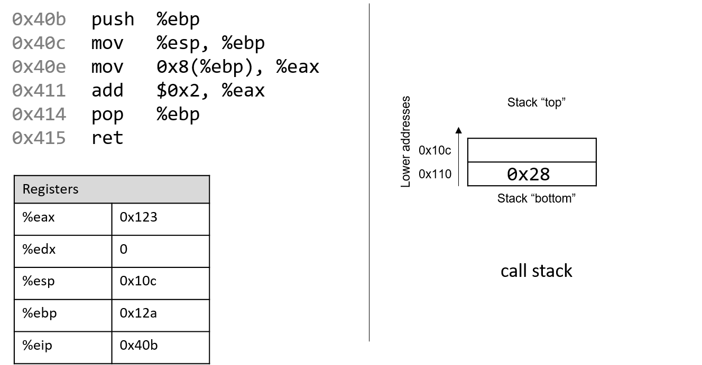
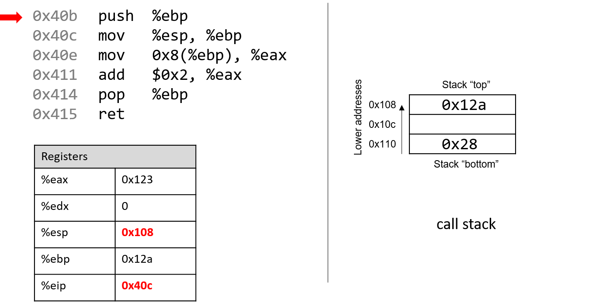
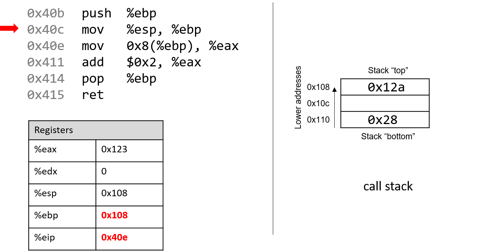
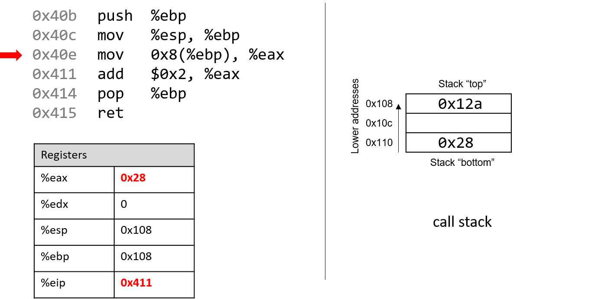
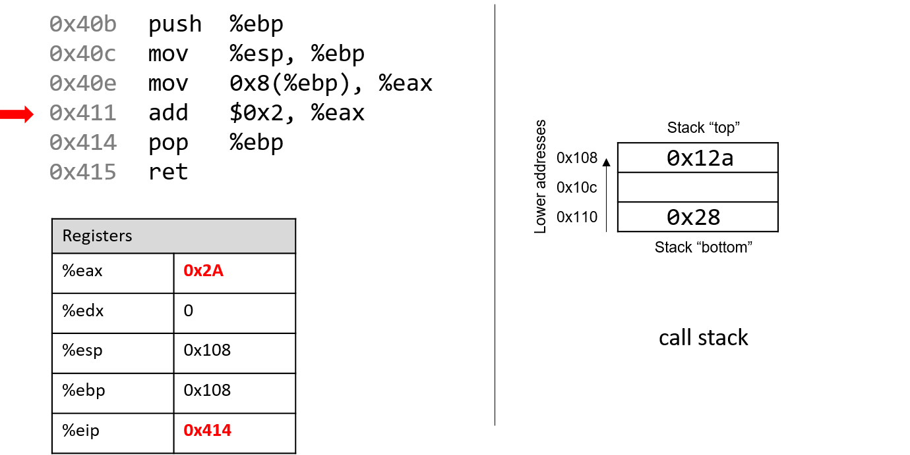
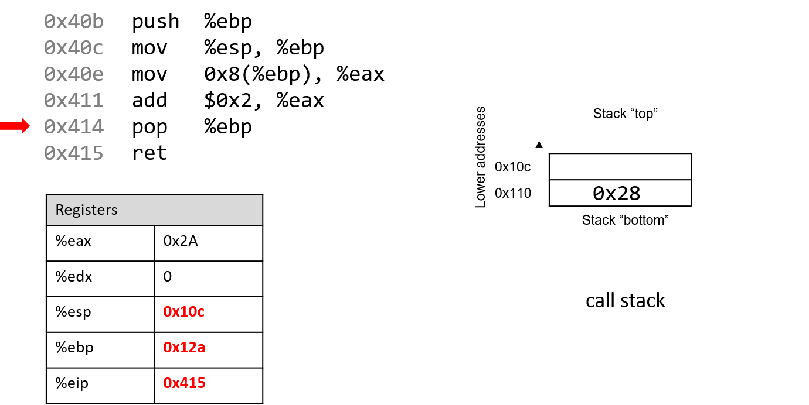

> **说明**
> 本文是个人学习用的**非官方**中英对照译文，原文：<https://diveintosystems.org/book/C8-IA32/common.html>。
> 原书采用 CC BY-NC-ND 4.0 许可（禁止演绎），**请勿公开传播本译文**。
> 标为「译注」「现代更新」的内容是译者补充，不代表原书作者观点；代码与原文逐字一致，未作改动。

## 8.2. 常用指令

*8.2. Common Instructions*

本节讨论几条常用的 x86 汇编指令。[表 1](8.2-common.html) 列出了 x86 汇编中最基础的指令。

> In this section, we discuss several common x86 assembly instructions. [Table 1](8.2-common.html) lists the most foundational instructions in x86 assembly.

**表 1.** 最常用的指令

*Table 1. Most Common Instructions*

| 指令 | 含义 |
|-------------|---------------------------------------------------------|
| `mov S, D` | S → D（把 S 的值复制到 D） |
| `add S, D` | S + D → D（把 S 加到 D 上，结果存入 D） |
| `sub S, D` | D - S → D（*从* D 中减去 S，结果存入 D） |

> | Instruction | Translation                                             |
> |-------------|---------------------------------------------------------|
> | `mov S, D`  | S → D (copies value of S into D)                        |
> | `add S, D`  | S + D → D (adds S to D and stores result in D)          |
> | `sub S, D`  | D - S → D (subtracts S *from* D and stores result in D) |

因此，指令序列

> Therefore, the sequence of instructions

```
mov    0x8(%ebp),%eax
add    $0x2,%eax
```

的含义是：

> translates to:

- 把*内存*中位置 `%ebp` + 0x8 处的值（即 M[`%ebp` + 0x8]）复制到寄存器 `%eax`。

> - Copy the value at location `%ebp` + 0x8 in *memory* (or M[`%ebp` + 0x8]) to register `%eax`.

- 把值 0x2 加到寄存器 `%eax` 上，结果存入寄存器 `%eax`。

> - Add the value 0x2 to register `%eax`, and store the result in register `%eax`.

[表 1](8.2-common.html) 中的三条指令也是维护程序栈（即**调用栈**，call stack）组织结构的那些指令的构建基础。回想一下，寄存器 `%ebp` 和 `%esp` 分别指*帧*指针和*栈*指针，由编译器保留用于调用栈管理。回想我们之前对[程序内存](../C2-C_depth/2.1-scope_memory.html)的讨论：调用栈存放局部变量和参数，并帮助程序跟踪自身的执行（见[图 1](8.2-common.html)）。

> The three instructions shown in [Table 1](8.2-common.html) also form the building blocks for instructions that maintain the organization of the program stack (i.e., the **call stack**). Recall that registers `%ebp` and `%esp` refer to the *frame* pointer and *stack* pointer, respectively, and are reserved by the compiler for call stack management. Recall from our earlier discussion on [program memory](../C2-C_depth/2.1-scope_memory.html) that the call stack stores local variables and parameters and helps the program track its own execution (see [Figure 1](8.2-common.html)).


**图 1.** 程序地址空间的组成部分

*Figure 1. The parts of a program’s address space*

在 IA32 系统上，执行栈向*低*地址方向增长。和所有栈数据结构一样，操作都发生在栈的「顶部」。x86 ISA 提供了两条指令（[表 2](8.2-common.html)）来简化调用栈的管理。

> On IA32 systems, the execution stack grows toward *lower* addresses. Like all stack data structures, operations occur at the "top" of the stack. The x86 ISA provides two instructions ([Table 2](8.2-common.html)) to simplify call stack management.

**表 2.** 栈管理指令

*Table 2. Stack Management Instructions*

**指令**

> **Instruction**

`push S`

> `push S`

**含义**

> **Translation**

把 `S` 的一个副本压到栈顶。等价于：

> Pushes a copy of `S` onto the top of the stack. Equivalent to:

```
sub $4, %esp
mov S, (%esp)
```

**指令**

> **Instruction**

`pop D`

> `pop D`

**含义**

> **Translation**

从栈顶弹出元素，并把它放到位置 `D` 中。等价于：

> Pops the top element off the stack and places it in location `D`. Equivalent to:

```
mov (%esp), D
add $4, %esp
```

注意，[表 1](8.2-common.html) 中的三条指令需要两个操作数，而[表 2](8.2-common.html) 中的 `push` 和 `pop` 指令各只需要一个操作数。

> Notice that while the three instructions in [[Basic]](8.2-common.html) require two operands, the `push` and `pop` instructions in [[Stack]](8.2-common.html) require only one operand apiece.

> **译注**
> 原书网页此处的两个交叉引用渲染成了 `[Basic]` 和 `[Stack]`，指的就是本节的表 1 和表 2。

### 8.2.1. 综合运用：一个更具体的例子

*8.2.1. Putting It All Together: A More Concrete Example*

我们来仔细看看 `adder2` 函数：

> Let’s take a closer look at the `adder2` function:

```
//adds two to an integer and returns the result
int adder2(int a) {
    return a + 2;
}
```

以及它对应的汇编代码：

> and its corresponding assembly code:

```
0804840b <adder2>:
 804840b:       55                      push   %ebp
 804840c:       89 e5                   mov    %esp,%ebp
 804840e:       8b 45 08                mov    0x8(%ebp),%eax
 8048411:       83 c0 02                add    $0x2,%eax
 8048414:       5d                      pop    %ebp
 8048415:       c3                      ret
```

这段汇编代码由一条 `push` 指令、随后的两条 `mov` 指令、一条 `add` 指令、一条 `pop` 指令，以及最后一条 `ret` 指令组成。要理解 CPU 如何执行这组指令，我们需要重温[程序内存](../C2-C_depth/2.1-scope_memory.html)的结构。回想一下，程序每次执行时，操作系统都会为新程序分配地址空间（也称为**虚拟内存**）。[虚拟内存](../C13-OS/13.3-vm.html)以及与之相关的[进程](../C13-OS/13.2-processes.html)概念会在第 13 章中详细介绍；目前，只需把进程看作正在运行的程序的抽象，把虚拟内存看作分配给单个进程的内存。每个进程都有自己的一块称为**调用栈**的内存区域。记住，调用栈位于进程/虚拟内存中，这与寄存器（位于 CPU 上）不同。

> The assembly code consists of a `push` instruction, followed by a couple of `mov` instructions, an `add` instruction, a `pop` instruction, and finally a `ret` instruction. To understand how the CPU executes this set of instructions, we need to revisit the structure of [program memory](../C2-C_depth/2.1-scope_memory.html). Recall that every time a program executes, the operating system allocates the new program’s address space (also known as **virtual memory**). [Virtual memory](../C13-OS/13.3-vm.html) and the related concept of [processes](../C13-OS/13.2-processes.html) are covered in greater detail in chapter 13; for now, it suffices to think of a process as the abstraction of a running program and virtual memory as the memory that is allocated to a single process. Every process has its own region of memory called the **call stack**. Keep in mind that the call stack is located in process/virtual memory, unlike registers (which are located on the CPU).

[图 2](8.2-common.html) 描绘了执行 `adder2` 函数之前调用栈和寄存器的一个示例状态。

> [Figure 2](8.2-common.html) depicts a sample state of the call stack and registers prior to the execution of the `adder2` function.



**图 2.** 执行之前的执行栈

*Figure 2. Execution stack prior to execution*

注意，栈向*低*地址方向增长。寄存器 `%eax` 和 `%edx` 当前存放的是垃圾值。为了让图更易读，程序内存代码段中各条指令的地址（0x804840b–0x8048415）被缩写为 0x40b–0x415。同样，程序内存调用栈段的地址从 0xffffd108–0xffffd110 缩写为 0x108–0x110。实际上，调用栈地址在程序内存中位于比代码段地址更高的位置。

> Notice that the stack grows toward *lower* addresses. Registers `%eax` and `%edx` currently contain junk values. The addresses associated with the instructions in the code segment of program memory (0x804840b-0x8048415) have been shortened to (0x40b-0x415) to improve figure readability. Likewise, the addresses associated with the call stack segment of program memory have been shortened to 0x108-0x110 from 0xffffd108-0xffffd110. In truth, call stack addresses occur at higher addresses in program memory than code segment addresses.

请留意寄存器 `%esp` 和 `%ebp` 的初始值（虚构的）：它们分别是 `0x10c` 和 `0x12a`。调用栈当前在栈地址 `0x110` 处存放着值 `0x28`（即 `40`）（它为什么、又是如何出现在这里的，我们会在讨论[函数](8.5-functions.html)时介绍）。下面各图中左上角的箭头直观地标出当前正在执行的指令。`%eip` 寄存器（即指令指针）显示下一条要执行的指令。最初，`%eip` 存放的是地址 `0x40b`，对应于 `adder2` 函数中的第一条指令。

> Pay close attention to the initial (made up) values of registers `%esp` and `%ebp`: they are `0x10c` and `0x12a`, respectively. The call stack currently has the value `0x28` (or `40`) at stack address `0x110` (why and how this got here will be covered in our discussion on [functions](8.5-functions.html)). The upper-left arrow in the following figures visually indicates the currently executing instruction. The `%eip` register (or instruction pointer) shows the next instruction to execute. Initially, `%eip` contains address `0x40b` which corresponds to the first instruction in the `adder2` function.

------------------------------------------------------------------------



第一条指令（`push %ebp`）把 `%ebp` 中值的一个副本（即 0x12a）放到栈顶。它执行之后，`%eip` 寄存器前进到下一条要执行的指令的地址（即 0x40c）。`push` 指令把栈指针减 4（让栈「增长」4 个字节），得到新的 `%esp` 值 `0x108`。回想一下，`push %ebp` 指令等价于：

> The first instruction (`push %ebp`) places a copy of the value in `%ebp` (or 0x12a) on top of the stack. After it executes, the `%eip` register advances to the address of the next instruction to execute (or 0x40c). The `push` instruction decrements the stack pointer by 4 ("growing" the stack by 4 bytes), resulting in a new `%esp` value of `0x108`. Recall that the `push %ebp` instruction is equivalent to:

```
sub $4, %esp
mov %ebp, (%esp)
```

换句话说，就是把栈指针减 4，再把 `%ebp` 内容的一个副本放到对栈指针解引用所指向的位置 `(%esp)`。

> In other words, subtract 4 from the stack pointer and place a copy of the contents of `%ebp` in the location pointed to by the dereferenced stack pointer, `(%esp)`.

------------------------------------------------------------------------



回想一下，`mov` 指令的结构是 `mov S,D`，其中 `S` 是源位置，`D` 是目标位置。因此，下一条指令（`mov %esp, %ebp`）把 `%ebp` 的值更新为 0x108。寄存器 `%eip` 前进到下一条要执行的指令的地址，即 0x40e。

> Recall that the structure of the `mov` instruction is `mov S,D`, where `S` is the source location, and `D` is the destination. Thus, the next instruction (`mov %esp, %ebp`) updates the value of `%ebp` to 0x108. The register `%eip` advances to the address of the next instruction to execute, or 0x40e.

------------------------------------------------------------------------



接下来执行 `mov 0x8(%ebp), %eax`。这条指令比上一条 `mov` 指令要复杂一些。我们参照上一节的操作数表来解析它。首先，`0x8(%ebp)` 翻译为 M[`%ebp` + 0x8]。由于 `%ebp` 存放的值是 0x108，加上 8 得到 0x110。在 0x110 处执行一次（栈）内存查找，得到值 0x28（回想一下，0x28 是之前的代码放到栈上的）。于是，值 0x28 被复制到寄存器 `%eax` 中。指令指针前进到地址 0x411，即下一条要执行的指令的地址。

> Next, `mov 0x8(%ebp), %eax` is executed. This is a bit more complicated than the last `mov` instruction. Let’s parse it by consulting the operand table from the previous section. First, `0x8(%ebp)` translates to M[`%ebp` + 0x8]. Since `%ebp` contains the value 0x108, adding 8 to it yields 0x110. Performing a (stack) memory lookup on 0x110 yields the value 0x28 (recall that 0x28 was placed on the stack by previous code). So, the value 0x28 is copied into register `%eax`. The instruction pointer advances to address 0x411, the next address to be executed.

------------------------------------------------------------------------



之后执行 `add $0x2, %eax`。回想一下，`add` 指令的形式是 `add S,D`，它把 S + D 的结果放到目标 D 中。所以，`add $0x2, %eax` 把常数值 0x2 加到 `%eax` 中存放的值（即 0x28）上，结果 0x2A 存放在寄存器 `%eax` 中。寄存器 `%eip` 前进，指向下一条要执行的指令，即 0x414。

> Afterwards, `add $0x2, %eax` is executed. Recall that the `add` instruction has the form `add S,D` and places the quantity S + D in the destination D. So, `add $0x2, %eax` adds the constant value 0x2 to the value stored in `%eax` (or 0x28), resulting in 0x2A being stored in register `%eax`. Register `%eip` advances to point to the next instruction to be executed, or 0x414.

------------------------------------------------------------------------



接下来执行的指令是 `pop %ebp`。这条指令从调用栈「弹出」一个值，并把它放到目标寄存器 `%ebp` 中。回想一下，这条指令等价于下面两条指令组成的序列：

> The next instruction that executes is `pop %ebp`. This instruction "pops" a value off call stack and places it in destination register `%ebp`. Recall that this instruction is equivalent to the following sequence of two instructions:

```
mov (%esp), %ebp
add $4, %esp
```

这条指令执行后，栈顶 `(%esp)`（即 M[0x108]）处的值被复制到寄存器 `%ebp` 中。于是，`%ebp` 现在存放的值是 0x12a。栈指针*增加* 4，因为栈向低地址方向增长（相应地，向高地址方向*收缩*）。`%esp` 的新值是 0x10c，`%eip` 现在指向这段代码中最后一条要执行的指令的地址（0x415）。

> After this instruction executes, the value at the top of the stack `(%esp)` or (M[0x108]) is copied into register `%ebp`. Thus, `%ebp` now contains the value 0x12a. The stack pointer *increments* by 4, since the stack grows toward lower addresses (and consequently, *shrinks* toward higher ones). The new value of `%esp` is 0x10c, and `%eip` now points to the address of the last instruction to execute in this code snippet (0x415).

------------------------------------------------------------------------

最后执行的指令是 `ret`。在后面讨论函数调用的小节中，我们会更多地讨论 `ret` 做了什么；目前只需知道它为从函数返回准备好调用栈。按照惯例，寄存器 `%eax` 总是存放返回值（如果有的话）。在这个例子中，函数返回值 0x2A，对应于十进制值 42。

> The last instruction executed is `ret`. We will talk more about what happens with `ret` in future sections when we discuss function calls, but for now it suffices to know that it prepares the call stack for returning from a function. By convention, the register `%eax` always contains the return value (if one exists). In this case, the function returns the value 0x2A, which corresponds to the decimal value 42.

在继续之前，注意寄存器 `%esp` 和 `%ebp` 的最终值分别是 0x10c 和 0x12a，*与函数开始执行时的值相同*！这是调用栈正常的、预期中的行为。调用栈的作用是在程序上下文中存放每个函数执行时的临时变量和数据。一旦函数执行完毕，栈就回到函数调用之前的状态。因此，你常常会在函数开头看到下面两条指令：

> Before we continue, note that the final values in registers `%esp` and `%ebp` are 0x10c and 0x12a, respectively, which are the *same values as when the function started executing*! This is normal and expected behavior with the call stack. The purpose of the call stack is to store the temporary variables and data of each function as it executes in the context of a program. Once a function completes executing, the stack returns to the state it was in prior to the function call. As a result, you will commonly see the following two instructions at the beginning of a function:

```
push %ebp
mov %esp, %ebp
```

并在每个函数的末尾看到下面两条指令：

> and the following two instructions at the end of every function:

```
pop %ebp
ret
```
