> [!WARNING] 说明
> 本文是个人学习用的**非官方**中英对照译文，原文：<https://diveintosystems.org/book/C8-IA32/functions.html>。
> 原书采用 CC BY-NC-ND 4.0 许可（禁止演绎），**请勿公开传播本译文**。
> 标为「译注」「现代更新」的内容是译者补充，不代表原书作者观点；代码与原文逐字一致，未作改动。


*8.5. Functions in Assembly*

在上一节中，我们跟踪了汇编中的一些简单函数。本节在一个较大程序的背景下，讨论汇编中多个函数之间的交互。我们还会介绍一些与函数管理有关的新指令。

> In the previous section, we traced through simple functions in assembly. In this section, we discuss the interaction between multiple functions in assembly in the context of a larger program. We also introduce some new instructions involved with function management.

我们先复习一下调用栈是如何管理的。回想一下，`%esp` 是**栈指针**，总是指向栈顶。寄存器 `%ebp` 表示基址指针（也称**帧指针**），指向当前栈帧的底部。**栈帧**（stack frame，也称**活动帧**或**活动记录**）指的是栈中分配给单次函数调用的那一部分。当前正在执行的函数总是位于栈顶，它的栈帧称为**活动帧**（active frame）。活动帧的边界由栈指针（在栈顶）和帧指针（在帧底）界定。活动记录中通常存放着函数的局部变量和参数。

> Let’s begin with a refresher on how the call stack is managed. Recall that `%esp` is the **stack pointer** and always points to the top of the stack. The register `%ebp` represents the base pointer (also known as the **frame pointer**) and points to the base of the current stack frame. The **stack frame** (also known as the **activation frame** or the **activation record**) refers to the portion of the stack allocated to a single function call. The currently executing function is always at the top of the stack, and its stack frame is referred to as the **active frame**. The active frame is bounded by the stack pointer (at the top of stack) and the frame pointer (at the bottom of the frame). The activation record typically holds local variables and parameters for a function.

[图 1](8.5-functions.html) 展示了 `main` 及其调用的一个名为 `fname` 的函数的栈帧。我们把 `main` 函数称为*调用者*（caller）函数，把 `fname` 称为*被调用者*（callee）函数。

> [Figure 1](8.5-functions.html) shows the stack frames for `main` and a function it calls named `fname`. We will refer to the `main` function as the *caller* function and `fname` as the *callee* function.

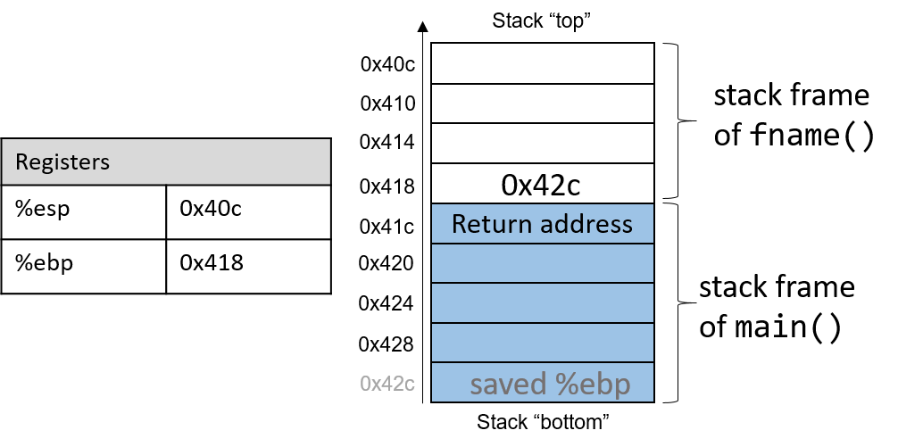

**图 1.** 栈帧的管理

*Figure 1. Stack frame management*

在[图 1](8.5-functions.html) 中，当前的活动帧属于被调用者函数（`fname`）。栈指针和帧指针之间的内存用于存放局部变量。随着局部值被压入和弹出栈，栈指针会移动。与之不同，帧指针相对保持不变，指向当前栈帧的开头（底部）。因此，像 GCC 这样的编译器通常相对于帧指针来引用栈上的值。在[图 1](8.5-functions.html) 中，活动帧的下边界是 `fname` 的基址指针，即栈地址 0x418。存放在这个地址处的值是「保存的」`%ebp` 值（0x42c），它本身表示 `main` 函数活动帧的底部。`main` 活动帧的顶部以**返回地址**（return address）为界，返回地址表示被调用函数执行完毕后，`main` 从哪个程序地址继续执行。

> In [Figure 1](8.5-functions.html), the current active frame belongs to the callee function (`fname`). The memory between the stack pointer and the frame pointer is used for local variables. The stack pointer moves as local values are pushed and popped from the stack. In contrast, the frame pointer remains relatively constant, pointing to the beginning (the bottom) of the current stack frame. As a result, compilers like GCC commonly reference values on the stack relative to the frame pointer. In [Figure 1](8.5-functions.html), the active frame is bounded below by the base pointer of `fname`, which contains the stack address 0x418. The value stored at this address is the "saved" `%ebp` value (0x42c), which itself indicates the bottom of the activation frame for the `main` function. The top of the activation frame of `main` is bounded by the **return address**, which indicates the program address at which `main` resumes execution once the callee function finishes executing.

> [!WARNING] 原书警示 · 返回地址指向代码段内存，而不是栈内存（The return address points to program memory, not stack memory）
> 回想一下，程序的调用栈区域（栈内存）与其代码区域（代码段内存）是不同的。`%ebp` 和 `%esp` 指向栈内存中的位置，而 `%eip` 指向*代码*段内存中的位置。换句话说，返回地址是代码段内存中的一个地址，而不是栈内存中的地址：
>
> 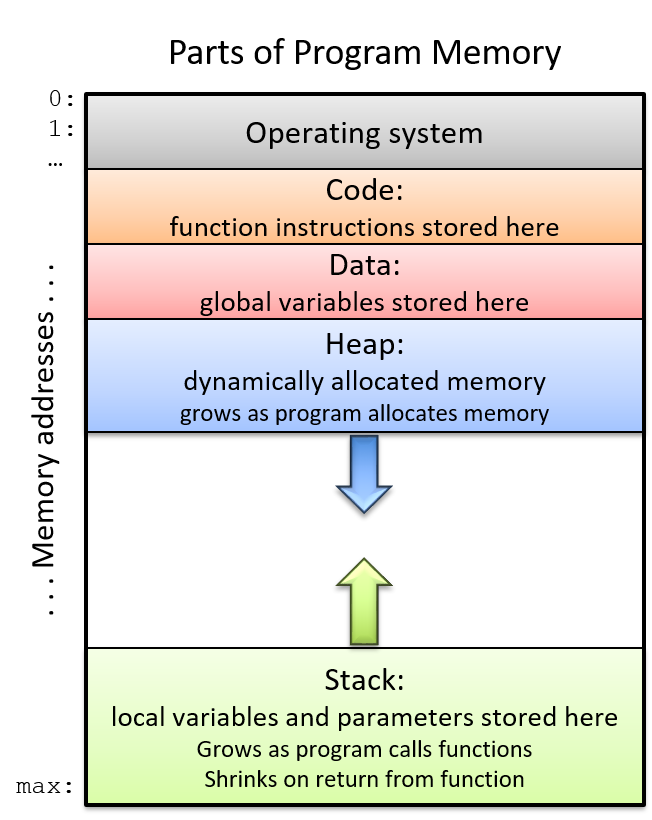
>
> *图示：程序地址空间的组成部分*
>
> > Recall that the call stack region (stack memory) of a program is different from its code region (code memory). Whereas `%ebp` and `%esp` point to locations in the stack memory, `%eip` points to a location in *code* memory. In other words, the return address is an address in code memory, not stack memory:
> >
> >
> >
> > *Figure 2. The parts of a program’s address space*

[表 1](8.5-functions.html) 列出了编译器用于基本函数管理的另外几条指令。

> [Table 1](8.5-functions.html) contains several additional instructions that the compiler uses for basic function management.

**表 1.** 常用的函数管理指令

*Table 1. Common Function Management Instructions*

**指令**

> **Instruction**

`leave`

**含义**

> **Translation**

为离开函数准备好栈。等价于：

> Prepares the stack for leaving a function. Equivalent to:

```
mov %ebp, %esp
pop %ebp
```

**指令**

> **Instruction**

`call addr <fname>`

**含义**

> **Translation**

把活动帧切换到被调用者函数。等价于：

> Switches active frame to callee function. Equivalent to:

```
push %eip
mov addr, %eip
```

**指令**

> **Instruction**

`ret`

**含义**

> **Translation**

把活动帧恢复为调用者函数。等价于：

> Restores active frame to caller function. Equivalent to:

```
pop %eip
```

例如，`leave` 指令是编译器在准备离开函数时，用来恢复栈指针和帧指针的简写形式。当被调用函数执行完毕时，`leave` 确保帧指针被*恢复*为之前的值。

> For example, the `leave` instruction is a shorthand that the compiler uses to restore the stack and frame pointers as it prepares to leave a function. When the callee function finishes execution, `leave` ensures that the frame pointer is *restored* to its previous value.

`call` 和 `ret` 指令在一个函数调用另一个函数的过程中起着重要作用。两条指令都会修改指令指针（寄存器 `%eip`）。当调用者函数执行 `call` 指令时，`%eip` 的当前值被保存到栈上，作为返回地址，即被调用函数执行完毕后调用者继续执行的程序地址。`call` 指令还会用被调用函数的地址替换 `%eip` 的值。

> The `call` and `ret` instructions play a prominent role in the process where one function calls another. Both instructions modify the instruction pointer (register `%eip`). When the caller function executes the `call` instruction, the current value of `%eip` is saved on the stack to represent the return address, or the program address at which the caller resumes executing once the callee function finishes. The `call` instruction also replaces the value of `%eip` with the address of the callee function.

`ret` 指令把 `%eip` 的值恢复为保存在栈上的值，确保程序在调用者函数中指定的程序地址处继续执行。被调用者返回的任何值都存放在 `%eax` 中。`ret` 指令通常是任何函数中执行的最后一条指令。

> The `ret` instruction restores the value of `%eip` to the value saved on the stack, ensuring that the program resumes execution at the program address specified in the caller function. Any value returned by the callee is stored in `%eax`. The `ret` instruction is usually the last instruction that executes in any function.

### 8.5.1. 跟踪一个例子

*8.5.1. Tracing Through an Example*

利用我们关于函数管理的知识，来跟踪本章开头首次介绍的那个代码示例。

> Using our knowledge of function management, let’s trace through the code example first introduced at the beginning of this chapter.

```
#include <stdio.h>

int assign(void) {
    int y = 40;
    return y;
}

int adder(void) {
    int a;
    return a + 2;
}

int main(void) {
    int x;
    assign();
    x = adder();
    printf("x is: %d\n", x);
    return 0;
}
```

我们用 `-m32` 选项编译代码，并用 `objdump -d` 查看底层的汇编。后一条命令会输出一个相当大的文件，其中包含许多我们不需要的信息。用 `less` 及其搜索功能提取出 `adder`、`assign` 和 `main` 函数：

> We compile the code with the `-m32` flag and use `objdump -d` to view the underlying assembly. The latter command outputs a pretty big file that contains a lot of information that we don’t need. Use `less` and the search functionality to extract the `adder`, `assign`, and `main` functions:

> [!NOTE] 译注 · 这段清单被手工改过
> 仔细对照会发现 `main` 部分的机器码与助记符对不上：字节 `83 ec 20` 编码的是 `sub $0x20,%esp`，而不是右边写的 `sub $0x14,%esp`；字节 `89 44 24 1c` 编码的是 `mov %eax,0x1c(%esp)`，而不是 `mov %eax,0xc(%esp)`（`8b 44 24 1c` 同理）。译者用 `clang -target i386-linux-gnu` 汇编这几条指令确认了编码：`sub $0x14,%esp` 是 `83 ec 14`，`mov %eax,0xc(%esp)` 是 `89 44 24 0c`。另外，`mov %esp,%ebp` 只有 2 字节，下一条指令本应位于 0x8048430，清单却从 0x8048433 开始，说明中间删去了一条 3 字节的指令（比如把栈指针按 16 字节对齐的 `and $0xfffffff0,%esp`，编码为 `83 e4 f0`，正好 3 字节）。本节后面的跟踪讲解与右边的助记符（`0x14`、`0xc`）一致，按助记符理解即可。

```
804840d <assign>:
 804840d:       55                      push   %ebp
 804840e:       89 e5                   mov    %esp,%ebp
 8048410:       83 ec 10                sub    $0x10,%esp
 8048413:       c7 45 fc 28 00 00 00    movl   $0x28,-0x4(%ebp)
 804841a:       8b 45 fc                mov    -0x4(%ebp),%eax
 804841d:       c9                      leave
 804841e:       c3                      ret

0804841f <adder>:
 804841f:       55                      push   %ebp
 8048420:       89 e5                   mov    %esp,%ebp
 8048422:       83 ec 10                sub    $0x10,%esp
 8048425:       8b 45 fc                mov    -0x4(%ebp),%eax
 8048428:       83 c0 02                add    $0x2,%eax
 804842b:       c9                      leave
 804842c:       c3                      ret

0804842d <main>:
 804842d:       55                      push   %ebp
 804842e:       89 e5                   mov    %esp,%ebp
 8048433:       83 ec 20                sub    $0x14,%esp
 8048436:       e8 d2 ff ff ff          call   804840d <assign>
 804843b:       e8 df ff ff ff          call   804841f <adder>
 8048440:       89 44 24 1c             mov    %eax,0xc(%esp)
 8048444:       8b 44 24 1c             mov    0xc(%esp),%eax
 8048448:       89 44 24 04             mov    %eax,0x4(%esp)
 804844c:       c7 04 24 f4 84 04 08    movl   $0x80484f4,(%esp)
 8048453:       e8 88 fe ff ff          call   80482e0 <printf@plt>
 8048458:       b8 00 00 00 00          mov    $0x0,%eax
 804845d:       c9                      leave
 804845e:       c3                      ret
```

每个函数都以一个与它在程序中声明的名字相对应的符号标签开头。例如，`<main>:` 是 `main` 函数的符号标签。函数标签的地址也就是该函数中第一条指令的地址。为了在后面的图中节省空间，我们把地址截取为低 12 位。所以，程序地址 0x804842d 显示为 0x42d。

> Each function begins with a symbolic label that corresponds to its declared name in the program. For example, `<main>:` is the symbolic label for the `main` function. The address of a function label is also the address of the first instruction in that function. To save space in the figures that follow, we truncate addresses to the lower 12 bits. So, program address 0x804842d is shown as 0x42d.

### 8.5.2. 跟踪 main

*8.5.2. Tracing Through main*

[图 3](8.5-functions.html) 展示了执行 `main` 之前那一刻的执行栈。

> [Figure 3](8.5-functions.html) shows the execution stack immediately prior to the execution of `main`.

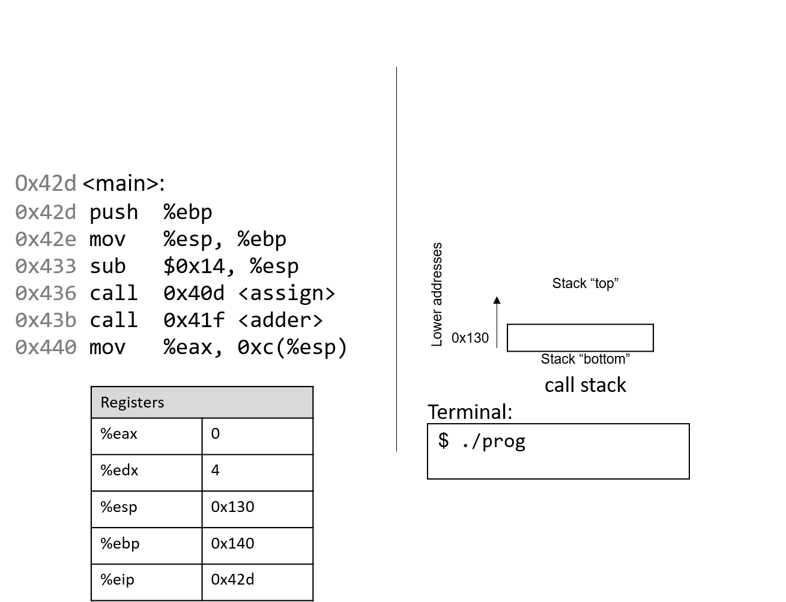

**图 3.** 执行 main 函数之前 CPU 寄存器和调用栈的初始状态

*Figure 3. The initial state of the CPU registers and call stack prior to executing the main function*

回想一下，栈向低地址方向增长。在这个例子中，`%ebp` 是地址 0x140，`%esp` 是地址 0x130（这两个值都是为本例虚构的）。寄存器 `%eax` 和 `%edx` 最初存放的是垃圾值。红色（左上角）箭头标出当前正在执行的指令。最初，`%eip` 存放地址 0x42d，即 `main` 函数第一行在程序内存中的地址。我们一起来跟踪程序的执行。

> Recall that the stack grows toward lower addresses. In this example, `%ebp` is address 0x140, and `%esp` is address 0x130 (both of these values are made up for this example). Registers `%eax` and `%edx` initially contain junk values. The red (upper-left) arrow indicates the currently executing instruction. Initially, `%eip` contains address 0x42d, which is the program memory address of the first line in the `main` function. Let’s trace through the program’s execution together.

------------------------------------------------------------------------

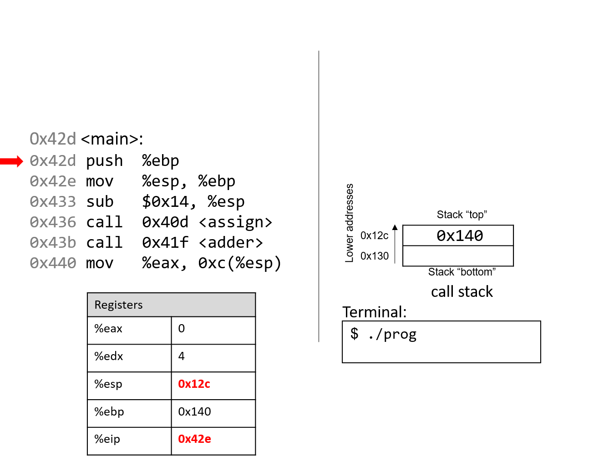

第一条指令把 `ebp` 的值压入栈，保存地址 0x140。由于栈向低地址方向增长，栈指针 `%esp` 更新为 0x12c，比 0x130 小 4 个字节。寄存器 `%eip` 前进到顺序中的下一条指令。

> The first instruction pushes the value of `ebp` onto the stack, saving address 0x140. Since the stack grows toward lower addresses, the stack pointer `%esp` updates to 0x12c, which is 4 bytes less than 0x130. Register `%eip` advances to the next instruction in sequence.

------------------------------------------------------------------------

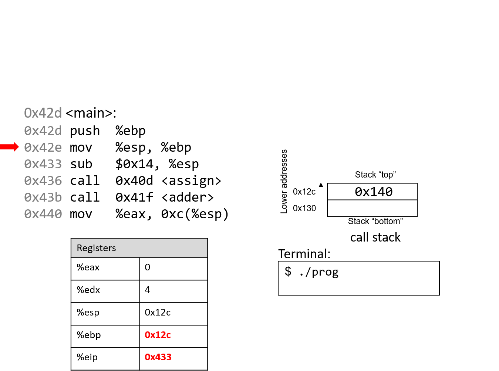

下一条指令（`mov %esp, %ebp`）把 `%ebp` 的值更新为与 `%esp` 相同。帧指针（`%ebp`）现在指向 `main` 函数栈帧的开头。`%eip` 前进到顺序中的下一条指令。

> The next instruction (`mov %esp, %ebp`) updates the value of `%ebp` to be the same as `%esp`. The frame pointer (`%ebp`) now points to the start of the stack frame for the `main` function. `%eip` advances to the next instruction in sequence.

------------------------------------------------------------------------

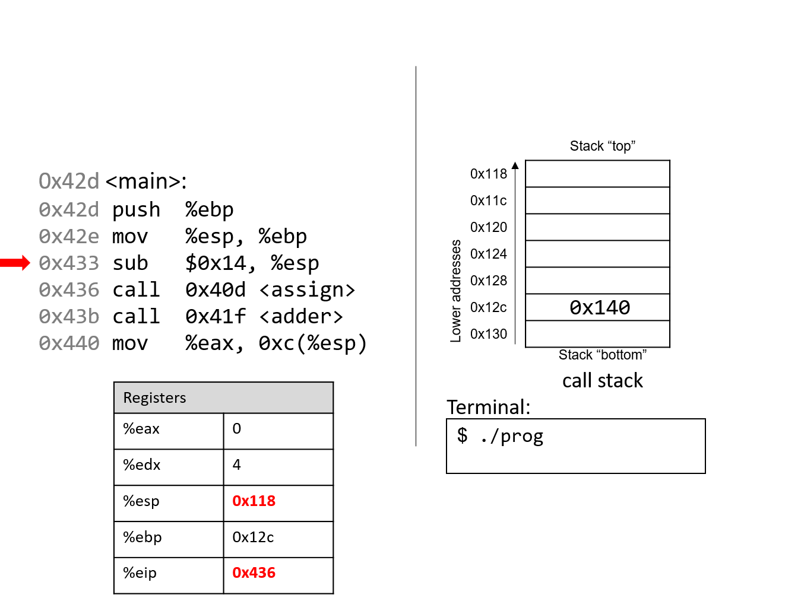

`sub` 指令从栈指针的地址中减去 0x14，让栈「增长」20 个字节。寄存器 `%eip` 前进到下一条指令，也就是第一条 `call` 指令。

> The `sub` instruction subtracts 0x14 from the address of our stack pointer, "growing" the stack by 20 bytes. Register `%eip` advances to the next instruction, which is the first `call` instruction.

------------------------------------------------------------------------

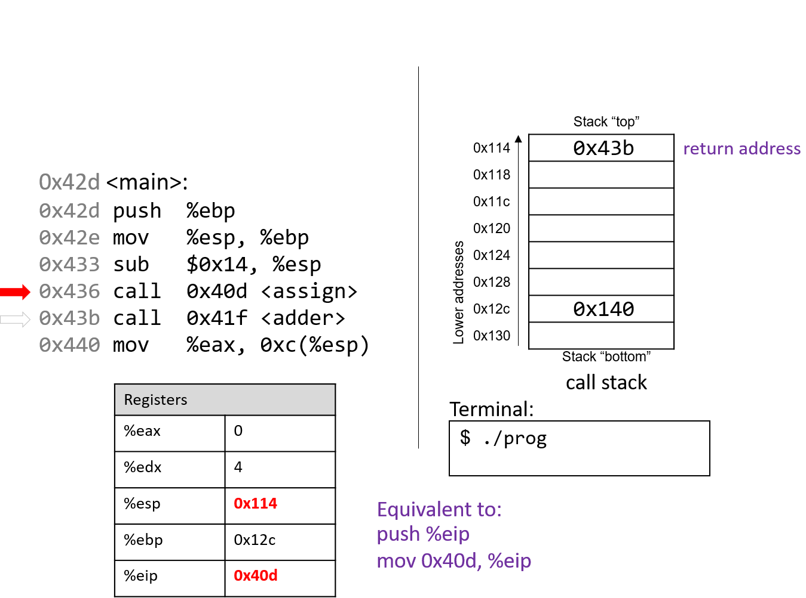

`call <assign>` 指令把寄存器 `%eip` 中的值（它表示*下一条*要执行的指令的地址）压入栈。由于 `call <assign>` 之后的下一条指令的地址是 0x43b，这个值就作为返回地址被压入栈。回想一下，返回地址表示程序执行返回 `main` 时应当从哪个程序地址继续执行。

> The `call <assign>` instruction pushes the value inside register `%eip` (which denotes the address of the *next* instruction to execute) onto the stack. Since the next instruction after `call <assign>` has the address 0x43b, that value is pushed onto the stack as the return address. Recall that the return address indicates the program address where execution should resume when program execution returns to `main`.

接着，`call` 指令把 `assign` 函数的地址（0x40d）移入寄存器 `%eip`，表示程序应当进入被调用函数 `assign` 继续执行，而不是执行 `main` 中的下一条指令。

> Next, the `call` instruction moves the address of the `assign` function (0x40d) into register `%eip`, signifying that program execution should continue into the callee function `assign` and not the next instruction in `main`.

------------------------------------------------------------------------

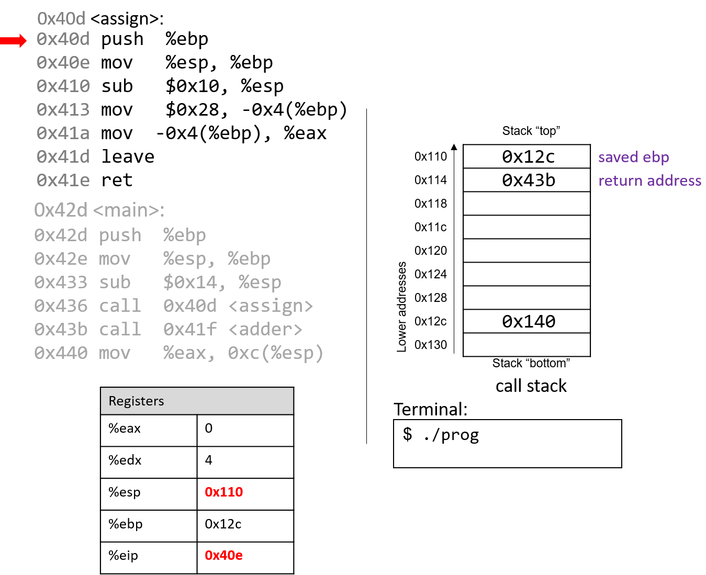

`assign` 函数中最先执行的两条指令是每个函数都要做的例行簿记工作。第一条指令把 `%ebp` 中存放的值（内存地址 0x12c）压入栈。回想一下，这个地址指向 `main` 栈帧的开头。`%eip` 前进到 `assign` 中的第二条指令。

> The first two instructions that execute in the `assign` function are the usual book-keeping that every function performs. The first instruction pushes the value stored in `%ebp` (memory address 0x12c) onto the stack. Recall that this address points to the beginning of the stack frame for `main`. `%eip` advances to the second instruction in `assign`.

------------------------------------------------------------------------

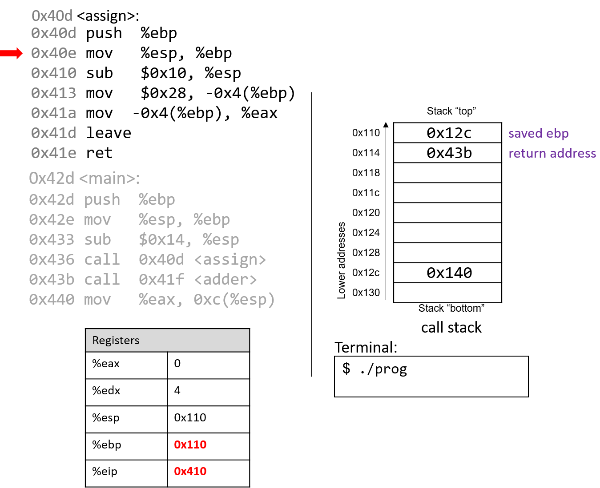

下一条指令（`mov %esp, %ebp`）更新 `%ebp`，使其指向栈顶，标志着 `assign` 栈帧的开始。指令指针（`%eip`）前进到 `assign` 函数中的下一条指令。

> The next instruction (`mov %esp, %ebp`) updates `%ebp` to point to the top of the stack, marking the beginning of the stack frame for `assign`. The instruction pointer (`%eip`) advances to the next instruction in the `assign` function.

------------------------------------------------------------------------

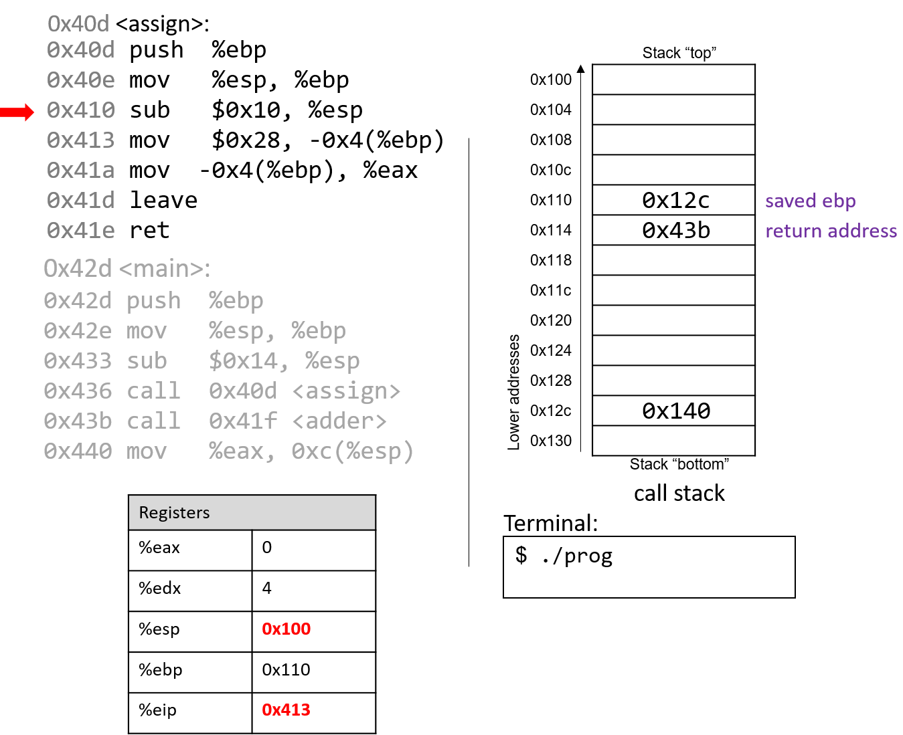

地址 0x410 处的 `sub` 指令让栈增长 16 个字节，在栈帧上腾出额外的空间存放局部值，并更新 `%esp`。指令指针再次前进到 `assign` 函数中的下一条指令。

> The `sub` instruction at address 0x410 grows the stack by 16 bytes, creating extra space on the stack frame to store local values and updating `%esp`. The instruction pointer again advances to the next instruction in the `assign` function.

------------------------------------------------------------------------

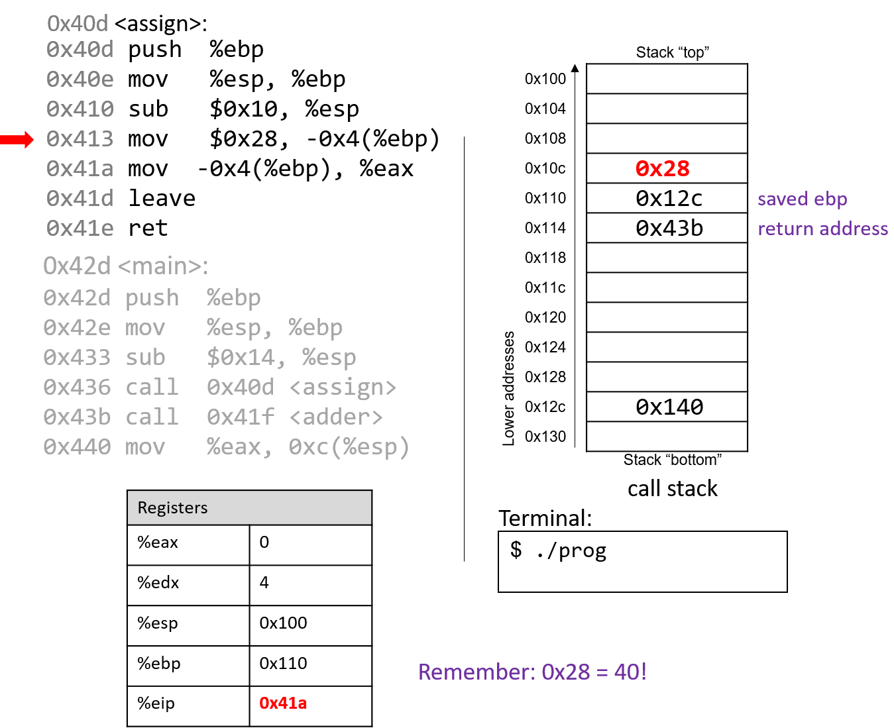

地址 0x413 处的 `mov` 指令把值 `$0x28`（即 40）移到栈上地址 `-0x4(%ebp)` 处，也就是帧指针上方四个字节的位置。回想一下，帧指针常用来引用栈上的位置。`%eip` 前进到 `assign` 函数中的下一条指令。

> The `mov` instruction at address 0x413 moves the value `$0x28` (or 40) onto the stack at address `-0x4(%ebp)`, which is four bytes above the frame pointer. Recall that the frame pointer is commonly used to reference locations on the stack. `%eip` advances to the next instruction in the `assign` function.

------------------------------------------------------------------------

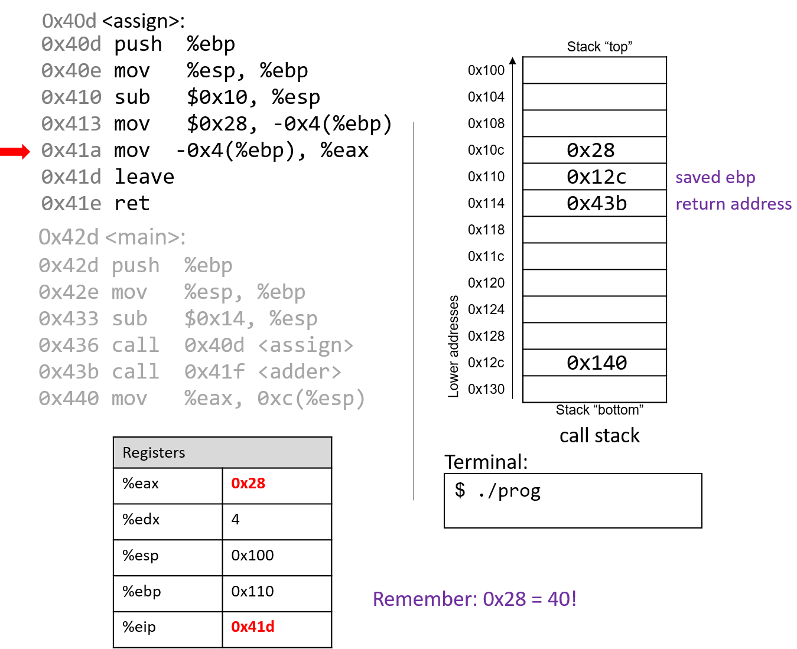

地址 0x41a 处的 `mov` 指令把值 `$0x28` 放到寄存器 `%eax` 中，该寄存器存放函数的返回值。`%eip` 前进到 `assign` 函数中的 `leave` 指令。

> The `mov` instruction at address 0x41a places the value `$0x28` into register `%eax`, which holds the return value of the function. `%eip` advances to the `leave` instruction in the `assign` function.

------------------------------------------------------------------------

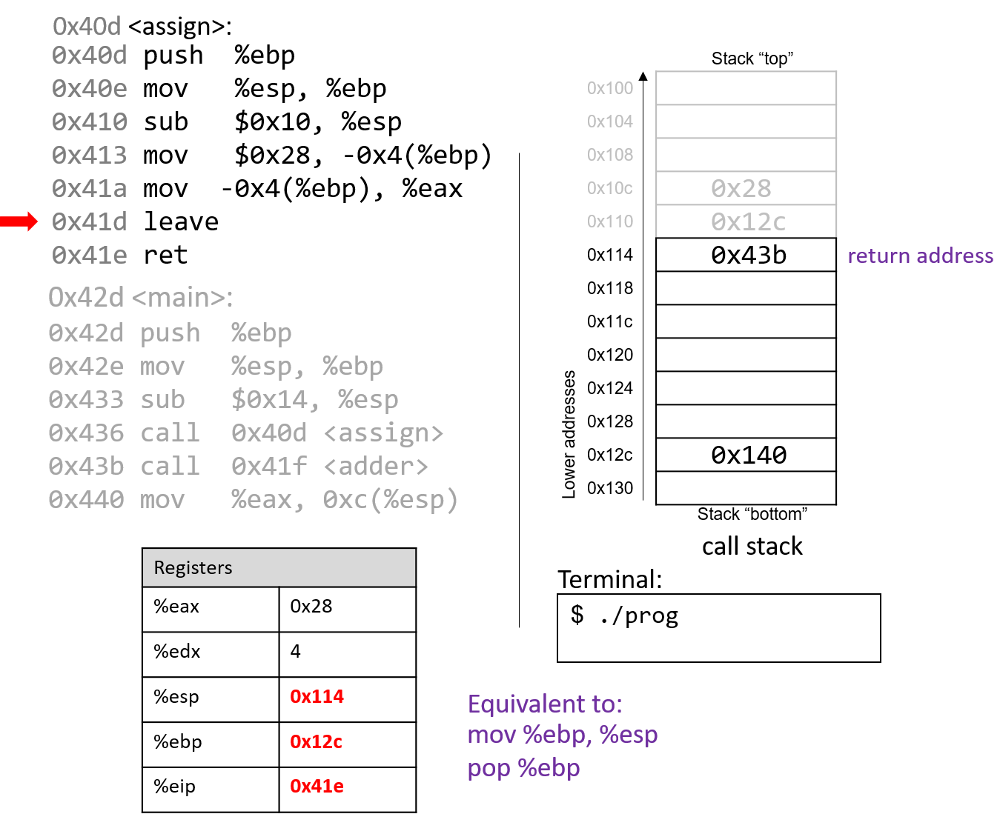

此时，`assign` 函数几乎执行完了。下一条执行的指令是 `leave`，它为从函数调用返回准备好栈。回想一下，`leave` 相当于下面这一对指令：

> At this point, the `assign` function has almost completed execution. The next instruction that executes is the `leave` instruction, which prepares the stack for returning from the function call. Recall that `leave` is analogous to the following pair of instructions:

```
mov %ebp, %esp
pop %ebp
```

换句话说，CPU 用帧指针覆盖栈指针。在我们的例子中，栈指针先从 0x100 被更新为 0x110。接着，CPU 执行 `pop %ebp`，取出位于 0x110 处的值（在我们的例子中是地址 0x12c），放入 `%ebp`。回想一下，0x12c 是 `main` 栈帧的开头。`%esp` 变为 0x114，`%eip` 指向 `assign` 函数中的 `ret` 指令。

> In other words, the CPU overwrites the stack pointer with the frame pointer. In our example, the stack pointer is initially updated from 0x100 to 0x110. Next, the CPU executes `pop %ebp`, which takes the value located at 0x110 (in our example, the address 0x12c) and places it in `%ebp`. Recall that 0x12c is the start of the stack frame for `main`. `%esp` becomes 0x114 and `%eip` points to the `ret` instruction in the `assign` function.

------------------------------------------------------------------------

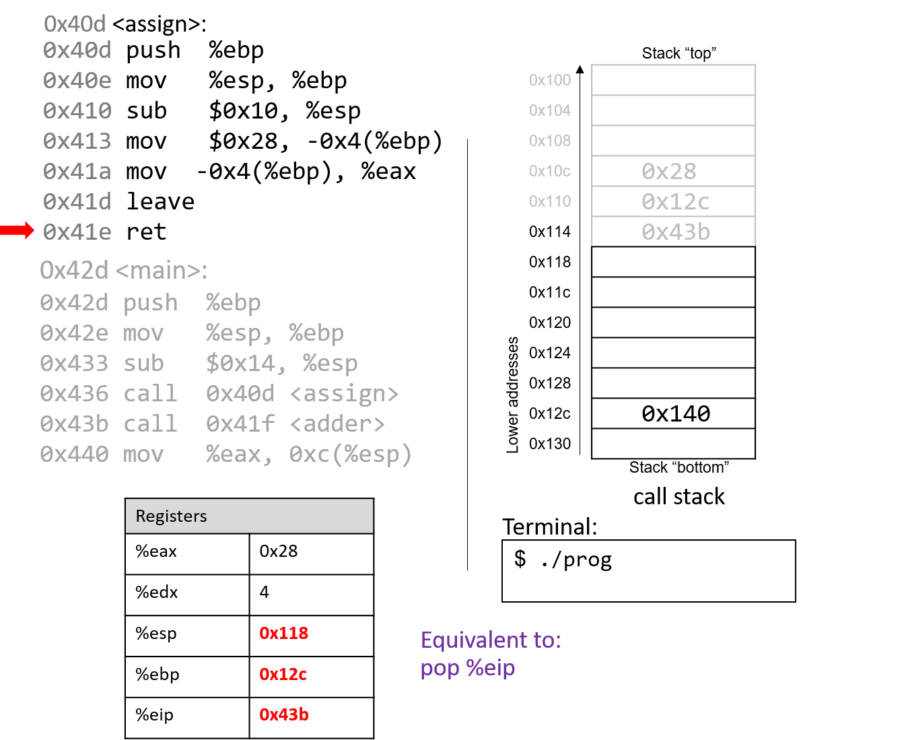

`assign` 中的最后一条指令是 `ret`。`ret` 执行时，返回地址被从栈中弹出，放入寄存器 `%eip`。在我们的例子中，`%eip` 现在前进到对 `adder` 函数的调用。

> The last instruction in `assign` is a `ret` instruction. When `ret` executes, the return address is popped off the stack into register `%eip`. In our example, `%eip` now advances to the call to the `adder` function.

此时有几件重要的事值得注意：

> Some important things to notice at this juncture:

- 栈指针和帧指针已恢复为调用 `assign` 之前的值，这表明 `main` 的栈帧再次成为活动帧。

> - The stack pointer and frame pointer have been restored to their values prior to the call to `assign`, reflecting that the stack frame for `main` is once again the active frame.

- 之前那个活动栈帧中的旧值*并没有*被移除，它们仍然存在于调用栈上。

> - The old values on the stack from the prior active stack frame are *not* removed. They still exist on the call stack.

------------------------------------------------------------------------

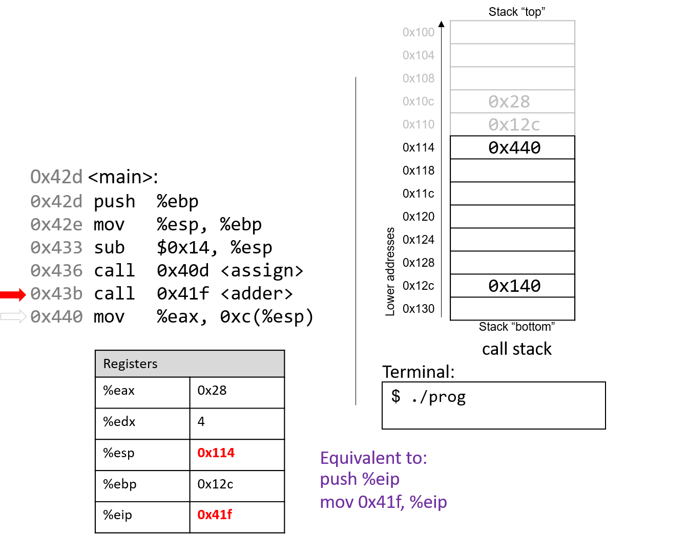

对 `adder` 的调用用一个新的返回地址（0x440）*覆盖*了栈上旧的返回地址。这个返回地址指向 `adder` 返回后要执行的下一条指令，即 `mov %eax, 0xc(%ebp)`。`%eip` 反映的是 `adder` 中要执行的第一条指令，位于地址 0x41f。

> The call to `adder` *overwrites* the old return address on the stack with a new return address (0x440). This return address points to the next instruction to be executed after `adder` returns, or `mov %eax, 0xc(%ebp)`. `%eip` reflects the first instruction to execute in `adder`, which is at address 0x41f.

> [!NOTE] 译注
> 按上面的清单，地址 0x440 处的指令是 `mov %eax,0xc(%esp)`（以 `%esp` 为基址），原文这里写成了 `0xc(%ebp)`。

------------------------------------------------------------------------

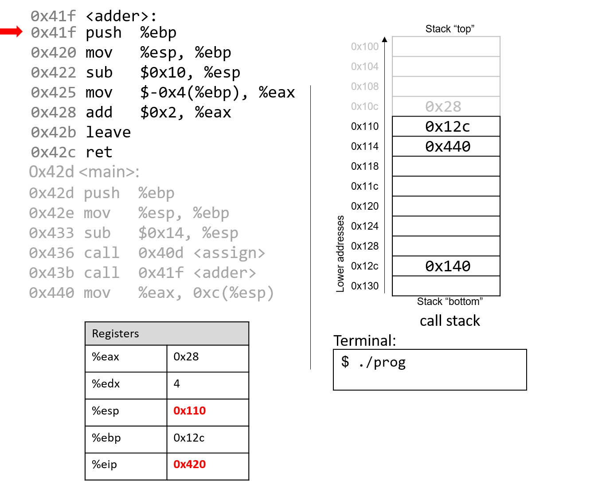

`adder` 函数中的第一条指令把调用者的帧指针（`main` 的 `%ebp`）保存到栈上。

> The first instruction in the `adder` function saves the caller’s frame pointer (`%ebp` of `main`) on the stack.

------------------------------------------------------------------------

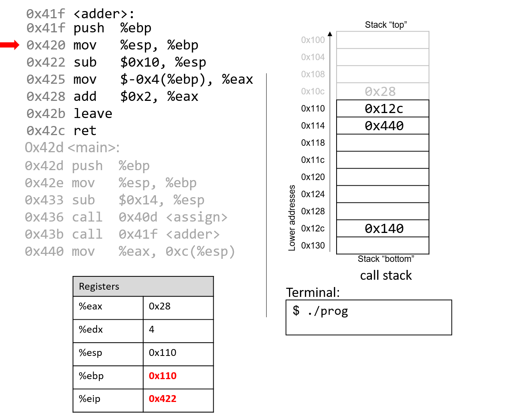

下一条指令用 `%esp` 的当前值，即地址 0x110，更新 `%ebp`。这两条指令合起来建立了 `adder` 栈帧的开头。

> The next instruction updates `%ebp` with the current value of `%esp`, or address 0x110. Together, these last two instructions establish the beginning of the stack frame for `adder`.

------------------------------------------------------------------------

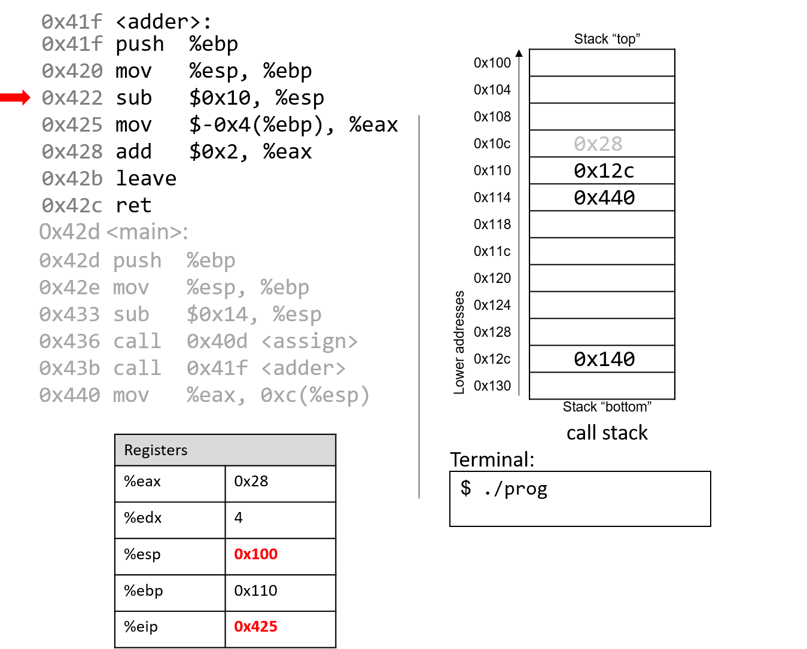

地址 0x422 处的 `sub` 指令让栈「增长」16 个字节。再次注意，让栈增长并不会影响栈上之前创建的任何值。同样，旧值会一直散落在栈上，直到被覆盖为止。

> The `sub` instruction at address 0x422 "grows" the stack by 16 bytes. Notice again that growing the stack does not affect any previously created values on the stack. Again, old values will litter the stack until they are overwritten.

------------------------------------------------------------------------

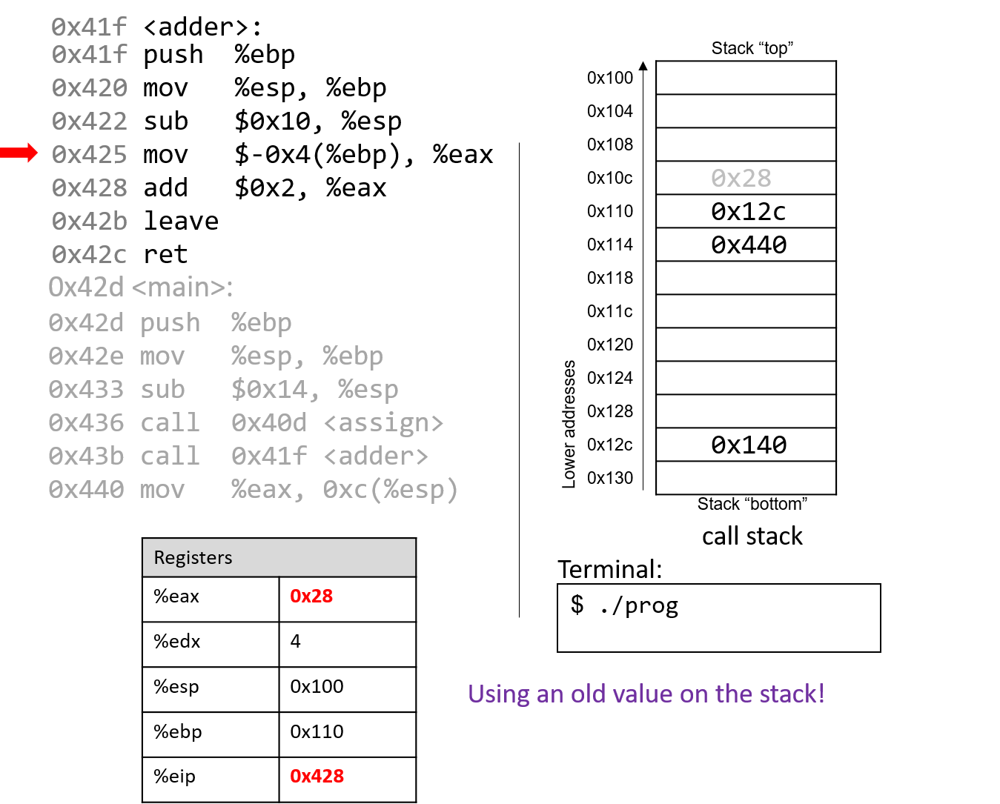

请仔细看看接下来执行的指令：`mov $-0x4(%ebp), %eax`。这条指令把栈上的一个*旧*值移入寄存器 `%eax`！这是程序员忘了在函数 `adder` 中初始化 `a` 的直接后果。

> Pay close attention to the next instruction that executes: `mov $-0x4(%ebp), %eax`. This instruction moves an *old* value that is on the stack into register `%eax`! This is a direct result of the fact that the programmer forgot to initialize `a` in the function `adder`.

> [!NOTE] 译注
> 指令中多了一个 `$`，按清单应为 `mov -0x4(%ebp),%eax`：这里是从栈上地址 `%ebp-4` 读取内存，而不是立即数。`adder` 的 `-0x4(%ebp)` 恰好与刚才 `assign` 存放 `y`（40）的位置相同，所以读到的「旧值」就是 40。

------------------------------------------------------------------------

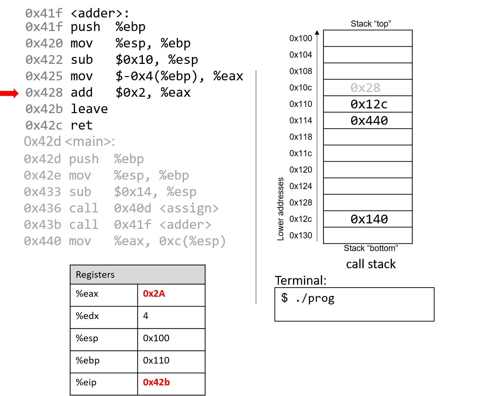

地址 0x428 处的 `add` 指令把寄存器 `%eax` 加 2。回想一下，IA32 通过寄存器 `%eax` 传递返回值。最后这两条指令合起来，等价于 `adder` 中的下面这段代码：

> The `add` instruction at address 0x428 adds 2 to register `%eax`. Recall that IA32 passes the return value through register `%eax`. Together, the last two instructions are equivalent to the following code in `adder`:

```
int a;
return a + 2;
```

------------------------------------------------------------------------


`leave` 执行后，帧指针再次指向 `main` 栈帧的开头，即地址 0x12c。栈指针现在存放的是地址 0x114。

> After `leave` executes, the frame pointer again points to the beginning of the stack frame for `main`, or address 0x12c. The stack pointer now stores the address 0x114.

------------------------------------------------------------------------

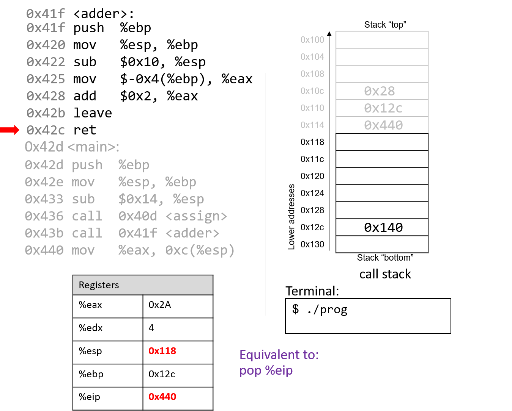

`ret` 的执行把返回地址从栈中弹出，把指令指针恢复为 0x440，也就是 `main` 中下一条要执行的指令的地址。`%esp` 现在是 0x118。

> The execution of `ret` pops the return address off the stack, restoring the instruction pointer back to 0x440, or the address of the next instruction to execute in `main`. The address of `%esp` is now 0x118.

------------------------------------------------------------------------

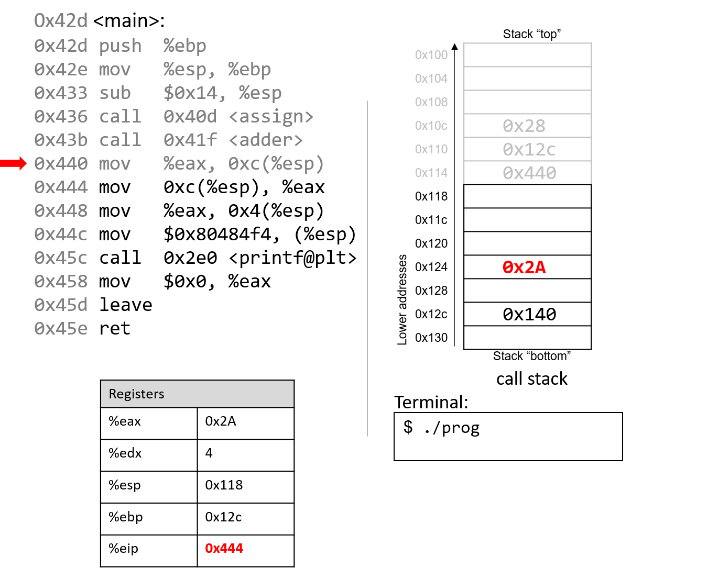

`mov %eax, 0xc(%esp)` 指令把 `%eax` 中的值放到 `%esp` 下方 12 个字节（三个位置）处。

> The `mov %eax, 0xc(%esp)` instruction places the value in `%eax` in a location 12 bytes (three spaces) below `%esp`.

------------------------------------------------------------------------

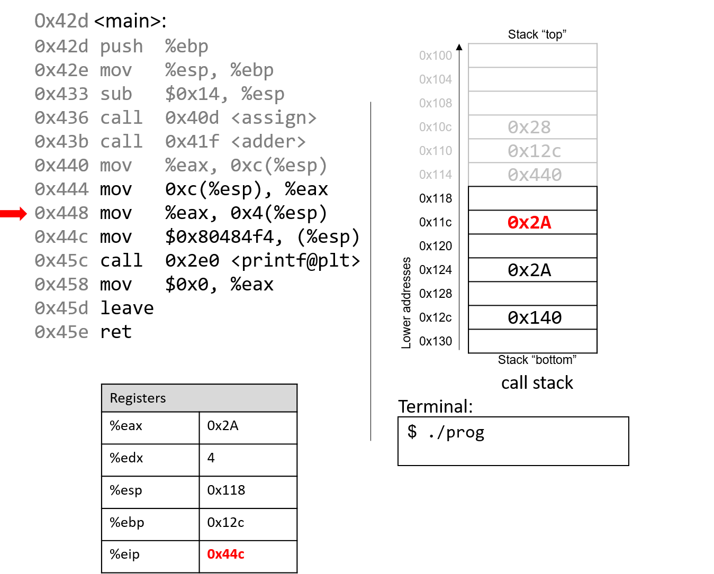

稍微跳过一点：地址 0x444 和 0x448 处的 `mov` 指令把 `%eax` 设为保存在位置 `%esp+12` 处的值（即 0x2A），并把 0x2A 放到栈顶下方一个位置处（地址 `%esp + 4`，即 0x11c）。

> Skipping ahead a little, the `mov` instructions at addresses 0x444 and 0x448 set `%eax` to the value saved at location `%esp+12` (or 0x2A) and places 0x2A one spot below the top of the stack (address `%esp + 4`, or 0x11c).

------------------------------------------------------------------------

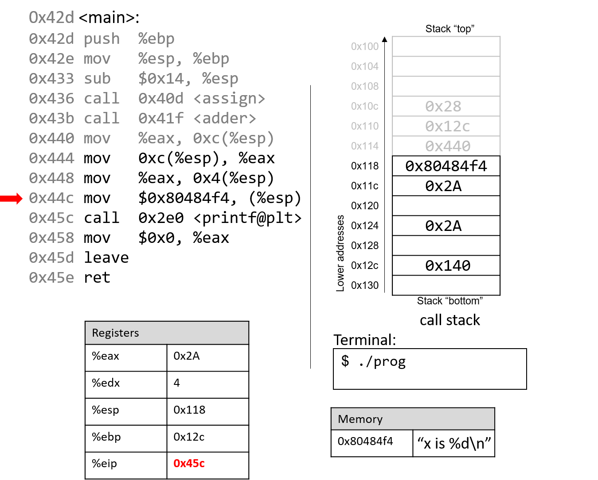

下一条指令（`mov $0x80484f4, (%esp)`）把一个本身是内存地址的常数值复制到栈顶。这个内存地址 0x80484f4 处存放的是字符串 `"x is %d\n"`。指令指针前进到对 `printf` 函数的调用（用标签 `<printf@plt>` 表示）。

> The next instruction (`mov $0x80484f4, (%esp)`) copies a constant value that is a memory address to the top of the stack. This particular memory address, 0x80484f4, contains the string `"x is %d\n"`. The instruction pointer advances to the call to the `printf` function (which is denoted with the label `<printf@plt>`).

> [!NOTE] 译注
> 按本节开头的源代码，这个格式字符串其实是 `"x is: %d\n"`（多一个冒号）；下文同。

------------------------------------------------------------------------

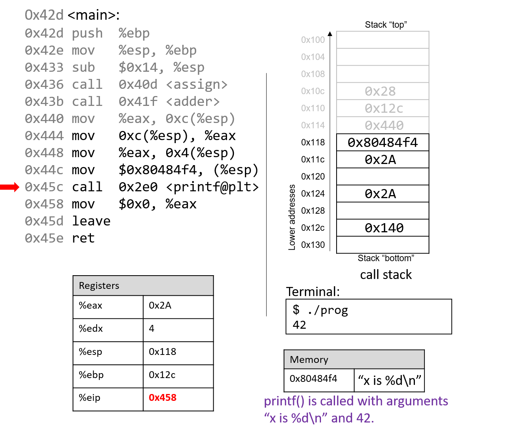

为简洁起见，我们不跟踪 `printf` 函数，它是 `stdio.h` 的一部分。不过，从手册页（`man -s3 printf`）可以知道，`printf` 的格式如下：

> For the sake of brevity, we will not trace the `printf` function, which is part of `stdio.h`. However, we know from the manual page (`man -s3 printf`) that `printf` has the following format:

```
int printf(const char * format, ...)
```

换句话说，第一个参数是指向指定格式的字符串的指针，从第二个参数起是该格式中用到的值。地址 0x444–0x45c 指定的那些指令，对应于 `main` 函数中的下面这一行：

> In other words, the first argument is a pointer to a string specifying the format, and the second argument onward specify the values that are used in that format. The instructions specified by addresses 0x444 - 0x45c correspond to the following line in the `main` function:

```
printf("x is %d\n", x);
```

调用 `printf` 函数时：

> When the `printf` function is called:

- 一个指定 `printf` 调用之后要执行的指令的返回地址被压入栈。

> - A return address specifying the instruction that executes after the call to `printf` is pushed onto the stack.

- `%ebp` 的值被压入栈，并更新 `%ebp`，使其指向栈顶，标志着 `printf` 栈帧的开始。

> - The value of `%ebp` is pushed onto the stack, and `%ebp` is updated to point to the top of the stack, indicating the beginning of the stack frame for `printf`.

在某个时刻，`printf` 会引用它的参数，即字符串 `"x is %d\n"` 和值 0x2A。回想一下，返回地址就位于 `%ebp` 正下方的位置 `%ebp+4` 处。因此，第一个参数位于 `%ebp+8`（即紧挨在返回地址*下方*），第二个参数位于 `%ebp+12`。

> At some point, `printf` references its arguments, which are the string `"x is %d\n"` and the value 0x2A. Recall that the return address is located directly below `%ebp` at location `%ebp+4`. The first argument is thus located at `%ebp+8` (i.e., right *below* the return address), and the second argument is located at `%ebp+12`.

对于任何有 *n* 个参数的函数，GCC 把第一个参数放在位置 `%ebp+8`，第二个放在 `%ebp+12`，第 *n* 个参数放在位置 `(%ebp+8) + (4*(n-1))`。

> For any function with *n* arguments, GCC places the first argument at location `%ebp+8`, the second at `%ebp+12`, and the *n*<sup>th</sup> argument at location `(%ebp+8) + (4*(n-1))`.

> [!NOTE] 译注
> 这个公式假定每个参数都占 4 字节（`int`、指针等）。`double`、`long long` 或按值传递的结构体会占更多空间，后续参数的偏移也随之变化。

调用 `printf` 之后，值 0x2A 以整数格式输出给用户。于是，屏幕上打印出了值 42！

> After the call to `printf`, the value 0x2A is output to the user in integer format. Thus, the value 42 is printed to the screen!

------------------------------------------------------------------------

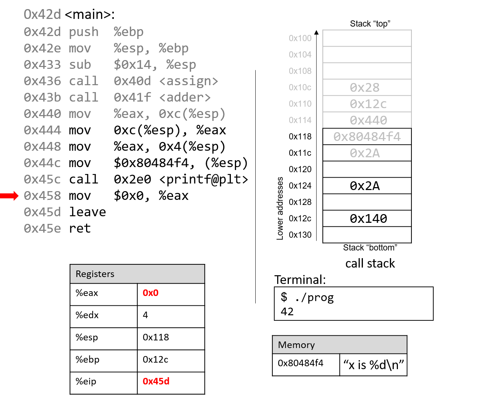

调用 `printf` 之后，最后几条指令清理栈，为从 `main` 函数干净地退出做准备。首先，值 0x0 被放入寄存器 `%eax`，表示 `main` 返回值 0。回想一下，程序返回 0 表示正常终止。

> After the call to `printf`, the last few instructions clean up the stack and prepare a clean exit from the `main` function. First, the value 0x0 is placed in register `%eax`, signifying that the value 0 is returned from `main`. Recall that a program returns 0 to indicate correct termination.

------------------------------------------------------------------------

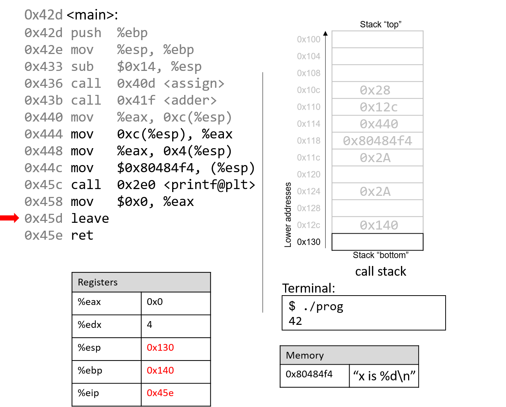

`leave` 和 `ret` 执行之后，栈指针和帧指针恢复为执行 `main` 之前的原始值。返回寄存器 `%eax` 中是 0x0，程序返回 0。

> After `leave` and `ret` are executed, the stack and frame pointers revert to their original values prior to the execution of `main`. With 0x0 in the return register `%eax`, the program returns 0.

如果你仔细读完了本节，应该能理解为什么我们的程序会打印出值 42。本质上，程序无意中使用了栈上的旧值，导致它以我们没有预料到的方式运行。虽然这个例子相当无害，但在后面的小节中，我们会讨论黑客如何滥用函数调用，让程序以真正恶意的方式出错。

> If you have carefully read through this section, you should understand why our program prints out the value 42. In essence, the program inadvertently uses old values on the stack to cause it to behave in a way that we didn’t expect. While this example was pretty harmless, we discuss in future sections how hackers have misused function calls to make programs misbehave in truly malicious ways.
