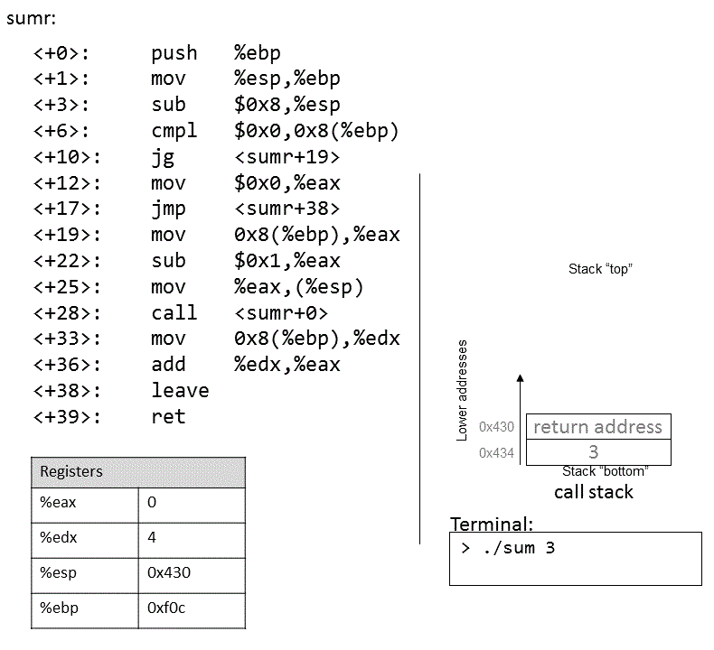

> [!WARNING] 说明
> 本文是个人学习用的**非官方**中英对照译文，原文：<https://diveintosystems.org/book/C8-IA32/recursion.html>。
> 原书采用 CC BY-NC-ND 4.0 许可（禁止演绎），**请勿公开传播本译文**。
> 标为「译注」「现代更新」的内容是译者补充，不代表原书作者观点；代码与原文逐字一致，未作改动。


*8.6. Recursion*

递归函数是一类特殊的函数，它们调用自身（也称为**自引用**函数，self-referential function）来计算一个值。和非递归的函数一样，递归函数的每次调用都会创建新的栈帧。与标准函数不同的是，递归函数中包含对自身的函数调用。

> Recursive functions are a special class of functions that call themselves (also known as **self-referential** functions) to compute a value. Like their nonrecursive counterparts, recursive functions create new stack frames for each function call. Unlike standard functions, recursive functions contain function calls to themselves.

我们再来看把从 *1* 到 *n* 的正整数加起来的问题。在前面的小节中，我们讨论了实现这一任务的 `sumUp` 函数。[表 1](8.6-recursion.html) 展示了一个相关的函数 `sumDown`，它倒序（从 *n* 到 *1*）累加这些数，以及与它等价的递归函数 `sumr`：

> Let’s revisit the problem of summing up the set of positive integers from *1* to *n*. In previous sections, we discussed the `sumUp` function to achieve this task. [Table 1](8.6-recursion.html) shows a related function called `sumDown`, which adds the numbers in reverse (*n* to *1*), and its recursive equivalent `sumr`:

**表 1.** 迭代版本（sumDown）与递归版本（sumr）

*Table 1. Iterative version (sumDown) and recursive version (sumr)*

**迭代版本**

> **Iterative**

```
int sumDown(int n) {
    int total = 0;
    int i = n;
    while (i > 0) {
        total += i;
        i--;
    }
    return total;
}
```

**递归版本**

> **Recursive**

```
int sumr(int n) {
    if (n <= 0) {
        return 0;
    }
    return n + sumr(n-1);
}
```

递归函数 `sumr` 中的基本情形处理所有小于 1 的 *n* 值，递归步骤则把 *n* 的当前值加到以 *n-1* 调用 `sumr` 的结果上。用 `-m32` 选项编译 `sumr` 并用 GDB 反汇编，得到下面的汇编代码：

> The base case in the recursive function `sumr` accounts for any values of *n* that are less than one, and the recursive step adds the current value of *n* to the result of the function call to `sumr` with the value *n-1*. Compiling `sumr` with the `-m32` flag and disassembling it with GDB yields the following assembly code:

```
0x0804841d <+0>:  push  %ebp                  # save ebp
0x0804841e <+1>:  mov   %esp,%ebp             # update ebp (new stack frame)
0x08048420 <+3>:  sub   $0x8,%esp             # add 8 bytes to stack frame
0x08048423 <+6>:  cmp   $0x0,0x8(%ebp)        # compare ebp+8 (n) with 0
0x08048427 <+10>: jg    0x8048430 <sumr+19>   # if (n > 0), goto <sumr+19>
0x08048429 <+12>: mov   $0x0,%eax             # copy 0 to eax (result)
0x0804842e <+17>: jmp   0x8048443 <sumr+38>   # goto <sumr+38>
0x08048430 <+19>: mov   0x8(%ebp),%eax        # copy n to eax (result)
0x08048433 <+22>: sub   $0x1,%eax             # subtract 1 from n (result--)
0x08048436 <+25>: mov   %eax,(%esp)           # copy n-1 to top of stack
0x08048439 <+28>: call  0x804841d <sumr>      # call sumr() function
0x0804843e <+33>: mov   0x8(%ebp),%edx        # copy n to edx
0x08048441 <+36>: add   %edx,%eax             # add n to result (result+=n)
0x08048443 <+38>: leave                       # prepare to leave the function
0x08048444 <+39>: ret                         # return result
```

上面汇编代码的每一行都附有英文注释。[表 2](8.6-recursion.html) 给出了对应的 `goto` 形式，以及不含 `goto` 语句的 C 程序：

> Each line in the preceding assembly code is annotated with its English translation. [Table 2](8.6-recursion.html) shows the corresponding `goto` form and C program without `goto` statements:

**表 2.** sumr 汇编代码的 C goto 形式及其翻译

*Table 2. C goto form and translation of sumr assembly code*

**C goto 形式**

> **C goto form**

```
int sumr(int n) {
    int result;
    if (n > 0) {
        goto body;
    }
    result = 0;
    goto done;
body:
    result = n;
    result -= 1;
    result = sumr(result);
    result += n;
done:
    return result;
}
```

**不含 goto 语句的 C 版本**

> **C version without goto statements**

```
int sumr(int n) {
    int result;
    if (n <= 0) {
        return 0;
    }
    result = sumr(n-1);
    result += n;
    return result;
}
```

尽管这个翻译乍一看与原来的 `sumr` 函数并不完全相同，但仔细检查就会发现，两个函数确实是等价的。

> Although this translation may not initially appear to be identical to the original `sumr` function, close inspection reveals that the two functions are indeed equivalent.

### 8.6.1. 动画：观察调用栈如何变化

*8.6.1. Animation: Observing How the Call Stack Changes*

作为练习，我们鼓励你把栈画出来，看看其中的值是如何变化的。下面的动画描绘了用值 3 运行这个函数时栈是如何更新的。

> As an exercise, we encourage you to draw out the stack and see how the values change. The animation below depicts how the stack is updated when we run this function with the value 3.


