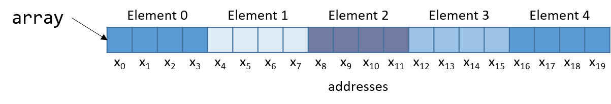

> [!WARNING] 说明
> 本文是个人学习用的**非官方**中英对照译文，原文：<https://diveintosystems.org/book/C8-IA32/arrays.html>。
> 原书采用 CC BY-NC-ND 4.0 许可（禁止演绎），**请勿公开传播本译文**。
> 标为「译注」「现代更新」的内容是译者补充，不代表原书作者观点；代码与原文逐字一致，未作改动。


*8.7. Arrays*

回想一下，[数组](../C1-C_intro/1.5-arrays_strings.html)是同类型数据元素的有序集合，这些元素在内存中连续存放。静态分配的[一维数组](../C2-C_depth/2.5-arrays.html)形如 `Type arr[N]`，其中 `Type` 是数据类型，`arr` 是与数组关联的标识符，`N` 是数据元素的个数。无论是静态地声明为 `Type arr[N]`，还是动态地写成 `arr = malloc(N*sizeof(Type))`，都会分配总共 *N* × sizeof(*Type*) 字节的内存，并让 `arr` 指向它。

> Recall that [arrays](../C1-C_intro/1.5-arrays_strings.html) are ordered collections of data elements of the same type that are contiguously stored in memory. Statically allocated [single-dimension arrays](../C2-C_depth/2.5-arrays.html) have the form `Type arr[N]`, where `Type` is the data type, `arr` is the identifier associated with the array, and `N` is the number of data elements. Declaring an array statically as `Type arr[N]` or dynamically as `arr = malloc(N*sizeof(Type))` allocates *N* x sizeof(*Type*) total bytes of memory, with `arr` pointing to it.

要访问数组 `arr` 中下标为 *i* 的元素，使用语法 `arr[i]`。编译器在翻译成汇编之前，通常会把数组引用转换成[指针运算](../C2-C_depth/2.2-pointers.html)。所以，`arr+i` 等价于 `&arr[i]`，`*(arr+i)` 等价于 `arr[i]`。由于 `arr` 中的每个数据元素都是 `Type` 类型，`arr+i` 意味着元素 *i* 存放在地址 `arr + sizeof(Type) * i` 处。

> To access the element at index *i* in array `arr`, use the syntax `arr[i]`. Compilers commonly convert array references into [pointer arithmetic](../C2-C_depth/2.2-pointers.html) prior to translating to assembly. So, `arr+i` is equivalent to `&arr[i]`, and `*(arr+i)` is equivalent to `arr[i]`. Since each data element in `arr` is of type `Type`, `arr+i` implies that element *i* is stored at address `arr + sizeof(Type) * i`.

[表 1](8.7-arrays.html) 概括了一些常见的数组操作及其对应的汇编指令。假设寄存器 `%edx` 存放 `arr` 的地址，寄存器 `%ecx` 存放值 `i`，寄存器 `%eax` 代表某个变量 `x`。

> [Table 1](8.7-arrays.html) outlines some common array operations and their corresponding assembly instructions. Assume that register `%edx` stores the address of `arr`, register `%ecx` stores the value `i`, and register `%eax` represents some variable `x`.

**表 1.** 常见的数组操作及其对应的汇编表示

*Table 1. Common Array Operations and Their Corresponding Assembly Representations*

| 操作 | 类型 | 汇编表示 |
|---|---|---|
| `x = arr` | `int *` | `movl %edx, %eax` |
| `x = arr[0]` | `int` | `movl (%edx), %eax` |
| `x = arr[i]` | `int` | `movl (%edx, %ecx,4), %eax` |
| `x = &arr[3]` | `int *` | `leal 0xc(%edx), %eax` |
| `x = arr+3` | `int *` | `leal 0xc(%edx), %eax` |
| `x = *(arr+3)` | `int` | `movl 0xc(%edx), %eax` |

> | Operation      | Type    | Assembly Representation     |
> |----------------|---------|-----------------------------|
> | `x = arr`      | `int *` | `movl %edx, %eax`           |
> | `x = arr[0]`   | `int`   | `movl (%edx), %eax`         |
> | `x = arr[i]`   | `int`   | `movl (%edx, %ecx,4), %eax` |
> | `x = &arr[3]`  | `int *` | `leal 0xc(%edx), %eax`      |
> | `x = arr+3`    | `int *` | `leal 0xc(%edx), %eax`      |
> | `x = *(arr+3)` | `int`   | `movl 0xc(%edx), %eax`      |

请留意[表 1](8.7-arrays.html) 中每个表达式的*类型*。一般来说，编译器用 `movl` 指令对指针解引用，用 `leal` 指令计算地址。

> Pay close attention to the *type* of each expression in [[ArrayOps]](8.7-arrays.html). In general, the compiler uses `movl` instructions to dereference pointers and the `leal` instruction to compute addresses.

> [!NOTE] 译注
> 原书网页此处的交叉引用渲染成了 `[ArrayOps]`，指的就是本节的表 1；下文的 `[FigArray6]` 指图 1。

注意，要访问元素 `arr[3]`（或用指针运算写成 `*(arr+3)`），编译器是在地址 `arr+3*4` 而不是 `arr+3` 上执行内存查找。要理解为什么必须这样，回想一下，数组中下标为 *i* 的任何元素都存放在地址 `arr + sizeof(Type) * i` 处。因此，编译器必须把下标乘以数据类型的大小，才能算出正确的偏移量。再回想一下，内存是按字节编址的；偏移正确的字节数，就等同于算出了地址。

> Notice that to access element `arr[3]` (or `*(arr+3)` using pointer arithmetic), the compiler performs a memory lookup on address `arr+3*4` instead of `arr+3`. To understand why this is necessary, recall that any element at index *i* in an array is stored at address `arr + sizeof(Type) * i`. The compiler must therefore multiply the index by the size of the data type to compute the correct offset. Recall also that memory is byte-addressable; offsetting by the correct number of bytes is the same as computing an address.

举个例子，考虑一个含有五个整数元素的示例数组（`array`）（[图 1](8.7-arrays.html)）：

> As an example, consider a sample array (`array`) with five integer elements ([Figure 1](8.7-arrays.html)):



**图 1.** 一个五元素整数数组在内存中的布局。每个标为 x<sub>i</sub> 的方框代表一个字节，每个 int 占四个字节。

*Figure 1. The layout of a five-integer array in memory. Each x<sub>i</sub>-labeled box represents one byte, each int is four bytes.*

注意，由于 `array` 是一个整数数组，每个元素恰好占四个字节。因此，一个含五个元素的整数数组占用 20 字节的连续内存。

> Notice that since `array` is an array of integers, each element takes up exactly four bytes. Thus, an integer array with five elements consumes 20 bytes of contiguous memory.

为了计算元素 3 的地址，编译器把下标 3 乘以整数类型的数据大小（4），得到偏移量 12。果然，[图 1](8.7-arrays.html) 中的元素 3 位于字节偏移 x<sub>12</sub> 处。

> To compute the address of element 3, the compiler multiplies the index 3 by the data size of the integer type (4) to yield an offset of 12. Sure enough, element 3 in [[FigArray6]](8.7-arrays.html) is located at byte offset x<sub>12</sub>.

我们来看一个简单的 C 函数 `sumArray`，它把数组中的所有元素加起来：

> Let’s take a look at a simple C function called `sumArray` that sums up all the elements in an array:

```
int sumArray(int *array, int length) {
    int i, total = 0;
    for (i = 0; i < length; i++) {
        total += array[i];
    }
    return total;
}
```

`sumArray` 函数接收一个数组的地址和数组的长度，把数组中的所有元素加起来。现在来看 `sumArray` 函数对应的汇编：

> The `sumArray` function takes the address of an array and the array’s associated length and sums up all the elements in the array. Now take a look at the corresponding assembly for the `sumArray` function:

```
<sumArray>:
 <+0>:  push %ebp                    # save ebp
 <+1>:  mov  %esp,%ebp               # update ebp (new stack frame)
 <+3>:  sub  $0x10,%esp              # add 16 bytes to stack frame
 <+6>:  movl $0x0,-0x8(%ebp)         # copy 0 to %ebp-8 (total)
 <+13>: movl $0x0,-0x4(%ebp)         # copy 0 to %ebp-4 (i)
 <+20>: jmp  0x80484ab <sumArray+46> # goto <sumArray+46> (start)
 <+22>: mov  -0x4(%ebp),%eax         # copy i to %eax
 <+25>: lea  0x0(,%eax,4),%edx       # copy i*4 to %edx
 <+32>: mov  0x8(%ebp),%eax          # copy array to %eax
 <+35>: add  %edx,%eax               # copy array+i*4 to %eax
 <+37>: mov  (%eax),%eax             # copy *(array+i*4) to %eax
 <+39>: add  %eax,-0x8(%ebp)         # add *(array+i*4) to total
 <+42>: addl $0x1,-0x4(%ebp)         # add 1 to i
 <+46>: mov  -0x4(%ebp),%eax         # copy i to %eax
 <+49>: cmp  0xc(%ebp),%eax          # compare i with length
 <+52>: jl   0x8048493 <sumArray+22> # if i<length goto <sumArray+22> (loop)
 <+54>: mov  -0x8(%ebp),%eax         # copy total to eax
 <+57>: leave                        # prepare to leave the function
 <+58>: ret                          # return total
```

跟踪这段汇编代码时，要考虑被访问的数据代表的是地址还是值。例如，`<sumArray+13>` 处的指令使 `%ebp-4` 存放一个 `int` 类型的变量，它的初值被设为 0。与之不同，存放在 `%ebp+8` 处的参数是函数的第一个参数（`array`），它的类型是 `int *`，对应于数组的基地址。另一个变量（我们称之为 `total`）存放在位置 `%ebp-8` 处。

> When tracing this assembly code, consider whether the data being accessed represents an address or a value. For example, the instruction at `<sumArray+13>` results in `%ebp-4` containing a variable of type `int`, which is initially set to 0. In contrast, the argument stored at `%ebp+8` is the first argument to the function (`array`) which is of type `int *` and corresponds to the base address of the array. A different variable (which we call `total`) is stored at location `%ebp-8`.

我们来仔细看看位置 `<sumArray+22>` 和 `<sumArray+39>` 之间的五条指令：

> Let’s take a closer look at the five instructions between locations `<sumArray+22>` and `<sumArray+39>`:

> [!NOTE] 译注
> 实际数一下，从 `<sumArray+22>` 到 `<sumArray+39>`（含两端）共有六条指令（`mov`、`lea`、`mov`、`add`、`mov`、`add`），原文说「五条」是笔误；下文第 21 段同。

```
<+22>: mov  -0x4(%ebp),%eax      # copy i to %eax
<+25>: lea  0x0(,%eax,4),%edx    # copy i*4 to %edx
<+32>: mov  0x8(%ebp),%eax       # copy array to %eax
<+35>: add  %edx,%eax            # copy array+i*4 to %eax
<+37>: mov  (%eax),%eax          # copy *(array+i*4) to %eax
<+39>: add  %eax,-0x8(%ebp)      # add *(array+i*4) to total (total+=array[i])
```

回想一下，编译器常用 `lea` 对操作数执行简单的算术运算。操作数 `0x0(,%eax,4)` 翻译为 `%eax*4 + 0x0`。由于 `%eax` 存放的是值 `i`，这个操作把值 `i*4` 复制到 `%edx`。此时，`%edx` 中存放的是为了算出 `array[i]` 的正确偏移量而必须加上的字节数。

> Recall that the compiler commonly uses `lea` to perform simple arithmetic on operands. The operand `0x0(,%eax,4)` translates to `%eax*4 + 0x0`. Since `%eax` holds the value `i`, this operation copies the value `i*4` to `%edx`. At this point, `%edx` contains the number of bytes that must be added to calculate the correct offset of `array[i]`.

下一条指令（`mov 0x8(%ebp), %eax`）把第一个参数（`array` 的基地址）复制到 `%eax` 中。下一条指令把 `%edx` 加到 `%eax` 上，使 `%eax` 存放 `array+i*4`。回想一下，`array` 中下标为 *i* 的元素存放在地址 `array + sizeof(T) * i` 处。因此，`%eax` 现在存放的是在汇编层面计算出的地址 `&array[i]`。

> The next instruction (`mov 0x8(%ebp), %eax`) copies the first argument (the base address of `array`) into `%eax`. Adding `%edx` to `%eax` in the next instruction causes `%eax` to contain `array+i*4`. Recall that the element at index *i* in `array` is stored at address `array + sizeof(T) * i`. Therefore, `%eax` now contains the assembly-level computation of the address `&array[i]`.

`<sumArray+37>` 处的指令对位于 `%eax` 的值*解引用*，把值 `array[i]` 放入 `%eax`。最后，`%eax` 被加到 `%ebp-8` 中的值，即 `total` 上。因此，位置 `<sumArray+22>` 和 `<sumArray+39>` 之间的五条指令对应于 `sumArray` 函数中的 `total += array[i]` 这一行。

> The instruction at `<sumArray+37>` *dereferences* the value located at `%eax`, placing the value `array[i]` into `%eax`. Lastly, `%eax` is added to the value in `%ebp-8`, or `total`. Therefore, the five instructions between locations `<sumArray+22>` and `<sumArray+39>` correspond to the line `total += array[i]` in the `sumArray` function.
