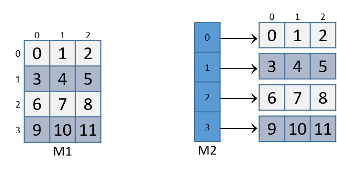
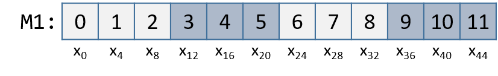
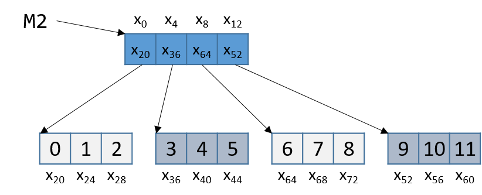

> [!WARNING] 说明
> 本文是个人学习用的**非官方**中英对照译文，原文：<https://diveintosystems.org/book/C8-IA32/matrices.html>。
> 原书采用 CC BY-NC-ND 4.0 许可（禁止演绎），**请勿公开传播本译文**。
> 标为「译注」「现代更新」的内容是译者补充，不代表原书作者观点；代码与原文逐字一致，未作改动。


*8.8. Matrices*

矩阵是一个二维数组。C 中的矩阵可以静态分配为二维数组（`M[n][m]`），可以通过一次 `malloc` 调用动态分配，也可以动态分配为一个「数组的数组」。我们来考虑数组的数组这种实现。第一个数组包含 `n` 个元素（`M[n]`），矩阵中的每个元素 `M[i]` 又包含一个由 `m` 个元素组成的数组。下面的代码片段各自声明了一个 4 × 3 的矩阵：

> A matrix is a two-dimensional (2D) array. A matrix in the C language can be statically allocated as a 2D array (`M[n][m]`), dynamically allocated with a single call to `malloc`, or dynamically allocated as an array of arrays. Let’s consider the array of arrays implementation. The first array contains `n` elements (`M[n]`), and each element `M[i]` in our matrix contains an array of `m` elements. The following code snippets each declare matrices of size 4 × 3:

```
//statically allocated matrix (allocated on stack)
int M1[4][3];

//dynamically allocated matrix (programmer friendly, allocated on heap)
int **M2, i;
M2 = malloc(4 * sizeof(int*));
for (i = 0; i < 4; i++) {
    M2[i] = malloc(3 * sizeof(int));
}
```

在动态分配矩阵的情况下，主数组包含一个连续的 `int` 指针数组，每个整型指针指向内存中一个不同的数组。[图 1](8.8-matrices.html) 展示了我们通常如何直观地想象这两种矩阵。

> In the case of the dynamically allocated matrix, the main array contains a contiguous array of `int` pointers. Each integer pointer points to a different array in memory. [Figure 1](8.8-matrices.html) illustrates how we would normally visualize each of these matrices.



**图 1.** 静态分配（M1）和动态分配（M2）的 3x4 矩阵示意图

*Figure 1. Illustration of a statically allocated (M1) and a dynamically allocated (M2) 3x4 matrix*

对于这两种矩阵声明，都可以用双下标语法 `M[i][j]` 访问元素 (*i*,*j*)，其中 `M` 是 `M1` 或 `M2`。不过，这两个矩阵在内存中的组织方式不同。尽管两者都把各自主数组中的元素连续存放在内存中，但我们的静态分配矩阵还把所有的行也连续存放在内存中，如[图 2](8.8-matrices.html) 所示。

> For both of these matrix declarations, element (*i*,*j*) can be accessed using the double-indexing syntax `M[i][j]`, where `M` is either `M1` or `M2`. However, these matrices are organized differently in memory. Even though both store the elements in their primary array contiguously in memory, our statically allocated matrix also stores all the rows contiguously in memory, as shown in [Figure 2](8.8-matrices.html).



**图 2.** 矩阵 M1 按行主序的内存布局

*Figure 2. Matrix M1’s memory layout in row-major order*

对于 `M2`，并不能保证这种连续的排列。[回想一下](../C2-C_depth/2.5-arrays.html)，要在堆上连续地分配一个 *n* × *m* 的矩阵，应当用一次 `malloc` 调用分配 *n* × *m* 个元素：

> This contiguous ordering is not guaranteed for `M2`. [Recall that](../C2-C_depth/2.5-arrays.html) to contiguously allocate an *n* × *m* matrix on the heap, we should use a single call to `malloc` that allocates *n* × *m* elements:

```
//dynamic matrix (allocated on heap, memory efficient way)
#define ROWS 4
#define COLS 3
int *M3;
M3  = malloc(ROWS * COLS * sizeof(int));
```

回想一下，对于 `M3` 这样的声明，*不能*用 `M[i][j]` 记法访问元素 (*i*,*j*)，而必须用 `M3[i*cols + j]` 的格式来索引元素。

> Recall that with the declaration of `M3`, element (*i*,*j*) *cannot* be accessed using the `M[i][j]` notation. Instead, we must index the element using the format `M3[i*cols + j]`.

### 8.8.1. 连续的二维数组

*8.8.1. Contiguous Two-Dimensional Arrays*

考虑一个函数 `sumMat`，它的第一个参数是指向一个连续分配的（静态分配的或以节省内存的方式动态分配的）矩阵的指针，另外两个参数是行数和列数，它返回矩阵中所有元素的和。

> Consider a function `sumMat` that takes a pointer to a contiguously allocated (either statically allocated or memory-efficiently dynamically allocated) matrix as its first parameter, along with the numbers of rows and columns, and returns the sum of all the elements inside the matrix.

在下面的代码片段中，我们使用按比例计算下标的方式，因为它同时适用于静态分配和动态分配的连续矩阵。回想一下，语法 `m[i][j]` 不适用于前面讨论的节省内存的连续动态分配。

> We use scaled indexing in the code snippet that follows because it applies to both statically and dynamically allocated contiguous matrices. Recall that the syntax `m[i][j]` does not work with the memory-efficient contiguous dynamic allocation previously discussed.

```
int sumMat(int *m, int rows, int cols) {
    int i, j, total = 0;
    for (i = 0; i < rows; i++){
        for (j = 0; j < cols; j++){
            total += m[i*cols + j];
        }
    }
    return total;
}
```

下面是对应的汇编，每一行都加上了英文注解：

> Here is the corresponding assembly. Each line is annotated with its English translation:

```
<sumMat>:
0x08048507 <+0>:  push %ebp                  #save ebp
0x08048508 <+1>:  mov  %esp,%ebp             #update ebp (new stack frame)
0x0804850a <+3>:  sub  $0x10,%esp            #add 4 more spaces to stack frame
0x0804850d <+6>:  movl $0x0,-0xc(%ebp)       #copy 0 to ebp-12 (total)
0x08048514 <+13>: movl $0x0,-0x4(%ebp)       #copy 0 to ebp-4 (i)
0x0804851b <+20>: jmp  0x8048555 <sumMat+78> #goto <sumMat+78>
0x0804851d <+22>: movl $0x0,-0x8(%ebp)       #copy 0 to ebp-8 (j)
0x08048524 <+29>: jmp  0x8048549 <sumMat+66> #goto <sumMat+66>
0x08048526 <+31>: mov  -0x4(%ebp),%eax       #copy i to eax
0x08048529 <+34>: imul 0x10(%ebp),%eax       #multiply i * cols, place in eax
0x0804852d <+38>: mov  %eax,%edx             #copy i*cols to edx
0x0804852f <+40>: mov  -0x8(%ebp),%eax       #copy j to %eax
0x08048532 <+43>: add  %edx,%eax             #add i*cols with j, place in eax
0x08048534 <+45>: lea  0x0(,%eax,4),%edx     #mult (i*cols+j) by 4,put in edx
0x0804853b <+52>: mov  0x8(%ebp),%eax        #copy m pointer to eax
0x0804853e <+55>: add  %edx,%eax             #add m to (i*cols+j)*4,put in eax
0x08048540 <+57>: mov  (%eax),%eax           #copy m[i*cols+j] to eax
0x08048542 <+59>: add  %eax,-0xc(%ebp)       #add eax to total
0x08048545 <+62>: addl $0x1,-0x8(%ebp)       #increment j by 1 (j+=1)
0x08048549 <+66>: mov  -0x8(%ebp),%eax       #copy j to eax
0x0804854c <+69>: cmp  0x10(%ebp),%eax       #compare j with cols
0x0804854f <+72>: jl   0x8048526 <sumMat+31> #if (j < cols) goto <sumMat+31>
0x08048551 <+74>: addl $0x1,-0x4(%ebp)       #add 1 to i (i+=1)
0x08048555 <+78>: mov  -0x4(%ebp),%eax       #copy i to eax
0x08048558 <+81>: cmp  0xc(%ebp),%eax        #compare i with rows
0x0804855b <+84>: jl   0x804851d <sumMat+22> #if (i < rows) goto sumMat+22
0x0804855d <+86>: mov  -0xc(%ebp),%eax       #copy total to eax
0x08048560 <+89>: leave                      #prepare to leave the function
0x08048561 <+90>: ret                        #return total
```

局部变量 `i`、`j` 和 `total` 分别位于栈上的地址 `%ebp-4`、`%ebp-8` 和 `%ebp-12` 处。输入参数 `m`、`row` 和 `cols` 分别位于位置 `%ebp+8`、`%ebp+12` 和 `%ebp+16` 处。有了这些知识，我们来放大只负责访问矩阵中元素 (*i*,*j*) 的那部分代码：

> The local variables `i`, `j`, and `total` are loaded at addresses `%ebp-4`, `%ebp-8`, and `%ebp-12` on the stack, respectively. The input parameters `m`, `row`, and `cols` are located at locations `%ebp+8`, `%ebp+12`, and `%ebp+16`, respectively. Using this knowledge, let’s zoom in on the component that just deals with the access of element (*i*,*j*) in our matrix:

```
0x08048526 <+31>: mov  -0x4(%ebp),%eax    # copy i to eax
0x08048529 <+34>: imul 0x10(%ebp),%eax    # multiply i with cols, place in eax
0x0804852d <+38>: mov  %eax,%edx          # copy i*cols to edx
```

第一组指令计算 `i * cols`，并把结果放到寄存器 `%edx` 中。回想一下，对于名为 `matrix` 的矩阵，`matrix + (i * cols)` 等价于 `&matrix[i]`。

> The first set of instructions computes `i * cols` and places the result in register `%edx`. Recall that for a matrix named `matrix`, `matrix + (i * cols)` is equivalent to `&matrix[i]`.

------------------------------------------------------------------------

```
0x0804852f <+40>: mov -0x8(%ebp),%eax   # copy j to eax
0x08048532 <+43>: add %edx,%eax         # add i*cols with j, place in eax
0x08048534 <+45>: lea 0x0(,%eax,4),%edx # multiply (i*cols+j) by 4, put in edx
```

下一组指令计算 `(i * cols + j) * 4`。编译器把下标 `(i * cols) + j` 乘以四，是因为矩阵中的每个元素都是四字节的整数，这次乘法让编译器能算出正确的偏移量。

> The next set of instructions computes `(i * cols + j) * 4`. The compiler multiplies the index `(i * cols) + j` by four because each element in the matrix is a four-byte integer, and this multiplication enables the compiler to calculate the correct offset.

------------------------------------------------------------------------

最后一组指令把算出的偏移量加到矩阵指针上，并对它解引用，得到元素 (*i*,*j*) 的值：

> The last set of instructions adds the calculated offset to the matrix pointer and dereferences it to yield the value of element (*i*,*j*):

```
0x0804853b <+52>: mov 0x8(%ebp),%eax    # copy m pointer to eax
0x0804853e <+55>: add %edx,%eax         # add m to (i*cols+j)*4, place in eax
0x08048540 <+57>: mov (%eax),%eax       # copy m[i*cols+j] to eax
0x08048542 <+59>: add %eax,-0xc(%ebp)   # add eax to total
```

第一条指令把矩阵 `m` 的地址加载到寄存器 `%eax` 中。`add` 指令把偏移量 `(i*cols + j)*4` 加到 `m` 的地址上，正确算出元素 (*i*,*j*) 的地址，并把这个地址放到寄存器 `%eax` 中。第三条指令对 `%eax` 解引用，把得到的值放到寄存器 `%eax` 中。最后一条指令把 `%eax` 中的值加到累加器 `total` 上，`total` 位于栈地址 `%ebp-0xc` 处。

> The first instruction loads the address of matrix `m` into register `%eax`. The `add` instruction adds the offset `(i*cols + j)*4` to the address of `m` to correctly calculate the address of element (*i*,*j*), and then places this address in register `%eax`. The third instruction dereferences `%eax` and places the resulting value in register `%eax`. The last instruction adds the value in `%eax` to the accumulator `total`, which is located at stack address `%ebp-0xc`.

我们来考虑[图 2](8.8-matrices.html) 中的元素 (1,2) 是如何被访问的。

> Let’s consider how element (1,2) is accessed in [Figure 2](8.8-matrices.html).


**图 3.** 矩阵 M1 按行主序的内存布局

*Figure 3. Matrix M1’s memory layout in row-major order*

元素 (1,2) 位于地址 `M1 + (1 * COLS) + 2` 处。由于 `COLS` = 3，元素 (1,2) 对应于 `M1+5`。要访问这个位置上的元素，编译器必须把 `5` 乘以 `int` 数据类型的大小（四个字节），得到偏移位置 `M1 + 20`，它对应于图中的字节 x<sub>20</sub>。对这个位置解引用，得到元素 5，它确实是矩阵中的元素 (1,2)。

> Element (1,2) is located at address `M1 + (1 * COLS) + 2`. Since `COLS` = 3, element (1,2) corresponds to `M1+5`. To access the element at this location, the compiler must multiply `5` by the size of the `int` data type (four bytes), yielding the offset `M1 + 20`, which corresponds to byte x<sub>20</sub> in the figure. Dereferencing this location yields element 5, which is indeed element (1,2) in the matrix.

### 8.8.2. 不连续的矩阵

*8.8.2. Noncontiguous Matrix*

不连续矩阵的实现要稍微复杂一些。[图 4](8.8-matrices.html) 直观地展示了 `M2` 在内存中可能的布局。

> The noncontiguous matrix implementation is a bit more complicated. [Figure 4](8.8-matrices.html) visualizes how `M2` may be laid out in memory.



**图 4.** 矩阵 M2 在内存中的不连续布局

*Figure 4. Matrix M2’s noncontiguous layout in memory*

注意，指针数组是连续的，`M2` 的每个元素所指向的数组（例如 `M2[i]`）也是连续的。但是，各个数组彼此之间并不连续。

> Notice that the array of pointers is contiguous, and that each array pointed to by an element of `M2` (e.g., `M2[i]`) is contiguous. However, the individual arrays are not contiguous with one another.

下例中的 `sumMatrix` 函数以一个整型指针数组（名为 `matrix`）作为第一个参数，以行数和列数作为第二个和第三个参数：

> The `sumMatrix` function in the following example takes an array of integer pointers (called `matrix`) as its first parameter, and a number of rows and columns as its second and third parameters:

```
int sumMatrix(int **matrix, int rows, int cols) {

    int i, j, total=0;

    for (i = 0; i < rows; i++) {
        for (j = 0; j < cols; j++) {
            total += matrix[i][j];
        }
    }
    return total;
}
```

尽管这个函数看起来与前面的 `sumMat` 函数几乎一模一样，但这个函数接收的矩阵由一个连续的*指针*数组构成。每个指针存放着一个单独的连续数组的地址，这个数组对应于矩阵中单独的一行。

> Even though this function looks nearly identical to the `sumMat` function shown earlier, the matrix accepted by this function consists of a contiguous array of *pointers*. Each pointer contains the address of a separate contiguous array, which corresponds to a separate row in the matrix.

下面是 `sumMatrix` 对应的汇编，每一行都加上了英文注解。

> The corresponding assembly for `sumMatrix` follows. Each line is annotated with its English translation.

```
0x080484ad <+0>:  push %ebp                     # save ebp
0x080484ae <+1>:  mov  %esp,%ebp                # update ebp (new stack frame)
0x080484b0 <+3>:  sub  $0x10,%esp               # add 4 spaces to stack frame
0x080484b3 <+6>:  movl $0x0,-0xc(%ebp)          # copy 0 to %ebp-12 (total)
0x080484ba <+13>: movl $0x0,-0x4(%ebp)          # copy 0 to %ebp-4 (i)
0x080484c1 <+20>: jmp  0x80484fa <sumMatrix+77> # goto <sumMatrix+77>
0x080484c3 <+22>: movl $0x0,-0x8(%ebp)          # copy 0 to %ebp-8 (j)
0x080484ca <+29>: jmp  0x80484ee <sumMatrix+65> # goto <sumMatrix+65>
0x080484cc <+31>: mov  -0x4(%ebp),%eax          # copy i to %eax
0x080484cf <+34>: lea  0x0(,%eax,4),%edx        # mult i by 4, place in %edx
0x080484d6 <+41>: mov  0x8(%ebp),%eax           # copy matrix to %eax
0x080484d9 <+44>: add  %edx,%eax                # put (i * 4) + matrix in %eax
0x080484db <+46>: mov  (%eax),%eax              # copy matrix[i] to %eax
0x080484dd <+48>: mov  -0x8(%ebp),%edx          # copy j to %edx
0x080484e0 <+51>: shl  $0x2,%edx                # mult j by 4, place in %edx
0x080484e3 <+54>: add  %edx,%eax                # put (j*4)+matrix[i] in %eax
0x080484e5 <+56>: mov  (%eax),%eax              # copy matrix[i][j] to %eax
0x080484e7 <+58>: add  %eax,-0xc(%ebp)          # add matrix[i][j] to total
0x080484ea <+61>: addl $0x1,-0x8(%ebp)          # add 1 to j (j+=1)
0x080484ee <+65>: mov  -0x8(%ebp),%eax          # copy j to %eax
0x080484f1 <+68>: cmp  0x10(%ebp),%eax          # compare j with cols
0x080484f4 <+71>: jl   0x80484cc <sumMatrix+31> # if j<cols goto<sumMatrix+31>
0x080484f6 <+73>: addl $0x1,-0x4(%ebp)          # add 1 to i (i+=1)
0x080484fa <+77>: mov  -0x4(%ebp),%eax          # copy i to %eax
0x080484fd <+80>: cmp  0xc(%ebp),%eax           # compare i with rows
0x08048500 <+83>: jl   0x80484c3 <sumMatrix+22> # if i<rows goto<sumMatrix+22>
0x08048502 <+85>: mov  -0xc(%ebp),%eax          # copy total to %eax
0x08048505 <+88>: leave                         # prepare to leave function
0x08048506 <+89>: ret                           # return total
```

同样，变量 `i`、`j` 和 `total` 分别位于栈地址 `%ebp-4`、`%ebp-8` 和 `%ebp-12` 处。输入参数 `m`、`row` 和 `cols` 分别位于栈地址 `%ebp+8`、`%ebp+12` 和 `%ebp+16` 处。

> Again, the variables `i`, `j`, and `total` are at stack addresses `%ebp-4`, `%ebp-8`, and `%ebp-12`, respectively. The input parameters `m`, `row`, and `cols` are located at stack addresses `%ebp+8`, `%ebp+12`, and `%ebp+16`, respectively.

我们来放大专门负责访问元素 (*i*,*j*)，即 `matrix[i][j]` 的那部分代码：

> Let’s zoom in on the section that deals specifically with an access to element (*i*,*j*), or `matrix[i][j]`:

```
0x080484cc <+31>: mov -0x4(%ebp),%eax      # copy i to %eax
0x080484cf <+34>: lea 0x0(,%eax,4),%edx    # multiply i by 4, place in %edx
0x080484d6 <+41>: mov 0x8(%ebp),%eax       # copy matrix to %eax
0x080484d9 <+44>: add %edx,%eax            # add i*4 to matrix, place in %eax
0x080484db <+46>: mov (%eax),%eax          # copy matrix[i] to %eax
```

`<sumMatrix+31>` 到 `<sumMatrix+46>` 之间的五条指令计算 `matrix[i]`，即 `*(matrix+i)`。注意，编译器需要先把 `i` 乘以四，再加到 `matrix` 上，才能算出正确的偏移量（回想一下，指针的大小是四个字节）。`<sumMatrix+46>` 处的指令随后对算出的地址解引用，得到元素 `matrix[i]`。

> The five instructions between `<sumMatrix+31>` and `<sumMatrix+46>` compute `matrix[i]`, or `*(matrix+i)`. Note that the compiler needs to multiply `i` by four prior to adding it to `matrix` to calculate the correct offset (recall that pointers are four bytes in size). The instruction at `<sumMatrix+46>` then dereferences the calculated address to get the element `matrix[i]`.

由于 `matrix` 是一个 `int` 指针数组，位于 `matrix[i]` 的元素本身也是一个 `int` 指针。`matrix[i]` 中的第 *j* 个元素位于 `matrix[i]` 数组中偏移 `j×4` 处。

> Since `matrix` is an array of `int` pointers, the element located at `matrix[i]` is itself an `int` pointer. The *j*<sup>th</sup> element in `matrix[i]` is located at offset `j×4` in the `matrix[i]` array.

------------------------------------------------------------------------

下一组指令取出数组 `matrix[i]` 中的第 *j* 个元素：

> The next set of instructions extract the *j*<sup>th</sup> element in array `matrix[i]`:

```
0x080484dd <+48>: mov -0x8(%ebp),%edx    # copy j to %edx
0x080484e0 <+51>: shl $0x2,%edx          # multiply j by 4, place in %edx
0x080484e3 <+54>: add %edx,%eax          # add j*4 to matrix[i], place in %eax
0x080484e5 <+56>: mov (%eax),%eax        # copy matrix[i][j] to %eax
0x080484e7 <+58>: add %eax,-0xc(%ebp)    # add matrix[i][j] to total
```

这段代码中的第一条指令把变量 `j` 加载到寄存器 `%edx` 中。编译器用左移（`shl`）指令把 `j` 乘以四，并把结果存放在寄存器 `%edx` 中。然后，编译器把得到的值加到位于 `matrix[i]` 中的地址上，得到 `matrix[i][j]` 的地址。

> The first instruction in this snippet loads variable `j` into register `%edx`. The compiler uses the left shift (`shl`) instruction to multiply `j` by four and stores the result in register `%edx`. The compiler then adds the resulting value to the address located in `matrix[i]` to get the address of `matrix[i][j]`.

我们再来看[图 4](8.8-matrices.html)，考虑访问 `M2[1][2]` 的例子。为方便起见，我们在[图 5](8.8-matrices.html) 中重新给出了这张图。

> Let’s revisit [Figure 4](8.8-matrices.html) and consider an example access to `M2[1][2]`. For convenience, we reproduce the figure in [Figure 5](8.8-matrices.html).


**图 5.** 矩阵 M2 在内存中的不连续布局

*Figure 5. Matrix M2’s noncontiguous layout in memory*

注意，`M2` 从内存位置 x<sub>0</sub> 开始。编译器先计算 `M2[1]` 的地址：把 1 乘以 4（`sizeof(int *)`），再加到 `M2` 的地址（x<sub>0</sub>）上，得到新地址 x<sub>4</sub>。对这个地址解引用，得到与 `M2[1]` 关联的地址，即 x<sub>36</sub>。然后，编译器把下标 2 乘以 4（`sizeof(int)`），把结果（8）加到 x<sub>36</sub> 上，得到最终地址 x<sub>44</sub>。对地址 x<sub>44</sub> 解引用，得到值 5。果然，[图 5](8.8-matrices.html) 中与 `M2[1][2]` 对应的元素的值是 5。

> Note that `M2` starts at memory location x<sub>0</sub>. The compiler first computes the address of `M2[1]` by multiplying 1 by 4 (`sizeof(int *)`) and adding it to the address of `M2` (x<sub>0</sub>), yielding the new address x<sub>4</sub>. A dereference of this address yields the address associated with `M2[1]`, or x<sub>36</sub>. The compiler then multiplies index 2 by 4 (`sizeof(int)`), and adds the result (8) to x<sub>36</sub>, yielding a final address of x<sub>44</sub>. The address x<sub>44</sub> is dereferenced, yielding the value 5. Sure enough, the element in [Figure 5](8.8-matrices.html) that corresponds to `M2[1][2]` has the value 5.
