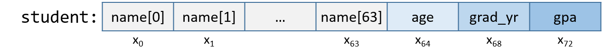
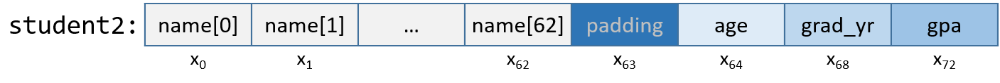

> [!WARNING] 说明
> 本文是个人学习用的**非官方**中英对照译文，原文：<https://diveintosystems.org/book/C8-IA32/structs.html>。
> 原书采用 CC BY-NC-ND 4.0 许可（禁止演绎），**请勿公开传播本译文**。
> 标为「译注」「现代更新」的内容是译者补充，不代表原书作者观点；代码与原文逐字一致，未作改动。


*8.9. structs in Assembly*

[结构体](../C2-C_depth/2.7-structs.html)是在 C 中创建数据类型集合的另一种方式。与数组不同，结构体可以把不同的数据类型组合在一起。C 像存放一维数组那样存放 `struct`，其数据元素（字段）连续存放。

> A [struct](../C2-C_depth/2.7-structs.html) is another way to create a collection of data types in C. Unlike arrays, structs enable different data types to be grouped together. C stores a `struct` like a single-dimension array, where the data elements (fields) are stored contiguously.

我们再来看第 1 章中的 `struct studentT`：

> Let’s revisit `struct studentT` from Chapter 1:

```
struct studentT {
    char name[64];
    int  age;
    int  grad_yr;
    float gpa;
};

struct studentT student;
```

[图 1](8.9-structs.html) 展示了 `student` 在内存中的布局。为了举例，假设 `student` 从地址 x<sub>0</sub> 开始。每个 x<sub>i</sub> 表示某个字段的地址。

> [Figure 1](8.9-structs.html) shows how `student` is laid out in memory. For the sake of example, assume that `student` starts at address x<sub>0</sub>. Each x<sub>i</sub> denotes the address of a field.



**图 1.** student 结构体的内存布局

*Figure 1. The memory layout of the student struct*

各字段按照声明的顺序在内存中一个挨一个地连续存放。在[图 1](8.9-structs.html) 中，`age` 字段被分配在紧跟 `name` 字段之后的内存位置（字节偏移 x<sub>64</sub>），后面依次是 `grad_yr`（字节偏移 x<sub>68</sub>）和 `gpa`（字节偏移 x<sub>72</sub>）字段。这种组织方式使访问字段既节省内存又高效。

> The fields are stored contiguously next to one another in memory in the order in which they are declared. In [Figure 1](8.9-structs.html), the `age` field is allocated at the memory location directly after the `name` field (at byte offset x<sub>64</sub>) and is followed by the `grad_yr` (byte offset x<sub>68</sub>) and `gpa` (byte offset x<sub>72</sub>) fields. This organization enables memory-efficient access to the fields.

为了理解编译器如何生成处理 `struct` 的汇编代码，考虑函数 `initStudent`：

> To understand how the compiler generates assembly code to work a `struct`, consider the function `initStudent`:

```
void initStudent(struct studentT *s, char *nm, int ag, int gr, float g) {
    strncpy(s->name, nm, 64);
    s->grad_yr = gr;
    s->age = ag;
    s->gpa = g;
}
```

`initStudent` 函数以一个 `struct studentT` 的基地址作为第一个参数，以各字段想要设置的值作为其余参数。下面的清单给出了这个函数的汇编。一般来说，`initStudent` 函数的参数 *i* 位于栈地址 `(ebp+8)` + 4 × *i* 处。

> The `initStudent` function uses the base address of a `struct studentT` as its first parameter, and the desired values for each field as its remaining parameters. The listing that follows depicts this function in assembly. In general, parameter *i* to function `initStudent` is located at stack address `(ebp+8)` + 4 × *i*.

> [!NOTE] 译注
> 这里的 *i* 从 0 开始数：`s` 是参数 0，位于 `%ebp+8`；`nm` 是参数 1，位于 `%ebp+0xc`；依此类推，`g` 是参数 4，位于 `%ebp+0x18`，与清单一致。

```
<initStudent>:
 <+0>:   push  %ebp                     # save ebp
 <+1>:   mov   %esp,%ebp                # update ebp (new stack frame)
 <+3>:   sub   $0x18,%esp               # add 24 bytes to stack frame
 <+6>:   mov   0x8(%ebp),%eax           # copy first parameter (s) to eax
 <+9>:   mov   0xc(%ebp),%edx           # copy second parameter (nm) to edx
 <+12>   mov   $0x40,0x8(%esp)          # copy 0x40 (or 64) to esp+8
 <+16>:  mov   %edx,0x4(%esp)           # copy nm to esp+4
 <+20>:  mov   %eax,(%esp)              # copy s to top of stack (esp)
 <+23>:  call  0x8048320 <strncpy@plt>  # call strncpy(s->name, nm, 64)
 <+28>:  mov   0x8(%ebp),%eax           # copy s to eax
 <+32>:  mov   0x14(%ebp),%edx          # copy fourth parameter (gr) to edx
 <+35>:  mov   %edx,0x44(%eax)          # copy gr to offset eax+68 (s->grad_yr)
 <+38>:  mov   0x8(%ebp),%eax           # copy s to eax
 <+41>:  mov   0x10(%ebp),%edx          # copy third parameter (ag) to edx
 <+44>:  mov   %edx,0x40(%eax)          # copy ag to offset eax+64 (s->age)
 <+47>:  mov   0x8(%ebp),%edx           # copy s to edx
 <+50>:  mov   0x18(%ebp),%eax          # copy g to eax
 <+53>:  mov   %eax,0x48(%edx)          # copy g to offset edx+72 (s->gpa)
 <+56>:  leave                          # prepare to leave the function
 <+57>:  ret                            # return
```

留意每个字段的字节偏移，是理解这段代码的关键。下面是几点需要记住的事情。

> Being mindful of the byte offsets of each field is key to understanding this code. Here are a few things to keep in mind.

- `strncpy` 调用以 `s` 的 `name` 字段的基地址、数组 `nm` 的地址和一个长度说明作为它的三个实参。回想一下，由于 `name` 是 `struct studentT` 中的第一个字段，`s` 的地址与 `s→name` 的地址是同一个。

> - The `strncpy` call takes the base address of the `name` field of `s`, the address of array `nm`, and a length specifier as its three arguments. Recall that because `name` is the first field in `struct studentT`, the address of `s` is synonymous with the address of `s→name`.

> [!NOTE] 译注
> 与第 7 章相同，原书网页把 `->` 排版成了箭头「→」，代码中要写作 `s->name`。

```
 <+6>:   mov   0x8(%ebp),%eax           # copy first parameter (s) to eax
 <+9>:   mov   0xc(%ebp),%edx           # copy second parameter (nm) to edx
 <+12>   mov   $0x40,0x8(%esp)          # copy 0x40 (or 64) to esp+8
 <+16>:  mov   %edx,0x4(%esp)           # copy nm to esp+4
 <+20>:  mov   %eax,(%esp)              # copy s to top of stack (esp)
 <+23>:  call  0x8048320 <strncpy@plt>  # call strncpy(s->name, nm, 64)
```

- 代码的下一部分（指令 `<initStudent+28>` 到 `<initStudent+35>`）把参数 `gr` 的值放到距 `s` 起始处偏移 68 的位置。回顾一下[图 1](8.9-structs.html) 中的内存布局可以看出，这个地址对应于 `s→grad_yr`。

> - The next part of the code (instructions `<initStudent+28>` thru `<initStudent+35>`) places the value of the `gr` parameter at an offset of 68 from the start of `s`. Revisiting the memory layout in [Figure 1](8.9-structs.html) shows that this address corresponds to `s→grad_yr`.

```
 <+28>:  mov   0x8(%ebp),%eax           # copy s to eax
 <+32>:  mov   0x14(%ebp),%edx          # copy fourth parameter (gr) to edx
 <+35>:  mov   %edx,0x44(%eax)          # copy gr to offset eax+68 (s->grad_yr)
```

- 下一段代码（指令 `<initStudent+38>` 到 `<initStudent+53>`）把参数 `ag` 复制到 `s→age` 字段。之后，参数 `g` 的值被复制到 `s→gpa` 字段（字节偏移 72）：

> - The next section of code (instructions `<initStudent+38>` thru `<initStudent+53>`) copies the `ag` parameter to the `s→age` field. Afterward, the `g` parameter value is copied to the `s→gpa` field (byte offset 72):

```
 <+38>:  mov   0x8(%ebp),%eax           # copy s to eax
 <+41>:  mov   0x10(%ebp),%edx          # copy third parameter (ag) to edx
 <+44>:  mov   %edx,0x40(%eax)          # copy ag to offset eax+64 (s->age)
 <+47>:  mov   0x8(%ebp),%edx           # copy s to edx
 <+50>:  mov   0x18(%ebp),%eax          # copy g to eax
 <+53>:  mov   %eax,0x48(%edx)          # copy g to offset edx+72 (s->gpa)
```

### 8.9.1. 数据对齐与结构体

*8.9.1. Data Alignment and structs*

考虑下面这个修改过的 `struct studentT` 声明：

> Consider the following modified declaration of `struct studentT`:

```
struct studentTM {
    char name[63]; //updated to 63 instead of 64
    int  age;
    int  grad_yr;
    float gpa;
};

struct studentTM student2;
```

`name` 字段的大小被改成了 63 字节，而不是原来的 64 字节。想想这会如何影响 `struct` 在内存中的布局。你可能会想当然地把它想象成[图 2](8.9-structs.html) 那样。

> The size of the `name` field is modified to be 63 bytes, instead of the original 64. Consider how this affects the way the `struct` is laid out in memory. It may be tempting to visualize it as in [Figure 2](8.9-structs.html).


**图 2.** 更新后的 struct studentTM 的一种错误内存布局。注意结构体的「name」字段从 64 字节减少到了 63 字节。

*Figure 2. An incorrect memory layout for the updated struct studentTM. Note that the struct’s "name" field is reduced from 64 to 63 bytes.*

在这种描绘中，`age` 字段出现在紧跟 `name` 字段之后的那个字节。但这是错误的。[图 3](8.9-structs.html) 描绘了实际的内存布局。

> In this depiction, the `age` field occupies the byte immediately following the `name` field. But this is incorrect. [Figure 3](8.9-structs.html) depicts the actual layout in memory.



**图 3.** 更新后的 struct studentTM 的正确内存布局。字节 x<sub>63</sub> 是编译器为满足内存对齐约束而添加的，它不对应任何字段。

*Figure 3. The correct memory layout for the updated struct studentTM. Byte x<sub>63</sub> is added by the compiler to satisfy memory alignment constraints, but it doesn’t correspond to any of the fields.*

IA32 的对齐策略要求：两字节的数据类型（即 `short`）位于两字节对齐的地址上，四字节的数据类型（`int`、`float`、`long` 和指针类型）位于四字节对齐的地址上，八字节的数据类型（`double`、`long long`）位于八字节对齐的地址上。对于 `struct`，编译器会在字段之间添加空字节作为**填充**（padding），以确保每个字段都满足其对齐要求。例如，在上面代码片段声明的 `struct` 中，编译器在字节 x<sub>63</sub> 处添加了一个字节的空白（即填充），确保 `age` 字段从一个四的倍数的地址开始。在内存中正确对齐的值可以在单次操作中被读取或写入，从而提高效率。

> IA32’s alignment policy requires that two-byte data types (i.e., `short`) reside at a two-byte-aligned address whereas four-byte data types (`int`, `float`, `long`, and pointer types) reside at four-byte-aligned addresses, and eight-byte data types (`double`, `long long`) reside at eight-byte-aligned addresses. For a `struct`, the compiler adds empty bytes as **padding** between fields to ensure that each field satisfies its alignment requirements. For example, in the `struct` declared in the previous code snippet, the compiler adds a byte of empty space (or padding) at byte x<sub>63</sub> to ensure that the `age` field starts at an address that is at a multiple of four. Values aligned properly in memory can be read or written in a single operation, enabling greater efficiency.

> [!NOTE] 译注 · i386 Linux 上 double 的对齐
> 在 32 位 x86 Linux（i386 System V ABI）上，结构体中的 `double` 和 `long long` 字段其实只按 4 字节对齐。译者用 `clang -target i386-linux-gnu` 检查：`struct { char c; double d; }` 中 `d` 的偏移是 4，整个结构体 12 字节；`long long` 字段同样位于偏移 4。而在 x86-64 Linux 上，同一个结构体中 `d` 的偏移是 8，大小是 16。所以原文说的「八字节类型位于八字节对齐的地址上」对 x86-64 成立，对 IA32 Linux 的结构体布局并不成立。

考虑把 `struct` 定义成下面这样时会发生什么：

> Consider what happens when a `struct` is defined as follows:

```
struct studentTM {
    int  age;
    int  grad_yr;
    float gpa;
    char name[63];
};

struct studentTM student3;
```

把 `name` 数组移到最后，就把那个填充字节移到了结构体的末尾，确保 `age`、`grad_yr` 和 `gpa` 都是四字节对齐的。

> Moving the `name` array to the end moves the byte of padding to the end of the struct, ensuring that `age`, `grad_yr`, and `gpa` are four-byte aligned.
