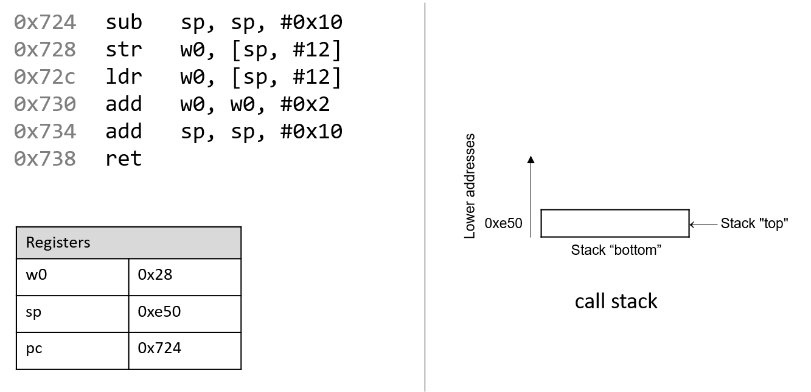
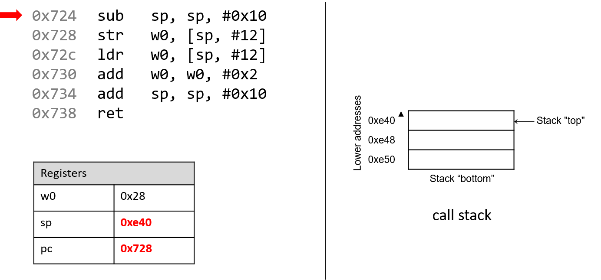
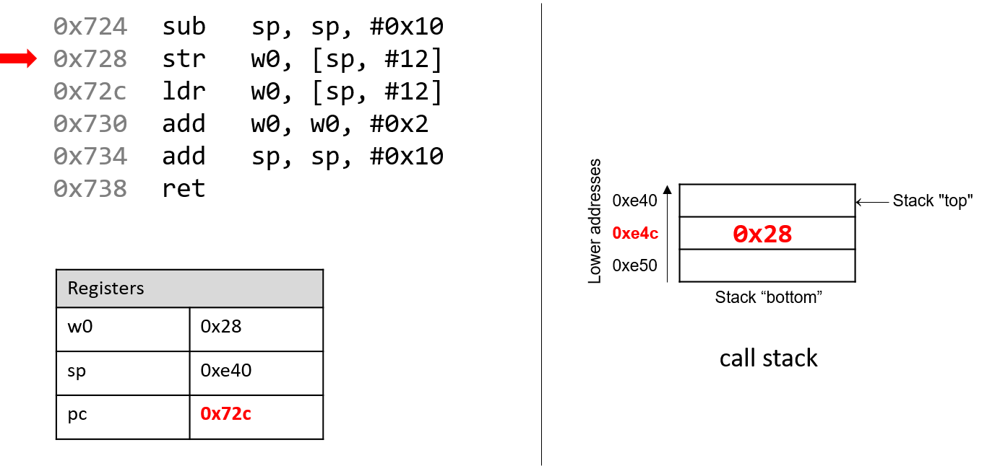
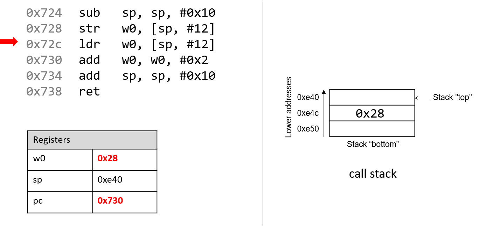
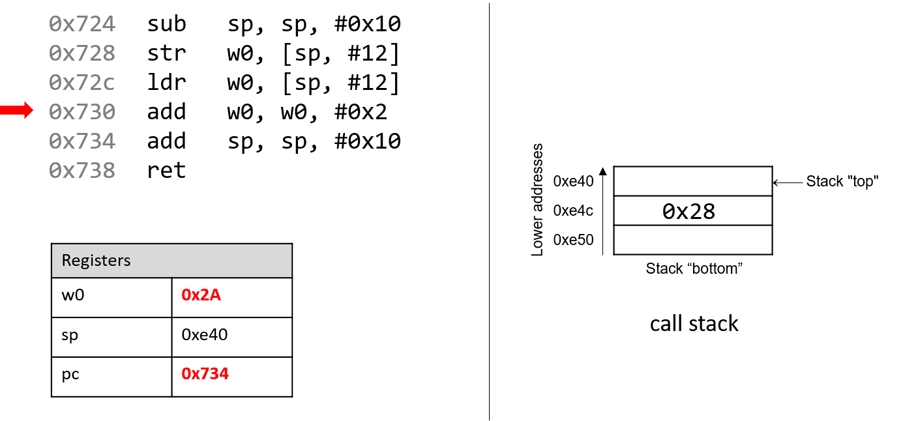
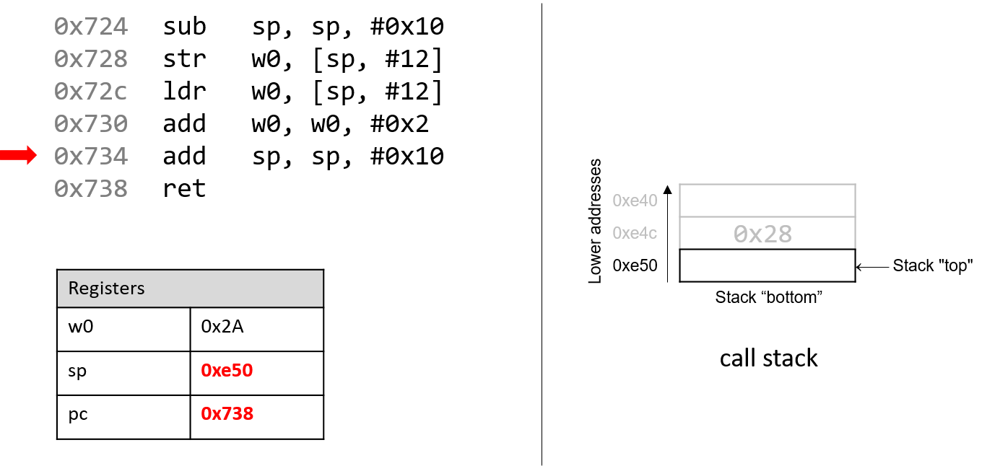
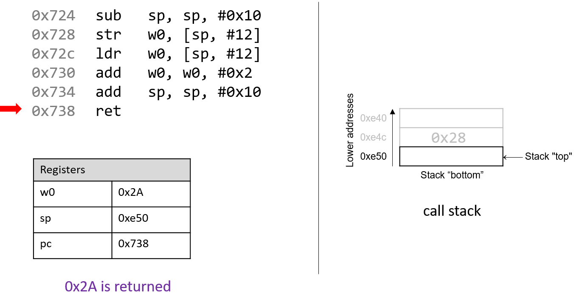

> [!WARNING] 说明
> 本文是个人学习用的**非官方**中英对照译文，原文：<https://diveintosystems.org/book/C9-ARM64/common.html>。
> 原书采用 CC BY-NC-ND 4.0 许可（禁止演绎），**请勿公开传播本译文**。
> 标为「译注」「现代更新」的内容是译者补充，不代表原书作者观点；代码与原文逐字一致，未作改动。


*9.2. Common Instructions*

本节讨论几条常用的 ARM 汇编指令。[表 1](9.2-common.html) 列出了 ARM 汇编中最基础的指令。

> In this section, we discuss several common ARM assembly instructions. [Table 1](9.2-common.html) lists the most foundational instructions in ARM assembly.

**表 1.** 最常用的指令

*Table 1. Most Common Instructions*

| 指令 | 含义 |
|---|---|
| `ldr D, [addr]` | D = \*(addr)（把内存中的值加载到寄存器 D） |
| `str S, [addr]` | \*(addr) = S（把 S 存入内存位置 \*(addr)） |
| `mov D, S` | D = S（把 S 的值复制到 D） |
| `add D, O1, O2` | D = O1 + O2（把 O1 与 O2 相加，结果存入 D） |
| `sub D, O1, O2` | D = O1 - O2（从 O1 中减去 O2，结果存入 D） |

> | Instruction     | Translation                                               |
> |-----------------|-----------------------------------------------------------|
> | `ldr D, [addr]` | D = \*(addr) (loads the value in memory into register D)  |
> | `str S, [addr]` | \*(addr) = S (stores S into memory location \*(addr) )    |
> | `mov D, S`      | D = S (copies value of S into D)                          |
> | `add D, O1, O2` | D = O1 + O2 (adds O1 to O2 and stores result in D)        |
> | `sub D, O1, O2` | D = O1 - O2 (subtracts O2 from O1 and stores result in D) |

因此，指令序列

> Therefore, the sequence of instructions

```
str     w0, [sp, #12]
ldr     w0, [sp, #12]
add     w0, w0, #0x2
```

的含义是：

> translates to:

- 把寄存器 `w0` 中的值存入由 `sp` + 12 指定的*内存*位置（即 `*(sp + 12)`）。

> - Store the value in register `w0` in the *memory* location specified by `sp` + 12 (or `*(sp + 12)`).

- *从*内存位置 `sp` + 12（即 `*(sp + 12)`）加载值到寄存器 `w0`。

> - Load the value *from* memory location `sp` + 12 (or `*(sp + 12)`) into register `w0`.

- 把值 0x2 加到寄存器 `w0` 上，并把结果存入寄存器 `w0`（即 `w0` = `w0` + 0x2）。

> - Add the value 0x2 to register `w0`, and store the result in register `w0` (or `w0` = `w0` + 0x2).

[表 1](9.2-common.html) 中的 `add` 和 `sub` 指令也协助维护程序栈（即**调用栈**，call stack）的组织结构。回想一下，**栈指针**（`sp`）由编译器保留用于调用栈管理。再回想我们之前对[程序内存](../C2-C_depth/2.1-scope_memory.html)的讨论：调用栈通常存放局部变量和参数，并帮助程序跟踪自身的执行（见[图 1](9.2-common.html)）。在 ARM 系统上，执行栈向*低*地址方向增长。和所有栈数据结构一样，操作都发生在调用栈的「顶部」；因此 `sp`「指向」栈顶，它的值就是栈顶的地址。

> The `add` and `sub` instructions shown in [Table 1](9.2-common.html) also assist with maintaining the organization of the program stack (i.e., the **call stack**). Recall that the **stack pointer** (`sp`) is reserved by the compiler for call stack management. Recall also from our earlier discussion on [program memory](../C2-C_depth/2.1-scope_memory.html) that the call stack typically stores local variables and parameters and helps the program track its own execution (see [Figure 1](9.2-common.html)). On ARM systems, the execution stack grows toward *lower* addresses. Like all stack data structures, operations occur at the "top" of the call stack; `sp` therefore "points" to the top of the stack, and its value is the address of top of the stack.


**图 1.** 程序地址空间的组成部分

*Figure 1. The parts of a program’s address space*

[表 2](9.2-common.html) 中的 `ldp` 和 `stp` 指令协助一次移动多个内存位置的数据，通常是压入或弹出程序栈。在[表 2](9.2-common.html) 中，寄存器 `x0` 存放的是一个内存地址。

> The `ldp` and `stp` instructions shown in [Table 2](9.2-common.html) assist with moving multiple memory locations, usually either on or off the program stack. In [Table 2](9.2-common.html), the register `x0` holds a memory address.

**表 2.** 访问多个内存位置的几条指令

*Table 2. Some Instructions for Accessing Multiple Memory Locations*

| 指令 | 含义 |
|----|----|
| `ldp D1, D2, [x0]` | D1 = \*(x0)，D2 = \*(x0+8)（把 x0 和 x0+8 处的值分别加载到寄存器 D1 和 D2） |
| `ldp D1, D2, [x0, #0x10]!` | x0 = x0 + 0x10，*然后*令 D1 = \*(x0)，D2 = \*(x0+8) |
| `ldp D1, D2, [x0], #0x10` | D1 = \*(x0)，D2 = \*(x0+8)，*然后*令 x0 = x0 + 0x10 |
| `stp S1, S2, [x0]` | \*(x0) = S1，\*(x0+8) = S2（把 S1 和 S2 分别存到位置 \*(x0) 和 \*(x0+8)） |
| `stp S1, S2, [x0, #-16]!` | 令 x0 = x0 - 16，*然后*存储 \*(x0) = S1，\*(x0+8) = S2 |
| `stp S1, S2, [x0], #-16` | 存储 \*(x0) = S1，\*(x0+8) = S2，*然后*令 x0 = x0 - 16 |

> | Instruction | Translation |
> |----|----|
> | `ldp D1, D2, [x0]` | D1 = \*(x0), D2 = \*(x0+8) (loads the value at x0 and x0+8 into registers D1 and D2, respectively) |
> | `ldp D1, D2, [x0, #0x10]!` | x0 = x0 + 0x10, *then* sets D1 = \*(x0), D2 = \*(x0+8) |
> | `ldp D1, D2, [x0], #0x10` | D1 = \*(x0), D2 = \*(x0+8), *then* sets x0 = x0 + 0x10 |
> | `stp S1, S2, [x0]` | \*(x0) = S1, \*(x0+8) = S2 (stores S1 and S2 at locations \*(x0) and \*(x0+8), respectively) |
> | `stp S1, S2, [x0, #-16]!` | sets x0 = x0 - 16, *then* stores \*(x0) = S1, \*(x0+8) = S2 |
> | `stp S1, S2, [x0], #-16` | stores \*(x0) = S1, \*(x0+8) = S2 *then* sets x0 = x0 - 16 |

简而言之，`ldp` 指令从寄存器 `x0` 中存放的内存位置，以及距该位置偏移 8 的位置（即 `x0` + 0x8），加载一对值，分别放入目标寄存器 D1 和 D2。而 `stp` 指令把源寄存器 S1 和 S2 中的一对值，存到寄存器 `x0` 中存放的内存位置以及距该地址偏移 8 的位置（即 `x0` + 0x8）。注意，这里假设寄存器中的值是 64 位的量。如果使用的是 32 位寄存器，内存偏移就分别变为 `x0` 和 `x0` + 0x4。

> In short, the `ldp` instruction loads a pair of values from the memory locations held in register `x0` and at an offset of eight from that memory location (i.e., `x0` + 0x8) into the destination registers D1 and D2, respectively. Meanwhile, the `stp` instruction stores the pair of values in source registers S1 and S2 to the memory locations held in register `x0` and at an offset of eight from that address (i.e., `x0` + 0x8). Note that the assumption here is that values in the registers are 64-bit quantities. If 32-bit registers are being used instead, the memory offsets change to `x0` and `x0` + 0x4 respectively.

`ldp` 和 `stp` 指令还有两种特殊形式，可以同时更新 `x0`。例如，指令 `stp S1, S2, [x0, #-16]!` 表示*先*从 `x0` 中减去 16 字节，然后才把 S1 和 S2 存到偏移 `[x0]` 和 `[x0+0x8]` 处。与之相反，指令 `ldp D1, D2, [x0], #0x10` 表示先把偏移 `[x0]` 和 `[x0+8]` 处的值存入目标寄存器 D1 和 D2，*然后*才给 `x0` 加上 16 字节。正如我们[后面](9.5-functions.html)将看到的，这两种特殊形式常用在包含多次函数调用的函数的开头和结尾。

> There are also two special forms of the `ldp` and `stp` instructions that enable simultaneous updates to `x0`. For example, the instruction `stp S1, S2, [x0, #-16]!` implies that 16 bytes should *first* be subtracted from `x0`, and only afterward should S1 and S2 be stored at the offsets `[x0]` and `[x0+0x8]`. In contrast, the instruction `ldp D1, D2, [x0], #0x10` states that the values at offsets `[x0]` and `[x0+8]` should first be stored in destination registers D1 and D2 and *only afterward* should `x0` have 16 bytes added to it. These special forms are commonly used at the beginning and end of functions that have multiple function calls, as we will see [later](9.5-functions.html).

> [!NOTE] 译注
> 带 `!` 的形式叫**前变址**（pre-index，先改基址再访问），`[x0], #imm` 的形式叫**后变址**（post-index，先访问再改基址）。函数开头常见的 `stp x29, x30, [sp, #-32]!` 就是前变址：一条指令同时完成「栈指针下移」和「保存帧指针与返回地址」。

### 9.2.1. 综合运用：一个更具体的例子

*9.2.1. Putting It All Together: A More Concrete Example*

我们来仔细看看 `adder2` 函数

> Let’s take a closer look at the `adder2` function

```
//adds two to an integer and returns the result
int adder2(int a) {
    return a + 2;
}
```

以及它对应的汇编代码：

> and its corresponding assembly code:

```
0000000000000724 <adder2>:
 724:   d10043ff        sub     sp, sp, #0x10
 728:   b9000fe0        str     w0, [sp, #12]
 72c:   b9400fe0        ldr     w0, [sp, #12]
 730:   11000800        add     w0, w0, #0x2
 734:   910043ff        add     sp, sp, #0x10
 738:   d65f03c0        ret
```

这段汇编代码由一条 `sub` 指令、随后的 `str` 和 `ldr` 指令、两条 `add` 指令，以及最后一条 `ret` 指令组成。要理解 CPU 如何执行这组指令，我们需要重温[程序内存](../C2-C_depth/2.1-scope_memory.html)的结构。回想一下，程序每次执行时，操作系统都会为新程序分配地址空间（也称为**虚拟内存**）。[虚拟内存](../C13-OS/13.3-vm.html)以及与之相关的[进程](../C13-OS/13.2-processes.html)概念会在第 13 章中详细介绍；目前，只需把进程看作正在运行的程序的抽象，把虚拟内存看作分配给单个进程的内存。每个进程都有自己的一块称为**调用栈**的内存区域。记住，调用栈位于进程/虚拟内存中，这与寄存器（位于 CPU 中）不同。

> The assembly code consists of a `sub` instruction, followed by `str` and `ldr` instructions, two `add` instructions, and finally a `ret` instruction. To understand how the CPU executes this set of instructions, we need to revisit the structure of [program memory](../C2-C_depth/2.1-scope_memory.html). Recall that every time a program executes, the operating system allocates the new program’s address space (also known as **virtual memory**). [Virtual memory](../C13-OS/13.3-vm.html) and the related concept of [processes](../C13-OS/13.2-processes.html) are covered in greater detail in Chapter 13; for now, it suffices to think of a process as the abstraction of a running program and virtual memory as the memory that is allocated to a single process. Every process has its own region of memory called the **call stack**. Keep in mind that the call stack is located in process/virtual memory, unlike registers (which are located in the CPU).

[图 2](9.2-common.html) 描绘了执行 `adder2` 函数之前调用栈和寄存器的一个示例状态。

> [Figure 2](9.2-common.html) depicts a sample state of the call stack and registers prior to the execution of the `adder2` function.



**图 2.** 执行之前的执行栈

*Figure 2. Execution stack prior to execution*

注意，栈向*低*地址方向增长。按照惯例，`adder2` 函数的参数（即 `a`）存放在寄存器 `x0` 中。由于 `a` 是 `int` 类型，它存放在组成部分寄存器 `w0` 中，如[图 2](9.2-common.html) 所示。同样，由于 `adder2` 函数返回 `int`，返回值使用组成部分寄存器 `w0` 而不是 `x0`。

> Notice that the stack grows toward *lower* addresses. The parameter to the `adder2` function (or `a`) is stored in register `x0` by convention. Since `a` is of type `int`, it is stored in component register `w0`, as shown in [Figure 2](9.2-common.html). Likewise, since the `adder2` function returns an `int`, component register `w0` is used for the return value instead of `x0`.

为了让图更易读，程序内存代码段中各条指令的地址被缩写为 0x724–0x738。同样，程序内存调用栈段的地址从 0xffffffffee40–0xffffffffee50 缩写为 0xe40–0xe50。实际上，调用栈地址在程序内存中位于比代码段地址高得多的位置。

> The addresses associated with the instructions in the code segment of program memory have been shortened to 0x724-0x738 to improve figure readability. Likewise, the addresses associated with the call stack segment of program memory have been shortened to 0xe40-0xe50 from a range of 0xffffffffee40 to 0xffffffffee50. In truth, call stack addresses occur at much higher addresses in program memory than code segment addresses.

请留意寄存器 `sp` 和 `pc` 的初始值：它们分别是 0xe50 和 0x724。`pc` 寄存器（即程序计数器）指示下一条要执行的指令，地址 0x724 对应于 `adder2` 函数中的第一条指令。下面各图中红色（左上角）的箭头直观地标出当前正在执行的指令。

> Pay close attention to the initial values of registers `sp` and `pc`: they are 0xe50 and 0x724, respectively. The `pc` register (or program counter) indicates the next instruction to execute, and the address 0x724 corresponds to the first instruction in the `adder2` function. The red (upper-left) arrow in the following figures visually indicates the currently executing instruction.

------------------------------------------------------------------------



第一条指令（`sub sp, sp, #0x10`）从栈指针中减去常数值 0x10，并用新的结果更新栈指针。由于栈指针存放的是栈顶的地址，这个操作让栈*增长*了 16 个字节。栈指针现在存放的是地址 0xe40，而程序计数器（`pc`）寄存器存放的是下一条要执行的指令的地址，即 0x728。

> The first instruction (`sub sp, sp, #0x10`) subtracts the constant value 0x10 from the stack pointer, and updates the stack pointer with the new result. Since the stack pointer contains the address of the top of the stack, this operation *grows* the stack by 16 bytes. The stack pointer now contains the address 0xe40, whereas the program counter (`pc`) register contains the address of the next instruction to execute, or 0x728.

------------------------------------------------------------------------



回想一下，`str` 指令把寄存器中的值*存储*到内存中。因此，下一条指令（`str w0, [sp, #12]`）把 `w0` 中的值（`a` 的值，即 0x28）放到调用栈位置 `sp` + 12，即 0xe4c 处。注意，这条指令丝毫不修改寄存器 `sp` 的内容；它只是把一个值存到调用栈上。这条指令执行后，`pc` 前进到下一条指令的地址，即 0x72c。

> Recall that the `str` instruction *stores* a value located in a register into memory. Thus, the next instruction (`str w0, [sp, #12]`) places the value in `w0` (the value of `a`, or 0x28) at call stack location `sp` + 12, or 0xe4c. Note that this instruction does not modify the contents of register `sp` in any way; it simply stores a value on the call stack. Once this instruction executes, `pc` advances to the address of the next instruction, or 0x72c.

------------------------------------------------------------------------



接下来执行 `ldr w0, [sp, #12]`。回想一下，`ldr` 指令把内存中的值*加载*到寄存器中。执行这条指令时，CPU 用位于栈地址 `sp` + 12 处的值替换寄存器 `w0` 中的值。尽管这看起来像是一个毫无意义的操作（毕竟是用 0x28 替换 0x28），但它体现了一种惯例：编译器通常会把函数参数存到调用栈上以备后用，然后在需要时再重新加载到寄存器中。同样，`sp` 寄存器中存放的值不受 `str` 操作的影响。就程序而言，栈的「顶部」仍然是 0xe40。`ldr` 指令执行后，`pc` 前进到地址 0x730。

> Next, `ldr w0, [sp, #12]` executes. Recall that the `ldr` instruction *loads* a value in memory into a register. By executing this instruction, the CPU replaces the value in register `w0` with the value located at stack address `sp` + 12. Even though this may seem like a nonsensical operation (0x28 is replaced by 0x28, after all), it highlights a convention where the compiler typically stores function parameters onto the call stack for later use and then reloads them into registers as needed. Again, the value stored in the `sp` register is not affected by the `str` operation. As far as the program is concerned, the "top" of the stack is still 0xe40. Once the `ldr` instruction executes, `pc` advances to address 0x730.

> [!NOTE] 译注
> 这一段讲的是 `ldr`，「不受 `str` 操作的影响」应为「不受 `ldr` 操作的影响」，属原文笔误。

------------------------------------------------------------------------



之后执行 `add w0, w0, #0x2`。回想一下，`add` 指令的形式是 `add D, O1, O2`，它把 O1 + O2 放到目标寄存器 D 中。所以，`add w0, w0, #0x2` 把常数值 0x2 加到 `w0` 中存放的值（0x28）上，结果 0x2A 存放在寄存器 `w0` 中。寄存器 `pc` 前进到下一条要执行的指令，即 0x734。

> Afterward, `add w0, w0, #0x2` executes. Recall that the `add` instruction has the form `add D, O1, O2` and places O1 + O2 in the destination register D. So, `add w0, w0, #0x2` adds the constant value 0x2 to the value stored in `w0` (0x28), resulting in 0x2A being stored in register `w0`. Register `pc` advances to the next instruction to be executed, or 0x734.

------------------------------------------------------------------------



接下来执行的指令是 `add sp, sp, #0x10`。这条指令把 `sp` 中存放的地址加上 16 字节。由于栈向低地址方向增长，给栈指针加上 16 字节就会让栈*收缩*，把 `sp` 恢复为原来的值 0xe50。然后 `pc` 寄存器前进到 0x738。

> The next instruction that executes is `add sp, sp, #0x10`. This instruction adds 16 bytes to the address stored in `sp`. Since the stack grows toward lower addresses, adding 16 bytes to the stack pointer consequently *shrinks* the stack, and reverts `sp` to its original value of 0xe50. The `pc` register then advances to 0x738.

回想一下，调用栈的作用是在更大的程序上下文中，存放每个函数执行时使用的临时数据。按照惯例，栈在函数调用开始时「增长」，在函数结束时恢复原状。因此，在函数开头常常会看到 `sub sp, sp, #v` 指令（其中 `v` 是某个常数值），在函数末尾则会看到 `add sp, sp, #v`。

> Recall that the purpose of the call stack is to store the temporary data that each function uses as it executes in the context of a larger program. By convention, the stack "grows" at the beginning of a function call, and reverts to its original state when the function ends. As a result, it is common to see a `sub sp, sp, #v` instruction (where `v` is some constant value) at the beginning of a function, and `add sp, sp, #v` at the end.

------------------------------------------------------------------------



最后执行的指令是 `ret`。在后面讨论函数调用的小节中，我们会更多地讨论 `ret` 做了什么；目前只需知道 `ret` 为从函数返回准备好调用栈。按照惯例，寄存器 `x0` 总是存放返回值（如果有的话）。在这个例子中，由于 `adder2` 的返回类型是 `int`，返回值存放在组成部分寄存器 `w0` 中，函数返回值 0x2A，即 42。

> The last instruction that executes is `ret`. We will talk more about what `ret` does in future sections when we discuss function calls, but for now it suffices to know that `ret` prepares the call stack for returning from a function. By convention, the register `x0` always contains the return value (if one exists). In this case, since `adder2` is of type `int`, the return value is stored in component register `w0` and the function returns the value 0x2A, or 42.
