> [!WARNING] 说明
> 本文是个人学习用的**非官方**中英对照译文，原文：<https://diveintosystems.org/book/C9-ARM64/functions.html>。
> 原书采用 CC BY-NC-ND 4.0 许可（禁止演绎），**请勿公开传播本译文**。
> 标为「译注」「现代更新」的内容是译者补充，不代表原书作者观点；代码与原文逐字一致，未作改动。


*9.5. Functions in Assembly*

在上一节中，我们跟踪了汇编中的一些简单函数。本节在一个较大程序的背景下，讨论汇编中多个函数之间的交互。我们还会介绍一些与函数管理有关的新指令。

> In the previous section, we traced through simple functions in assembly. In this section, we discuss the interaction between multiple functions in assembly in the context of a larger program. We also introduce some new instructions involved with function management.

我们先复习一下调用栈是如何管理的。回想一下，`sp` 是**栈指针**，总是指向栈顶。寄存器 `x29` 表示基址指针（也称**帧指针**，即 `FP`），指向当前栈帧的底部。**栈帧**（stack frame，也称**活动帧**或**活动记录**）指的是栈中分配给单次函数调用的那一部分。当前正在执行的函数总是位于栈顶，它的栈帧称为**活动帧**（active frame）。活动帧的边界由栈指针（在栈顶，地址较低）和帧指针（在帧底，地址较高）界定。活动记录中通常存放着函数的局部变量。最后，**返回地址**（return address）表示被调用函数退出后，调用函数（例如 `main`）从哪个程序地址继续执行。在 A64 系统中，返回地址存放在寄存器 `x30`（也称 `LR`，链接寄存器）中。

> Let’s begin with a refresher on how the call stack is managed. Recall that `sp` is the **stack pointer** and always points to the top of the stack. The register `x29` represents the base pointer (also known as the **frame pointer** or `FP`) and points to the base of the current stack frame. The **stack frame** (also known as the **activation frame** or the **activation record**) refers to the portion of the stack allocated to a single function call. The currently executing function is always at the top of the stack, and its stack frame is referred to as the **active frame**. The active frame is bounded by the stack pointer (at the top of stack, lower address) and frame pointer (at the bottom of the frame, higher address). The activation record typically holds local variables for a function. Lastly, the **return address** indicates the program address at which the calling function (e.g., `main`) resumes execution once the callee function exits. In A64 systems, the return address is stored in register `x30` (also known as `LR`).

[图 1](9.5-functions.html) 展示了 `main` 及其调用的一个名为 `fname` 的函数的栈帧。我们把 `main` 函数称为*调用者*（caller）函数，把 `fname` 称为*被调用者*（callee）函数。

> [Figure 1](9.5-functions.html) shows the stack frames for `main` and a function it calls named `fname`. We will refer to the `main` function as the *caller* function and `fname` as the *callee* function.

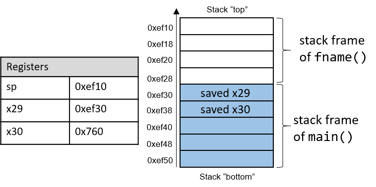

**图 1.** 栈帧的管理

*Figure 1. Stack frame management*

在[图 1](9.5-functions.html) 中，当前的活动帧属于被调用者函数（`fname`）。调用栈中位于栈指针和帧指针之间的区域用于存放局部变量。随着局部值被压入和弹出栈，栈指针会移动。帧指针在优化后的代码中不常用，通常对程序运行来说是可选的。因此，像 GCC 这样的编译器通常相对于栈指针来引用栈上的值。在[图 1](9.5-functions.html) 中，活动帧的下边界是 `fname` 的基址指针，即 `x29`，它存放着栈地址 0xef30。存放在地址 0xef30 处的值是「保存的」帧指针值（0xef50），它本身表示 `main` 函数活动帧的底部。紧挨在帧指针下面的是一个保存的**返回地址**（来自 `x30`），它表示 `main` 退出后程序将从哪个地址继续执行。

> In [Figure 1](9.5-functions.html), the current active frame belongs to the callee function (`fname`). The region of the call stack between the stack and frame pointers is used for local variables. The stack pointer moves as local values are pushed onto and popped from the stack. The frame pointer is not commonly used in optimized code, and is usually optional for operation. As a result, compilers like GCC commonly reference values on the stack relative to the stack pointer. In [Figure 1](9.5-functions.html), the active frame is bounded below by the base pointer of `fname`, or `x29`, which contains stack address 0xef30. The value stored at address 0xef30 is the "saved" frame pointer value (0xef50), which itself indicates the bottom of the activation frame for the `main` function. Right below the frame pointer is a saved **return address** (stored in `x30`), which indicates the address that the program will continue executing once `main` exits.

> [!NOTE] 译注
> 帧指针是否「可选」取决于平台 ABI。Apple 平台规定 `x29` 必须始终指向一个有效的帧记录（叶函数等可以不建立），以保证即使没有调试信息，栈回溯也总是有意义的。[Apple Developer：Writing ARM64 code for Apple platforms](https://developer.apple.com/documentation/xcode/writing-arm64-code-for-apple-platforms)

> [!WARNING] 原书警示 · 返回地址指向代码段内存，而不是栈内存（The return address points to code memory, not stack memory）
> 回想一下，程序的调用栈区域（栈内存）与其代码区域（代码段内存）是不同的。`sp` 和 `x29` 指向栈内存中的地址，而 `pc` 指向*代码*段内存中的地址。换句话说，返回地址是*代码*段内存中的一个地址，而不是栈内存中的地址：
>
> 
>
> *图示：程序地址空间的组成部分*
>
> > Recall that the call stack region (stack memory) of a program is different from its code region (code memory). Whereas `sp` and `x29` point to addresses in the stack memory, `pc` points to an address in *code* memory. In other words, the return address is an address in *code* memory, not stack memory:
> >
> >
> >
> > *Figure 2. The parts of a program’s address space*

[表 1](9.5-functions.html) 列出了编译器用于基本函数管理的另外几条指令。

> [Table 1](9.5-functions.html) contains several additional instructions that the compiler uses for basic function management.

**表 1.** 常用的函数管理指令

*Table 1. Common Function Management Instructions*

| 指令 | 含义 |
|---|---|
| `bl addr <fname>` | 令 `x30 = pc + 4`，并令 `pc = addr` |
| `blr R <fname>` | 令 `x30 = pc + 4`，并令 `pc = R` |
| `ret` | 返回 `x0` 中的值，并令 `pc = x30` |

> | Instruction       | Translation                               |
> |-------------------|-------------------------------------------|
> | `bl addr <fname>` | Sets `x30 = pc + 4` and sets `pc = addr`  |
> | `blr R <fname>`   | Sets `x30 = pc + 4` and sets `pc = R`     |
> | `ret`             | Returns value in `x0` and sets `pc = x30` |

`bl` 和 `ret` 指令在一个函数调用另一个函数的过程中起着重要作用。两条指令都会修改指令指针（寄存器 `pc`）。当调用者函数执行 `bl` 指令时，`pc + 4` 的值被保存到寄存器 `x30` 中，作为返回地址，即被调用函数执行完毕后调用者继续执行的程序地址。`bl` 指令还会用被调用函数的地址替换 `pc` 的值。

> The `bl` and `ret` instructions play a prominent role in the process where one function calls another. Both instructions modify the instruction pointer (register `pc`). When the caller function executes the `bl` instruction, the value of `pc + 4` is saved in register `x30` to represent the return address, or the program address at which the caller resumes executing once the callee function finishes. The `bl` instruction also replaces the value of `pc` with the address of the callee function.

> [!NOTE] 译注
> 与 x86 的 `call` 把返回地址压栈不同，ARM 的 `bl`（branch with link）只把返回地址放进寄存器 `x30`，不碰栈。所以一个还要调用别的函数的函数，必须先把 `x30` 存到栈上（下面 `main` 开头的 `stp x29, x30, ...` 就是在做这件事），否则内层调用会覆盖它；而不调用其他函数的「叶函数」（如 `assign`、`adder`）就可以完全不保存 `x30`。

`ret` 指令把 `pc` 的值恢复为 `x30` 中保存的值，确保程序在调用者函数中指定的程序地址处继续执行。被调用者返回的任何值都存放在寄存器 `x0` 或它的组成部分寄存器 `w0` 中。`ret` 指令通常是任何函数中执行的最后一条指令。

> The `ret` instruction restores the value of `pc` to the value saved in `x30`, ensuring that the program resumes execution at the program address specified in the caller function. Any value returned by the callee is stored in register `x0` or its component register `w0`. The `ret` instruction is usually the last instruction that executes in any function.

### 9.5.1. 函数参数

*9.5.1. Function Parameters*

函数参数通常在函数调用之前被预先加载到寄存器中。函数的前八个参数存放在寄存器 `x0`…`x7` 中。如果函数需要超过七个参数，其余的参数会根据其大小依次加载到调用栈上（32 位数据按 4 字节偏移，64 位数据按 8 字节偏移）。

> Function parameters are typically preloaded into registers prior to a function call. The first eight parameters to a function are stored in registers `x0`…​`x7`. If a function requires more than seven parameters, the remaining parameters are successively loaded into the call stack based on their size (4-byte offsets for 32-bit data, 8-byte offsets for 64-bit data).

> [!NOTE] 译注
> 「超过七个」应为「超过八个」：`x0`–`x7` 恰好能放八个参数，第九个起才放到栈上。另外，在 Linux 的标准 AArch64 调用约定中，栈上的每个参数占一个 8 字节槽位；按实际大小紧凑排列（`int` 只占 4 字节）的是 Apple 平台的做法。译者用 Clang 编译一个传 10 个 `int` 参数的调用：`-target aarch64-linux-gnu` 下第 9、10 个参数分别存到 `[sp]` 和 `[sp, #8]`，而 `-target arm64-apple-macos` 下两者被合并成一条 8 字节的 `str x8, [sp]`。[Apple Developer：Writing ARM64 code for Apple platforms](https://developer.apple.com/documentation/xcode/writing-arm64-code-for-apple-platforms)

### 9.5.2. 跟踪一个例子

*9.5.2. Tracing Through an Example*

利用我们关于函数管理的知识，来跟踪本章开头首次介绍的那个代码示例。

> Using our knowledge of function management, let’s trace through the code example first introduced at the beginning of this chapter.

```
#include <stdio.h>

int assign() {
    int y = 40;
    return y;
}

int adder() {
    int a;
    return a + 2;
}

int main(void) {
    int x;
    assign();
    x = adder();
    printf("x is: %d\n", x);
    return 0;
}
```

我们用命令 `gcc -o prog prog.c` 编译这段代码，并用 `objdump -d` 查看底层的汇编。后一条命令会输出一个相当大的文件，里面有很多我们不需要的信息。用 `less` 及其搜索功能提取出 `adder`、`assign` 和 `main` 函数：

> We compile this code with the command `gcc -o prog prog.c` and use `objdump -d` to view the underlying assembly. The latter command outputs a pretty big file that contains a lot of information that we don’t need. Use `less` and the search functionality to extract the `adder`, `assign`, and `main` functions:

```
0000000000000724 <assign>:
 724:   d10043ff        sub     sp, sp, #0x10
 728:   52800500        mov     w0, #0x28                       // #40
 72c:   b9000fe0        str     w0, [sp, #12]
 730:   b9400fe0        ldr     w0, [sp, #12]
 734:   910043ff        add     sp, sp, #0x10
 738:   d65f03c0        ret

000000000000073c <adder>:
 73c:   d10043ff        sub     sp, sp, #0x10
 740:   b9400fe0        ldr     w0, [sp, #12]
 744:   11000800        add     w0, w0, #0x2
 748:   910043ff        add     sp, sp, #0x10
 74c:   d65f03c0        ret

0000000000000750 <main>:
 750:   a9be7bfd        stp     x29, x30, [sp, #-32]!
 754:   910003fd        mov     x29, sp
 758:   97fffff3        bl      724 <assign>
 75c:   97fffff8        bl      73c <adder>
 760:   b9001fa0        str     w0, [x29, #28]
 764:   90000000        adrp    x0, 0 <_init-0x598>
 768:   91208000        add     x0, x0, #0x820
 76c:   b9401fa1        ldr     w1, [x29, #28]
 770:   97ffffa8        bl      610 <printf@plt>
 774:   52800000        mov     w0, #0x0                        // #0
 778:   a8c27bfd        ldp     x29, x30, [sp], #32
 77c:   d65f03c0        ret
```

每个函数都以一个与它在程序中声明的名字相对应的符号标签开头。例如，`<main>:` 是 `main` 函数的符号标签。函数标签的地址也就是该函数中第一条指令的地址。为了在后面的图中节省空间，我们把代码地址截取为低 12 位，把栈地址截取为低 16 位。所以，栈地址 0xffffffffef50 显示为 0xef50。

> Each function begins with a symbolic label that corresponds to its declared name in the program. For example, `<main>:` is the symbolic label for the `main` function. The address of a function label is also the address of the first instruction in that function. To save space in the figures that follow, we truncate code addresses to the lower 12 bits, and stack addresses to the lower 16 bits. So, stack address 0xffffffffef50 is shown as 0xef50.

### 9.5.3. 跟踪 main

*9.5.3. Tracing Through main*

[图 3](9.5-functions.html) 展示了执行 `main` 之前那一刻的执行栈。

> [Figure 3](9.5-functions.html) shows the execution stack immediately prior to the execution of `main`.

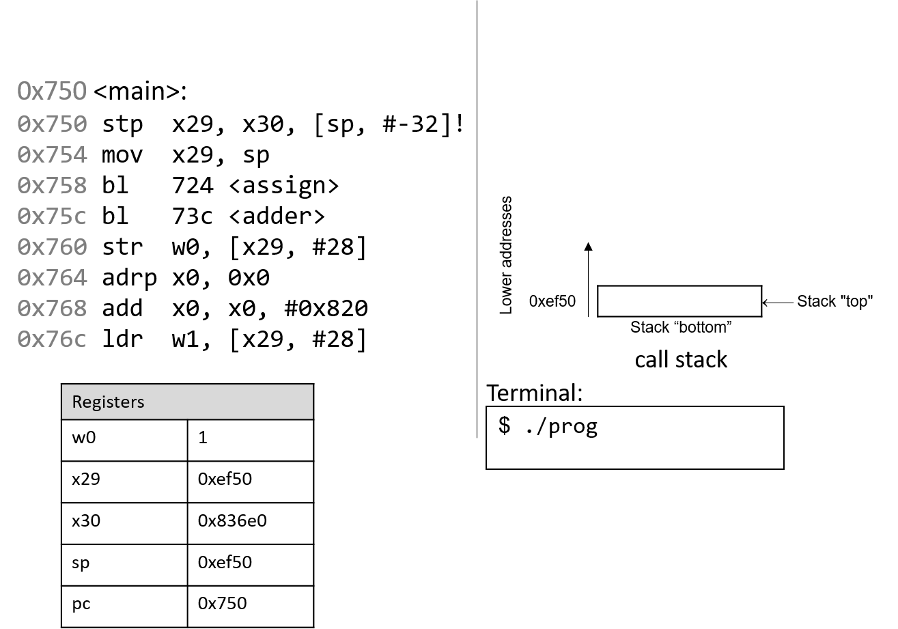

**图 3.** 执行 main 函数之前 CPU 寄存器和调用栈的初始状态

*Figure 3. Initial state of CPU registers and call stack prior to executing the main function*

回想一下，栈向低地址方向增长。在这个例子中，帧指针和栈指针（`x29` 和 `sp`）都存放着地址 0xef50。最初，`pc` 是 `main` 函数中第一条指令的地址，即 0x750。这个例子中还突出显示了寄存器 `x30` 和 `w0`，它们最初都存放着垃圾值。

> Recall that the stack grows toward lower addresses. In this example, the frame and stack pointers (`x29` and `sp`) both contain address 0xef50. Initially, `pc` is the address of the first instruction in the `main` function, or 0x750. Registers `x30` and `w0` are also highlighted in this example, and both contain initial junk values.

------------------------------------------------------------------------

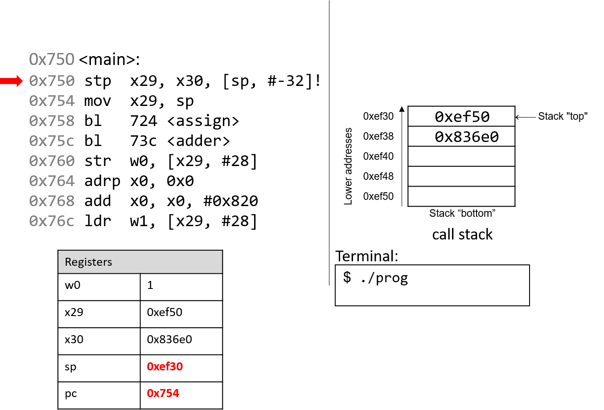

第一条指令（`stp`）是一条由两部分组成的复合指令。首先，第二个操作数（`[sp, #-32]!`）把栈指针减 32 字节，从而为当前栈帧分配空间。求值完这个操作数后，栈指针更新为 0xef30。接着，`stp` 指令把 `x29` 和 `x30` 的当前值分别存到位置 `sp` 和 `sp+8` 处。指令指针 `pc` 前进到顺序中的下一条指令。

> The first instruction (`stp`) is a composite instruction with two parts. First, the second operand (`[sp, #-32]!`) decrements the stack pointer by 32 bytes, thus allocating space for the current stack frame. After the evaluation of the operand, the stack pointer updates to 0xef30. Next, the `stp` instruction stores the current values of `x29` and `x30` at locations `sp` and `sp+8`, respectively. The instruction pointer `pc` advances to the next instruction in sequence.

------------------------------------------------------------------------

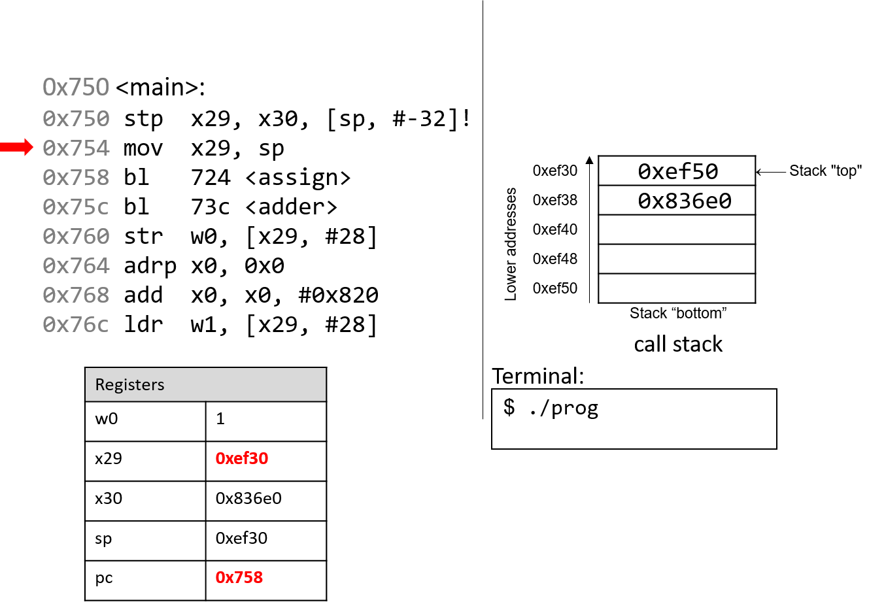

下一条指令（`mov x29, sp`）把 `x29` 的值更新为与 `sp` 相同。于是，帧指针（`x29`）现在指向 `main` 函数栈帧的开头。指令指针 `pc` 前进到顺序中的下一条指令。

> The next instruction (`mov x29, sp`) updates the value of `x29` to be the same as `sp`. Thus, the frame pointer (`x29`) now points to the start of the stack frame for the `main` function. The instruction pointer `pc` advances to the next instruction in sequence.

------------------------------------------------------------------------

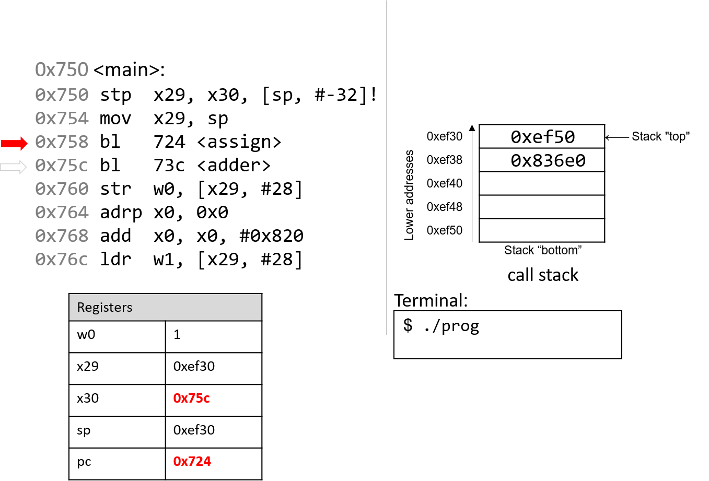

第一条 `bl` 指令把 `pc+4`（即 0x75c）存到寄存器 `x30` 中，这是 `assign` 函数返回后程序在 `main` 中继续执行的地址。接着，寄存器 `pc` 被更新为地址 0x724，即 `assign` 函数中第一条指令的地址。

> The first `bl` instruction stores `pc+4` (or 0x75c) in register `x30`, which is the address in `main` at which the program will resume executing once the `assign` function returns. Next, the register `pc` is updated with address 0x724, which indicates the address of the first instruction in the `assign` function.

------------------------------------------------------------------------

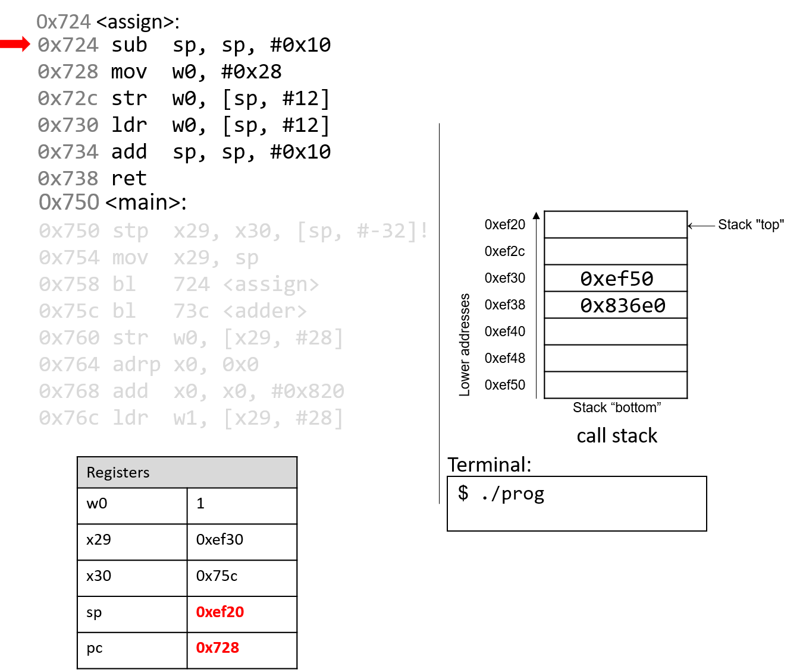

接下来执行的是 `assign` 中的第一条指令。`sub` 指令把栈指针减 16 字节。注意，`x29` 和 `sp` 现在标出了 `assign` 函数活动栈帧的边界。程序计数器前进到下一条指令。

> The next instruction that executes is the first instruction in `assign`. The `sub` instruction decrements the stack pointer by 16 bytes. Note that `x29` and `sp` now denote the active stack frame boundaries for the `assign` function. The program counter advances to the next instruction.

------------------------------------------------------------------------

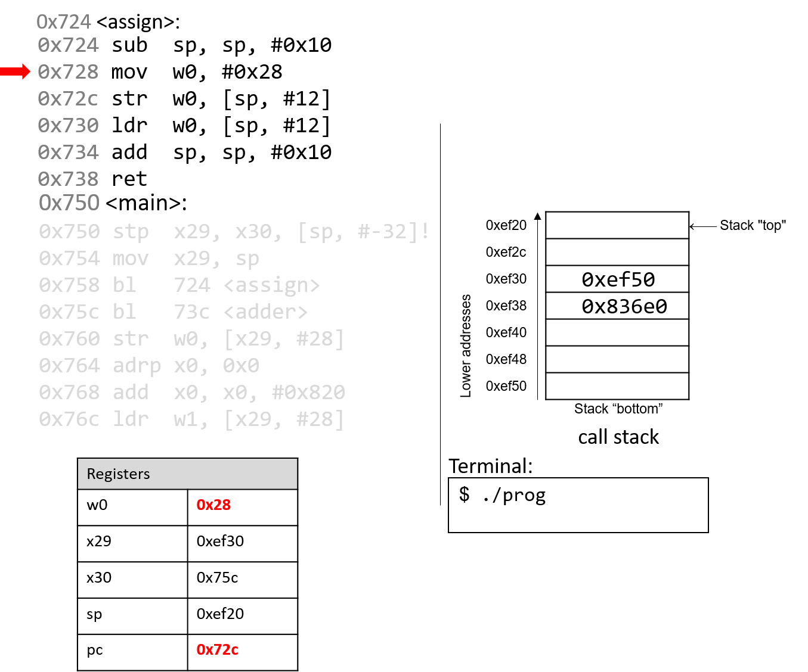

`mov` 指令把常数值 0x28 存入寄存器 `w0`。寄存器 `pc` 前进到顺序中的下一条指令。

> The `mov` instruction stores the constant value 0x28 in register `w0`. Register `pc` advances to the next instruction in sequence.

------------------------------------------------------------------------

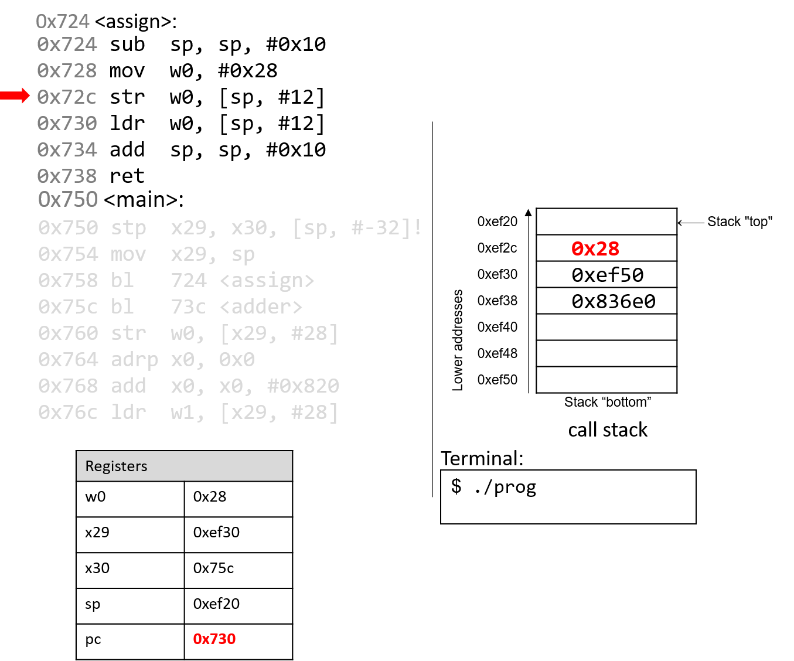

`str` 指令把 0x28 存到距栈指针偏移 12 字节的位置，即地址 0xef2c 处。指令指针前进到下一条指令。

> The `str` instruction stores 0x28 at an offset of 12 bytes from the stack pointer, or at address 0xef2c. The instruction pointer advances to the next instruction.

------------------------------------------------------------------------


`ldr` 指令把栈地址 0xef2c 处的 0x28 存入寄存器 `w0`。指令指针前进到下一条指令。

> The `ldr` instruction saves 0x28 from stack address 0xef2c into register `w0`. The instruction pointer advances to the next instruction.

------------------------------------------------------------------------


`add` 指令释放当前栈帧，把 `sp` 恢复为之前的值，即 0xef30。

> The `add` instruction deallocates the current stack frame and reverts `sp` to its previous value, or 0xef30.

------------------------------------------------------------------------

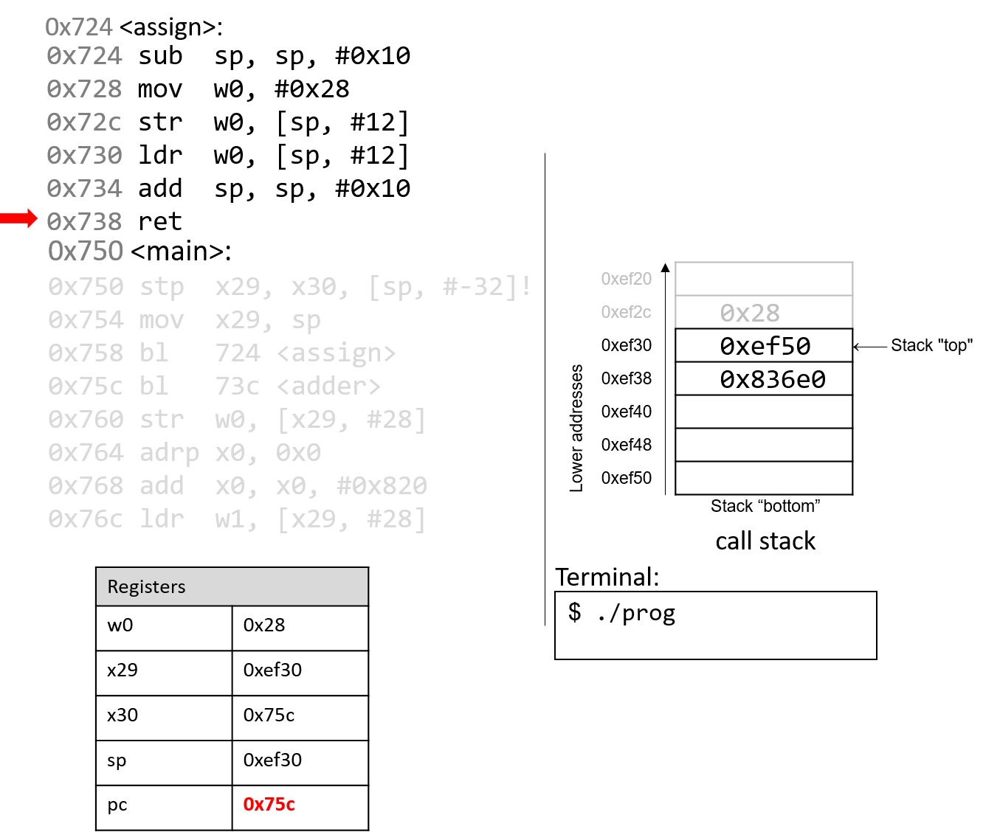

`ret` 指令用 `x30` 中的值（即 0x75c）替换 `pc` 中的值。于是，程序的执行回到 `main` 函数中紧跟在 `assign` 调用之后的那条指令。

> The `ret` instruction replaces the value in `pc` with the value in `x30`, or 0x75c. As a result, program execution returns to the first instruction in the `main` function immediately after the call to `assign`.

------------------------------------------------------------------------

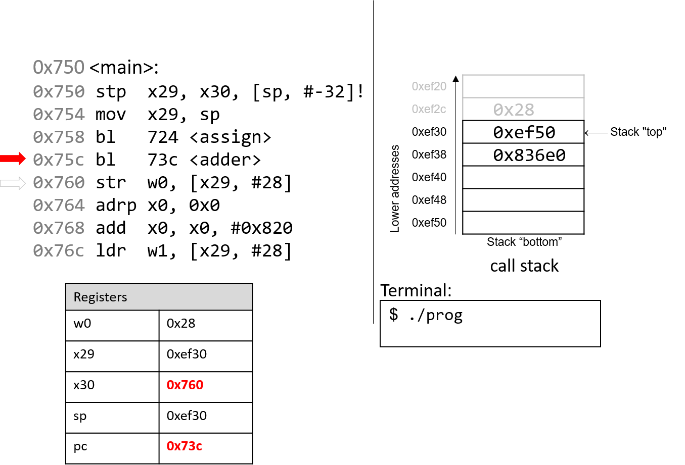

接下来执行的指令是对 `adder` 的函数调用（即 `bl 73c <adder>`）。因此，寄存器 `x30` 被更新为 `pc+4`，即 0x760。程序计数器被替换为地址 0x73c，表示程序进入 `adder` 函数继续执行。

> The next instruction that executes is a function call to `adder` (or `bl 73c <adder>`). Therefore, register `x30` is updated with `pc+4`, or 0x760. The program counter is replaced with address 0x73c, signifying that program execution continues into the `adder` function.

------------------------------------------------------------------------

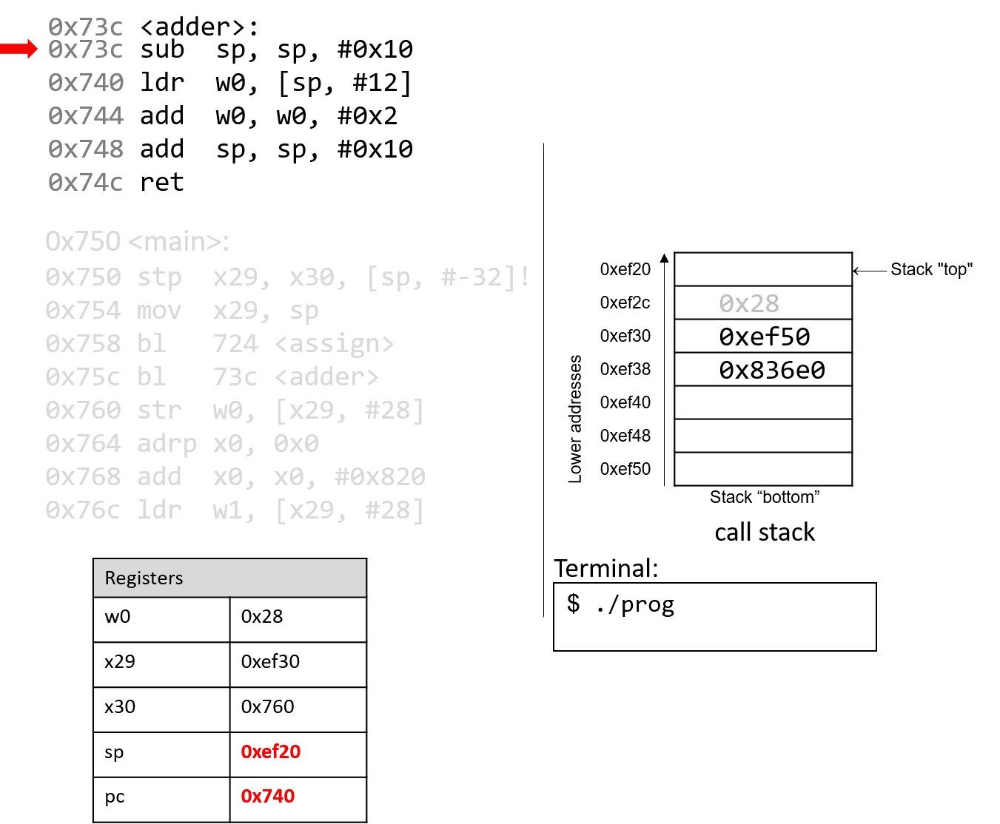

`adder` 函数中的第一条指令把栈指针减 16 字节，为 `adder` 函数分配新的栈帧。注意，`adder` 函数活动栈帧的边界由寄存器 `sp` 和 `x29` 标出。指令指针前进到顺序中的下一条指令。

> The first instruction in the `adder` function decrements the stack pointer by 16 bytes, allocating the new stack frame for the the `adder` function. Note that the active stack frame boundaries for the `adder` function are designated by registers `sp` and `x29`. The instruction pointer advances to the next instruction in sequence.

------------------------------------------------------------------------

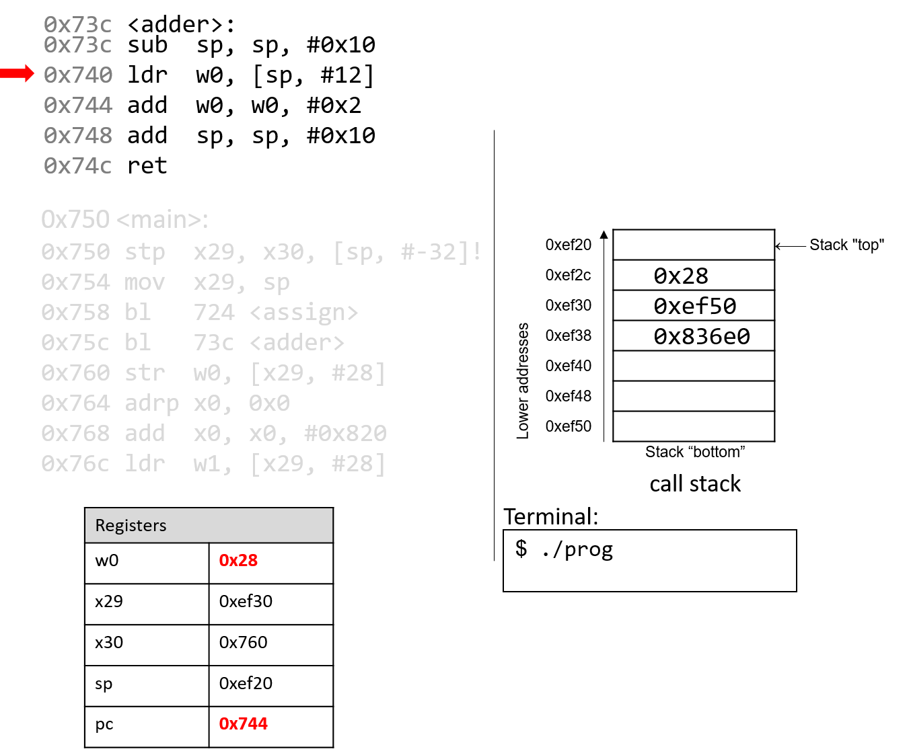

接下来发生的事情非常关键。`ldr` 指令把栈上（位于 `sp+12`）的一个*旧*值加载到寄存器 `w0` 中。这是程序员忘了在 `adder` 函数中初始化 `a` 的直接后果。指令指针前进到顺序中的下一条指令。

> What happens next is crucial. The `ldr` instruction loads an *old* value from the stack (at `sp+12`) into register `w0`. This is a direct result of the fact that the programmer forgot to initialize `a` in the `adder` function. The instruction pointer advances to the next instruction in sequence.

------------------------------------------------------------------------

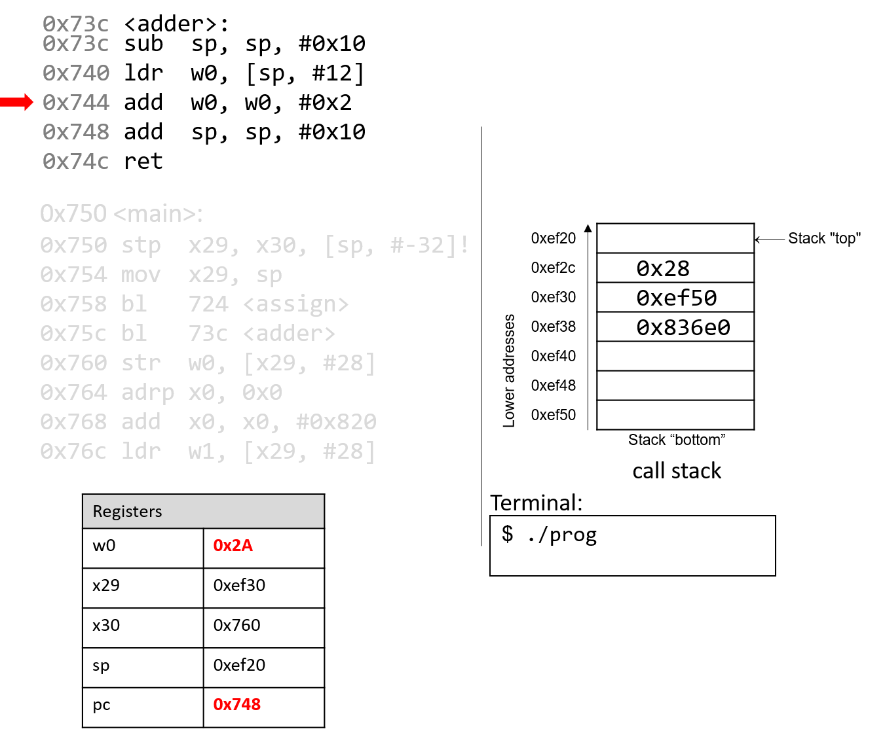

然后，`add` 指令把 `w0` 中的值加上 0x2，并把结果（0x2A）存入寄存器 `w0`。指令指针前进到顺序中的下一条指令。

> The `add` instruction then adds 0x2 to the value in `w0` and stores the result (0x2A) in register `w0`. The instruction pointer advances to the next instruction in sequence.

------------------------------------------------------------------------

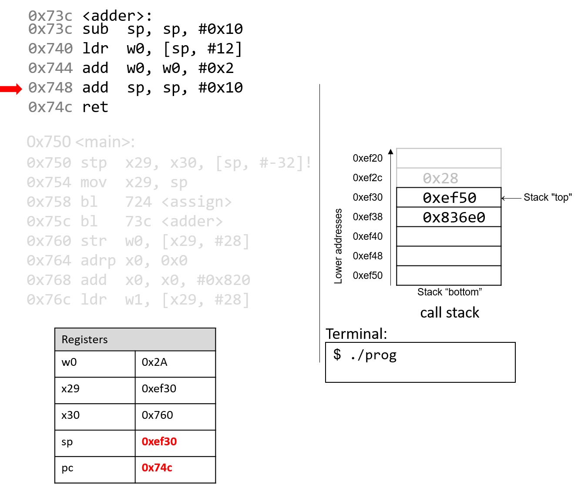

下一条 `add` 指令把栈指针加 16 字节，从而销毁 `adder` 的活动帧，并把 `sp` 恢复为之前的值。指令指针前进到顺序中的下一条指令。

> The next `add` instruction increments the stack pointer by 16 bytes, thus destroying the active frame for `adder` and restoring `sp` to its previous value. The instruction pointer advances to the next instruction in sequence.

------------------------------------------------------------------------


最后，`ret` 指令用寄存器 `x30` 中的地址覆盖 `pc`，表示程序应当在 `main` 函数中代码段地址 0x760 处继续执行。

> Finally, the `ret` instruction overwrites `pc` with the address in register `x30`, indicating that program execution should continue in the `main` function at code segment address 0x760.

------------------------------------------------------------------------

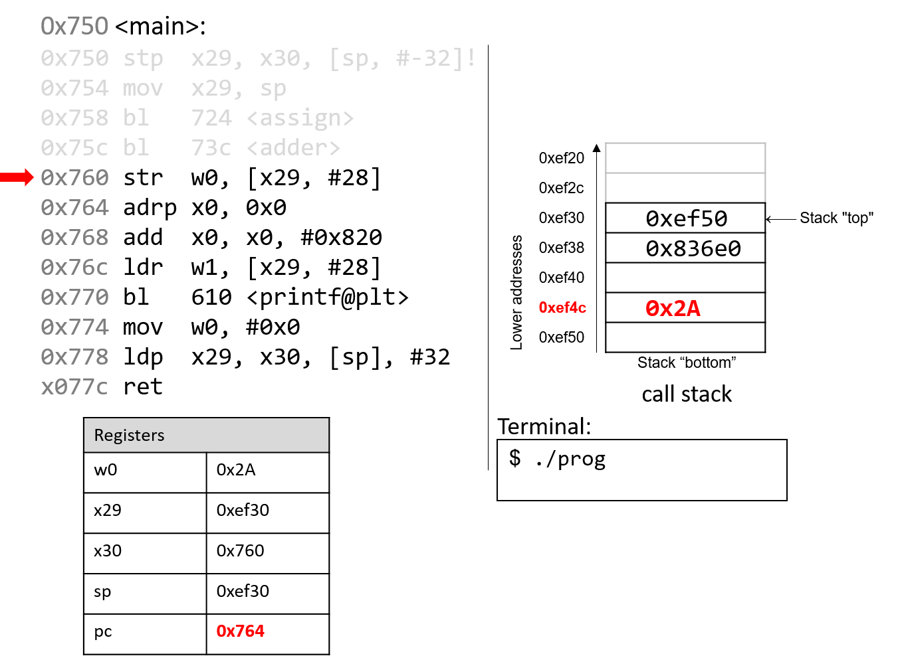

回到 `main()` 函数，程序地址 0x760 处的 `str` 指令把 `w0` 寄存器的内容（0x2A）存到调用栈上距帧指针（`x29`）28 字节的位置。因此，0x2A 被存放在栈地址 0xef4c 处。

> Back in the `main()` function, the `str` instruction at program address 0x760 stores the contents of the `w0` register (0x2A) at a call stack location that is 28 bytes from the frame pointer (`x29`). Therefore, 0x2A is stored at stack address 0xef4c.

------------------------------------------------------------------------

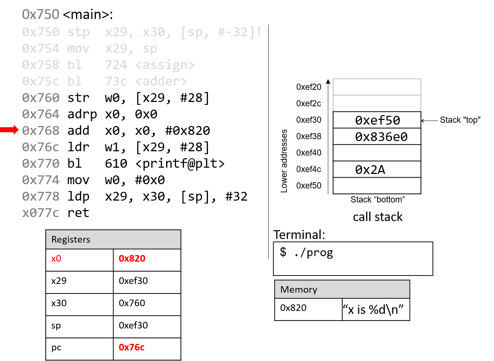

接下来的两条指令一起把一个页的地址加载到寄存器 `x0` 中。由于地址长 8 字节，使用的是 64 位寄存器 `x0`，而不是它的 32 位组成部分 `w0`。`adrp` 指令把地址（0x0）加载到寄存器 `x0` 中，而代码段地址 0x768 处的 `add` 指令把值 0x820 加到它上面。这两条指令执行完后，寄存器 `x0` 中存放的是内存地址 0x820。注意，地址 0x820 处存放的是字符串 `"x is %d\n"`。

> The next two instructions together load an address of a page into register `x0`. Since addresses are 8 bytes long, the 64-bit register `x0` is used instead of its 32-bit component, `w0`. The `adrp` instruction loads the address (0x0) into register `x0`, while the `add` instruction at code segment address 0x768 adds the value 0x820 to it. At the end of these two instructions, register `x0` contains memory address 0x820. Note that the value stored at address 0x820 is the string `"x is %d\n"`.

> [!NOTE] 译注
> 按本节开头的源代码，格式字符串其实是 `"x is: %d\n"`（多一个冒号）。另外，`adrp` 计算的是「当前 `pc` 所在 4KB 页的地址 + 偏移若干页」，再由 `add` 补上页内偏移，两条指令配合就能以位置无关的方式得到任意 ±4GB 范围内的地址；在 macOS 的汇编里，这一对指令写作 `adrp x0, l_.str@PAGE` 和 `add x0, x0, l_.str@PAGEOFF`。

------------------------------------------------------------------------

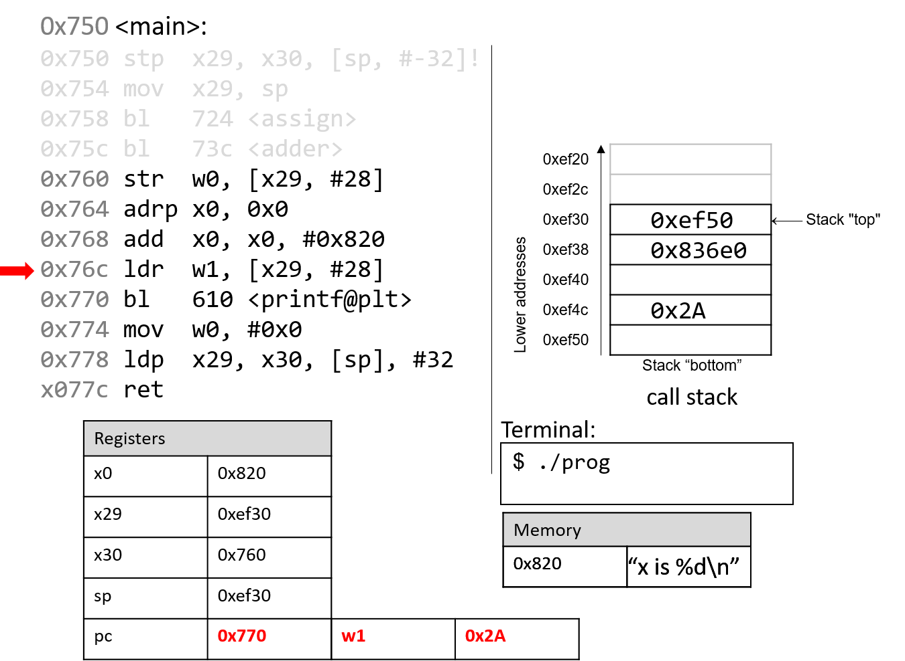

接着，程序地址 0x76c 处的 `ldr` 指令把 0x2A（位于距帧指针偏移 28 字节处）加载到寄存器 `w1` 中。

> Next, the `ldr` instruction at program address 0x76c loads 0x2A (which is located at an offset of 28 bytes from the frame pointer) into register `w1`.

------------------------------------------------------------------------

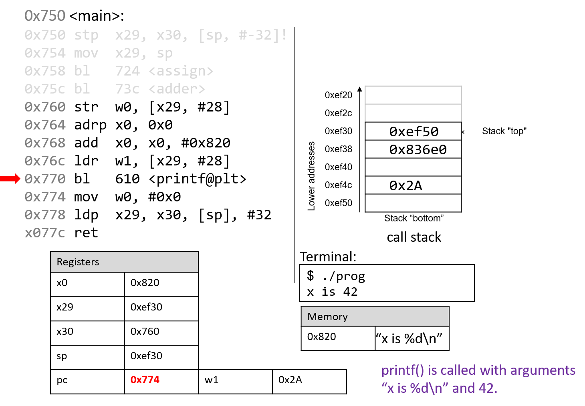

下一条指令调用 `printf` 函数。为了简洁起见，我们不跟踪 `printf` 函数，它是 `stdio.h` 的一部分。不过，从手册页（`man -s3 printf`）我们知道 `printf` 的格式如下：

> The next instruction calls the `printf` function. For the sake of brevity, we will not trace the `printf` function, which is part of `stdio.h`. However, we know from the manual page (`man -s3 printf`) that `printf` has the following format:

```
int printf(const char * format, ...)
```

换句话说，第一个参数是指向指定格式的字符串的指针，从第二个参数起是该格式中用到的值。地址 0x764–0x770 指定的那些指令，对应于 `main` 函数中的下面这一行：

> In other words, the first argument is a pointer to a string specifying the format, and the second argument onward specify the values that are used in that format. The instructions specified by addresses 0x764 - 0x770 correspond to the following line in the `main` function:

```
printf("x is %d\n", x);
```

调用 `printf` 函数时：

> When the `printf` function is called:

- 返回地址（`pc+4`，即 0x774）被存到寄存器 `x30` 中。

> - The return address (`pc+4` or 0x774) is stored in register `x30`.

- 寄存器 `pc` 切换到地址 0x610，即 `printf` 函数的起始处。

> - Register `pc` switches address 0x610, which is the start of the `printf` function.

- 寄存器 `sp` 被更新，以反映 `printf` 函数的新栈帧。

> - Register `sp` is updated to reflect the new stack frame for the `printf` function.

在某个时刻，`printf` 会引用它的参数，即字符串 `"x is %d\n"` 和值 0x2A。回想一下，对于任何有 *n* 个参数的函数，gcc 把前八个参数放在寄存器 `x0`–`x7` 中，把其余的参数放到栈上帧指针的*下方*。在这个例子中，第一个参数存放在寄存器 `x0` 中（因为它是一个字符串的地址），第二个参数存放在组成部分寄存器 `w1` 中。

> At some point, `printf` references its arguments, which are the string `"x is %d\n"` and the value 0x2A. Recall that for any function with *n* arguments, gcc places the first eight arguments in registers `x0`-`x7`, and the remaining arguments onto the stack *below* the frame pointer. In this case, the first parameter is stored in register `x0` (since it is an address to a string), and the second parameter is stored in component register `w1`.

> [!NOTE] 译注
> 这是 Linux 上的情形。如果你在 Apple Silicon Mac 上编译这个程序，`printf` 的可变参数 0x2A 不会放进 `w1`，而是存到栈上（见本章开头的译注）。

调用 `printf` 之后，值 0x2A 以整数格式输出给用户。于是，屏幕上打印出值 42。栈指针恢复为之前的值，`pc` 更新为寄存器 `x30` 中存放的值，即 0x774。

> After the call to `printf`, the value 0x2A is output to the user in integer format. Thus, the value 42 is printed to the screen. The stack pointer reverts to its previous value, and `pc` updates to the value stored in register `x30`, or 0x774.

------------------------------------------------------------------------

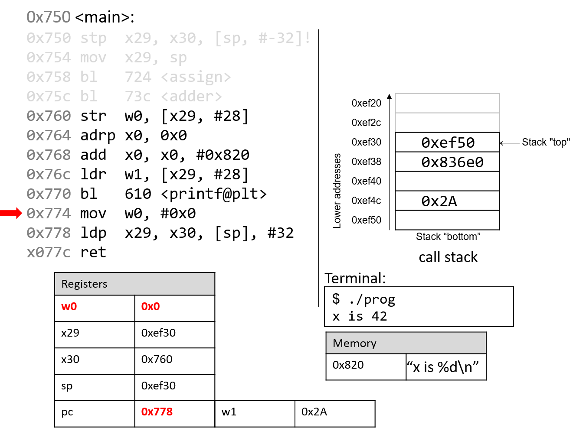

地址 0x774 处的 `mov` 指令把常数值 `#0x0` 加载到组成部分寄存器 `w0` 中。它代表 `main` 执行完毕时要返回的值。程序计数器前进到顺序中的下一条指令。

> The `mov` instructions at address 0x774 loads the constant value `#0x0` into component register `w0`. This represents the value that will be returned when `main` completes execution. The program counter advances to the next instruction in sequence.

------------------------------------------------------------------------

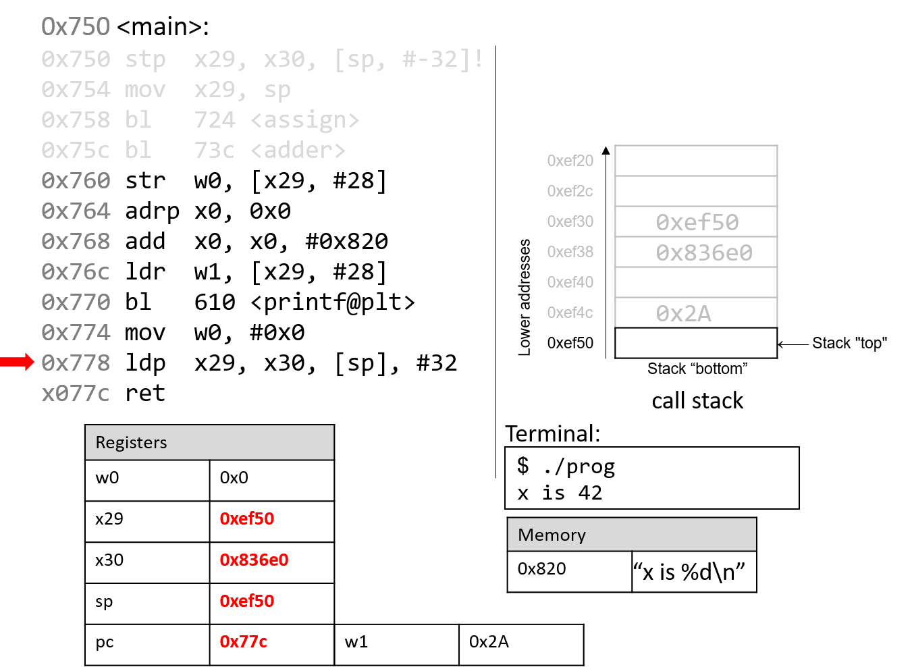

程序地址 0x778 处的 `ldp` 指令先把 `sp` 和 `sp+8` 处的值复制到寄存器 `x29` 和 `x30` 中，把它们恢复为 `main` 函数开始执行之前的原始值。`ldp` 指令的最后一部分（由操作数 `[sp], #32` 指定）把栈指针加 32 字节，把 `sp` 恢复为执行 `main` 之前的原始值。因此，当 `ldp` 指令执行完毕时，栈指针（`sp`）、帧指针（`x29`）和返回寄存器（`x30`）都已恢复为原始值。程序计数器前进到 `main` 函数中的最后一条指令。

> The `ldp` instruction at program address 0x778 first copies the values at `sp` and `sp+8` into registers `x29` and `x30`, reverting them to their original values prior to the start of the execution of the `main` function. The last part of the `ldp` instruction (as specified by the operand `[sp], #32`) increments the stack pointer by 32 bytes, restoring `sp` to its original value prior to the execution of `main`. Thus, when the `ldp` instruction completes execution, the stack pointer (`sp`), frame pointer (`x29`), and return register (`x30`) all have returned to their original values. The program counter advances to the last instruction in the `main` function.

------------------------------------------------------------------------

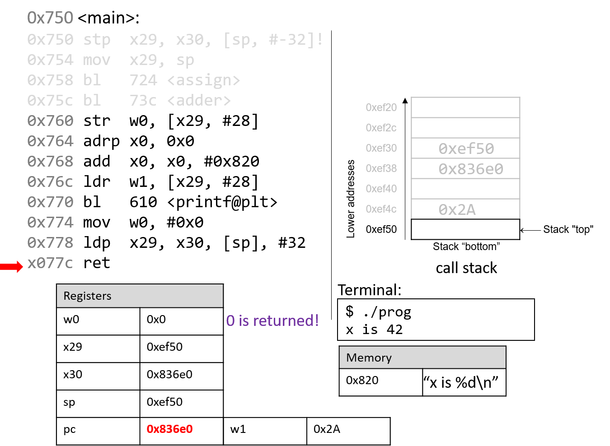

最后执行的指令是 `ret`。返回寄存器 `w0` 中是 0x0，程序返回 0，表示正常终止。

> The last instruction that executes is `ret`. With 0x0 in the return register `w0`, the program returns 0, indicating correct termination.

如果你仔细读完了本节，应该能理解为什么我们的程序会打印出值 42。本质上，程序无意中使用了栈上的旧值，导致它以我们没有预料到的方式运行。这个例子相当无害；不过在后面的小节中，我们会讨论黑客如何滥用函数调用，让程序以真正恶意的方式出错。

> If you have carefully read through this section, you should understand why our program prints out the value 42. In essence, the program inadvertently uses old values on the stack to cause it to behave in a way that we didn’t expect. This example was pretty harmless; however we discuss in future sections how hackers have misused function calls to make programs misbehave in truly malicious ways.
