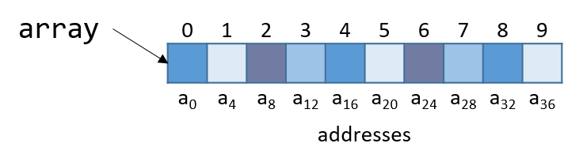

> [!WARNING] 说明
> 本文是个人学习用的**非官方**中英对照译文，原文：<https://diveintosystems.org/book/C9-ARM64/arrays.html>。
> 原书采用 CC BY-NC-ND 4.0 许可（禁止演绎），**请勿公开传播本译文**。
> 标为「译注」「现代更新」的内容是译者补充，不代表原书作者观点；代码与原文逐字一致，未作改动。


*9.7. Arrays*

回想一下，[数组](../C1-C_intro/1.5-arrays_strings.html)是同类型数据元素的有序集合，这些元素在内存中连续存放。静态分配的[一维数组](../C2-C_depth/2.5-arrays.html)形如 `Type arr[N]`，其中 `Type` 是数据类型，`arr` 是与数组关联的标识符，`N` 是数据元素的个数。无论是静态地声明为 `Type arr[N]`，还是动态地写成 `arr = malloc(N*sizeof(Type))`，都会分配总共 *N* × `sizeof`(*Type*) 字节的内存。

> Recall that [arrays](../C1-C_intro/1.5-arrays_strings.html) are ordered collections of data elements of the same type that are contiguously stored in memory. Statically allocated [single-dimension arrays](../C2-C_depth/2.5-arrays.html) have the form `Type arr[N]`, where `Type` is the data type, `arr` is the identifier associated with the array, and `N` is the number of data elements. Declaring an array statically as `Type arr[N]` or dynamically as `arr = malloc(N*sizeof(Type))` allocates *N* × `sizeof`(*Type*) total bytes of memory.

要访问数组 `arr` 中下标为 `i` 的元素，使用语法 `arr[i]`。编译器在翻译成汇编之前，通常会把数组引用转换成[指针运算](../C2-C_depth/2.2-pointers.html)。所以，`arr+i` 等价于 `&arr[i]`，`*(arr+i)` 等价于 `arr[i]`。由于 `arr` 中的每个数据元素都是 `Type` 类型，`arr+i` 意味着元素 `i` 存放在地址 `arr + sizeof(Type) * i` 处。

> To access the element at index `i` in array `arr`, use the syntax `arr[i]`. Compilers commonly convert array references into [pointer arithmetic](../C2-C_depth/2.2-pointers.html) prior to translating to assembly. So ,`arr+i` is equivalent to `&arr[i]`, and `*(arr+i)` is equivalent to `arr[i]`. Since each data element in `arr` is of type `Type`, `arr+i` implies that element `i` is stored at address `arr + sizeof(Type) * i`.

[表 1](9.7-arrays.html) 概括了一些常见的数组操作及其对应的汇编指令。在下面的例子中，假设我们声明了一个长度为 10 的 `int` 数组（例如 `int arr[10]`）。假设寄存器 `x1` 存放 `arr` 的地址，寄存器 `x2` 存放 `int` 值 `i`，寄存器 `x0` 代表某个变量 `x`（也是 `int` 类型）。回想一下，`int` 变量占四个字节，而 `int *` 变量占八个字节。

> [Table 1](9.7-arrays.html) outlines some common array operations and their corresponding assembly instructions. In the examples that follow, suppose we declare an `int` array of length 10 (e.g., `int arr[10]`). Assume that register `x1` stores the address of `arr`, register `x2` stores the `int` value `i`, and register `x0` represents some variable `x` (also of type `int`). Recall that `int` variables take up four bytes of space, whereas `int *` variables take up eight bytes.

**表 1.** 常见的数组操作及其对应的汇编表示

*Table 1. Common Array Operations and Their Corresponding Assembly Representations*

| 操作 | 类型 | 汇编表示 |
|---|---|---|
| `x = arr` | `int *` | `mov x0, x1` |
| `x = arr[0]` | `int` | `ldr w0, [x1]` |
| `x = arr[i]` | `int` | `ldr w0, [x1, x2, LSL, #2]` |
| `x = &arr[3]` | `int *` | `add x0, x1, #12` |
| `x = arr+3` | `int *` | `add x0, x1, #12` |
| `x = *(arr+5)` | `int` | `ldr w0, [x1, #20]` |

> | Operation      | Type    | Assembly Representation     |
> |----------------|---------|-----------------------------|
> | `x = arr`      | `int *` | `mov x0, x1`                |
> | `x = arr[0]`   | `int`   | `ldr w0, [x1]`              |
> | `x = arr[i]`   | `int`   | `ldr w0, [x1, x2, LSL, #2]` |
> | `x = &arr[3]`  | `int *` | `add x0, x1, #12`           |
> | `x = arr+3`    | `int *` | `add x0, x1, #12`           |
> | `x = *(arr+5)` | `int`   | `ldr w0, [x1, #20]`         |

> [!NOTE] 译注
> 与 9.1 节表 1 的译注相同，实际语法应写作 `ldr w0, [x1, x2, lsl #2]`（`lsl` 与 `#2` 之间没有逗号）。另外，`i` 是 32 位的 `int`，若它只在 `w2` 中，严格的写法是 `ldr w0, [x1, w2, sxtw #2]`，先符号扩展再左移。

注意，要访问元素 `arr[5]`（或用指针运算写成 `*(arr+5)`），编译器是在地址 `arr+5*4` 而不是 `arr+5` 上执行内存查找。要理解为什么必须这样，回想一下，数组中下标为 `i` 的任何元素都存放在地址 `arr + sizeof(Type) * i` 处。因此，编译器必须把下标乘以数据类型的大小（这里是 4，因为 `sizeof(int) = 4`），才能算出正确的偏移量。再回想一下，内存是按字节编址的；偏移正确的字节数，就等同于算出了地址。

> Notice that to access element `arr[5]` (or `*(arr+5)` using pointer arithmetic), the compiler performs a memory lookup on address `arr+5*4` instead of `arr+5`. To understand why this is necessary, recall that any element at index `i` in an array is stored at address `arr + sizeof(Type) * i`. The compiler must therefore multiply the index by the size of the data type (in this case 4, since `sizeof(int) = 4`) to compute the correct offset. Recall also that memory is byte-addressable; offsetting by the correct number of bytes is the same as computing an address.

举个例子，考虑一个含有 10 个整数元素的示例数组（`array`）（[图 1](9.7-arrays.html)）。

> As an example, consider a sample array (`array`) with 10 integer elements ([[FigArray6]](9.7-arrays.html)).



**图 1.** 一个十元素整数数组在内存中的布局。每个标为 a<sub>i</sub> 的方框代表四个字节的偏移，因为每个整数需要四个字节来存储。

*Figure 1. The layout of a ten-integer array in memory. Each a<sub>i</sub>-labeled box represents an offset of four bytes, as each integer requires four bytes to store.*

注意，由于 `array` 是一个整数数组，每个元素恰好占四个字节。因此，一个有 10 个元素的整数数组占用 40 个字节的连续内存。

> Notice that since `array` is an array of integers, each element takes up exactly four bytes. Thus, an integer array with 10 elements consumes 40 bytes of contiguous memory.

为了计算元素 3 的地址，编译器把下标 3 乘以整数类型的数据大小（4），得到偏移量 12（即 0xc）。果然，[图 1](9.7-arrays.html) 中的元素 3 位于字节偏移 a<sub>12</sub> 处。

> To compute the address of element 3, the compiler multiplies the index 3 by the data size of the integer type (4) to yield an offset of 12 (or 0xc). Sure enough, element 3 in [Figure 1](9.7-arrays.html) is located at byte offset a<sub>12</sub>.

我们来看一个简单的 C 函数 `sumArray`，它把数组中的所有元素加起来：

> Let’s take a look at a simple C function called `sumArray` that sums up all the elements in an array:

```
int sumArray(int *array, int length) {
    int i, total = 0;
    for (i = 0; i < length; i++) {
        total += array[i];
    }
    return total;
}
```

`sumArray` 函数接收一个数组的地址和数组的长度，把数组中的所有元素加起来。现在来看 `sumArray` 函数对应的汇编：

> The `sumArray` function takes the address of an array and the array’s associated length and sums up all the elements in the array. Now take a look at the corresponding assembly of the `sumArray` function:

```
Dump of assembler code for function sumArray:
0x874 <+0>:   sub    sp, sp, #0x20       // grow stack by 32 bytes (new frame)
0x878 <+4>:   str    x0, [sp, #8]        // store x0 at sp + 8 (array address)
0x87c <+8>:   str    w1, [sp, #4]        // store w1 at sp + 4 (length)
0x880 <+12>:  str    wzr, [sp, #28]      // store 0 at sp + 28  (total)
0x884 <+16>:  str    wzr, [sp, #24]      // store 0 at sp + 24 (i)
0x888 <+20>:  b      0x8b8 <sumArray+68> // goto <sumArray+68>
0x88c <+24>:  ldrsw  x0, [sp, #24]       // x0 = i
0x890 <+28>:  lsl    x0, x0, #2          // left shift i by 2 (i << 2, or i*4)
0x894 <+32>:  ldr    x1, [sp, #8]        // x1 = array
0x898 <+36>:  add    x0, x1, x0          // x0 = array + i*4
0x89c <+40>:  ldr    w0, [x0]            // w0 = array[i]
0x8a0 <+44>:  ldr    w1, [sp, #28]       // w1 = total
0x8a4 <+48>:  add    w0, w1, w0          // w0 = total + array[i]
0x8a8 <+52>:  str    w0, [sp, #28]       // store (total + array[i]) in total
0x8ac <+56>:  ldr    w0, [sp, #24]       // w0 = i
0x8b0 <+60>:  add    w0, w0, #0x1        // w0 = w0 + 1 (i+1)
0x8b4 <+64>:  str    w0, [sp, #24]       // store (i + 1) in i (i.e. i+=1)
0x8b8 <+68>:  ldr    w1, [sp, #24]       // w1 = i
0x8bc <+72>:  ldr    w0, [sp, #4]        // w0 = length
0x8c0 <+76>:  cmp    w1, w0              // compare i and length
0x8c4 <+80>:  b.lt   0x88c <sumArray+24> // if (i < length) goto <sumArray+24>
0x8c8 <+84>:  ldr    w0, [sp, #28]       // w0 = total
0x8cc <+88>:  add    sp, sp, #0x20       // revert stack to original state
0x8d0 <+92>:  ret                        // return (total)
```

跟踪这段汇编代码时，要考虑被访问的数据代表的是指针还是值。例如，`<sumArray+12>` 处的指令使栈位置 `sp + 28` 存放一个 `int` 类型的变量，它的初值被设为 `0`。与之不同，存放在位置 `sp + 8` 处的参数是函数的第一个参数（`array`），它的类型是 `int *`，对应于数组的基地址。另一个变量（我们称之为 `i`）存放在位置 `sp + 24` 处，初值也被设为 0。

> When tracing this assembly code, consider whether the data being accessed represents a pointer or a value. For example, the instruction at `<sumArray+12>` results in stack location `sp + 28` containing a variable of type `int`, which is initially set to `0`. In contrast, the argument stored at location `sp + 8` is the first argument to the function (`array`), which is of type `int *` and corresponds to the base address of the array. A different variable (which we call `i`) is stored at location `sp + 24` and is initially set to 0.

细心的读者会注意到 `<sumArray+30>` 这一行有一条之前没见过的指令 `ldrsw`。`ldrsw` 指令的意思是「加载寄存器有符号字」（load register signed word），它把存放在 `sp + 24` 处的 32 位 `int` 值转换成 64 位整数值，并存入 `x0`。这个操作是必要的，因为接下来的指令要进行指针运算。回想一下，在 64 位系统上，指针占八个字节。编译器使用 `ldrsw`，确保所有数据都存放在完整的 64 位寄存器而不是其 32 位组成部分中，从而简化了处理过程。

> The astute reader will notice a previously unseen instruction at line `<sumArray+30>` called `ldrsw`. The `ldrsw` instruction stands for "load register signed word" and converts the 32-bit `int` value stored at `sp + 24` to a 64-bit integer value and stores it in `x0`. This operation is necessary because the instructions that follow perform pointer arithmetic. Recall that on 64-bit systems, pointers take up eight bytes of space. The compiler’s use of `ldrsw` simplifies the process by ensuring that all data are stored in full 64-bit registers instead of their 32-bit components.

> [!NOTE] 译注
> 按清单，`ldrsw` 位于 `<sumArray+24>`（下文第 21 段也是这么写的）。A64 指令都是 4 字节对齐的，偏移量不可能是 30。

我们来仔细看看位置 `<sumArray+28>` 和 `<sumArray+52>` 之间的七条指令：

> Let’s take a closer look at the seven instructions between locations `<sumArray+28>` and `<sumArray+52>`:

```
0x890 <+28>:  lsl    x0, x0, #2             // left shift i by 2 (i << 2, or i*4)
0x894 <+32>:  ldr    x1, [sp, #8]           // x1 = array
0x898 <+36>:  add    x0, x1, x0             // x0 = array + i*4
0x89c <+40>:  ldr    w0, [x0]               // w0 = array[i]
0x8a0 <+44>:  ldr    w1, [sp, #28]          // w1 = total
0x8a4 <+48>:  add    w0, w1, w0             // w0 = total + array[i]
0x8a8 <+52>:  str    w0, [sp, #28]          // store (total + array[i]) in total
```

编译器用 `lsl` 对存放在 `x0` 中的值 `i` 执行左移。这条指令执行完后，寄存器 `x0` 中存放的是 `i << 2`，即 `i * 4`。此时，`x0` 中存放的是为了算出 `array[i]` 的正确偏移量所需的字节数（因为 `sizeof(int) = 4`）。

> The compiler uses `lsl` to perform a left shift on the value `i` stored in `x0`. When this instruction completes execution, register `x0` contains `i << 2`, or `i * 4`. At this point, `x0` contains the number of bytes to calculate the correct offset of `array[i]` (or `sizeof(int) = 4`).

下一条指令（`ldr x1, [sp, #8]`）把函数的第一个参数（即 `array` 的基地址）加载到寄存器 `x1` 中。下一条指令把 `x1` 加到 `x0` 上，使 `x0` 存放 `array + i * 4`。回想一下，`array` 中下标为 `i` 的元素存放在地址 `array + sizeof(T) * i` 处。因此，`x0` 现在存放的是在汇编层面计算出的地址 `&array[i]`。

> The next instruction (`ldr x1, [sp, #8]`) loads the first argument to the function (i.e., the base address of `array`) into register `x1`. Adding `x1` to `x0` in the next instruction causes `x0` to contain `array + i * 4`. Recall that the element at index `i` in `array` is stored at address `array + sizeof(T) * i` Therefore, `x0` now contains the assembly-level computation of address `&array[i]`.

`<sumArray+40>` 处的指令对位于 `x0` 的值*解引用*，把值 `array[i]` 放入 `w1`。注意这里使用的是组成部分寄存器 `w1`，因为 `array[i]` 存放的是 32 位的 `int` 值！与之不同，变量 `i` 在 `<sumArray+24>` 这一行被转换成了 64 位整数，因为 `i` 即将用于*地址计算*。再说一遍，地址（指针）是以 64 位字的形式存放的。

> The instruction at `<sumArray+40>` *dereferences* the value located at `x0`, placing the value `array[i]` into `w1`. Notice the use of the component register `w1`, because `array[i]` contains a 32-bit `int` value! In contrast, the variable `i` was changed to a 64-bit integer on line `<sumArray+24>` since `i` was about to be used for *address computation*. Again, addresses (pointers) are stored as 64-bit words.

> [!NOTE] 译注
> 按清单，`<sumArray+40>` 处是 `ldr w0, [x0]`，`array[i]` 被放进的是 `w0` 而不是 `w1`；`w1` 是下一条指令用来存放 `total` 的。

`<sumArray+44>` 到 `<sumArray+52>` 之间的最后三条指令把 `total` 的当前值加载到组成部分寄存器 `w1` 中，把 `array[i]` 加到它上面，把结果存入组成部分寄存器 `w0`，然后用新的和更新位于 `sp + 28` 的 `total`。因此，`<sumArray+28>` 和 `<sumArray+52>` 之间的七条指令等价于 `sumArray` 函数中的 `total += array[i]` 这一行。

> The last three instructions between `<sumArray+44>` and `<sumArray+52>` load the current value of `total` into component register `w1`, add `array[i]` to it, and store the result in component register `w0`, before updating `total` at location `sp + 28` with the new sum. Therefore, the seven instructions between `<sumArray+28>` and `<sumArray+52>` are equivalent to the line `total += array[i]` in the `sumArray` function.
