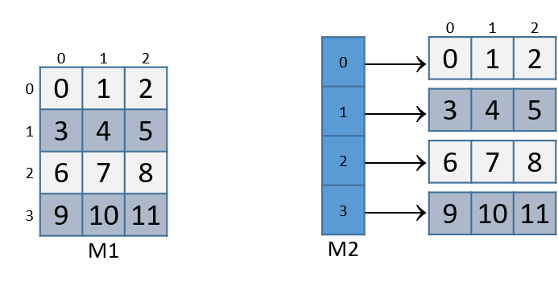
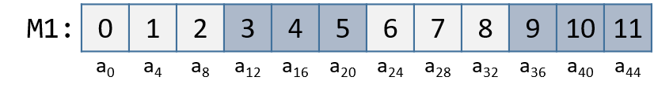
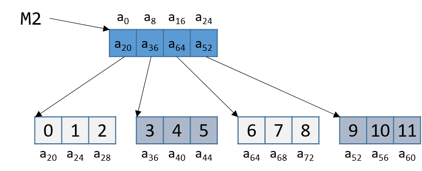

> [!WARNING] 说明
> 本文是个人学习用的**非官方**中英对照译文，原文：<https://diveintosystems.org/book/C9-ARM64/matrices.html>。
> 原书采用 CC BY-NC-ND 4.0 许可（禁止演绎），**请勿公开传播本译文**。
> 标为「译注」「现代更新」的内容是译者补充，不代表原书作者观点；代码与原文逐字一致，未作改动。


*9.8. Matrices*

矩阵是一个二维数组。C 中的矩阵可以静态分配为二维数组（`M[n][m]`），可以通过一次 `malloc` 调用动态分配，也可以动态分配为一个「数组的数组」。我们来考虑数组的数组这种实现。第一个数组包含 `n` 个元素（`M[n]`），矩阵中的每个元素 `M[i]` 又包含一个由 `m` 个元素组成的数组。下面的代码片段各自声明了一个 4 × 3 的矩阵：

> A matrix is a two-dimensional (2D) array. A matrix in C can be statically allocated as a 2D array (`M[n][m]`), dynamically allocated with a single call to `malloc`, or dynamically allocated as an array of arrays. Let’s consider the array of arrays implementation. The first array contains `n` elements (`M[n]`), and each element `M[i]` in our matrix contains an array of `m` elements. The following code snippets each declare matrices of size 4 × 3:

```
//statically allocated matrix (allocated on stack)
int M1[4][3];

//dynamically allocated matrix (programmer friendly, allocated on heap)
int **M2, i;
M2 = malloc(4 * sizeof(int*));
for (i = 0; i < 4; i++) {
    M2[i] = malloc(3 * sizeof(int));
}
```

在动态分配矩阵的情况下，主数组包含一个连续的 `int` 指针数组，每个整型指针指向内存中一个不同的数组。[图 1](9.8-matrices.html) 展示了我们通常如何直观地想象这两种矩阵。

> In the case of the dynamically allocated matrix, the main array contains a contiguous array of `int` pointers. Each integer pointer points to a different array in memory. [Figure 1](9.8-matrices.html) illustrates how we would normally visualize each of these matrices.



**图 1.** 静态分配（M1）和动态分配（M2）的 3×4 矩阵示意图

*Figure 1. Illustration of a statically allocated (M1) and dynamically-allocated (M2) 3×4 matrix*

对于这两种矩阵声明，都可以用双下标语法 `M[i][j]` 访问元素 (i,j)，其中 `M` 是 `M1` 或 `M2`。不过，这两个矩阵在内存中的组织方式不同。尽管两者都把各自主数组中的元素连续存放在内存中，但我们的静态分配矩阵还把所有的行也连续存放在内存中：

> For both of the these matrix declarations, element (i,j) can be accessed using the double-indexing syntax `M[i][j]`, where `M` is either `M1` or `M2`. However, these matrices are organized differently in memory. Even though both store the elements in their primary array contiguously in memory, our statically allocated matrix also stores all the rows contiguously in memory:



**图 2.** 矩阵 M1 按行主序的内存布局

*Figure 2. Matrix M1’s memory layout in row-major order*

对于 `M2`，并不能保证这种连续的排列。[回想一下](../C2-C_depth/2.5-arrays.html)，要在堆上连续地分配一个 *n* × *m* 的矩阵，应当用一次 `malloc` 调用分配 *n* × *m* 个元素：

> This contiguous ordering is not guaranteed for `M2`. [Recall that](../C2-C_depth/2.5-arrays.html) to contiguously allocate an *n* × *m* matrix on the heap, we should use a single call to `malloc` that allocates *n* × *m* elements:

```
//dynamic matrix (allocated on heap, memory efficient way)
#define ROWS 4
#define COLS 3
int *M3;
M3 = malloc(ROWS*COLS*sizeof(int));
```

回想一下，对于 `M3` 这样的声明，*不能*用 `M[i][j]` 记法访问元素 (*i*,*j*)，而必须用 `M3[i*cols + j]` 的格式来索引元素。

> Recall that with the declaration of `M3`, element (*i*,*j*) *cannot* be accessed using the `M[i][j]` notation. Instead, we must index the element using the format: `M3[i*cols + j]`.

### 9.8.1. 连续的二维数组

*9.8.1. Contiguous Two-Dimensional Arrays*

考虑一个函数 `sumMat`，它的第一个参数是指向一个连续分配的（静态分配的或以节省内存的方式动态分配的）矩阵的指针，另外两个参数是行数和列数，它返回矩阵中所有元素的和。

> Consider a function `sumMat` that takes a pointer to a contiguously allocated (either statically allocated or memory-efficient dynamically allocated) matrix as its first parameter, along with a number of rows and columns, and returns the sum of all the elements inside the matrix.

在下面的代码片段中，我们使用按比例计算下标的方式，因为它同时适用于静态分配和动态分配的连续矩阵。回想一下，语法 `m[i][j]` 不适用于前面讨论的节省内存的连续动态分配。

> We use scaled indexing in the code snippet that follows because it applies to both statically and dynamically allocated contiguous matrices. Recall that the syntax `m[i][j]` does not work with the memory-efficient contiguous dynamic allocation previously discussed.

```
int sumMat(int *m, int rows, int cols) {
    int i, j, total = 0;
    for (i = 0; i < rows; i++){
        for (j = 0; j < cols; j++){
            total += m[i*cols + j];
        }
    }
    return total;
}
```

下面是对应的汇编，每一行都加上了英文注解：

> Here is the corresponding assembly. Each line is annotated with its English translation:

```
Dump of assembler code for function sumMat:
0x884 <+0>:   sub   sp, sp, #0x20      // grow stack by 32 bytes (new frame)
0x888 <+4>:   str   x0, [sp, #8]       // store m in location sp + 8
0x88c <+8>:   str   w1, [sp, #4]       // store rows in location sp + 4
0x890 <+12>:  str   w2, [sp]           // store cols at top of stack
0x894 <+16>:  str   wzr, [sp, #28]     // store zero at sp + 28 (total)
0x898 <+20>:  str   wzr, [sp, #20]     // store zero at sp + 20 (i)
0x89c <+24>:  b     0x904 <sumMat+128> // goto <sumMat+128>
0x8a0 <+28>:  str   wzr, [sp, #24]     // store zero at sp + 24 (j)
0x8a4 <+32>:  b     0x8e8 <sumMat+100> // goto <sumMat+100>
0x8a8 <+36>:  ldr   w1, [sp, #20]      // w1 = i
0x8ac <+40>:  ldr   w0, [sp]           // w0 = cols
0x8b0 <+44>:  mul   w1, w1, w0         // w1 = cols * i
0x8b4 <+48>:  ldr   w0, [sp, #24]      // w0 = j
0x8b8 <+52>:  add   w0, w1, w0         // w0 = (cols * i) + j
0x8bc <+56>:  sxtw  x0, w0             // x0 = signExtend(cols * i + j)
0x8c0 <+60>:  lsl   x0, x0, #2         // x0 = (cols * i + j) * 4
0x8c4 <+64>:  ldr   x1, [sp, #8]       // x1 = m
0x8c8 <+68>:  add   x0, x1, x0         // x0 = m+(cols*i+j)*4 (or &m[i*cols+j])
0x8cc <+72>:  ldr   w0, [x0]           // w0 = m[i*cols + j]
0x8d0 <+76>:  ldr   w1, [sp, #28]      // w1 = total
0x8d4 <+80>:  add   w0, w1, w0         // w0 = total + m[i*cols + j]
0x8d8 <+84>:  str   w0, [sp, #28]      // total is now (total + m[i*cols + j])
0x8dc <+88>:  ldr   w0, [sp, #24]      // w0  = j
0x8e0 <+92>:  add   w0, w0, #0x1       // w0 = j + 1
0x8e4 <+96>:  str   w0, [sp, #24]      // update j  with (j + 1)
0x8e8 <+100>: ldr   w1, [sp, #24]      // w1 = j
0x8ec <+104>: ldr   w0, [sp]           // w0 = cols
0x8f0 <+108>: cmp   w1, w0             // compare j with cols
0x8f4 <+112>: b.lt  0x8a8 <sumMat+36>  // if (j < cols) goto <sumMat+36>
0x8f8 <+116>: ldr   w0, [sp, #20]      // w0 = i
0x8fc <+120>: add   w0, w0, #0x1       // w0 = i + 1
0x900 <+124>: str   w0, [sp, #20]      // update i with (i+1)
0x904 <+128>: ldr   w1, [sp, #20]      // w1 = i
0x908 <+132>: ldr   w0, [sp, #4]       // w0 = rows
0x90c <+136>: cmp   w1, w0             // compare i with rows
0x910 <+140>: b.lt  0x8a0 <sumMat+28>  // if (i < rows) goto <sumMat+28>
0x914 <+144>: ldr   w0, [sp, #28]      // w0 = total
0x918 <+148>: add   sp, sp, #0x20      // revert stack to prior state
0x91c <+152>: ret                      // return (total)
```

局部变量 `i`、`j` 和 `total` 分别存放在栈位置 `sp + 20`、`sp + 24` 和 `sp + 28` 处。输入参数 `m`、`row` 和 `cols` 分别存放在位置 `sp + 8`、`sp + 4` 和 `sp`（栈顶）处。有了这些知识，我们来放大只负责访问矩阵中元素 (*i*,*j*) 的那部分代码（0x8a8 到 0x8d8）：

> The local variables `i`, `j`, and `total` are stored at stack locations `sp + 20`, `sp + 24` and `sp + 28`, respectively. The input parameters `m`, `row`, and `cols` are stored at locations `sp + 8`, `sp + 4`, and `sp` (top of stack), respectively. Using this knowledge, let’s zoom in on the component that just deals with the access of element (*i*,*j*) in our matrix (0x8a8 to 0x8d8):

```
0x8a8 <+36>:   ldr   w1, [sp, #20]       // w1 = i
0x8ac <+40>:   ldr   w0, [sp]            // w0 = cols
0x8b0 <+44>:   mul   w1, w1, w0          // w1 = cols * i
```

第一组指令计算值 `cols * i`，并把它放到寄存器 `w1` 中。回想一下，对于某个名为 `matrix` 的矩阵，`matrix+i*cols` 等价于 `&matrix[i]`。

> The first set of instructions calculates the value `cols * i` and places it in register `w1`. Recall that for some matrix called `matrix`, `matrix+i*cols` is equivalent to `&matrix[i]`.

```
0x8b4 <+48>:   ldr   w0, [sp, #24]       // w0 = j
0x8b8 <+52>:   add   w0, w1, w0          // w0 = (cols * i) + j
0x8bc <+56>:   sxtw  x0, w0              // x0 = signExtend(cols * i + j)
0x8c0 <+60>:   lsl   x0, x0, #2          // x0 = (cols * i + j) * 4
```

下一组指令计算 `(cols*i + j) * 4`。编译器把下标 `cols * i + j` 乘以四，是因为矩阵中的每个元素都是四字节的整数，这次乘法让编译器能算出正确的偏移量。`<sumMat+56>` 这一行的 `sxtw` 指令把 `w0` 的内容符号扩展为 64 位整数，因为这个值要用于地址计算。

> The next set of instructions computes `(cols*i + j) * 4`. The compiler multiplies the index `cols * i + j` by four because each element in the matrix is a four-byte integer, and this multiplication enables the compiler to compute the correct offset. The `sxtw` instruction on line `<sumMat+56>` sign-extends the contents of `w0` into a 64-bit integer, since that value is needed for address calculation.

接下来这组指令把算出的偏移量加到矩阵指针上，并对它解引用，得到元素 (*i*,*j*) 的值：

> The following set of instructions adds the calculated offset to the matrix pointer and dereferences it to yield the value of element (*i*,*j*):

```
0x8c4 <+64>: ldr   x1, [sp, #8]  // x1 = m
0x8c8 <+68>: add   x0, x1, x0    // x0 = m + (cols*i + j)*4 (or &m[i*cols + j])
0x8cc <+72>: ldr   w0, [x0]      // w0 = m[i*cols + j]
0x8d0 <+76>: ldr   w1, [sp, #28] // w1 = total
0x8d4 <+80>: add   w0, w1, w0    // w0 = total + m[i*cols + j]
0x8d8 <+84>: str   w0, [sp, #28] // update total with (total + m[i*cols + j])
```

第一条指令把矩阵 `m` 的地址加载到寄存器 `x1` 中。`add` 指令把 `(cols * i + j) * 4` 加到 `m` 的地址上，正确算出元素 (*i*,*j*) 的偏移位置，并把结果放到寄存器 `x0` 中。第三条指令对 `x0` 中的地址解引用，把值（`m[i * cols + j]`）放入 `w0`。注意这里使用 `w0` 作为目标组成部分寄存器；由于我们的矩阵包含的是整数，而整数占四个字节，所以这里同样使用组成部分寄存器 `w0` 而不是 `x0`。

> The first instruction loads the address of matrix `m` into register `x1`. The `add` instruction adds `(cols * i + j) * 4` to the address of `m` to correctly calculate the offset of element (*i*,*j*) and then places the result in register `x0`. The third instruction dereferences the address in `x0` and places the value (`m[i * cols + j]`) into `w0`. Notice the use of `w0` as the destination component register; since our matrix contains integers, and integers take up four bytes of space, component register `w0` is again used instead of `x0`.

最后三条指令把 `total` 的当前值加载到寄存器 `w1` 中，把 `total` 与 `m[i * cols + j]` 相加，然后用得到的和更新 `total`。

> The last three instructions load the current value of `total` into register `w1`, add `total` with `m[i * cols + j]`, and then update `total` with the resulting sum.

我们来考虑矩阵 M1 中的元素 (1,2) 是如何被访问的（下面重新给出这张图）。

> Let’s consider how element (1,2) is accessed in matrix M1 (figure reproduced below).


**图 3.** 矩阵 M1 按行主序的内存布局

*Figure 3. Matrix M1’s memory layout in row-major order*

元素 (1,2) 位于地址 `M1 + 1 * cols + 2` 处。由于 `cols` = 3，元素 (1,2) 对应于 `M1 + 5`。要访问这个位置上的元素，编译器必须把 5 乘以 `int` 数据类型的大小（四个字节），得到偏移位置 `M1 + 20`，它对应于图中的字节 a<sub>20</sub>。对这个位置解引用，得到元素 5，它确实是矩阵中的元素 (1,2)。

> Element (1,2) is located at address `M1 + 1 * cols + 2`. Since `cols` = 3, element (1,2) corresponds to `M1 + 5`. To access the element at this location, the compiler must multiply 5 by the size of the `int` data type (four bytes), yielding the offset `M1 + 20`, which corresponds to byte a<sub>20</sub> in the figure. Dereferencing this location yields element 5, which is indeed element (1,2) in the matrix.

### 9.8.2. 不连续的矩阵

*9.8.2. Noncontiguous Matrix*

不连续矩阵的实现要稍微复杂一些。[图 4](9.8-matrices.html) 直观地展示了 `M2` 在内存中可能的布局。

> The noncontiguous matrix implementation is a bit more complicated. [Figure 4](9.8-matrices.html) visualizes how `M2` may be laid out in memory.



**图 4.** 矩阵 M2 在内存中的不连续布局

*Figure 4. Matrix M2’s noncontiguous layout in memory*

注意，`M2` 中的指针数组是连续的，`M2` 的某个元素所指向的每个数组（例如 `M2[i]`）也是连续的。但是，各个数组彼此之间并不连续。由于 `M2` 是一个指针数组，`M2` 的每个元素占八个字节。与之不同，由于每个 `M2[i]` 都是一个 `int` 数组，每个 `M2[i]` 数组中的元素相隔四个字节。

> Notice that the array of pointers in `M2` is contiguous, and that each array pointed to by some element of `M2` (e.g., `M2[i]`) is contiguous. However, the individual arrays are not contiguous with one another. Since `M2` is an array of pointers, each element of `M2` takes eight bytes of space. In contrast, because each `M2[i]` is an `int` array, the elements of every `M2[i]` array are four bytes apart.

下面例子中的 `sumMatrix` 函数以一个整型指针数组（称为 `matrix`）作为第一个参数，以行数和列数作为第二、第三个参数：

> The `sumMatrix` function in the follow example takes an array of integer pointers (called `matrix`) as its first parameter, and a number of rows and columns as its second and third parameters:

```
int sumMatrix(int **matrix, int rows, int cols) {
    int i, j, total=0;
    for (i = 0; i < rows; i++) {
        for (j = 0; j < cols; j++) {
            total += matrix[i][j];
        }
    }
    return total;
}
```

尽管这个函数看起来与前面的 `sumMat` 函数几乎一模一样，但这个函数接收的矩阵由一个连续的*指针*数组构成。每个指针存放着一个单独的连续数组的地址，这个数组对应于矩阵中单独的一行。

> Even though this function looks nearly identical to the `sumMat` function shown earlier, the matrix accepted by this function consists of a contiguous array of *pointers*. Each pointer contains the address of a separate contiguous array, which corresponds to a separate row in the matrix.

下面是 `sumMatrix` 对应的汇编，每一行都加上了英文注解。

> The corresponding assembly for `sumMatrix` follows. Each line is annotated with its English translation.

```
Dump of assembler code for function sumMatrix:
0x920 <+0>:   sub   sp, sp, #0x20         // grow stack 32 bytes (new frame)
0x924 <+4>:   str   x0, [sp, #8]          // store matrix at sp + 8
0x928 <+8>:   str   w1, [sp, #4]          // store rows at sp + 4
0x92c <+12>:  str   w2, [sp]              // store cols at sp (top of stack)
0x930 <+16>:  str   wzr, [sp, #28]        // store 0 at sp + 28 (total)
0x934 <+20>:  str   wzr, [sp, #20]        // store 0 at sp + 20 (i)
0x938 <+24>:  b     0x99c <sumMatrix+124> // goto <sumMatrix+124>
0x93c <+28>:  str   wzr, [sp, #24]        // store 0 at sp + 24 (j)
0x940 <+32>:  b     0x980 <sumMatrix+96>  // goto <sumMatrix+96>
0x944 <+36>:  ldrsw x0, [sp, #20]         // x0 = signExtend(i)
0x948 <+40>:  lsl   x0, x0, #3            // x0 = i << 3 (or i * 8)
0x94c <+44>:  ldr   x1, [sp, #8]          // x1 = matrix
0x950 <+48>:  add   x0, x1, x0            // x0 = matrix + i * 8
0x954 <+52>:  ldr   x1, [x0]              // x1 = matrix[i]
0x958 <+56>:  ldrsw x0, [sp, #24]         // x0 = signExtend(j)
0x95c <+60>:  lsl   x0, x0, #2            // x0 = j << 2 (or j * 4)
0x960 <+64>:  add   x0, x1, x0            // x0 = matrix[i] + j * 4
0x964 <+68>:  ldr   w0, [x0]              // w0 = matrix[i][j]
0x968 <+72>:  ldr   w1, [sp, #28]         // w1 = total
0x96c <+76>:  add   w0, w1, w0            // w0 = total + matrix[i][j]
0x970 <+80>:  str   w0, [sp, #28]         // store total = total+matrix[i][j]
0x974 <+84>:  ldr   w0, [sp, #24]         // w0 = j
0x978 <+88>:  add   w0, w0, #0x1          // w0 = j + 1
0x97c <+92>:  str   w0, [sp, #24]         // update j with (j + 1)
0x980 <+96>:  ldr   w1, [sp, #24]         // w1 = j
0x984 <+100>: ldr   w0, [sp]              // w0 = cols
0x988 <+104>: cmp   w1, w0                // compare j with cols
0x98c <+108>: b.lt  0x944 <sumMatrix+36>  // if (j < cols) goto <sumMatrix+36>
0x990 <+112>: ldr   w0, [sp, #20]         // w0 = i
0x994 <+116>: add   w0, w0, #0x1          // w0 = i + 1
0x998 <+120>: str   w0, [sp, #20]         // update i with (i + 1)
0x99c <+124>: ldr   w1, [sp, #20]         // w1 = i
0x9a0 <+128>: ldr   w0, [sp, #4]          // w0 = rows
0x9a4 <+132>: cmp   w1, w0                // compare i with rows
0x9a8 <+136>: b.lt  0x93c <sumMatrix+28>  // if (i < rows) goto <sumMatrix+28>
0x9ac <+140>: ldr   w0, [sp, #28]         // w0 = total
0x9b0 <+144>: add   sp, sp, #0x20         // revert stack to its original form
0x9b4 <+148>: ret                         // return (total)
```

同样，变量 `i`、`j` 和 `total` 分别位于栈地址 `sp + 20`、`sp + 24` 和 `sp + 28` 处。输入参数 `matrix`、`row` 和 `cols` 分别位于栈地址 `sp + 8`、`sp + 4` 和 `sp`（栈顶）处。我们来放大专门负责访问元素 (*i*, *j*)，即 `matrix[i][j]` 的那部分代码，它位于指令 0x944 到 0x970 之间：

> Again, variables `i`, `j`, and `total` are at stack addresses `sp`\
> `20`, `sp + 24`, and `sp + 28`, respectively. The input parameters `matrix`, `row`, and `cols` are located at stack addresses `sp + 8`, `sp + 4`, and `sp` (top of stack), respectively. Let’s zoom in on the section that deals specifically with an access to element (*i*, *j*), or `matrix[i][j]`, which is between instructions 0x944 and 0x970:

> [!NOTE] 译注
> 原书网页此处的 `sp + 20` 排版出错，显示成了 `sp`、反斜杠和换行后的 `20`。

```
0x944 <+36>:   ldrsw  x0, [sp, #20]          // x0 = signExtend(i)
0x948 <+40>:   lsl    x0, x0, #3             // x0 = i << 3 (or i * 8)
0x94c <+44>:   ldr    x1, [sp, #8]           // x1 = matrix
0x950 <+48>:   add    x0, x1, x0             // x0 = matrix + i * 8
0x954 <+52>:   ldr    x1, [x0]               // x1 = matrix[i]
```

这个例子中的五条指令计算 `matrix[i]`，即 `*(matrix+i)`。由于 `matrix[i]` 存放的是一个指针，`i` 先被转换成 64 位整数。然后，编译器用移位操作把 `i` 乘以八，再把结果加到 `matrix` 上，得到正确的地址偏移（回想一下，指针的大小是八个字节）。随后，`<sumMatrix+52>` 处的指令对算出的地址解引用，得到元素 `matrix[i]`。

> The five instructions in this example compute `matrix[i]`, or `*(matrix+i)`. Since `matrix[i]` contains a pointer, `i` is first converted to a 64-bit integer. Then, the compiler multiplies `i` by eight by using a shift operation, and then adds the result to `matrix` to yield the correct address offset (recall that pointers are eight bytes in size). The instruction at `<sumMatrix+52>` then dereferences the calculated address to get the element `matrix[i]`.

由于 `matrix` 是一个 `int` 指针数组，位于 `matrix[i]` 的元素本身就是一个 `int` 指针。`matrix[i]` 中的第 *j* 个元素位于 `matrix[i]` 数组中偏移 `j × 4` 处。

> Since `matrix` is an array of `int` pointers, the element located at `matrix[i]` is itself an `int` pointer. The *j*<sup>th</sup> element in `matrix[i]` is located at offset `j × 4` in the `matrix[i]` array.

下一组指令取出数组 `matrix[i]` 中的第 *j* 个元素：

> The next set of instructions extract the *j*<sup>th</sup> element in array `matrix[i]`:

```
0x958 <+56>:   ldrsw  x0, [sp, #24]     // x0 = signExtend(j)
0x95c <+60>:   lsl    x0, x0, #2        // x0 = j << 2 (or j * 4)
0x960 <+64>:   add    x0, x1, x0        // x0 = matrix[i] + j * 4
0x964 <+68>:   ldr    w0, [x0]          // w0 = matrix[i][j]
0x968 <+72>:   ldr    w1, [sp, #28]     // w1 = total
0x96c <+76>:   add    w0, w1, w0        // w0 = total + matrix[i][j]
0x970 <+80>:   str    w0, [sp, #28]     // store total = total + matrix[i][j]
```

这段代码中的第一条指令把变量 `j` 加载到寄存器 `x0` 中，同时进行符号扩展。然后，编译器用左移（`lsl`）指令把 `j` 乘以四，并把结果存放在寄存器 `x0` 中。最后，编译器把得到的值加到位于 `matrix[i]` 中的地址上，得到元素 `matrix[i][j]` 的地址，即 `&matrix[i][j]`。随后，`<sumMatrix+68>` 处的指令对这个地址解引用，得到 `matrix[i][j]` 处的*值*，并存入寄存器 `w0`。最后，`<sumMatrix+72>` 到 `<sumMatrix+80>` 的指令把 `total` 与 `matrix[i][j]` 相加，并用得到的和更新变量 `total`。

> The first instruction in this snippet loads variable `j` into register `x0`, sign-extending it in the process. The compiler then uses the left shift (`lsl`) instruction to multiply `j` by four and stores the result in register `x0`. The compiler finally adds the resulting value to the address located in `matrix[i]` to get the address of element `matrix[i][j]`, or `&matrix[i][j]`. The instruction at `<sumMatrix+68>` then dereferences the address to get the *value* at `matrix[i][j]`, which is then stored in register `w0`. Lastly, the instructions from `<sumMatrix+72>` through `<sumMatrix+80>` add `total` to `matrix[i][j]` and update the variable `total` with the resulting sum.

我们来考虑访问 `M2[1][2]` 的例子（下面重新给出这张图）。

> Let’s consider an example access to `M2[1][2]` (figure reproduced below).


注意，`M2` 从内存位置 a<sub>0</sub> 开始。编译器先计算 `M2[1]` 的地址：把 1 乘以 8（`sizeof(int *)`），再加到 `M2` 的地址（a<sub>0</sub>）上，得到新地址 a<sub>8</sub>。对这个地址解引用，得到与 `M2[1]` 关联的地址，即 a<sub>36</sub>。然后，编译器把下标 2 乘以 4（`sizeof(int)`），把结果（8）加到 a<sub>36</sub> 上，得到最终地址 a<sub>44</sub>。对地址 a<sub>44</sub> 解引用，得到值 5。果然，[上图](9.8-matrices.html)中与 `M2[1][2]` 对应的元素的值是 5。

> Note that `M2` starts at memory location a<sub>0</sub>. The compiler first computes the address of `M2[1]` by multiplying 1 by 8 (`sizeof(int *)`) and adding it to the address of `M2` (a<sub>0</sub>), yielding the new address a<sub>8</sub>. A dereference of this address yields the address associated with `M2[1]`, or a<sub>36</sub>. The compiler then multiplies index 2 by 4 (`sizeof(int)`), and adds the result (8) to a<sub>36</sub>, yielding a final address of a<sub>44</sub>. The address a<sub>44</sub> is dereferenced, yielding the value 5. Sure enough, the element in [[DynamicMatrix6a64repro]](9.8-matrices.html) that corresponds to `M2[1][2]` has the value 5.
