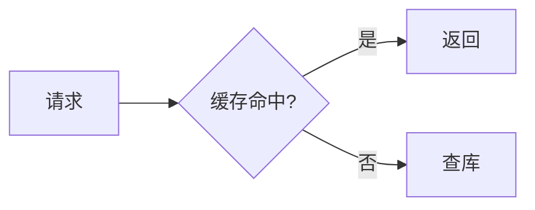

# hexo-theme-codex

A minimal Hexo theme for technical writing. Its core feature is a three-level index for long serial content: **book → chapter → article**.

一个简洁的 Hexo 技术博客主题，核心能力是把长篇连载内容组织成「专栏 → 章 → 文章」三级索引。

## 功能

- **专栏**
  - 专栏目录页 `/books/<id>/`，所有专栏汇总在 `/books/`。
  - 专栏文章页采用三栏布局：左侧导航树（当前篇高亮，章节可折叠）、正文、右侧本页目录。顶部有面包屑和「第 x / N 篇」，底部有跨章节的上一篇 / 下一篇。在手机上，导航树变成抽屉。
  - 首页和归档列表里，专栏文章旁边会显示「专栏名 · x/N」。
- **全文搜索**：按 `/` 或 Ctrl/Cmd+K 打开。索引在第一次打开时才下载（`/search.json`），中文按子串匹配。
- **阅读时长**：显示「约 N 分钟」，中文按 400 字/分钟、英文按 200 词/分钟估算。
- **数学公式**（KaTeX）和**流程图**（Mermaid）：只在需要的页面从 CDN 加载。
- 普通文章右侧有本页目录，滚动时高亮当前小节。
- 代码块：语言标签、一键复制、行号；深浅两套配色。
- 深色模式：默认跟随系统，可手动切换并记住选择。
- 提示框：GitHub 语法 `> [!NOTE]`、`[!TIP]`、`[!IMPORTANT]`、`[!WARNING]`、`[!CAUTION]`。
- giscus 评论；自动生成 `/categories/` 和 `/tags/` 索引页；配合 hexo-generator-feed 提供 RSS。
- 纯 CSS 和原生 JS，没有构建步骤，不加载网络字体。

## 安装

```bash
npm install hexo-theme-codex hexo-renderer-ejs
```

```yaml
# 站点 _config.yml
theme: codex
language: zh-CN        # 或 en
```

你自己的设置写在站点根目录的 `_config.codex.yml` 里，它会覆盖主题自带的 `_config.yml`：

```yaml
author:
  avatar: /images/avatar.jpg     # 把图片放在站点的 source/images/ 里
  location: Xi'an, China
  links:
    GitHub: https://github.com/you
giscus:
  enable: true
  repo: you/your-repo
  repo_id: R_xxx
  category: Announcements
  category_id: DIC_xxx
```

## 专栏

1. 在 `source/_data/books.yml` 里声明专栏：

   ```yaml
   jvm:
     title: 深入理解 JVM
     description: 类加载、内存结构……
   my-book:
     title: 一本有章节的书
     chapters:            # 可选；不写时专栏只有「专栏 → 文章」两级
       - id: ch1
         title: 第 1 章 入门
   ```

2. 在文章（post 或 page 都可以）的 front matter 里加入专栏：

   ```yaml
   book: my-book
   chapter: ch1      # 专栏声明了 chapters 时填写
   order: 3          # 可选
   ```

排序规则：
- 有 `order` 的按数值排在前面。
- 没有 `order` 的，post 按发布日期排，page 按文件名自然排序（`1.2` 排在 `1.10` 前面）。

构建时如果 `book` 或 `chapter` 写错，会打印 `[codex]` 警告，不会让构建失败。

## 数学公式和流程图

````markdown
---
math: true            # 本页启用 KaTeX；若想全站默认启用，把主题配置 math.auto 设为 true
---
行内公式 $e^{i\pi}+1=0$，独立公式：

$$
\sum_{i=1}^{n} i = \frac{n(n+1)}{2}
$$


````

- 公式在 Markdown 解析之前就会被保护起来，下划线、星号不会被误当成强调。
- 不会被当成公式的情况：代码里的 `$`、写成 `\$` 的美元符号，以及 `$5`、`$10` 这类价格写法。
- KaTeX 和 Mermaid 的 CDN 地址在主题配置的 `cdn` 里，可以改成国内镜像。

## 主题配置（`_config.yml`）

| 配置项 | 作用 |
|---|---|
| `menu` | 导航条，键名对应 `languages/*.yml` 里的 `nav.*` |
| `author` | 首页的头像、所在地、链接；姓名、副标题、简介取自站点配置 |
| `toc.max_depth` | 本页目录收录的最深标题级别 |
| `reading_time` | 是否显示阅读时长 |
| `search` | 是否开启搜索、索引文件路径、每篇收录的最大字数 |
| `math.auto` | 是否全站自动识别公式 |
| `cdn` | KaTeX 和 Mermaid 的加载地址 |
| `callout_titles` | 没写标题的提示框使用的默认标题 |
| `giscus` | 评论配置，各个 ID 从 https://giscus.app 获取 |

如果某篇文章不想被搜索收录，在它的 front matter 里写 `search: false`。

## 开发

```bash
npm test     # node --test：专栏目录树、提示框、阅读时长、搜索、公式和流程图
```

| 目录 | 内容 |
|---|---|
| `lib/` | 纯函数，不依赖 Hexo：`books.js`、`callouts.js`、`markdown.js`、`reading.js`、`search.js` |
| `scripts/` | Hexo 插件注册：helper、生成器、过滤器 |
| `layout/` | EJS 模板 |
| `source/` | CSS 和 JS，其中 `js/search.js` 同时可在 node 中测试 |

## License

MIT
